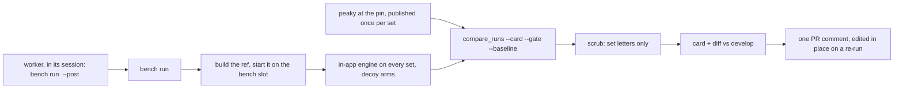

`ULTRA TRACE MASCOPE - DESIGN DOC - ASSIGNMENT BENCH`

# The assignment bench: both engines on demand, on the agent box

- **Status:** building
- **As of:** 2026-11-12
- **Tracked in:** [Assignment quality plan](https://linear.app/ultra-trace/project/assignment-quality-plan-553f4854192c) (Linear, milestone 6: MAS-64, MAS-835 to MAS-841, MAS-849)
- **What:** One command on the agent box that runs a branch's in-app assignment engine beside peaky at a pinned release on fixed sample sets, prints the plan's metrics as a card, and posts it on the PR; a worker runs it in its own session.

## 1. Why

The [assignment quality plan](assignment_quality_plan.md) measures every
step on fixed sample sets with the reference engine's run beside the
in-app engine's. Until now that measurement has been the plan owner's
pass: deploy the branch to the testbed, run the engine on the sets, run
the comparison tool, compute the metrics the tool does not, paste the
table into the measurement log. It takes an afternoon, it needs the
testbed, and it is the one thing an agent building a step cannot do, so
an agent's PR carries unit tests and an as-built note but no reading of
what the change did to the ledgers.

Two facts settled on 2026-11-11 make a bench worth building now. The
assignment in Mascope is developed in parallel with peaky until it reaches
a stable state; peaky's pipeline stays mostly as it is, with adjustments to
its evidence ladder. So the comparison is the daily instrument for months,
not a gate run a few times. And the agents build the steps, so the
instrument must answer them, on their own, without a login to the machine
it runs on.

The bench runs on the agent box, never on a workstation: a reference run
over a gate set is minutes of several cores and gigabytes of memory
([`peaky_mascope_boundary.md`](peaky_mascope_boundary.md) measured it), and
the box already holds the agents, the fleet regression corpus store, the
demo bundles and the replay tool that builds any ref into an instance
slot of its own.

## 2. What the bench is

- **The sets** are fixed sample sets the bench instance holds, named by a
  letter, each with its chemistry (ionization mode, profile, lists) and its
  instrument class; section 4.
- **The reference** is peaky installed at a tagged release, run once per
  set per pin and published into the bench instance through the import
  contract, so both engines' runs sit in one store; section 5.
- **The card** is the plan's table, G1 to G14, the mass-error row, the
  reason coverage and the decoy arms, computed as code from the two runs,
  with a pass-or-fail line against the stage targets and a diff against
  develop's last card; section 6.
- **The ask** is a command in the worker's own session, and the answer
  one comment on its PR; section 7.

The bench judges a change the way the plan judges a step. It does not
decide what is true: the reference is read, not targeted (decision 18),
and the truth corpus's card ([`peaky_mascope_boundary.md`](peaky_mascope_boundary.md)
section 4) joins the bench's card when the corpus baseline exists
(step 4.20).

## 3. Where it runs

The agent box, where the agents run and where the fleet corpus store is
canonical (decision MAS-835, 2026-11-11; the LAN host keeps a nightly
mirror of the store and the demo bundles, and runs the same command off
them for the plan owner when wanted, but it is not a bench the agents
reach). The corpus tool's `replay` already registers a free instance slot
in the agents' runtime home,
builds a ref into a worktree, loads the corpus into the instance and
purges everything afterwards. The bench keeps what the replay throws
away: one persistent instance, env `bench`, whose database and filestore
hold the sets, and against which every `bench run` deploys a ref. A run
builds the ref into a worktree, migrates the bench database forward with
the ref's alembic (a ref older than the database's head is refused),
starts the ref's backend on the bench slot, runs, compares, and stops the
backend and removes the worktree. The instance stays. One run at a time.

Everything that could name a site stays on the box: the manifest that
names the sets' files, the state file with the sample ids, the cards. The
repository carries the tool, a public manifest for the demo dataset (the
one set that can also run in CI), and this note. The box's folder layout,
its env file and the private manifest are described in the testbed notes
outside the repository, as the gate's are.

The bench shares the box with up to four workers and their test suites,
so one run at a time, behind a lock, with a time budget per set. The
alternative, the LAN host with a trigger an agent could reach without a
login there, was weighed in MAS-835 and set aside: a watcher, a second
`gh` login and a label protocol for what is otherwise one command.

## 4. The sets

Decided 2026-11-11 (MAS-836): the bench starts with the demo dataset
alone, the published bundle at the CLI's default version, named in the
manifest by bundle version and sample name, nothing copied; its manifest
is public, in the repository, and it is the set that also runs in CI. The
other sets are a separate task (6.8, MAS-849): the plan owner names the
files, one set per chemistry and instrument class the plan judges
(uronium Orbitrap sparse and dense, labelled nitrate, bromide Orbitrap,
bromide and nitrate TOF, the charge-transfer source) drawn from the fleet
corpus, and the gate sets A to L where the corpus lacks them, which the
de-identified testbed copy on the agent box already holds. A set's files
live in the fleet corpus store, canonical on the agent box and mirrored
nightly to the LAN host, so they are on both boxes with no copy step of
the bench's own; a file not yet in the store enters through the corpus
inbox and the owner's promote, and the private manifest names it by
object hash. The gate sets stay the plan owner's gate on the testbed until
one parallel pass shows the bench's sets read the same way; then the card
is the plan's measurement.

The manifest (step 6.2) names, per set: its letter, its files, its
ionization mode and profile, the target collections and reference lists to
seed, the instrument class, and the window the reference is run at (the
TOF sets at 8 and 25 ppm, as the gate ran them). `bench init` builds the
instance from it and verifies every sample resolved a mode and has peaks,
because a fresh instance has no ionization modes and silently assigns
nothing.

As built (6.2, `tooling/assignment_bench/`): the demo manifest holds the
demo bundle's MS1 acquisitions as two sets, one per chemistry, `Db`
(bromide, 80 files) and `Du` (uronium, 81 files); its four MS2
acquisitions are left out. A set is named by the gate card's rule (an
upper-case letter, then at most a digit or a lower-case letter, then at
most a sign), so the bench's state can feed the card. `init` uploads each
file with its SHA-256 and finds its sample file again by that hash, keeps
its state in the runtime home (`$MASCOPE_PATH/.runtime/bench`, a copy of
the manifest beside `state.json`) and stops the backend when it is done;
the instance's database and filestore stay.

## 5. The reference at a pin

Decision 29: the reference is read at a tagged release, never at a main
commit. Step 6.3 installs peaky at the tag into its own tool environment
under the bench folder, runs it per sample of every set with the set's
profile and window, and publishes the runs into the bench instance with
the engine badge `peaky` and the version string, cached by pin, set,
sample and library version. `bench reference --pin` at the next release is
step 5.1's refresh, and the sets whose reference changed are listed for
the boundary review the plan owner writes. Since step 5.6 a batch import
row carries the engine's own tier, so the bench wants every tier
published, not only the reference's Assigned rows; where the pinned peaky
cannot do that, the bench publishes per sample and the ask goes to peaky's
owner through 5.1.

As built (6.3, `tooling/assignment_bench/reference.py`): `bench reference
--pin vX.Y.Z` refuses anything but a release tag. It clones peaky into the
bench's home, exports the tag's tree and installs it with `uv tool install
--python 3.12` into a tool environment under the bench folder. The installed
peaky is asked for its version string, the `mascope-tools` version it
scores with, and which of the sets' profiles it knows. Each sample then runs
alone through `peaky assign` with its set's profile and window, and
`peaky publish` imports the ledger with that version string. The pinned
0.9.0's per-sample publish already carries every role and peaky's own tier
(`engine_tier`) on its M0 rows, so no ask of peaky's owner was needed. The
cache key's "library version" is the installed `mascope-tools`, which
peaky's own dependency range lets move under one tag; a reinstall that
resolves another one publishes again. A new pin lists the sets whose
reference changed, sample by sample, by a digest of each ledger row's
peak, role, formula, adduct and tier. peaky runs with the bench's URL and
token only: the caller's `MASCOPE_*` variables are dropped, so a sourced
testbed env cannot redirect it.

## 6. The card

Step 6.4 moves the metrics out of the planner's hands. Every metric of the
measurement log's table becomes a function in the comparison tool with
its definition quoted: G1 to G8 as the log states them, G9 to G14 from
the tier reasons and roles as the plan's stage 3 defines them, the
mass-error MAD, the reason coverage, the decoy arms. `compare_runs.py
--card` prints one card per set and one pooled, as markdown and JSON;
`--gate thresholds.json` marks each metric against its stage target and
prints the pass-or-fail line; `--baseline` diffs against a previous card
row by row.

The scrub is the card's last step and the repository's rule made
mechanical: the card names sets by letter and nothing else. A deny list
built from the manifest (sample ids, batch, dataset, workspace and
instrument names, host names) is checked over the card's text, and a
match refuses the card and names the token. Nothing leaves the cards
folder unscrubbed.

As built (6.5, `tooling/assignment_bench/run.py`): `bench run <ref>` checks
the ref out into the bench's worktree with `uv sync --frozen`, refuses it
when it does not know the bench database's alembic revision, and otherwise
migrates the database to the ref's head. It starts the ref's backend on the
bench slot with peak assignment on and four uvicorn workers, written into
the env's own config layer, since an engine run and the card's detail reads
are CPU-bound in their worker. It leaves out a sample whose newest
reference run is not the one `bench reference` published at the pin, and
runs the in-app engine on every other sample with no run config, the
engine's own defaults; `--decoys` adds the arms of the set's class (9 ppm
either way and the swapped adducts on an Orbitrap, 0.35 Da and the swapped
adducts on a TOF), each against that run. A set has a time budget of its
own; one that runs out is left off the card whole. After the runs it checks
that each sample's newest in-app run is this run's and its newest reference
run still the pin's, since the card reads the newest. The card is made by
the comparison tool of the checkout the bench runs from, never the ref's,
and on a card that tool now reads a decoy arm only where its control is the
run the card reads. The comparison has no budget, since its time grows with
the rows it reads; one that writes nothing for 30 minutes is stopped. The
bench gives the tool a deny list of every name and id the instance holds,
then scrubs what the tool wrote again before it moves it into
`cards/<ref>/<timestamp>/`. The private run log and the comparison's input
stay beside it. `--baseline` diffs against develop's rolling baseline,
which a run of develop's head with `--baseline` replaces when it read every
set with nothing left out; a run of some sets diffs those sets' columns
only. The backend is stopped and the worktree removed after every run,
including a failed one, so `bench reference` now checks its own build out
before it starts a backend.

A branch with a migration of its own moves the bench database to its
revision, and develop is then refused until that migration is on develop;
one that never lands leaves the bench where only `init --rebuild` brings it
back. The brief's rule, kept as written; the options are #3171.

## 7. The ask and the answer

Decided 2026-11-11 (MAS-835): there is no trigger. An implementer whose
brief asks for a card runs `bench run <branch> --post <pr>` from its
worktree once CI is green; the reviewer re-runs it on the PR's head. The
command posts the scrubbed card's headline, gate line and diff against
develop's baseline as one PR comment, edited in place on a re-run so a PR
carries one bench comment, under the worker's own identity, the one that
writes every other comment the agents make; no token is added anywhere. A
nightly user timer on the box runs develop's head for the baseline card.
The agents' skills learn the step in the ops repository (6.7), and the
brief shape gains a `**Bench.**` line naming the sets and the metrics
that must hold. The options set aside, a PR label polled by a watcher on
the LAN host, a forced-command SSH key from the agent box, an agent
worker on the LAN host, are recorded in the decision.

## 8. The steps

| step | Linear | what |
|---|---|---|
| 6.0 | MAS-835 | Decision: the box and the ask (taken: the agent box, no trigger) |
| 6.1 | MAS-836 | Decision: the sets (taken: the demo dataset first) |
| 6.2 | MAS-837 | `bench init`: the instance from a manifest (built: `tooling/assignment_bench/`) |
| 6.3 | MAS-838 | `bench reference --pin`: peaky at a tag, published per set (built: `tooling/assignment_bench/reference.py`) |
| 6.4 | MAS-64 | the gate card as code: metrics, thresholds, baseline, scrub (was 4.4) |
| 6.5 | MAS-840 | `bench run <ref>`: build, run, compare, card, diff (built: `tooling/assignment_bench/run.py`) |
| 6.6 | MAS-841 | `--post`: the PR comment, and the nightly baseline |
| 6.7 | MAS-839 | the agents' skills run the bench and read the card (the ops repository, OPS-91) |
| 6.8 | MAS-849 | more sets after the demo set: from the fleet corpus and the gate sets (the owner's picks) |

6.4 started on 2026-11-11 against the testbed's existing runs; 6.2 starts
on the demo manifest, 6.3 waits for 6.2, 6.5 for all three, 6.6 for 6.5,
6.7 for 6.6, 6.8 for 6.2 and the owner's picks. The plan's steps that
need a bench reading (4.3, 4.7, 4.8, 4.10,
4.13, 4.14, 4.15, 4.18, 4.2d, 4.20) are blocked on 6.5 or 6.6 and start
when it exists.

## 9. What the bench is not

- Not a truth. Agreement with the reference and the plan's intrinsic
  metrics are readings; the truth corpus's precision and recall join the
  card when the baseline exists and are read then, once, over everything
  merged before (decision 34).
- Not a port of peaky's scorecard. The decoy arms are Mascope's own since
  step 5.2; the metrics are the plan's; the reference's own card stays
  peaky's.
- Not a second testbed. The gate sets and the chemist's readings stay on
  the testbed and in the plan owner's hands until the bench's sets are
  shown to read the same way; after that the testbed is the owner's
  instrument for the stage gates and the bench is everyone's for the steps.
- Not a place for a name. A set is a letter; a card that holds anything
  else is refused.

## 10. Operations

On the agent box, in the agents' runtime home: a bench folder with the
private manifest, `state.json`, the reference's tool environment, the cards
and the lock; an env file holding the bench instance's URL and SDK token,
beside the testbed copy's; a user systemd unit for the nightly baseline;
the guard's allow rows for the bench commands. The exact paths and the
install steps are in the testbed notes and the ops repository's handbook,
not here. The repository's README under `tooling/assignment_bench/` says how
to run the commands against any instance and how to ask for a card.

- **The bench folder** is `.runtime/bench` in the runtime home
  (`MASCOPE_PATH`), private to the box, mode 700. Each run adds
  `cards/<ref>/<timestamp>/`: the card, the diff and `run.json`, scrubbed,
  which are what may leave the box, and `run.log` and `work/`, which name
  samples and never do. `state.json` lists the cards and names develop's
  rolling baseline.
- **The env file** is the folder's `bench.env`: `MASCOPE_URL` and an SDK
  token, written afresh each time a command signs in. A run sends its
  assign requests with that token, which outlives a signed-in session, and
  hands the comparison that URL and token alone, with every other
  `MASCOPE_*` variable of the caller dropped.
- **The lock** is the folder's `bench.lock`: one bench command at a time.
  A run waits for it, naming the command that holds it; `--no-wait`
  refuses instead, and `init` and `reference` refuse unless given `--wait`.
- **The cost.** On the agent box, with the backend's four workers and four
  samples at once, the engine takes about 26 minutes over the two demo sets
  and the card about 67, since it reads each committed row's provenance
  with a request of its own (#3134): about an hour and a half a run. The
  decoy arms add three engine runs per Orbitrap sample. The default budget
  is 120 minutes a set, for its runs; the card has none, and is stopped
  only when it writes nothing for 30 minutes.

## 11. Open

- Settled by 6.3: peaky's repository is public, so the bench clones it
  with no credential; and the pinned 0.9.0's per-sample publish carries
  every tier (section 5).
- Whether the certified cylinder sets are in the corpus store (decision
  24's ground truth); if not, they are the first sets taken from the
  testbed copy under 6.8.

## Related documents

- [`assignment_quality_plan.md`](assignment_quality_plan.md): the plan the bench measures.
- [`assignment_quality_plan_log.md`](assignment_quality_plan_log.md): the metrics and their targets.
- [`peaky_mascope_boundary.md`](peaky_mascope_boundary.md): the boundary with peaky and the truth corpus.
- `tooling/assignment_compare/README.md`: the comparison tool the card is built on.
