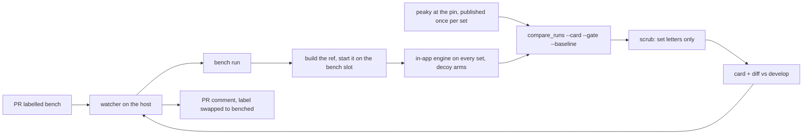

`ULTRA TRACE MASCOPE - DESIGN DOC - ASSIGNMENT BENCH`

# The assignment bench: both engines on demand, on the LAN host

- **Status:** design
- **As of:** 2026-11-11
- **Tracked in:** [Assignment quality plan](https://linear.app/ultra-trace/project/assignment-quality-plan-553f4854192c) (Linear, milestone 6: MAS-64, MAS-835 to MAS-841, MAS-849)
- **What:** One command that runs a branch's in-app assignment engine beside peaky at a pinned release on fixed sample sets, prints the plan's metrics as a card, and posts it where the agent that asked can read it.

## 1. Why

The [assignment quality plan](assignment_quality_plan.md) measures every
step on fixed sample sets with the reference engine's run beside the
in-app engine's. Until now that measurement has been the plan owner's
pass: deploy the branch to the testbed, run the engine on the sets, run
the comparison tool, compute the metrics the tool does not, paste the
table into the measurement log. It takes an afternoon, it needs the
testbed, and it is the one thing an agent building a step cannot do, so
an agent's PR carries unit tests and an as-built note but no reading of
what the change did to the ledgers.

Two facts settled on 2026-11-11 make a bench worth building now. The
assignment in Mascope is developed in parallel with peaky until it reaches
a stable state; peaky's pipeline stays mostly as it is, with adjustments to
its evidence ladder. So the comparison is the daily instrument for months,
not a gate run a few times. And the agents build the steps, so the
instrument must answer them, on their own, without a login to the machine
it runs on.

The bench runs on the LAN host, never on a workstation: a reference run
over a gate set is minutes of several cores and gigabytes of memory
([`peaky_mascope_boundary.md`](peaky_mascope_boundary.md) measured it), and
the host already holds the fleet regression corpus mirror, four instance
slots and the replay tool that builds any ref into one of them.

## 2. What the bench is

- **The sets** are fixed sample sets the bench instance holds, named by a
  letter, each with its chemistry (ionization mode, profile, lists) and its
  instrument class; section 4.
- **The reference** is peaky installed at a tagged release, run once per
  set per pin and published into the bench instance through the import
  contract, so both engines' runs sit in one store; section 5.
- **The card** is the plan's table, G1 to G14, the mass-error row, the
  reason coverage and the decoy arms, computed as code from the two runs,
  with a pass-or-fail line against the stage targets and a diff against
  develop's last card; section 6.
- **The trigger** is a PR label an agent can set and a PR comment it can
  read; section 7.

The bench judges a change the way the plan judges a step. It does not
decide what is true: the reference is read, not targeted (decision 18),
and the truth corpus's card ([`peaky_mascope_boundary.md`](peaky_mascope_boundary.md)
section 4) joins the bench's card when the corpus baseline exists
(step 4.20).

## 3. Where it runs

The LAN host, beside the fleet corpus mirror. The corpus tool's `replay`
already registers a free instance slot in the shared runtime home,
builds a ref into a worktree, loads the corpus into the instance and
purges everything afterwards. The bench keeps what the replay throws
away: one persistent instance, env `bench`, whose database and filestore
hold the sets, and against which every `bench run` deploys a ref. A run
builds the ref into a worktree, migrates the bench database forward with
the ref's alembic (a ref older than the database's head is refused),
starts the ref's backend on the bench slot, runs, compares, and stops the
backend and removes the worktree. The instance stays. One run at a time.

Everything that could name a site stays on the host: the manifest that
names the sets' files, the state file with the sample ids, the cards. The
repository carries the tool, a public manifest for the demo dataset (the
one set that can also run in CI), and this note. The host's folder layout,
its env file and the private manifest are described in the testbed notes
outside the repository, as the gate's are.

Which box is open inside MAS-835 since the corpus review of 2026-11-11.
The agent box holds everything the bench needs and more: the canonical
fleet corpus store (the LAN host is its nightly mirror), the demo bundles,
the de-identified testbed copy with the gate sets, and the agents
themselves. A bench there is a command in the worker's own session, with
no trigger, no second `gh` login and no route between the boxes; the LAN
host runs the same command for the plan owner off the mirror. The review
recommends the agent box; the note's sections read for either until the
call is written.

## 4. The sets

Decided 2026-11-11 (MAS-836): the bench starts with the demo dataset
alone, the published bundle at the CLI's default version, named in the
manifest by bundle version and sample name, nothing copied; its manifest
is public, in the repository, and it is the set that also runs in CI. The
other sets are a separate task (6.8, MAS-849): the plan owner names the
files, one set per chemistry and instrument class the plan judges
(uronium Orbitrap sparse and dense, labelled nitrate, bromide Orbitrap,
bromide and nitrate TOF, the charge-transfer source) drawn from the fleet
corpus, and the gate sets A to L where the corpus lacks them, which the
de-identified testbed copy on the agent box already holds. A set's files
live in the fleet corpus store, canonical on the agent box and mirrored
nightly to the LAN host, so they are on both boxes with no copy step of
the bench's own; a file not yet in the store enters through the corpus
inbox and the owner's promote, and the private manifest names it by
object hash. The gate sets stay the plan owner's gate on the testbed until
one parallel pass shows the bench's sets read the same way; then the card
is the plan's measurement.

The manifest (step 6.2) names, per set: its letter, its files, its
ionization mode and profile, the target collections and reference lists to
seed, the instrument class, and the window the reference is run at (the
TOF sets at 8 and 25 ppm, as the gate ran them). `bench init` builds the
instance from it and verifies every sample resolved a mode and has peaks,
because a fresh instance has no ionization modes and silently assigns
nothing.

## 5. The reference at a pin

Decision 29: the reference is read at a tagged release, never at a main
commit. Step 6.3 installs peaky at the tag into its own tool environment
under the bench folder, runs it per sample of every set with the set's
profile and window, and publishes the runs into the bench instance with
the engine badge `peaky` and the version string, cached by pin, set,
sample and library version. `bench reference --pin` at the next release is
step 5.1's refresh, and the sets whose reference changed are listed for
the boundary review the plan owner writes. Since step 5.6 a batch import
row carries the engine's own tier, so the bench wants every tier
published, not only the reference's Assigned rows; where the pinned peaky
cannot do that, the bench publishes per sample and the ask goes to peaky's
owner through 5.1.

## 6. The card

Step 6.4 moves the metrics out of the planner's hands. Every metric of the
measurement log's table becomes a function in the comparison tool with
its definition quoted: G1 to G8 as the log states them, G9 to G14 from
the tier reasons and roles as the plan's stage 3 defines them, the
mass-error MAD, the reason coverage, the decoy arms. `compare_runs.py
--card` prints one card per set and one pooled, as markdown and JSON;
`--gate thresholds.json` marks each metric against its stage target and
prints the pass-or-fail line; `--baseline` diffs against a previous card
row by row.

The scrub is the card's last step and the repository's rule made
mechanical: the card names sets by letter and nothing else. A deny list
built from the manifest (sample ids, batch, dataset, workspace and
instrument names, host names) is checked over the card's text, and a
match refuses the card and names the token. Nothing leaves the cards
folder unscrubbed.

## 7. The trigger

A decision for the plan owner (MAS-835). The leaning: a watcher on the
host, a user systemd timer every few minutes, lists the repository's open
PRs labelled `bench`, runs `bench run` on each head once, posts the
scrubbed card's headline, gate line and diff as one PR comment (edited in
place on a re-run), and swaps the label to `benched`. An agent asks with
`gh pr edit --add-label bench` and reads the comment; both are things the
agents do today. No credential leaves either machine; the host needs `gh`
and a login that may comment. A nightly run on develop's head refreshes
the baseline. The alternatives, a forced-command SSH key from the agent
box or an agent worker on the host itself, are in the decision; the first
re-opens a route the corpus decision closed, the second is the later step
if the host becomes an agent box.

## 8. The steps

| step | Linear | what |
|---|---|---|
| 6.0 | MAS-835 | Decision: the trigger and the posting identity |
| 6.1 | MAS-836 | Decision: the sets |
| 6.2 | MAS-837 | `bench init`: the instance from a manifest |
| 6.3 | MAS-838 | `bench reference --pin`: peaky at a tag, published per set |
| 6.4 | MAS-64 | the gate card as code: metrics, thresholds, baseline, scrub (was 4.4) |
| 6.5 | MAS-840 | `bench run <ref>`: build, run, compare, card, diff |
| 6.6 | MAS-841 | the watcher, the PR comment, the nightly baseline |
| 6.7 | MAS-839 | the agents' skills ask for and read the card (the ops repository) |
| 6.8 | MAS-849 | more sets after the demo set: from the fleet corpus and the gate sets (the owner's picks) |

6.4 started on 2026-11-11 against the testbed's existing runs; 6.2 starts
on the demo manifest, 6.3 waits for 6.2, 6.5 for all three, 6.6 for the
trigger decision and 6.5, 6.8 for 6.2 and the owner's picks. The plan's steps that need a bench reading (4.3, 4.7, 4.8, 4.10,
4.13, 4.14, 4.15, 4.18, 4.2d, 4.20) are blocked on 6.5 or 6.6 and start
when it exists.

## 9. What the bench is not

- Not a truth. Agreement with the reference and the plan's intrinsic
  metrics are readings; the truth corpus's precision and recall join the
  card when the baseline exists and are read then, once, over everything
  merged before (decision 34).
- Not a port of peaky's scorecard. The decoy arms are Mascope's own since
  step 5.2; the metrics are the plan's; the reference's own card stays
  peaky's.
- Not a second testbed. The gate sets and the chemist's readings stay on
  the testbed and in the plan owner's hands until the bench's sets are
  shown to read the same way; after that the testbed is the owner's
  instrument for the stage gates and the bench is everyone's for the steps.
- Not a place for a name. A set is a letter; a card that holds anything
  else is refused.

## 10. Operations

On the host: a bench folder with the private manifest, `state.json`, the
reference's tool environment, the cards and the lock; an env file holding
the bench instance's URL and SDK token and the posting identity's token;
user systemd units for the watcher and the nightly baseline. The exact
paths, the account and the install steps are in the testbed notes, not
here. The repository's README under `tooling/assignment_bench/` says how
to run the commands against any instance and how to ask for a card.

## 11. Open

- MAS-835, above, now also the box: the LAN host as first written, or the
  agent box the review recommends. MAS-836 is taken.
- Whether the pinned peaky publishes every tier (section 5); an ask of
  peaky's owner through 5.1 if not.
- Whether the certified cylinder sets are in the corpus store (decision
  24's ground truth); if not, they are the first sets taken from the
  testbed copy under 6.8.

## Related documents

- [`assignment_quality_plan.md`](assignment_quality_plan.md): the plan the bench measures.
- [`assignment_quality_plan_log.md`](assignment_quality_plan_log.md): the metrics and their targets.
- [`peaky_mascope_boundary.md`](peaky_mascope_boundary.md): the boundary with peaky and the truth corpus.
- `tooling/assignment_compare/README.md`: the comparison tool the card is built on.
