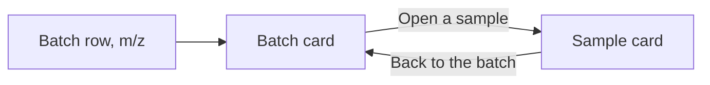
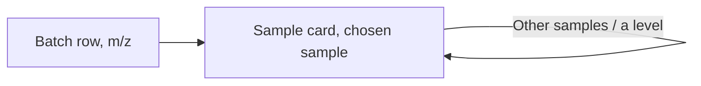
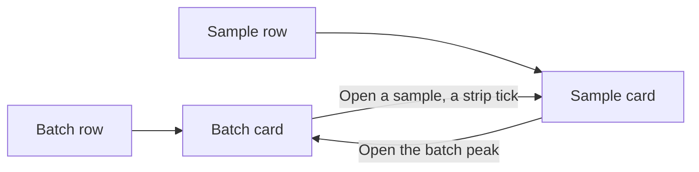
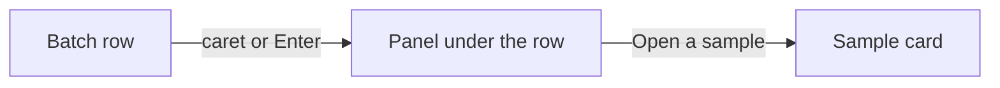

# The assignment ledger and the inspector card

- **Status:** building
- **As of:** 2026-11-26
- **Tracked in:** [Assignment ledger and inspector card](https://linear.app/ultra-trace/project/assignment-ledger-and-inspector-card-8caa997cc3da)
  (Linear, P-MAS-23: milestone 1 "One ledger", MAS-1062 to MAS-1065 and MAS-1069;
  milestone 2 "The card", MAS-1066 to MAS-1068, and the batch card's four steps,
  MAS-1314, MAS-1315, MAS-1321 and MAS-1322)
- **What:** One ledger for the sample and the batch, one vocabulary of marks for every
  reading, a way to see the rows a multi-row reading spans, and an inspector card that
  answers "is this right, and what do I do" before it explains.

*The peak-assignment views grew one step at a time: each step of the assignment quality
plan added a column, a glyph or a section where its reading would show. This note reviews
what that left and proposes the overhaul. It changes how assignments are shown and judged,
never what the engine writes.*

## 1. Where it stands

Three components carry the assignment UI:
[`PaneBrowserAssignment.vue`](../../server/frontend/src/lib/panes/PaneBrowserMatch/PaneBrowserAssignment.vue)
(the sample ledger, 1,941 lines),
[`PaneBrowserBatchPeaks.vue`](../../server/frontend/src/lib/panes/PaneBrowserMatch/PaneBrowserBatchPeaks.vue)
(the batch ledger, 2,442) and
[`PanePeakAssign.vue`](../../server/frontend/src/lib/panes/PanePeakAssign/PanePeakAssign.vue)
(the inspector card, 3,262). They were reviewed on 2026-11-20 on a running instance with
peak assignment on, a nine-sample nitrate CIMS batch of 1,024 batch peaks, and against
the code.

1. **Two ledgers, built twice.** Both show a formula at an m/z with a tier, and they
   disagree in about twenty details:
   - header case;
   - the formula font, monospace in one and body text in the other;
   - an empty formula, "—" against "unassigned";
   - isotopologue labels, `[13C]` against `M+1`;
   - the hand mark: inside the tier chip in the accent in one, after the formula and muted
     in the other;
   - the tier chips: multi-select in one; single-select in the other, bound to a filter
     menu that lists raw keys such as `below_assignability`;
   - verdict sorting, which only one has;
   - error handling.

   The listing column, the tier strip, the view menu, the sort helpers and the two verdict
   popovers (about 80 % the same) are copies.
2. **Every batch step added a column or a glyph.** The batch ledger reaches 14 columns.
   Nine glyphs at 0.8 opacity share the formula cell, whose meaning lives in tooltips:
   series, stamp, scissors, known species, blend, flat series, persistence, water ladder
   and the hand. The two ledgers hold about 50 kinds of mark and 32 icons between them.
   Several icons carry three or four meanings:
   - the seal-check is the assigned tier, the verdict header, the unjudged verdict and a
     batch step;
   - the clock is the history banner, a stale ratio grade and "judge again";
   - the flask is the listing column and the reagent role;
   - the hand is manual, curated, an empty state and "use this";
   - the wave is the artifact role and co-variation.

   In the card a dashed border means seven different things.
3. **Rows carry chrome instead of content.** Every row has:
   - a chart toggle or checkbox;
   - a jump icon;
   - an empty verdict seal;
   - dashes in empty cells.

   Isotopologue lines repeat the whole row, checkbox, role tag, sample count and verdict
   included. Intensities read `6.751E2`. The batch ledger's default sort, by samples, puts
   a screen of identical "9" rows on top.
4. **Useful controls hide in a cog and reset.** The cog holds the verdict filter,
   grouping by formula, the stripped, blend and flat-series filters, the engine tier and
   the CSV export. Every toggle except the listing's resets when the pane swaps between
   sample and batch. The ledger repeats the shell's breadcrumb, truncated.
5. **The card answers its own question last.** It is up to 21 blocks stacked; in its
   column of about 300 px that is three screens:
   - eight uppercase numbers, four of them percentages that read alike (fit, plausibility,
     evidence, confidence);
   - six batch lines;
   - "Why this tier" as the server's full sentences;
   - same-ion readings;
   - the identification level and its rivals;
   - an isotopologue table that clips its columns and scrolls sideways;
   - manual notes of 50 to 65 words;
   - the verify buttons, in the middle of the card;
   - alternatives, whose "use this" shows only on hover.
6. **The card misses states.**
   - Viewing an earlier run shows no notice, and verify and curate stay live.
   - A decoy run is not marked.
   - The viewer role is offered controls until a 403 arrives.
   - Sections pop in as the detail loads.
   - The batch's series, ratio stability, known species and blends reach the batch ledger
     but not the card.
7. **The design system drifts.** The card alone sets 14 font sizes and 9 opacities, the
   reagent purple is hard-coded, and a synthesised 600 weight is used. All are things
   [`frontend_design_system.md`](frontend_design_system.md) already rules on.

## 2. The design in one paragraph

One ledger component serves both scopes, *This sample* and *Whole batch*, the scope
switch MAS-713 decided. Where a concept is the same in both scopes, it has the same
column, mark and words. Its filters are in the open and remembered. Every reading is one
mark from one shared vocabulary, in which colour says what the reading does to confidence
and the glyph says which reading it is. Some readings span several rows: a homologous
series, the channels of one neutral, a co-variation partner, a pair from the batch
checks, an isotopologue family. Each of these opens a lens on its rows, and *Group by*
shows them all as groups. The card leads with the answer and the reason for its tier,
draws the evidence against the run's own bands, keeps the server's prose one click away,
folds its sections, and pins the verdict to its foot.

## 3. The ledger

### 3.1 One component, two scopes

A shared `AssignmentLedger` component and its composables live in `lib/ledger/`: sort,
filters, listing, the tier strip, the verdict cell and one verdict popover with a scope
prop. The two panes become scope configurations of it. The differences of section 1.1
converge on one answer each:

- sentence-case headers;
- formulas in Plex Mono;
- a blank empty cell;
- an isotopologue named by its substitution (`[13C]`, `[34S]`) wherever that is known,
  `M+n` only where it is not;
- one empty state (`BaseEmptyState`) and one inline error.

The ledger's own breadcrumb goes, because the shell's says the same.

### 3.2 Columns

| Column | This sample | Whole batch | Cell |
|---|---|---|---|
| Plot | yes | yes | a checkbox; it plots the species in the batch chart, the same in both scopes |
| m/z | yes | yes | Plex Mono, tabular |
| Compound | yes | yes | the formula, with the listed name and its list under it when a list or target names it. This replaces the *Listed as* column |
| Ion | yes | yes | the sample scope: the mechanism. The batch scope: the ion formula the read already serves (`consensus_ion_formula`). Either way, a `×N` pill when the neutral is seen through N channels. In the sample scope it counts the sample's own rows (`channelRows`, as today), which needs no batch; in the batch scope it counts the groups the batch-peaks read serves (3.5) |
| Intensity | yes | yes, as *Max intensity* | a compact number (`8.31k`, `1.20M`) and a log-scale bar. The batch scope's is `max_intensity`, the brightest sample's, and its header says so in its tooltip |
| Tier | yes | yes | the tier chip; a capping reason as a mark on the chip |
| Level | when any row has one | when any row has one | the level chip. In the batch scope a button: it opens where the level comes from (below) |
| Samples | no | yes | `n/N` |
| Across the batch | no | yes | up to three badges (section 5), holding-back badges first, then `+n`, which opens every badge of the row with its reading |
| Verdict | yes | yes | an icon only once someone has judged |

Compound shows the neutral formula in both scopes. A batch peak is one ion, so two
channels of one compound are two batch rows; the Ion column and its `×N` pill are what
tell them apart.

Imported engine tiers and levels show in the Tier and Level cells as a second, outlined
chip when *Show › Engine readings* is on. They do not get columns of their own.

The batch scope's level cell shows the batch peak's own level, the one most of its
members hold under the batch's isotope checks (step 5.8c, MAS-940), else, where the batch
states none, the level most of its members' runs stated for the consensus formula, a tie
reading as the weaker level; a live batch-level claim's shows in its place. That level is
a set of samples, and the set can hide better ones, so the chip opens a popover
(MAS-1301, `lib/ledger/LedgerLevelSources.vue`): the claim first where there is one, the
batch's own level with its evidence and lift next, then the members' own split in the
scale's order, the members' level's evidence and lift (the most common line of each,
with how many members wrote it), the best level any member states where it is better,
and the members that state none, by why, with no control: a pass of the batch stages gives no
member a run of its own, so **Assign batch** there was taken out (MAS-1342). **Open a sample** opens the
brightest member at a level in the sample scope, the card stepping through that level's
members; a list picks another. The members come from one read per batch peak, on the
click (`GET /batch-peaks/batch/{id}/levels/{batch_peak_id}`), never from the ledger's
list read. The content is a component of its own, for the batch row's card to reuse
(MAS-1298).

### 3.3 Rows

- A row is 40 px; an isotopologue line is a 28 px sub-row under its parent. The sub-row
  shows the line's label, m/z and intensity; it inherits the rest and repeats none of it.
  A caret with the line count folds and unfolds a family.
- Row actions show on hover, on `:focus-within` and on the selected row: open the
  brightest sample in the batch scope, curate in the sample scope. A keyboard user
  reaches them without selecting first.
- Clicking an m/z opens the peak in the inspector. In the sample scope that is the
  sample's own row. In the batch scope a batch peak is in many samples, so the card
  shows the batch peak in its brightest sample, the one today's jump icon opens, and
  says which sample it is showing (4.2). Plotting is the checkbox.
- The default sort is intensity, descending, in both scopes; in the batch scope that is
  the brightest sample's intensity. A sort the user picked is remembered per scope, as
  `ledgerSort.js` does now.
- Narrow columns drop cells in order, by container query on the ledger's own width,
  the least needed first: the Level column (900 px or less), then Samples (780 px),
  then Across the batch (680 px), then Intensity's bar (560 px). The m/z, the compound,
  the ion, the number, the tier and the level stay in every width.
- Two cells narrow rather than drop (the plan owner, 2026-11-27, MAS-1310):
  - at 680 px, with Across the batch, a tier chip shows its dot alone. The word leaves
    sight only: it stays the chip's accessible name, and the chip's hover names the tier
    first. The Tier column's 7 rem minimum width goes with it. A role chip has no dot
    and keeps its word; the cap mark, the hand and isotopologue marks and the level's
    chips stay;
  - at 680 px too, the Tier header's *provisional* mark shows an asterisk in place of
    its word (the plan owner, 2026-11-28), the word kept as its accessible name and the
    hover explaining it, so the header holds the column no wider than its cells;
  - at 560 px, with the bar, the Intensity column's 7 rem minimum width goes, and its
    header shows *Int.*, the full label kept as its accessible name and its hover, so
    the column is as narrow as its number. Measured on the demo: the minimum width held
    the sample scope's column, the header *Max intensity* the batch scope's, and once
    the minimum went the header held both.
  Both minimum widths are in `lib/ledger/narrow.css` beside the rules that lower them:
  an inline style cannot be lowered by a container query.
- The level leaves with the tier, never first. It is what a reader may state of a row,
  and the tier alone is not a result (the plan owner, 2026-11-24). So where the Level
  column drops, its chips show compact beside the tier chip in the Tier cell, the
  engine's own level too with Show > Engine readings on, as the engine's tier is. Above
  that width the Tier cell carries no level, so a row never shows it twice. The level's
  filter and sort, which go with the column's header, are also in Show's *Level*
  section, writing the same filter and sort. Decided on 2026-11-26 (MAS-1300), after
  the ledger, which shares its row with the chart, turned out to be under 900 px at the
  usual split, so the level was on screen in neither scope.

### 3.4 The filter bar

- A search box: a formula, a listed name, or an m/z. An m/z matches within the run's
  fitted tolerance in the sample scope. In the batch scope, whose rows come from many
  runs, it matches within 5 ppm, the window an imported batch result is matched to batch
  peaks at.
- The tier bar of the design system's ledger strip: a 7 px proportion bar over the tier
  chips with their counts.
  - It is multi-select in both scopes.
  - A chip with nothing in it is hidden.
  - The roles (reagent, artifact) sit apart from the tiers.
  - The sample scope keeps its *to verify* queue chip at the right.
- **Show**, a menu in place of the cog:
  - row kinds: isotopologue lines, roles, stripped rows;
  - the batch's flags: blends, flat series, one badge kind;
  - engine readings;
  - **Group by**: none, compound, series (3.5).
- **…**, an overflow menu: export the ledger as CSV, and write listed names in full.

Every choice persists per scope, in the pattern of `ledgerSort.js` and `ledgerListing.js`.

### 3.5 Groups: the rows a reading spans

Several readings are about more than one row. The user has to be able to see those rows
together, not read about them in a tooltip.

| Group | Its members (the server's rule) |
|---|---|
| Channels of one neutral | the batch peaks with the same `consensus_formula` and a different `consensus_ion_formula`; each member names its mechanism |
| Homologous series | the root and every batch peak whose formula is the root's plus or minus whole repeat units through the same mechanism, from the series record's `root_batch_peak_id`, `unit` and `root_formula` |
| Co-variation partner | the batch peaks a co-variation record pairs |
| Batch-check pair | the 14N twin, the halogen line, the urea pair the check names |
| Isotopologue family | the main peak and its lines, the fold the ledger already does |

**One definition, served.** A group is the server's. MAS-1066 serves `batch_groups` on
the batch-peaks read and on a sample's detail row, from one derivation, so the ledger,
the lens and the card count the same members. The batch rows carry no mechanism today
(the read serves `consensus_formula`, `consensus_ion_formula`, `consensus_role` and
`consensus_tier`); the group's members carry it instead. The client only orders the
members, labels them, and adds the gaps.

**Members are batch peaks.** A series step with no batch peak is a gap. The lens draws
it greyed and labelled *no batch peak*, and counts it apart, so "4 batch peaks, one step
with no peak" means four members and one gap, in the ledger and in the card alike.

**Where each scope reads them.**

- **The batch scope** reads the groups on the batch-peaks read, for every row at once.
- **The sample scope's list** is the slim paged read, which carries none, and the detail
  row arrives one row at a time, when a peak is focused.
  - Its `×N` pill counts the sample's own rows (`channelRows`), as today, so it needs no
    batch and shows before anything is clicked.
  - A click on a badge or a pill reads that row's detail for `batch_groups` and applies
    the lens from it, the members the sample does not hold included.
  - Where the batch has no batch peaks yet, the detail has no groups. The lens then falls
    back to the sample's own rows and shows channels only, as today's grouping does.
  - *Group by* offers compound in the sample scope, from those same rows. Grouping by
    series needs every row's groups at once, so it belongs to the batch scope.

The sample's list read gains nothing.

**The lens.** Any badge or pill that names other rows applies a lens when clicked:

- the series badge;
- the channel pill (`×N`);
- the co-variation and batch-check badges;
- the isotopologue caret.

Under the lens:

- The ledger narrows to the group's rows, in the group's own order. A bar above the table
  names the group ("CH2 series from C8H13NO9, through [M+NO3]⁻, 4 batch peaks, one step
  with no peak"), offers *Plot the group*, and closes with ×.
- A Step or Channel column labels each row: root, `+1 CH2`, `−1 CH2`, or the ion.
- A series step that has no batch peak stays in the list, greyed, so the gap shows.
- In the sample scope the lens lists every member. Where the sample holds a member, its
  own row shows. Where it does not, a greyed line reads *not in this sample*, labelled
  apart from a gap.

**Group by** shows every group at once, as collapsible group lines over their members. A
group line names the compound or series and the member count. It is the header of its
members: bold on a surface of its own, its Tier, Level and verdict cells empty (a group
has no tier of its own, and a chip there read as one, the owner on 2026-11-27, MAS-1339),
and a guide on the left edge of every row under it.

**From the card.** The card's reasons and its *Across the batch* section list the same
members, with m/z links that focus each row and *Show in the ledger*, which applies the
lens.

## 4. The card

### 4.1 Layout

1. **The answer.** The listed name and its list, if any; the formula, large; the ion line
   ("[M+HCOO]⁻ → C3H3O4⁻ · m/z 103.0035 · M0"); and one chip row with the tier, the level
   and the verdict. The provisional marker becomes a small caption ("tier rules
   provisional"), not a chip.
2. **Why the tier.** A box titled for the tier ("Why below", "Why assigned"). It holds:
   - the evidence (fit × plausibility) drawn against the run's own bands (`tier_bands`;
     45 and 75 by default);
   - the product line, "fit 30 % × plausibility 100 %";
   - one line per reason: the rule's label from `lib/tierReasons.js`, with the deciding
     number or formula inline. A reason expands to the server's sentence. Holding-back
     reasons come first, in the warning colour. Supporting reasons ("Seen through 2
     channels", "In the batch's O series") are in the support colour and list their rows
     (3.5).
3. **The measurements.** Four tiles, each a value with a caption in words:
   - the mass error, in ppm and in widths from the run's centre;
   - the isotope lines, as found of predicted, with the abundance error;
   - the confidence, with the tie flag spelled out;
   - the batch: the samples the peak is in, and how many batch readings it has.
4. **The sections, folded by default.** Each shows a summary on its folded line:
   - **Isotope pattern**: a stick plot of the predicted lines against the measured ones,
     the absent and untested lines drawn hollow, and a four-column list under it;
   - **Alternatives**: rivals with fit, ppm and kind, and a visible *Use*;
   - **Across the batch**: the shared badges of section 5, each with its line and its
     group;
   - **Identification level**: the level, why, what would lift it, and the rivals.
5. **The verdict bar, pinned at the foot.** *Confirm*, *Reject* and *Unsure*, or the
   recorded verdict with *Change*. Under it, *Find other formulas for this peak*, today's
   *Find more*, renamed to say what it does.

Manual and batch-pin notes shrink to one line with their action ("Assigned by hand in
place of C3H4O4 · Undo"); their full sentence is the tooltip.

### 4.2 States

- **Viewing an earlier run:** a read-only notice under the answer, the verdict bar
  disabled with its reason, *Use* hidden.
- **A decoy run:** a notice naming the arm. The decoy run selector already keeps decoys
  out unless asked.
- **The viewer role:** checked before offering, with `canEditWorkspace` as the verdict
  popovers do, not discovered from a 403.
- **Opened from the batch scope:** the answer names the sample the card is showing, the
  batch peak's brightest, with *Other samples* to step through the samples that hold it.
- **Loading:** skeleton lines in each section until the detail arrives.
- **A focused peak with no ledger row:** the answer area says so, and *Find other
  formulas* is offered.
- **A sample with no run of its own** (MAS-1297), served from the batch ledger: a note
  under the answer in `--state-info`, not a warning, says the card is the batch's reading
  for the sample, with *Assign sample* beside it (the bar's action, disabled with its
  reason for a viewer). Each part a run fills says so where it would be: the Why box where
  the channels' line would be, the isotope pattern under its lines, the level as a folded
  section reading *none*. The spectrum draws the predicted pattern from the card's
  on-demand measurement and names it *predicted, not measured in this sample*. Nothing is
  borrowed from the batch's other samples.

### 4.3 What the card needs from the server

The sample detail row (`GET /peak-assignments/sample/{id}/assignment/{paid}`) already
serves the batch's isotopologue stamp, co-variation, batch checks, persistence and flat
series. It adds:

- the series record and its root;
- the ratio-stability grade;
- the known-species and water-ladder decisions;
- the blend flag;
- each group's members (batch peak id, formula, mechanism, m/z, tier, and the sample's own
  peak where it holds the member), from the same derivation that serves `batch_groups` on
  the batch-peaks read (3.5), so the card can list rows the sample scope has not loaded.

MAS-983 turns batch decisions into versioned records and replaces the fields this would
otherwise read, so MAS-1066 is blocked by it and reads those records.

### 4.4 A batch row's card: the options

*Added for MAS-1298, from the owner's question "peak card for batch assignment?". This
section lays out the options, and the choice was the Decision issue MAS-1311, call 4 of
section 7. Decided on 2026-11-26: option C, recorded under "The choice" below.*

#### What happens today

Read from the code on develop and checked on a demo instance with an assigned batch.

- **A click on a batch row selects it.** The selection is what the batch chart plots.
  No card opens. The Batch tab has no inspector column at all, only the chart
  (`PaneTabBatch.vue`).
- **The m/z and the row's arrow open the brightest sample.** `useBatchPeakJump` reads
  the batch peak's series (`POST /batch-peaks/records/series`). It picks the measured
  member with the highest intensity, the first of equals, among the samples the sample
  list holds. Then it switches to the Sample tab with that member's peak focused
  (`focusSamplePeak`).
- **The card is then that sample's card.** The answer, the chips, *Why the tier*, the
  tiles, the isotope pattern, the alternatives and the level are the sample's own run
  row. Where that row commits another formula than the consensus, the card heads with
  the sample's formula and says nothing of the consensus.
- **It names the sample** (section 4.2, built). The answer reads "In *sample*: the
  brightest of N samples that hold this batch peak". *Other samples* steps to the next
  member by intensity and wraps round.
- **What it shows of the batch:**
  - the batch tile: the samples the peak is in, of the batch's, and how many batch
    readings it has;
  - *Across the batch*, folded: the stamp, the predicted isotope lines, co-variation,
    the isotope checks, persistence, flat series, the series, ratio stability, the
    reagent decisions and the blend flag;
  - the batch-level verdict, as borrowed evidence above the verdict bar;
  - the batch pin, as a one-line note.
- **What it leaves out:**
  - the consensus formula and tier, and how firm the consensus is (`support_fraction`,
    `is_ambiguous`);
  - what the members that disagree read, and how many they are;
  - the members' level split, and which members state the shown level. The brightest
    sample is not where the level comes from (MAS-1301);
  - which samples lack the peak, and where in the acquisition order the peak is;
  - an importing engine's tier and claim for the batch peak.
- **Seen on the demo instance.** Three samples of a demo batch were assigned, then the
  batch's pass was run. One row's consensus was an assigned formula, held by two of its
  three members. Its m/z opened the brightest member, whose own run read another formula
  as a candidate. The card headed with that candidate. Its batch tile read "0 batch
  readings" and showed no sample count, and nothing on the card named the consensus.
- **Where a reader sees the batch's readings for the peak now:** all on the ledger row.
  - the Tier chip, the consensus tier;
  - the Level chip, the members' majority level, with the split in its tooltip;
  - Samples, `n/N`;
  - Across the batch, up to three badges and `+n`, each explained by its tooltip;
  - the ratio-stability popover and the batch verdict popover;
  - the lens, from a badge or the `×N` pill, for the rows a reading spans (3.5);
  - the chart, one point per sample, for the rows plotted.

#### What a reader of a batch row wants to know

What a sample's card does not answer:

1. **The consensus and how firm it is.** The formula and ion the batch settled on, its
   tier, how many members agree, which disagree and what they read.
2. **Where in the batch the peak is.** The samples that hold it and those that do not,
   in acquisition order, with intensity.
3. **The samples its level comes from, the evidence, and what would raise it.** The
   owner's input of 2026-11-26: these three sit on the first screen of any batch card.
   MAS-1301 builds them now as a popover on the ledger's level chip, in a component a
   card can reuse.
4. **The batch checks' readings in full.** Today they are one line each, in tooltips or
   folded.
5. **What the batch decided against the samples' own runs.** A known-species or
   water-ladder claim, a batch pin, a stamp or a strip that overrode a sample's reading,
   and how many samples each one changed.

#### What is served, and what is not

| A reader wants | Served today | Not served |
|---|---|---|
| Consensus, tier, role, `support_fraction`, `is_ambiguous`, `n_present` | the batch-peaks read, per row | nothing |
| The batch's readings and groups | the batch-peaks read, per row, and `batch_groups` | nothing |
| The members' level split | the batch-peaks read, `member_levels` | nothing |
| Each member's level, evidence and lift | the members read, whole batch, paged; for one batch peak, the levels read (MAS-1301) for the members on the consensus formula, and the member readings read (MAS-1315) for every member | nothing |
| What each dissenting member reads | the member readings read, `GET /api/batch-peaks/batch/{sample_batch_id}/members/{batch_peak_id}` (MAS-1315): every member, any formula, with why it states no level of the consensus | nothing |
| Presence and intensity per sample | the series read, per batch peak | the absent samples are the sample list minus the members, worked out by the client |
| What the batch overrode in each sample | the member readings read, per member: `batch_stage`, the stage that rewrote its run row (known species, water ladder, the merged-isotopologue strip); `batch_read`, the decisions its run read onto the row; `member_stage`, the stage whose mark the member carries | a batch pin leaves no mark on a member or a row: only the batch peak's pin names the members it displaced |
| The batch-level verdict | the verdicts read | nothing |

So every option needs one new read: **one batch peak's members**, each with its sample,
intensity, formula, tier, level, evidence, lift and whether a batch decision wrote it.
MAS-1301's route is that read narrowed to the consensus formula. Widened to every member,
it serves all the options below.
MAS-1315 serves it as a sibling of MAS-1301's route, on the same member query: all
members in one response, about 30 ms for a batch peak of 547 members.

#### Option A: a batch card

The batch scope gets a card of its own, about the batch peak. It opens in a new
inspector column of the Batch tab, beside the chart, on a click on the m/z. A way down
opens one sample's card.

The first screen, at about 300 px:

1. **The answer.** The consensus formula, its ion line, the batch's tier, level and
   verdict chips. A firmness line under it: "31 of 40 samples agree · 9 read C3H5O4".
2. **The level block**, MAS-1301's component. The split, the shown level's evidence
   and lift, *Open a sample* per level, and the best level any member states.
3. **The samples strip.** One tick per sample of the batch, in acquisition order, its
   height the intensity and its colour the member's tier. A gap is a sample without the
   peak. A tick opens that sample's card.
4. **Why the batch's tier.** The batch's `tier_reasons` and its holding-back readings,
   in the Why box's style.
5. **Folded:** *Across the batch* in full, each reading with its line and its group;
   *What the batch decided*, the overrides with their sample counts; *Members*, the
   small table (sample, time, intensity, formula, tier, level).
6. **The verdict bar**, for the batch-level verdict, pinned at the foot.

- **Keyboard.** Enter on the m/z opens the card and moves focus to its heading. Tab
  walks the level block, the strip (arrow keys step ticks, Enter opens one), the
  sections and the verdict bar. Escape returns focus to the row.
- **An unassigned batch peak.** The answer says "Unassigned", with its m/z and the
  strip. The level block shows nothing. *Why* says what kept it out.
- **A blend.** The firmness line names both formulas and the axis they separate on. The
  strip colours ticks by formula, so the split shows in place.
- **One sample only.** The strip has one tick and the firmness line reads "in 1 of 40
  samples". The card offers *Open the sample* in the answer. The level block reads that
  member alone.
- **Cost: L.** A new column in the Batch tab, and its layout beside the chart. A card
  model of its own beside `useAssignmentCard`, its answer, Why and verdict bar reworked
  for a batch peak, the strip, the members table. The members read.
- **Data not served:** the members read, widened; the per-member override flag.

#### Option B: the sample's card, in batch dress

The card stays a sample's. Opened from the batch ledger, it names the sample and why
that one, and gains a batch section at the top. It is section 4.2 as built, grown.

The first screen, at about 300 px:

1. **The batch banner**, above the sample's answer: the consensus formula and tier,
   the firmness line, and the sample shown with why ("the brightest of 40", or "a
   sample at level 3c").
2. **The level block**, MAS-1301's component, in the banner, folded to one line: the
   split and the best level. Unfolded, *Open a sample* per level changes which sample
   the card shows.
3. **The sample's own card**, as today, under the banner.

The strip and the members table go in a folded *This batch peak's samples* section.

- **Keyboard.** As today's card. The banner is the first stop. *Other samples* and the
  level block's choices move the card to another member and keep focus on the banner.
- **An unassigned batch peak.** The banner says the batch left it unassigned, and the
  sample's card under it may still hold the sample's own reading.
- **A blend.** The banner names both formulas. The card under it shows one sample's
  side only, and *Other samples* walks by intensity, not by formula.
- **One sample only.** The banner shrinks to "in this sample only", and the card is
  the sample's.
- **Cost: S to M.** No new column: the card stays in the Sample tab. The banner, the
  level block reused, the folded samples section. The members read.
- **Data not served:** the members read, widened.
- **Its limit.** The first screen is the banner plus the sample's answer. At 300 px the
  sample's Why falls below the fold. The card mixes two readers' questions, and a
  sample's formula that differs from the consensus sits under a banner that says the
  other.

#### Option C: both, by scope

The batch ledger opens option A's batch card. The sample ledger opens the sample card.
Each links to the other: the batch card's *Open a sample* and strip go down, and the
sample card gains one line, "In batch peak *m/z*, consensus *formula* · Open the batch
peak", that goes up.

- **The first screen** of the batch card is option A's. The sample card's is today's,
  plus the one line up, in place of section 4.2's "In *sample*" line.
- **Keyboard.** As option A's batch card, and the up line is one more stop on the
  sample card, right after the answer.
- **Unassigned, blend, one sample:** as option A.
- **Cost: L**, option A's plus the up line and the round trip, which MAS-1294's way
  back to the batch ledger already starts.
- **Data not served:** as option A.

#### Option D: the row unfolds in the ledger

The code suggests a fourth. The ledger already folds isotopologue lines under a row
(`useFamilyFold`) and narrows to a group under a lens (`useLedgerLens`). A batch row can
unfold a panel in place, under itself, with no card at all. The m/z keeps opening the
brightest sample's card, as today.

- **The panel**, as wide as the ledger: the firmness line, the level block, the strip,
  and the batch's readings in full, one line each.
- **Keyboard.** The caret is a button in the row. Enter unfolds, Tab walks the panel,
  Escape folds it and returns to the row.
- **Unassigned, blend, one sample:** as option A, in the panel.
- **Cost: M.** No new column. One more fold kind in the ledger, which has to live beside
  the isotopologue sub-rows and the lens. The members read.
- **Its limit.** The panel pushes the rows below it down, and a ledger of 1,000 rows
  with one panel open is harder to scan. There is no verdict bar of the batch's own: the
  verdict popover stays where it is.

#### Side by side

| | A: batch card | B: sample card, batch dress | C: both, by scope | D: row unfolds |
|---|---|---|---|---|
| Opens from a batch row | the batch card | the sample's card, banner on top | the batch card | a panel under the row |
| Level source, evidence, lift | level block, first screen | level block in the banner, folded to a line | level block, first screen | level block in the panel |
| Where the peak is in the batch | strip, first screen | folded section | strip, first screen | strip in the panel |
| The batch's verdict | its own verdict bar | borrowed, as today | its own verdict bar | the ledger's popover |
| New screen area | the card's column, MAS-713's (interim: the Batch tab) | none | the card's column, MAS-713's (interim: the Batch tab) | none |
| Cost | L | S to M | L | M |

Every option needs the members read for one batch peak. Every option reuses MAS-1301's
level block.

#### The column is MAS-713's

Options A and C put the batch card in an inspector column of the Batch tab. That column
is already decided. MAS-713 lays the main area out as the ledger, with its *This sample*
/ *Whole batch* switch, and one detail column, the inspector card on top, in both
scopes. So the batch card is not a card of its own in a screen area of its own. It is
the card's second scope, in the column the sample card already has. It reuses the
card's answer, its Why box and its verdict bar with a batch peak's data. What is new is
the scope's model, the strip and the members table.

Until MAS-713 ships, the Batch tab has only its chart (`PaneTabBatch.vue`). A batch card
built before it needs an interim column there, beside the chart, which MAS-713 then
moves into its detail column. That interim column, and a card model apart from
`useAssignmentCard`, are most of the L in A and C. Built as a scope of the card, in the
column MAS-713 brings, they cost less.

#### Recommendation

**Option C**, built in four steps. The first two are needed by any answer to MAS-1311,
so they need not wait for it.

1. **The consensus line on the sample card** (MAS-1314). A card the batch ledger opens
   names the batch's consensus formula and tier and how many members agree, and says
   whether this sample agrees. It replaces section 4.2's "In *sample*" line. It reads the
   batch row the ledger already holds, so it needs no new read. It is option C's up line
   without its link, and it answers the case seen on the demo instance whatever is
   chosen. MAS-1092 goes with it: the batch tile's sample count on a run's own row.
2. **One batch peak's members, served** (MAS-1315). MAS-1301's route widened to every
   member, any formula, with the per-member flag "the batch changed this sample's
   reading" from the claim records. Backend only.
3. **The batch card's first screen** (MAS-1321), after MAS-1314 and MAS-1315: the
   answer and its firmness line, the level block, the strip and Why, as the card's batch
   scope. The up line gains its link. It goes in MAS-713's detail column where that has
   shipped, else in the interim column.
4. **The folded sections, the members table, and the batch verdict bar** (MAS-1322).

It is the one option where each card answers one reader's question. A batch row is about
the batch, a sample row about the sample. The owner's three things sit on the batch
card's first screen whole, not folded under a banner. Option B is the cheapest. Its
limit is the 300 px first screen, which then holds a banner and a sample's answer that
may disagree.

#### The choice

*Decided on 2026-11-26, MAS-1311: option C, built in the four steps above.*

- **Where the batch card goes.** In an interim column beside the Batch tab's chart,
  built as the card's batch scope so that MAS-713 moves the column and changes nothing
  inside the card. Waiting for MAS-713, which is in Backlog, would have parked the batch
  card with it.
- **No checkpoint of its own before step 3.** The click-through the recommendation
  first put between steps 2 and 3 is not a step: step 3 waits on step 1, so the
  consensus line is in the app before the batch card starts, and moving step 3 to
  Backlog holds it if the line turns out to be enough.

## 5. One mark, one meaning

**Colour says what a reading does to confidence.** The tones are the design system's
state tokens, used in the meanings its section 3 records:

- **supports**: `--state-success`, the colour of assigned and confirmed;
- **holds back**: `--state-warning`, the colour of candidate and unsure;
- **drifted**: `--state-info`, which the design system already gives to "drifted";
- **moves nothing**: `--p-text-muted-color`;
- **a person's act**: an outline in `--p-text-color`, which reads on both grounds.

A chip is a state, and a badge is a reading. The tier chip and the verdict are states,
in the design system's sense of a `Tag`. The 22 px square badges are readings. The two
share colours on purpose: green leans toward confidence and amber holds it back,
whichever shape it is on. So an amber badge beside an amber candidate chip says the same
thing twice: this reading is one of the reasons the row is a candidate.

**The glyph says which reading it is.** One registry, `lib/evidence/marks.js`, holds each
reading's id, glyph, tone rule, label and tooltip. One component,
`BaseEvidenceBadge.vue`, draws it, the same in the ledger and in the card.

| Reading | Glyph | Tone |
|---|---|---|
| Homologous series | stairs | supports |
| Channels co-vary | wave | supports |
| Isotope lines stamped | three bars | supports |
| Ratio stable | pulse | supports when stable; drifted when it drifts; holds back when unstable |
| Batch facts | check | supports; holds back when a fact refutes |
| Persistence only | repeat | holds back |
| Probable blend | two circles | holds back |
| Flat series | equals | moves nothing |
| Reagent decided (water ladder, known species) | drop | moves nothing |
| Changed by hand | hand | a person's act |

**Tiers and the other chips:**

- The tier chips keep their colours and lose their glyphs for a dot. Filled is assigned,
  half is candidate, a ring is below, a dashed ring is unassigned. That frees the
  seal-check, half circle and minus circle.
- The reagent and artifact roles take the `--role-reagent` token the design-system note
  names.
- The level keeps its three tokens.
- A verdict shows nothing until someone judges. A batch-level verdict reaching a sample
  is the same icon with a small batch mark at its upper right (the `#` the breadcrumb uses
  for a batch, at 9 px). It is never dashed.

**Single meanings, enforced:**

- A dashed border means *not yet known*, and nothing else. The unassigned tier is the one
  place it appears.
- The clock means history.
- The hand means a person changed this.
- The wave means co-variation.
- The flask disappears: the listed name is written out instead.

The design-system note changes with it (section 8 of this note), and the ledger's tier
help card gains its legend.

## 6. What does not change

- **The tier vocabulary and what moves a tier.** Assigned, candidate, below assignability
  and unassigned. Decisions 18, 25, 35 to 37 of the assignment quality plan hold; this
  note only shows them.
- **The identification level's scale and words** (decision 38).
- **P(correct) stays hidden** while its curve is provisional.
- **The verification and curation semantics and their endpoints.** One verdict per
  family on its M0; a per-sample verdict wins over a batch-level one; curation keeps its
  undo.
- **The bench card.** Nothing here changes what the engine writes.

## 7. Calls for the plan owner

1. **The reagent role's name.** The mockup says *source ion*. The word is one of the
   naming decisions in the peak-assignment glossary kept with Peaky's author. The build
   keeps *reagent* until that decision is taken.
2. **The default sort:** intensity, descending, in both scopes. The alternative was
   tier, which the sample ledger uses now. *Decided on 2026-11-22: intensity.* A row
   keeps its place when a re-run changes its tier, and the order matches the spectrum;
   tier stays one click away as a sort and in the filter bar.
3. **Engine readings in the Tier and Level cells.** They become a second chip behind
   *Show › Engine readings*, not columns. The alternative kept today's columns.
   *Decided on 2026-11-22: the chip.*

4. **What card a batch ledger row opens** (4.4). A batch card, the sample's card in
   batch dress, both by scope, or a panel unfolding under the row. The recommendation is
   both by scope, built in the four steps of 4.4. *Decided on 2026-11-26: both by scope
   (MAS-1311), with an interim column in the Batch tab until MAS-713 lands.*

The first is built as written here and raised on its PR. The second and third are
settled, and MAS-1064's brief carries them. The fourth is built in the four steps of
4.4: MAS-1314, MAS-1315, MAS-1321 and MAS-1322.

## 8. Docs

- [`peak-assignment.md`](../user/how-it-works/peak-assignment.md): the ledger and card
  sections, the batch ledger's columns, and a new *Seeing a group* section. Each issue
  updates the part it changes.
- `_help/assignment-tiers.md`, `_help/batch-peaks.md` and `_help/assignment-evidence.md`
  match the new layout. The tier help card carries the mark legend.
- [`frontend_design_system.md`](frontend_design_system.md), in three sections, each row
  carried by the step that changes it:
  - **Section 3**, the state table: what supports and holds back add to
    `--state-success` and `--state-warning`, and the `--role-reagent` token it already
    promises (MAS-1063).
  - **Section 8**: the Tag recipe's tier chips draw a dot instead of a Phosphor icon, and
    the evidence badge's recipe is new (MAS-1063).
  - **Section 9**: the *Ledger strip* recipe becomes the bar over the chips, with no
    *All* or *Targets* chip and the roles set apart (MAS-1065). The *Inspector card*
    recipe becomes the Why box and the four tiles (MAS-1067).
- [`peak_assignment_frontend.md`](peak_assignment_frontend.md): its ledger and inspector
  paragraphs point here once the steps land.

## 9. Steps

The Linear project *Assignment ledger and inspector card* (P-MAS-23). The `blockedBy`
relations hold the order.

| Issue | Milestone | Step | Blocked by | Size |
|---|---|---|---|---|
| MAS-1063 | 1 · One ledger | One mark, one meaning: the evidence badge and its registry (5) | none | M |
| MAS-1062 | 1 · One ledger | One ledger component for both scopes; the differences converge (3.1) | MAS-1063, MAS-1015, MAS-1016 | L |
| MAS-1064 | 1 · One ledger | The columns and rows (3.2, 3.3) | MAS-1062, MAS-1063 | M |
| MAS-1065 | 1 · One ledger | The filter bar (3.4) | MAS-1062 | M |
| MAS-1069 | 1 · One ledger | Groups: the lens and Group by (3.5) | MAS-1064, MAS-1065, MAS-1066, MAS-1067 | M |
| MAS-1066 | 2 · The card | The batch's readings and groups, served on the batch-peaks read and the detail row (3.5, 4.3) | MAS-983 | M |
| MAS-1067 | 2 · The card | The card: answer, why, measurements, sections, verdict bar (4.1) | MAS-1063, MAS-1066 | L |
| MAS-1068 | 2 · The card | The card's states (4.2) | MAS-1067 | S |
| MAS-1314 | 2 · The card | The consensus line on a card the batch ledger opens (4.4, step 1) | MAS-1297, MAS-1291 | S |
| MAS-1315 | 2 · The card | One batch peak's members on any formula, with what the batch changed (4.4, step 2) | MAS-1301 | S to M |
| MAS-1321 | 2 · The card | The batch card's first screen, in an interim column of the Batch tab (4.4, step 3) | MAS-1314, MAS-1315 | L |
| MAS-1322 | 2 · The card | The batch card's folded sections, members table and verdict bar (4.4, step 4) | MAS-1321 | M |

MAS-1063 is the one step that can start at once. The other two roots wait on files other
work is rewriting:

- MAS-1062 waits on MAS-1063, which sweeps the marks in both ledgers, and on milestone 8's
  batch control (MAS-1015, MAS-1016), which replaces the batch ledger's header controls in
  the file MAS-1062 turns into a configuration.
- MAS-1066 waits on MAS-983, which replaces the fields it would read.

Groups come last because they join the ledger, the card and the server's groups. The
issues also relate to MAS-713 (the ledger as the first content column), MAS-160 (the type
scale), MAS-153 (the chip legend) and MAS-73 (the identification level). None of those
four blocks them.
