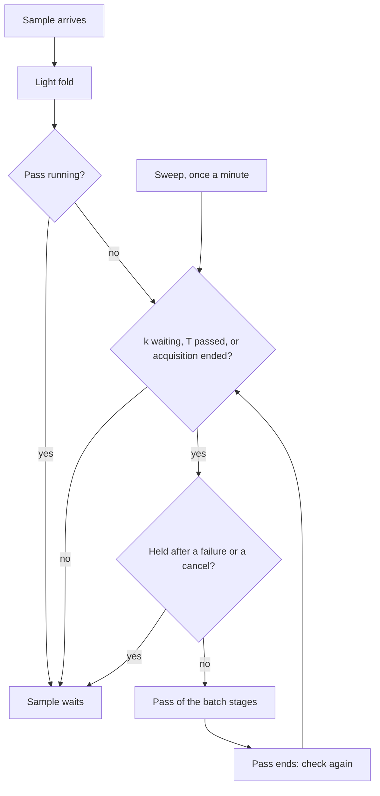

# Assignment performance: folding a sample in and assigning a batch

- **Status:** building
- **As of:** 2026-11-28
- **Tracked in:** [Assignment quality plan](https://linear.app/ultra-trace/project/assignment-quality-plan-553f4854192c)
  (Linear, MAS-1179 the first measurement, MAS-1199 the second, on
  develop after MAS-1172; the fold-in design was the Decision
  MAS-1187, decided 2026-11-24, and is section 8, MAS-1224, with its steps
  MAS-1231 to MAS-1233 and the Decision MAS-1230 on its defaults; the
  findings are GitHub issues, section 6)
- **What:** What peak assignment's two uses cost on the demo's largest batch, where the
  time goes down to the functions, what one arrival changes, and the design for
  folding samples in during continuous acquisition: a light fold on arrival and
  a pass of the batch stages deferred.

## 1. The two uses

Assignment is used two ways, and they ask different things of its speed.

1. **Fold-in, during continuous acquisition.** A sample arrives, ingest folds
   it into a batch that already has its batch peaks and decisions, and the
   batch stages bring the batch back to consistent. It has to finish before
   the next sample arrives, and must not grow without bound as the batch
   grows. **The bar (the owner, 2026-11-23): one sample folded in, everything
   included, in 20 s is the goal and 30 s is acceptable.**
2. **Whole batch, retrospectively.** The user presses **Assign batch** and
   comes back when it is done. Minutes are acceptable; it has to finish, show
   progress and scale sanely with the batch. No bar: faster is better.

What "everything included" means today: ingest folds the sample without a
run (`service.auto_assign_sample_peaks` -> `batch_fold.fold_sample_peaks_without_run`,
the default `peak_assignment_ingest_ledger = "batch"`). The fold marks every
batch stage stale (`batch_staleness.mark_every_stage_stale`), so the batch is
consistent again only after a pass of all nine stages
(`batch_stages.assign_batch`). Nothing starts that pass on its own today:
the user presses **Assign batch**, or the batch stays stale.

## 2. Method

`tooling/assignment_perf/perf.py` (its README has the recipe) runs both uses
in one process with the backend's code, against a copy of the public demo
dataset, on the demo's largest batch: the uronium batch, 81 samples. A batch
of N is its first N samples in acquisition order; the others wait in a
holding batch, and an arrival moves the next one in.

- **Whole batch at N:** `assign_batch(fold="always")` on a copy with nothing
  assigned: every sample folded without a run, then the nine stages.
- **Fold-in at N:** on the copy the whole batch left, the sample N+1 arrives
  as ingest folds it, then the pass that brings the batch back to
  consistent (`assign_batch()`, which runs from the first stale stage, here
  every stage).
- **Arrivals:** from a batch of 4 made consistent, arrivals one after
  another. In the first measurement, in three copies: a pass after every
  arrival (5 arrivals), after every 5th and after the 16th (16 arrivals);
  and in a fourth, 47 arrivals with the fold alone. The box's load cut the
  first and the last short. In the second, 36 arrivals up to N = 40 in six
  copies: a pass after every arrival, after every 5th, 10th and 20th
  arrival and after the last, and a single pass after the 36th in two
  copies (section 7.3).

Per step, stage, judging and pipeline stage it records the wall time, the
CPU time beside it (CPU over wall is the cores busy), the SQL time and
statement count with the reads that repeat an earlier read of the same
span, and the process's peak memory. A py-spy profile (`profile_report.py`)
names the functions: of each second run in the first measurement, of the
curve's runs in the second.

**Two measurements.** The first (MAS-1179, 2026-11-23) on develop at
`0ffcef511`; the second (MAS-1199, 2026-11-27 and 28) on develop at
`7e7a8f8dc`, the timing script's own commit on top of it (`55eb0f231`)
for the curve. Every build ran on a copy of the same demo env, migrated to
that build's schema. The env holds the twelve compound reference lists the
demo ships with (783 compounds, every list active) and no spectral library:
the lists are what a fold and a first judging read of the reference
sources (MAS-1274, MAS-1282). Sections 3 to 5 are the second measurement's,
with the first's beside it; 2.2 says what changed between the two, and 2.3
that the work stayed the same.

**The box.** The agent box, 12 cores (24 threads), shared with other
workers. Above 12, two runs share a core, and every number is higher than
on an idle box: develop's whole pass at N = 4 took 126 s at load 1 and
185 s at load 17, its CPU time rising with it. The first measurement's runs
went side by side, at a load of 7 to 47. The second's curve and builds ran
one after the other, each in an env of its own; the arrivals ran beside
them, and the assignment bench and other workers' tests came and went, so
the load was 4 to 25 and once higher. Each table gives its runs' load.
Shares, ratios and growth with N hold either way; seconds are upper bounds.

### 2.1 Repeat agreement, per step

The bar: two runs in a row agree within 10 % per step. In the first
measurement two pairs were run one after the other at N = 4, each fold-in
in its own copy of the same consistent batch, and both meet it:

| pair | build | load | arrival fold | pass | stages over 2 s | ledgers |
| -- | -- | -- | -- | -- | -- | -- |
| the reviewer's, round 1 | the branch's base then | 15, 12 | 18.1 / 17.9 s (0.9 %) | 263.3 / 262.8 s (0.2 %) | all within 6 % | 0 members differ |
| round 2 | develop of round 2 | 10, 7 | 9.2 / 8.7 s (4.5 %) | 99.6 / 97.0 s (2.6 %) | all within 3.7 % | 0 members differ |

The first measurement's curve ran its pairs side by side instead, two copies at once
under different loads, the second under py-spy. Their totals agree within
0.2 to 7 %, but per step they miss the bar where the load moved between
them:

| pair, side by side | load | arrival fold | pass | stages over 2 s and over 10 % apart |
| -- | -- | -- | -- | -- |
| fold-in, N = 4 | 12, 24 | 16.9 / 21.3 s (20.5 %) | 5.8 % | series 14 %, co-variation 40 % |
| fold-in, N = 20 | 47, 40 | 26.7 / 28.2 s (5.2 %) | 2.4 % | five of the cheap ones (water ladders, known species, co-variation, ratio stability, checks), 12 to 35 % |
| fold-in, N = 40 | 26, 17 | 25.6 / 23.2 s (9.5 %) | 3.8 % | known species 24 %, series 12 %, two cheap ones |
| fold-in, N = 80 | 10, 19 | 17.5 / 26.5 s (34 %) | 2.3 % | known species 33 %, three cheap ones |
| whole, N = 4 | 7, 14 | - | 34.6 % | every costly stage, 21 to 50 % |
| whole, N = 20 | 12, 15 | - | 4.7 % | fold 23 %, known species 20 %, co-variation 22 % |
| whole, N = 40 | 12, 15 | - | 0.3 % | fold 14 %, known species 21 %, series 10 %, five cheap ones |
| whole, N = 80 | 13, 15 | - | 0.2 % | four cheap ones, 17 to 42 % |

So the script repeats to within a few per cent when the box's load holds.
The side-by-side pairs' per-step spread is the load's, and it is largest on
the short steps: the arrival fold, and stages of a few seconds. The
fold-in's ranking in section 6 rests on the pass, which agrees within 6 %
in every pair; the arrival fold is quoted as its range, 17 to 28 s.

The two pairs of the first measurement ran on newer builds than its
`0ffcef511`: the reviewer's on that branch's base, `e5e807efb`, which does
not have MAS-1172 (#3483), and round 2 on `945e9f000`, which has it and
three more changes. Their 263 s and 100 s are 2.6 times apart, but under
loads of 12 to 15 and 7 to 10; under a like load the same two builds are
1.9 times apart (2.2). The second measurement's pairs:

| pair | build | load: whole, fold-in | arrival fold | fold-in's pass | whole pass | ledgers |
| -- | -- | -- | -- | -- | -- | -- |
| steady, back to back | develop `7e7a8f8dc`, the script's `55eb0f231` | 6, 10 and 9, 7 | 7.1 / 6.9 s (3.5 %) | 95.6 / 93.2 s (2.6 %), stages within 5 % | 132.9 / 134.0 s (0.8 %), stages within 3 % | 15 and 19 members differ, all in the records |
| the ends of the chain of 2.2 | develop `7e7a8f8dc` | 7, 11 and 10, 14 | 6.8 / 8.8 s (30 %) | 92.6 / 104.2 s (12.5 %), the series 14 % | 134.3 / 150.2 s (11.9 %), the series 28 % | 29 and 32 members differ, all in the records |
| the curve's first two | develop `7e7a8f8dc` | 1, 17 and 4, 20 | 7.8 / 9.0 s (16 %) | 125.3 / 115.9 s (8.1 %), the search 16 % | 126.4 / 185.3 s (47 %), the search 60 % | 17 and 0 members differ, all in the records |

The pair run back to back at a steady load meets the bar of 10 % per
step, with 3.5 % on the arrival's fold and under 3 % on the passes. The
other two pairs miss it where the load moved between their runs: by 4 in
the chain's, by 16 in the curve's first, which ran as other workers'
tests started. The ledgers of every pair differ in 0 to 32 members of
6,694 and 8,363, all in the records: the floor of 7.1 holds on develop.

### 2.2 What changed between the two

Each build below ran whole and fold-in at N = 4 in an env of its own, one
after the other; develop ran first and last, so the two develop rows show
how far the load moved over the chain. Between two rows, a step under
about 10 % is within what the load moves (2.1). A row named "before" is
the commit just before the change below it, so the step between the two
is that change's alone. Between other rows lie other commits, fixes and
features among them.

| build | the change | load | whole pass | fold-in: fold, pass |
| -- | -- | -- | -- | -- |
| `0ffcef511` | the first measurement | 11, 13 | 343 s | 14.0 s, 218 s |
| `e5e807efb` | round 1's base, 36 changes later | 6, 5 | 313 s | 13.5 s, 216 s |
| `a3ea8b968` | MAS-1172: the election without pandas per peak | 8, 5 | 266 s | 8.8 s, 179 s |
| `1f522d513` | MAS-1172: a pass reads a sample's inputs and envelopes once | 7, 10 | 144 s | 8.9 s, 117 s |
| `945e9f000` | round 2: two changes to the app's settings dialog | 14, 11 | 159 s | 14.2 s, 114 s |
| `791bfeed1` | two fixes: each batch member keeps its own target | 15 | 180 s | - |
| `4da8d0fc8` | before MAS-1144's change | 15 | 174 s | - |
| `6bdbb3d2a` | MAS-1144: an isotope-line record stands on the ion, a change of decisions (2.3) | 20 | 196 s | - |
| `a42c085ba` | before MAS-1072 | 34, 21 | 202 s | 12.4 s, 137 s |
| `064f55564` | MAS-1072: one tie rule | 18, 21 | 192 s | 10.8 s, 130 s |
| `dacd01feb` | MAS-1072: one rival set per peak | 10, 12 | 214 s | 14.0 s, 139 s |
| `0d8e414ec` | MAS-1072: the rival frames read off their columns | 13, 17 | 179 s | 10.4 s, 119 s |
| `74225768b` | before MAS-1189 | 19, 12 | 165 s | 11.4 s, 114 s |
| `a86c59e8e` | MAS-1189 (#3505): the search leaves out a peak it searched in vain | 10, 8 | 148 s | 8.9 s, 93 s |
| `f857da9cf` | before MAS-1190 | 7, 6 | 147 s | 8.5 s, 108 s |
| `2ac1a3842` | MAS-1190 (#3506): `resolve_lines` without reading each line alone | 11, 21 | 146 s | 18.1 s, 88 s |
| `c6387bf1c` | before MAS-1274 | 14, 25 | 163 s | 10.3 s, 94 s |
| `d95b376db` | MAS-1274: the lists' ions, not their lines, where nothing matches them | 15, 15 | 124 s | 8.9 s, 74 s |
| `e98786650` | MAS-1274: group only the ions a claim can take | 13, 8 | 116 s | 8.2 s, 71 s |
| `496e19738` | before MAS-1282 | 14, 8 | 109 s | 8.1 s, 66 s |
| `66ecd2d15` | MAS-1282: Stage A resolves only the reference ions that can reach a peak | 11, 7 | 108 s | 6.7 s, 65 s |
| `4a336df46` | before MAS-1045's fix | 15, 15 | 128 s | 8.9 s, 80 s |
| `d294f9726` | MAS-1045 (#3347): a measured batch decision weighs its rivals as a run does | 7, 4 | 168 s | 6.7 s, 108 s |
| `a142cd7bc` | MAS-1045: the grid's answer kept through a pass | 5, 6 | 128 s | 6.8 s, 105 s |
| `7e7a8f8dc` | develop, first and last in the chain | 7, 10 and 11, 14 | 134 s, 150 s | 6.8 s, 93 s and 8.8 s, 104 s |

**What made round 2 faster.** MAS-1172, both of its commits, and nothing
else: the fold-in's pass went from 216 to 117 s and the whole pass from
313 to 144 s under like load. The election without pandas per peak
(`a3ea8b968`) took 37 s off the fold-in's pass and halved the arrival's
fold (13.5 to 8.8 s); reading a sample's inputs and envelopes once per pass
(`1f522d513`) took 62 s more, and 122 s off the whole pass. Round 2's
two other changes are in the app's settings dialog and moved nothing. The
2.6 times of the brief was 1.9 times and the load: round 1 ran at 12 to
15, round 2 at 7 to 10.

**What each change since took off, at N = 4** (the fold-in's pass, then the
whole pass):

- MAS-1186 (#3500) built nothing: no two demo samples share a
  resolving-power function, so a first judging had nothing to share.
- From round 2 to MAS-1072's perf commit the passes rose to 130 to 139 s
  and 180 to 214 s and came back to 119 s and 179 s with it, while the
  load went from 11 to 34 and back. These steps are not told apart from
  the load; together, round 2 to `0d8e414ec` moved the fold-in's pass 5 s
  and the whole pass 20 s.
- MAS-1189 (#3505) took 21 s off the fold-in's pass and nothing off the
  whole pass, as expected: a pass from nothing has searched nothing before.
- MAS-1190 (#3506) took 20 s off the fold-in's pass; the whole pass moved
  less than the load does.
- MAS-1274 (#3631) took 23 s and 47 s: with the lists loaded, a fold and a
  judging read the lists' ions without resolving their lines.
- MAS-1282 moved nothing measurable at N = 4: after MAS-1274, few
  reference ions are resolved at all.
- MAS-1045's fix (#3347) added 28 to 43 s and 40 to 60 s: the batch's
  judging now asks the formula grid for the rivals of every reading it
  elects (`given_rivals.given_readings_rivals`). Its second commit kept the
  grid's answer through a pass and took back 3 s and 40 s.
- So, from `0ffcef511` to develop: the fold-in's pass 218 s to 93 to
  104 s (2.1 to 2.3 times faster), the arrival's fold 14 s to 7 to 9 s,
  and the whole pass 343 s to 134 to 150 s (2.3 to 2.6 times).

**At N = 20**, before and after each change from round 2 on, one build
after the other in an env of its own:

| build | the change | load: whole, fold-in | whole pass | fold-in: fold, pass | the fold-in's ledger against the row before: members (tiers, formulas) |
| -- | -- | -- | -- | -- | -- |
| `0ffcef511` | the first measurement | 12, 47 | 2,753 s | 26.7 s, 1,333 s |  |
| `945e9f000` | round 2: has MAS-1172 | 16, 22 | 805 s | 13.5 s, 558 s | 124 (0 tiers, 0 formulas) |
| `74225768b` | before MAS-1189 | 18, 18 | 947 s | 13.4 s, 460 s | 781 (449 tiers, 315 formulas) |
| `a86c59e8e` | MAS-1189 (#3505) | 16, 18 | 819 s | 11.0 s, 406 s | 101 (0 tiers, 0 formulas) |
| `f857da9cf` | before MAS-1190 | 1, 8 | 690 s | 9.9 s, 350 s | 180 (0 tiers, 0 formulas) |
| `2ac1a3842` | MAS-1190 (#3506) | 21, 7 | 576 s | 8.7 s, 272 s | 144 (0 tiers, 0 formulas) |
| `c6387bf1c` | before MAS-1274 | 4, 4 | 548 s | 8.6 s, 273 s | 135 (51 tiers, 0 formulas) |
| `e98786650` | MAS-1274, both commits | 5, 5 | 499 s | 8.5 s, 217 s | 134 (0 tiers, 0 formulas) |
| `4a336df46` | before MAS-1045's fix | 9, 9 | 487 s | 8.1 s, 225 s | 128 (0 tiers, 0 formulas) |
| `d294f9726` | MAS-1045 (#3347): a measured batch decision weighs its rivals as a run does | 5, 4 | 829 s | 7.4 s, 393 s | 132 (0 tiers, 0 formulas) |
| `a142cd7bc` | MAS-1045: the grid's answer kept through a pass | 9, 8 | 639 s | 7.8 s, 378 s | 181 (0 tiers, 0 formulas) |
| `7e7a8f8dc` | develop, at the chain's load | 7, 9 | 658 s | 8.0 s, 381 s | 142 (0 tiers, 0 formulas) |

The first measurement's runs ran at a load of 12 to 47, round 2 to
MAS-1189 at 16 to 22, the rest at 1 to 9 but for one whole pass at 21.
Against the build just before it, at N = 20:

- **MAS-1189** took 54 s off the fold-in's pass (460 to 406 s) and 128 s
  off the whole pass (947 to 819 s), where the search runs over each
  sample twice (40 searches at N = 20).
- **MAS-1190** took 78 s off the fold-in's pass (350 to 272 s, 22 %) and
  114 s off the whole pass, the second of them at a load of 21.
- **MAS-1274** took 56 s and 49 s (273 to 217 s, 548 to 499 s).
- **MAS-1045's fix** added 168 s to the fold-in's pass (225 to 393 s,
  75 %) and 342 s to the whole pass (487 to 829 s, 70 %). Its second
  commit took back 15 s and 190 s.
- **Develop** at the chain's load: 381 s and 658 s. The curve's run at a
  load of 19 to 22 took 525 s and 769 s: at N = 20 the load alone moves a
  pass by a third.
- **From `0ffcef511` to develop**, at N = 20: the fold-in's pass from
  1,333 s to 381 s (3.5 times faster) and the whole pass from 2,753 s to
  658 s (4.2 times), most of it MAS-1172's; MAS-1045's fix gave back about
  150 s of each.

### 2.3 The same work

Every build of 2.2 ran the same stages, and judged the same samples in
each: in the whole pass at N = 4, 4 samples after each of known species,
the search, the isotope lines and the series; in the fold-in's pass, 3, 3
and 5. At N = 20 every build of the chain did the same: the whole pass
judged 18, 20, 20 and 20 samples, the fold-in's 11 in the search, 1 in the
isotope lines and 21 in the series. Develop runs one stage more, last: the
batch level (MAS-940), which judges nothing again.

The ledgers, member by member (the digest of 7.1), against the build
before:

- **Two identical passes** differ in 29 of 6,694 members at N = 4 (0.4 %,
  develop first and last in the chain, the whole pass) and 32 of 8,363 in
  the fold-in, all in the series and records: the floor.
- **Every perf change** stays within it: 9 to 38 members a step, all in
  the records. One other step moves 6 to 8 tiers beside its records: from
  MAS-1190 to the build before MAS-1274, which holds no perf change but
  fixes and features, the series' S/N 4 floor among them.
- **One change moves more: MAS-1144** (`6bdbb3d2a`, #3442), on purpose:
  the plan owner decided that an isotope-line record stands on the ion,
  so the series may take a proposal of the same ion through another
  mechanism. At N = 4 it moves 121 members of the whole pass against the
  build just before it (`4da8d0fc8`, whose own step moved 20), and 161 of
  the fold-in's from round 2 to the build before MAS-1072: 67 members a
  consensus tier from candidate to assigned, and 51 members, on 13 batch
  peaks, a consensus formula. Every one of the 13 keeps its ion and takes
  another neutral, the one the series proposed through another mechanism.
  That is a decision the change made, not the same work done differently,
  so it is no finding.
- **MAS-1072** (one rival set per peak, `064f55564` to `0d8e414ec`) moves
  7 to 23 members a commit, within the floor.
- **Develop against `0ffcef511`**, at N = 4: 124 members of the whole
  pass and 176 of the fold-in's, nearly all of them MAS-1144's.
- **At N = 20, 40 and 80 the pattern is the same, and the share no
  larger.** The whole pass's decisions but the records, which the first
  measurement's digest read differently, differ in 92 of 6,694 members at
  N = 4 (1.4 %), 543 of 36,632 at N = 20 (1.5 %), 1,063 of 72,463 at
  N = 40 (1.5 %) and 2,297 of 142,433 at N = 80 (1.6 %). The fold-in's,
  the whole digest, in 804 of 38,443 at N = 20 (2.1 %), 1,627 of 74,207 at
  N = 40 (2.2 %) and 3,356 of 144,160 at N = 80 (2.3 %). Every formula
  that moved, 299 to 1,233 members, is one of the same 21 or 22 pairs of
  formulas, each keeping its ion and taking another neutral; and most
  tiers that moved went from candidate to assigned. That is MAS-1144's
  decision. The chain at N = 20 (2.2) puts it in the same place as at
  N = 4: 781 members of the fold-in (449 tiers, 315 formulas) between round
  2 and the build before MAS-1189. Every other step at N = 20 moves 94 to
  181 members, 0.3 to 0.5 %, at the floor's 0.4 % (145 at N = 20, 7.1), all
  in the records but 47 to 51 tiers in the step to the build before
  MAS-1274, the one that moved 6 to 8 tiers at N = 4.
- **So the batch stages do the same work**, but for MAS-1144's change of
  decisions, which the plan owner made: no finding, and no GitHub issue
  filed.

## 3. Fold-in

One sample arrives into a batch of N that a pass left consistent: its fold
as ingest does it, then the pass that makes the batch consistent again.
Develop at `7e7a8f8dc`, one run after the other; at N = 4, the two ends of
the chain of 2.2 and a third under py-spy; at N = 20, the curve's run
under py-spy and the N = 20 chain's last, at about half its load. The last column is the first
measurement's total, run 1 of each N at `0ffcef511` under a load of 10 to
47:

| N | run | load | arrival fold | pass | total | judgings | SQL | CPU over wall | peak memory | at `0ffcef511` |
| -- | -- | -- | -- | -- | -- | -- | -- | -- | -- | -- |
| 4 | 1 | 10 | 6.8 s | 93 s | **99 s** | 11 | 7 s | 1.41 | 682 MB | 311 s |
| 4 | 2 | 14 | 8.8 s | 104 s | **113 s** | 11 | 9 s | 1.38 | 718 MB | 311 s |
| 4 | 3 | 16 | 7.6 s | 113 s | **121 s** | 11 | 9 s | 1.35 | 705 MB | 311 s |
| 20 | 1 | 22 | 10.8 s | 525 s | **536 s** | 33 | 25 s | 1.26 | 1,055 MB | 1,360 s |
| 20 | 2 | 9 | 8.0 s | 381 s | **389 s** | 33 | 21 s | 1.38 | 1,120 MB | 1,360 s |
| 40 | 1 | 14 | 8.6 s | 926 s | **935 s** | 108 | 45 s | 1.34 | 1,630 MB | 2,745 s |
| 80 | 1 | 5 | 8.4 s | 1,478 s | **1,486 s** | 206 | 67 s | 1.38 | 2,731 MB | 5,373 s |

**Against the bar.** The 30 s line, and the 20 s goal, are still crossed
before the smallest batch measured: at N = 4 one arrival costs three to
four times the acceptable time, and the cost grows with N. The arrival's
fold alone stays under 20 s at every N (6.8 to 10.8 s here, 3.7 to 13.2 s over the 215 arrivals of 7.3); the pass is the cost.

**Which stages run again, and which only needed the new sample.** The fold
marks all nine stages stale, so the pass runs them all, over the whole
batch, and the batch level after them. Per stage (seconds, and the samples
it judged again):

| stage | N = 4 | N = 20 | N = 40 | N = 80 |
| -- | -- | -- | -- | -- |
| water ladders | 1 s, 0 | 3 s, 0 | 4 s, 0 | 5 s, 0 |
| known species | 1 s, 0 | 2 s, 0 | 9 s, 1 | 7 s, 1 |
| search | 51 s, 3 | 234 s, 11 | 394 s, 25 | 544 s, 43 |
| isotope lines | 19 s, 3 | 13 s, 1 | 274 s, 41 | 500 s, 81 |
| series | 37 s, 5 | 264 s, 21 | 235 s, 41 | 407 s, 81 |
| co-variation, ratio stability, checks, blends, batch level | 4 s | 8 s | 9 s | 10 s |

The series stage still judges every sample again (#3504 was closed with
MAS-1188 cancelled: every arrival moves series corroborations in every
sample, MAS-1229). The search searches only the new sample now (MAS-1189,
#3505): 1 to 2 s of searching at every N. The search stage still takes
a third to a half of a pass, in the judgings it starts: it judges again
every sample whose members its decisions moved (3, 11, 25 and 43 at
N = 4, 20, 40 and 80).

**What grows with N.** The judgings, as before: the series stage judges
every sample, so its cost is N times a judging. A later judging is cheap
now (MAS-1172: 2.1 to 2.8 s median at every N, section 5); a first
judging in a fold-in's pass is not (10 to 16 s). So a fold-in is still about N judgings, in the
series and in the isotope lines once the batch is past 20, plus a search
stage that judges again the samples its decisions moved: linear in N,
about 18 s for every sample already in the batch from N = 4 to 80, 14 to
27 s between neighbouring N as the load moved (389 to 536 s at N = 20,
935 s at N = 40, 1,486 s at N = 80), against about 67 s on the first
measurement's build. That is 2.5 to 3.6 times less at each N, the N = 80
run at a lower load than its first counterpart. Peak memory grows with
N: 2.7 GB at N = 80, against 3.0 GB before.

## 4. Whole batch

**Assign batch** from nothing on a batch of N: every sample folded without
a run, then the nine stages and the batch level. The runs are those of
section 3. The last column is the first measurement's total at
`0ffcef511` (run 1, load 7 to 13):

| N | run | load | fold | stages | total | per sample | judgings | of the time judging | SQL | CPU over wall | peak memory | at `0ffcef511` |
| -- | -- | -- | -- | -- | -- | -- | -- | -- | -- | -- | -- | -- |
| 4 | 1 | 7 | 14 s | 120 s | **134 s** | 34 s | 16 | 43 % | 6 s | 1.39 | 672 MB | 372 s |
| 4 | 2 | 11 | 15 s | 135 s | **150 s** | 38 s | 16 | 45 % | 7 s | 1.36 | 696 MB | 372 s |
| 4 | 3 | 14 | 16 s | 148 s | **164 s** | 41 s | 16 | 44 % | 7 s | 1.34 | 667 MB | 372 s |
| 20 | 1 | 19 | 74 s | 695 s | **769 s** | 38 s | 78 | 51 % | 22 s | 1.37 | 964 MB | 2,753 s |
| 20 | 2 | 7 | 63 s | 595 s | **658 s** | 33 s | 78 | 50 % | 19 s | 1.38 | 1,050 MB | 2,753 s |
| 40 | 1 | 18 | 160 s | 1,443 s | **1,603 s** | 40 s | 153 | 51 % | 44 s | 1.32 | 1,500 MB | 5,601 s |
| 80 | 1 | 1 | 228 s | 2,210 s | **2,438 s** | 30 s | 311 | 51 % | 68 s | 1.40 | 2,088 MB | 9,407 s |

Per stage, the last run at each N (seconds, samples judged):

| stage | N = 4 | N = 20 | N = 40 | N = 80 |
| -- | -- | -- | -- | -- |
| fold (every sample, without a run) | 16 | 74 | 160 | 228 |
| known species | 14, 4 | 80, 18 | 198, 33 | 254, 71 |
| search | 98, 4 | 434, 20 | 887, 40 | 1366, 80 |
| isotope lines | 10, 4 | 54, 20 | 99, 40 | 166, 80 |
| series | 22, 4 | 118, 20 | 247, 40 | 409, 80 |
| the other five and the batch level | 4 | 9 | 11 | 14 |

**How it grows.** Linear in N, as before: 33 to 41 s a sample at N = 4 to 40 under a load of
7 to 19, and 30 s at N = 80 at a load of 1 to 5, against 93 to 144 s a
sample on the first measurement's build: 2.7 to 3.9 times less. From
nothing to a consistent batch of 80 took 41 minutes, against 2.6 hours. Every stage grows in
step with N; none grows faster.

**A sample judged more than once.** Each sample is still judged about four
times in a pass: after known species, after the search, after the isotope
lines and after the series. Judging is 43 to 51 % of the pass. Since
MAS-1172 a later judging reuses what the pass measured of the sample, so
the first judging after the search costs the most; the grid's rivals of
the readings it elects (MAS-1045) are most of that (section 5).

## 5. Where the time goes, both uses

A py-spy profile of the curve's runs on develop (`profile_report.py`),
counted over every thread's busy samples. Shares of the busy time (py-spy
misses some samples under load, so its seconds run short of the timed ones;
the shares hold):

| | fold-in, N = 4 | whole, N = 4 | fold-in, N = 20 | whole, N = 20 | fold-in, N = 40 | whole, N = 40 | fold-in, N = 80 | whole, N = 80 |
| -- | -- | -- | -- | -- | -- | -- | -- | -- |
| the grid's rivals of the readings a batch decision weighs (`given_rivals.given_readings_rivals`) | 21.8 % | 19.9 % | 31.7 % | 23.5 % | 29.4 % | 25.1 % | 28.5 % | 26.1 % |
| `line_model.resolve_lines`, all callers | 15.4 % | 17.5 % | 18.4 % | 18.1 % | 16.6 % | 18.9 % | 16.6 % | 17.7 % |
| the tiering caps (`Judging.cap`) | 14.5 % | 14.7 % | 13.1 % | 15.0 % | 14.4 % | 15.2 % | 14.9 % | 14.8 % |
| the reference lists' ions (`target_ions_compute.generate_target_ions_from_composition`) | 13.7 % | 13.6 % | 14.3 % | 12.6 % | 12.2 % | 12.9 % | 12.1 % | 11.9 % |
| pandas row access | 0.8 % | 1.4 % | 1.2 % | 2.1 % | 1.4 % | 2.1 % | 1.0 % | 1.7 % |
| the rest of pandas | 4.5 % | 5.0 % | 5.0 % | 6.3 % | 5.7 % | 6.2 % | 5.0 % | 6.2 % |
| SQL (driver and SQLAlchemy) | 11.2 % | 5.9 % | 5.9 % | 4.9 % | 5.8 % | 5.0 % | 6.0 % | 5.5 % |
| Python threads busy on average | 0.96 | 1.00 | 0.98 | 1.00 | 0.97 | 1.00 | 0.99 | 1.00 |
| of the busy time, on the event loop's thread | 22 % | 13 % | 14 % | 13 % | 15 % | 12 % | 15 % | 12 % |

Against the first measurement's profile:

- **`resolve_lines` fell from half the busy time to under a fifth.** MAS-1172
  measures a sample's envelopes once a pass, MAS-1190 made each call about
  twice as fast, MAS-1274 and MAS-1282 resolve fewer reference ions. The
  caps fell from 37 to 45 % to 13 to 15 %, the reference lists' lines at the
  file from 17 to 18 % to the ions' 12 to 14 %.
- **The election left the profile** (1 % at N = 40, against 9 to 14 %):
  MAS-1172's election without pandas per peak.
- **The grid's rivals are the largest single cost now**, a fifth to a third
  of the busy time. MAS-1045 (#3347) has a batch decision weigh its rivals
  as a run does: for every reading it elects, the composition finder scores
  the formulas the grid holds near it (`finder.rivals_of_readings`,
  `_score_reading`). It grows with the judgings, and so weighs most in a
  fold-in's pass, which judges each sample after the series once more.
- **SQL and pandas stay small**: SQL 5 to 6 % (11 % in the N = 4 fold-in,
  whose pass is short), pandas 6 to 8 % with its row access 1 to 2 %.

**The first judging of a sample in a pass, and the later ones** (median,
from the curve's runs): a later judging, which reuses what the pass
measured of the sample (MAS-1172), takes 2.1 to 2.8 s at every N, against
15 to 25 s before. A first judging takes 3 to 6 s in the whole pass, where
it is the known-species stage's and judges few members, and 10 to 16 s in a
fold-in's pass, where it judges every member. The fold-in's first judgings
are most of its judging time (#3500).

### 5.1 The cores, and what a worker would be handed (MAS-1191, MAS-1161)

**CPU over wall, per step.** The process's CPU time is 1.3 to 1.4 times its
wall time in every pass (1.26 to 1.41 in the tables of sections 3 and 4),
and 0.95 to 0.99 in a fold. py-spy sees one Python thread busy at a time
(0.96 to 1.00 above), so what exceeds one core is native code running
beside it, numpy's among it; the first measurement read 0.93 to 1.03. Per
kind of step, in the curve's runs: a judging 1.28 to 1.41, the search of a
sample 1.2 to 1.5, a fold of a sample 0.95 to 0.97, the batch-wide rest
0.8 to 0.9. On the 12-core box, about 11 cores stand idle for the length
of a pass. The event loop's own thread is busy 12 to 22 % of the busy time
(section 5's last row): the rest is the engine's steps in `to_thread`
workers, one at a time (MAS-1161).

**The share of a pass in per-sample work.** The steps that do not depend on
the other samples of their stage: the fold of a sample (in a whole pass), a
judging, the batch search's search of a sample, and the engine's steps a stage
runs on one sample outside a judging (its election, score and caps, in the
search and the series stages: "measure on a sample" below). Against it,
the batch-wide rest: the stages' own decisions over the pooled samples,
the series walk, the readings, the writes.

| use | N | pass (CPU over wall) | fold of a sample | judging | search of a sample | measure on a sample | per-sample, all | batch-wide rest |
| -- | -- | -- | -- | -- | -- | -- | -- | -- |
| whole | 4 | 164 s (1.34) | 16 s (10 %, 0.97) | 72 s (44 %, 1.36) | 27 s (17 %, 1.46) | 38 s (23 %, 1.52) | **93.1 %** (1.38) | 11 s (6.9 %, 0.81) |
| whole | 20 | 769 s (1.37) | 73 s (9 %, 0.95) | 389 s (51 %, 1.37) | 54 s (7 %, 1.35) | 227 s (30 %, 1.55) | **96.6 %** (1.38) | 26 s (3.4 %, 0.88) |
| whole | 40 | 1,603 s (1.32) | 157 s (10 %, 0.95) | 824 s (51 %, 1.31) | 86 s (5 %, 1.21) | 496 s (31 %, 1.52) | **97.5 %** (1.33) | 40 s (2.5 %, 0.88) |
| whole | 80 | 2,438 s (1.40) | 226 s (9 %, 0.95) | 1,246 s (51 %, 1.40) | 94 s (4 %, 1.18) | 820 s (34 %, 1.56) | **97.8 %** (1.41) | 53 s (2.2 %, 0.89) |
| fold-in | 4 | 113 s (1.35) | - | 74 s (65 %, 1.41) | 1 s (1 %, 1.07) | 25 s (22 %, 1.44) | **87.4 %** (1.42) | 14 s (12.6 %, 0.85) |
| fold-in | 20 | 525 s (1.26) | - | 387 s (74 %, 1.28) | 2 s (0 %, 0.81) | 99 s (19 %, 1.36) | **93.0 %** (1.29) | 37 s (7.0 %, 0.88) |
| fold-in | 40 | 926 s (1.34) | - | 696 s (75 %, 1.36) | 1 s (0 %, 0.93) | 181 s (20 %, 1.38) | **94.8 %** (1.36) | 48 s (5.2 %, 0.92) |
| fold-in | 80 | 1,478 s (1.38) | - | 1,097 s (74 %, 1.41) | 1 s (0 %, 0.98) | 312 s (21 %, 1.38) | **95.4 %** (1.40) | 68 s (4.6 %, 0.92) |

Each cell: the seconds, their share of the pass and their CPU over wall time.

So 87 to 98 % of a pass is per-sample work, and the share grows with N:
the batch-wide rest stays at 10 to 70 s. A pool of k workers could take up
to (k - 1)/k of it, if the samples of a stage were handed out (#3507). Within
a stage, the samples' work does not depend on each other; between stages it
does, so a pool would run one stage's samples at a time.

**What would cross a process boundary for one judging.** `perf.py
crossing`, one arrival and its pass at N = 20 on develop (`55eb0f231`), at
a load of 56 at its start. Each of the pass's 33 judgings, pickled with the
highest protocol: what goes in (the context `batch_rejudge.rejudge_sample`
hands the stages: the path, the sample, the config, the run, the given
readings, the held peaks, the floors; and the sample's kept-measurement
entry), and what comes back (the result rows and the kept entry):

| part | median | largest | pickle and read back, median | largest |
| -- | -- | -- | -- | -- |
| the inputs, in | 107 kB | 132 kB | 0.003 s | 0.005 s |
| the kept entry, in | empty (a first judging) | 10.6 MB | 0.000 s | 0.072 s |
| the result, out | 2.0 MB | 2.6 MB | 0.044 s | 0.068 s |
| the kept entry, out | 8.3 MB | 10.6 MB | 0.062 s | 0.351 s |
| a judging, in and out | 10.8 MB | 23.9 MB | 0.13 s | 0.46 s |

The median judging took 13.5 s in that pass: the crossing is about 1 % of
a judging, 5.8 s over the pass's 333 s of judging (1.7 %), before the pipe
itself. The kept entry is most of it, and it crosses twice: a worker that
kept its samples' entries between judgings would hand back the result
alone, 2 MB. The peaks a judging reads from the database are 95 kB
pickled; a worker would read them itself. No pool was built.

## 6. Findings, ranked

Each finding with its measurement, the code, and a first guess at the fix
and its size, in its GitHub issue. Ranked by the seconds it would save at
N = 20 on develop, fold-in first: the fold-in (536 s, load 22) and the
whole batch (769 s, load 19). The estimates are upper bounds taken from
the measured spans and the profile's shares; several act on the same time,
so the fold-in column takes them in order, each on what the ones above
left. Merged or cancelled since the first measurement, and so out of the
ranking: #3483 (MAS-1172), #3505 (MAS-1189) and #3506 (MAS-1190), merged;
#3504 (MAS-1188), cancelled (MAS-1229). What each took off is in 2.2.

**Fold-in**, against 30 s and then 20 s:

| rank | finding | what it removes at N = 20 | fold-in after it and the ranks above it | low-hanging |
| -- | -- | -- | -- | -- |
| 1 | Not running the batch stages on every arrival: decided (MAS-1187), section 8, being built (MAS-1224) | the pass, 525 s | the fold alone, 10.8 s here and 3.7 to 13.2 s (median 5.0 s) over the 215 arrivals of 7.3: **under the 20 s goal at every N measured** | built in MAS-1231 to MAS-1233 |
| 2 | [#3697](https://github.com/ultra-trace-systems/mascope/pull/3697) (MAS-1346, in review) and [#3707](https://github.com/ultra-trace-systems/mascope/issues/3707): the grid's rivals of every reading a batch decision is measured with | up to 170 s, 32 % of the pass's busy time (`given_rivals.given_readings_rivals`); #3697 measured a first judging 30 % faster, #3707 holds the rest | about 370 s | #3697 is built |
| 3 | [#3507](https://github.com/ultra-trace-systems/mascope/issues/3507) (MAS-1191) a pass runs one sample at a time | 93 % of the pass is per-sample work that does not depend on the other samples of its stage (5.1); with 4 workers, three quarters of it | about 110 s | M to L |
| 4 | [#3500](https://github.com/ultra-trace-systems/mascope/issues/3500) the first judging of a sample in a pass | the fold-in's first judgings, 12 to 16 s each (median), most of the judging time left | | M |
| - | already filed: [#3231](https://github.com/ultra-trace-systems/mascope/issues/3231) the fold reads every member it joins, [#3468](https://github.com/ultra-trace-systems/mascope/issues/3468) (MAS-1161) worker threads hold the loop, [#3488](https://github.com/ultra-trace-systems/mascope/issues/3488) the kept measurement's memory | | | |

Even with ranks 2 to 4 together, a full pass on every arrival stays over
30 s at N = 20, and it still grows with N: the stages are batch-wide by
nature (section 7.2). Only rank 1 brings a fold-in under the bar.

**Whole batch**, faster is better:

| rank | finding | what it removes at N = 20 |
| -- | -- | -- |
| 1 | [#3507](https://github.com/ultra-trace-systems/mascope/issues/3507) one sample at a time | 97 % of the pass is per-sample work (5.1): with k workers, up to (k-1)/k of nearly all of it |
| 2 | [#3697](https://github.com/ultra-trace-systems/mascope/pull/3697) and [#3707](https://github.com/ultra-trace-systems/mascope/issues/3707) the grid's rivals | 24 % of the busy time, about 180 s |
| 3 | [#3500](https://github.com/ultra-trace-systems/mascope/issues/3500) the first judging | part of the judging, 51 % of the pass |

**`resolve_lines` is still 18 %** of the busy time at N = 20, in both uses,
after MAS-1190 made each call 1.9 times faster. Its callers are the caps'
envelopes, the reference lists' lines at the file and the grid's scoring.
No issue is open for it; one more cut would be a finding of its own.

**Not findings.** SQL is 5 to 11 % of a pass's busy time (4.9 to 5.9 % at
N = 20), pandas row access 1 to 2 %: reading from the database, and
pandas, are not where the time goes. Peak memory grows with N:
0.7 GB at N = 4, 1.0 GB at N = 20, 1.5 to 1.6 GB at N = 40, 2.1 GB at N = 80 in a whole pass and 2.7 GB in a fold-in (1.9 to 3.0 GB before); #3488 holds the kept measurement's share of it.

## 7. Fold-in as a design question

With a sample about once a minute, back-to-back samples mostly carry the
same assignments. It may not be right to run every batch stage on every
arrival. This section measures what that choice needs to know and lays out
the options; the choice was the owner's (MAS-1187 (Decision)). Decided on
2026-11-24: (d), the mix. Section 8 is the design.

### 7.1 How much one arrival changes

The batch's samples one at a time, in acquisition order, from a batch of 4
made consistent by a pass. "Decided" is a batch peak with a consensus
formula before the arrival.

**Where an arrival's peaks land**, with the fold alone after each arrival
(47 arrivals, the batch growing from 5 to 51 samples):

| batch size | arrivals | peaks per arrival | on a decided batch peak | on an undecided one | new batch peaks |
| -- | -- | -- | -- | -- | -- |
| 5 to 9 | 5 | 1,969 | 83.2 % | 8.0 % | 8.8 % (median 83) |
| 10 to 19 | 10 | 1,828 | 89.0 % | 10.4 % | 0.6 % (median 8) |
| 20 to 34 | 15 | 1,793 | 91.5 % | 8.2 % | 0.3 % (median 4) |
| 35 to 51 | 17 | 1,775 | 92.3 % | 7.5 % | 0.2 % (median 4) |

Past the first ten samples, an arrival brings a handful of peaks the batch
has not seen, and nine in ten of its peaks land on a batch peak whose
formula is already decided. The fold alone took 21.6 s (median; 18 to 35 s)
and did not grow with the batch.

**What the full stages change**, with a pass after every arrival: the
members the batch held before the arrival whose decision differs after its
fold and pass.

| arrival | batch size | members before | changed | consensus formula | tier | isotope line | series and records |
| -- | -- | -- | -- | -- | -- | -- | -- |
| 1 | 5 | 6,694 | 201 (3.0 %) | 3 | 89 | 2 | 156 |
| 2 | 6 | 8,363 | 251 (3.0 %) | 6 | 141 | 5 | 166 |
| 3 | 7 | 10,091 | 502 (5.0 %) | 16 | 184 | 7 | 405 |
| 4 | 8 | 12,287 | 484 (3.9 %) | 23 | 234 | 14 | 336 |
| 5 | 9 | 14,524 | 539 (3.7 %) | 32 | 347 | 34 | 307 |
| fold-in at N = 20 | 21 | 36,632 | 549 (1.5 %) | 0 | 387 | 0 | 252 |
| fold-in at N = 40 | 41 | 72,463 | 558 (0.8 %) | 108 | 279 | 108 | 441 |
| fold-in at N = 80 | 81 | 142,433 | 932 (0.7 %) | 226 | 355 | 226 | 803 |

**What a count includes.** A member's decision is its tier, role and
candidate, and its batch peak's consensus formula and ion, consensus and
engine tier, isotope line, role and records. Of the records, the series,
the batch checks, the stamped lines, the known-species claim, the water
ladder and the merged lines count by their words and flags (a verdict, a
reason, `stamped`, `claimed`, a unit), and the first three also by their
top-level counts. The numbers each sample read moves (an r, a ppm, a
share, the files holding a species) are left out, and so are the
co-variation and the flat-series flag, readings shown and never acted on.
The rows above were counted before the digest read the known-species,
water-ladder and merged-line records and the verdicts nested in the checks
and the predicted lines. The ledgers before each arrival are gone, so they
were not counted again, and they run short by those. At the 16th arrival
of section 7.3, where both ledgers are kept, the fuller count is 997
members against 744: 121 more in the series' units, 92 in the known-species
claim, 40 in the merged lines. Arrival 1, counted again with the fuller
digest on the round-2 develop (section 2.1), changes 262 members where the
table has 201: the same 3 formulas, 89 tiers and 2 isotope lines, and 220
records against 156.

Two passes over the same batch in two copies differ in about 30 members
(0.4 %, all in the series and records): that is the noise floor. The fuller
digest leaves it where it was: the repeat pairs' kept copies differ in 145
of 38,443 members at N = 20, 122 of 74,207 at N = 40 and 268 of 144,160 at
N = 80, the same counts as before, all in the records. So an
arrival moves 0.7 to 5 % of the batch's earlier decisions, mostly tiers and
series records, and few consensus formulas. That is the share of a pass's
work the arrival needed; the pass redoes all of it.

### 7.2 What each stage needs to see

Read from the code (paths under `server/backend/src/mascope_backend/api/new/peak_assignments/`).
Every stage decides on quantities pooled over the batch's samples, and every
pass runs each stage over the whole batch. None has a path that does only the
new sample's work; three have a narrow catch-up for a new sample's members,
but it runs inside the batch-wide pass.

| stage | decides on | a new sample can change, for the others | for the new sample alone, against the standing decisions |
| -- | -- | -- | -- |
| water ladders | a rung present in half a segment's spectra and 3x its decoys, per acquisition segment | the segments, and a rung's pass in them: claims added or withdrawn elsewhere | partly: the fold claims a passed rung for a sample inside a passed segment; a re-cut segment or a flipped rung needs the pass (`run_batch_water_ladders`) |
| known species | present in 2 or more files and half the partition's files, the vote | the verdict for species the new sample lacks, so claims everywhere | partly: the fold takes a present species on the batch's word; a flipped verdict needs the pass (`plan_batch`) |
| search | the unassigned anchors; the persistence split over every anchor's share of spectra; the brightest member | the split, so admission anywhere; the representative; a new anchor to search | yes for anchors already searched (`_readings_to_measure_again` proposes the standing reading); every still-unassigned anchor is searched again each pass |
| isotope lines, strip | the median intensity share over 3 or more samples, the mass scatter, the majority | the median, the window, the majority: a row stripped or held, a parent changed | partly: `strip_again` handles new members of rows already stripped |
| isotope lines, stamp | a track stamped where the ratio holds in a large enough share of samples | track verdicts, stamps elsewhere | not today; the per-sample judgement is separable, the share is not |
| series | a walk over every assigned and target anchor, decoy enrichment | families committed or not, records on or off | not today; a member that already reads the formula is skipped (`_takes_the_member`) |
| co-variation | Pearson r over shared spectra after the batch's common mode is removed | every pair's r and gate | no: batch-wide by nature (a reading, display-only) |
| ratio stability | each pair's ratio series over the samples both share | every pair's grade ("every new sample moves every pair's series", `continuity.py`) | no: batch-wide by nature (a reading) |
| batch checks | halogen lock over stamped samples, label twins, neutral pairs | all three facts | no |
| probable blends | the consensus vote, persistence hold, blend tests | every anchor the new sample has a member in | the anchors it has no member in cannot change; the fold already recomputes the ones it touches |

Two facts of the code bear on the options:

- **The fold already keeps the vote current** for the anchors the new sample
  joined (`batch_peaks_controller`'s consensus recompute at the end of a
  fold). After the fold alone, the new sample's members carry the batch's
  standing decisions and the consensus counts include it.
- **A pass judges more samples than changed.** `judge_again` judges the samples
  a stage wrote in. Most stages write only what changed, but the series stage
  writes every record again with the pass's version
  (`batch_series._write_records`, `batch_stages.stamp_versions`), so
  `batch_rejudge.series_corroborated` returns every sample whose member reads a
  standing series record: every pass judges almost every sample in the
  series stage, changed or not.

### 7.3 What skipping costs

**On develop, up to N = 40** (MAS-1199, `7e7a8f8dc`). From the same
consistent batch of 4, 36 arrivals one at a time, each folded as ingest
folds it, in six copies: a pass after every arrival; a pass after every
k-th arrival and after the last, for k = 5, 10 and 20; and a single pass
after the 36th, in two copies. Each ran in an env of its own, the six side
by side and beside the curve, at a load of 4 to 25. Every pass ended
`success`.

The floor: the two single passes at N = 40 leave ledgers that differ in
109 of 72,463 members (0.15 %), all in the records.

**How far each ledger stands from the pass-per-arrival one**, after each of
its passes, over the members both hold:

| after arrival | N | k = 5 | k = 10 | k = 20 | one pass at the end |
| -- | -- | -- | -- | -- | -- |
| 5 | 9 | 749 of 16,540 (4.5 %): 145 tiers, 140 formulas | | | |
| 10 | 14 | 1,372 of 25,806 (5.3 %): 194, 202 | 1,627 (6.3 %): 221, 225 | | |
| 15 | 19 | 1,798 of 34,820 (5.2 %): 232, 242 | | | |
| 20 | 24 | 2,300 of 43,866 (5.2 %): 277, 291 | 2,716 (6.2 %): 309, 334 | 3,478 (7.9 %): 371, 382 | |
| 25 | 29 | 2,773 of 52,812 (5.3 %): 309, 300 | | | |
| 30 | 34 | 3,191 of 61,712 (5.2 %): 351, 328 | 4,009 (6.5 %): 401, 411 | | |
| 35 | 39 | 3,663 of 70,657 (5.2 %): 390, 353 | | | |
| 36 | 40 | **3,419 of 72,463 (4.7 %)**: 376, 357 | **4,511 (6.2 %)**: 441, 449 | **5,806 (8.0 %)**: 629, 616 | **6,845 (9.4 %)**: 725, 664 |

- **The distance is set by k, and passes do not close it.** At every pass
  of its own, k = 5 stands 4.5 to 5.3 % from the pass-per-arrival ledger,
  k = 10 6.2 to 6.5 %, k = 20 7.9 to 8.0 %, and one pass at the end 9.4 %,
  against a floor of 0.15 %. The gap does not shrink as passes add up: a
  ledger made by fewer passes is not the one made by more, and the
  difference is in the order of the decisions, not in samples left
  unjudged.
- **Most of it is in the records.** Of the members that differ, a tenth
  differ in their tier and a tenth in their batch peak's formula; the rest
  in the series and the other records only. The formulas that differ are
  0.5 to 0.9 % of the batch's members.
- **The first measurement read 3.5 % for k = 5** at N = 9 (below); develop
  reads 4.5 % there, under the fuller digest of 7.1.

**What a pass moves of the waiting samples' decisions, and what the passes
cost.** The waiting samples are those folded since the last pass, the last
arrival aside: its members are new at that pass and have no decision
before it. The older members are those the batch held at the last pass.
Per pass, median and range:

| k | passes | the waiting members a pass moves | of them, tiers and formulas | older members a pass moves | the passes' wall time | their CPU time | against one pass at the end |
| -- | -- | -- | -- | -- | -- | -- | -- |
| 1, a pass after every arrival | 36 | none wait | | 1.8 % | about 15,800 s | about 22,400 s | about 11.5 x |
| 5 | 8 | 65 % (64 to 73 %) | 63 %, 0.3 % | 5.5 % | 4,457 s | 6,218 s | 3.2 x |
| 10 | 4 | 66 % (65 to 77 %) | 63 %, 0.4 % | 9.3 % | 2,764 s | 3,763 s | 2.0 x |
| 20 | 2 | 72 % (66 to 78 %) | 63 %, 3.9 % | 26 % | 1,851 s | 2,478 s | 1.3 x |
| one pass at the end | 1 | 78 % | 63 %, 6.1 % | 44 % | 1,381 s | 1,807 s | 1.0 x |

- **A pass moves about two thirds of the waiting samples' decisions,
  whatever k**, and nearly all of it in their tiers (63 % at every k). The
  fold judges a sample against the batch's standing decisions; the stages
  that would claim, strip, stamp and corroborate its members have not run.
  The waiting samples' formulas move little at k = 5 and 10 (0.3 to
  0.4 %), more when the first pass comes late: 3.9 % at k = 20 and 6.1 %
  for one pass, whose waiting samples include the batch's first ten,
  where new batch peaks still appear (7.1).
- **The older members move more the longer a pass waits:** 1.8 % at a
  pass after every arrival, 5.5 % at k = 5, 44 % for one pass at N = 40.
- **Compute.** Against one pass at the end, k = 5 costs 3.2 times, k = 10
  2.0 times, k = 20 1.3 times, a pass after every arrival about 11.5
  times. The 33rd of its passes was stopped with the session that ran it
  and finished on a restart (section 9); its time is taken as its
  neighbours', 750 s. Its passes took 123 s at N = 5, 690 to 780 s at
  N = 33 to 36 and 620 to 660 s at N = 38 to 40, the last three on the
  next day at about half the load.
- **The light fold** took 5.0 s median, 3.7 to 13.2 s, over the 215
  arrivals of the six sequences, flat in N.
- **Machine time.** The six sequences took 8.5 hours of process time,
  side by side over about 4.5 hours of wall clock; their passes 10.6 CPU
  hours.

**On the first measurement's build** (MAS-1179, `0ffcef511`). Three
sequences from the same start, in three copies: a pass after every
arrival, after every 5th, and after the 16th alone. Each arrival's ledger
compared with the every-arrival one (members both hold):

| arrival | every 5th: pass here | differ from every arrival | of them tier | formula | after 16 alone: differ |
| -- | -- | -- | -- | -- | -- |
| 1 | no | 1,365 of 8,363 (16 %) | 1,222 | 23 | 1,352 |
| 2 | no | 2,706 of 10,091 (27 %) | 2,429 | 72 | 2,688 |
| 3 | no | 4,537 of 12,287 (37 %) | 3,730 | 322 | 4,525 |
| 4 | no | 6,301 of 14,524 (43 %) | 5,031 | 627 | 6,292 |
| 5 | **yes** | **572 of 16,540 (3.5 %)** | 144 | 140 | 7,825 (47 %) |

- **In between, the waiting samples' rows are provisional.** At each
  deferred pass, the members of the samples that waited for it, and the
  older members:

  | pass | waiting samples | their members changed | of them tier | formula | older members changed |
  | -- | -- | -- | -- | -- | -- |
  | every 5th, at arrival 5 (N = 9) | 5 | 5,648 of 7,830 (72 %) | 4,909 | 603 | 726 of 6,694 (11 %) |
  | every 5th, at arrival 10 (N = 14) | 5 | 4,596 of 7,469 (62 %) | 4,464 | 80 | 912 of 16,540 (6 %) |
  | once, at arrival 16 (N = 20) | 16 | 20,053 of 28,126 (71 %) | 17,054 | 2,008 | 998 of 6,694 (15 %) |
  | every 5th, at arrival 15 (N = 19) | 5 | 4,477 of 7,233 (62 %) | 4,433 | 14 | 671 of 25,806 (3 %) |

  The deferred pass costs what a fold-in's pass costs at that N (1,122 s at
  N = 9, 1,364 s at N = 14, 2,547 s at N = 20, under this load). Most of what differs between passes is the
  waiting samples' own tiers: the fold judges a sample against the batch's
  standing decisions, but the stages that would claim, strip, stamp and
  corroborate its members have not run.
- **They converge once the pass runs**, to 3.5 % of the every-arrival ledger
  at the 5th arrival, against a noise floor of 0.4 %. At the 16th arrival,
  where the every-5th and the once-at-the-end sequences have both just run a
  pass, their ledgers differ in 997 of 36,632 members (2.7 %; 965 of them in
  the records, 93 tiers, 70 formulas), read from the two kept copies with
  the fuller digest of 7.1. The table's rows were counted with the earlier
  digest and run short by the known-species claims and the merged lines. The rest is the
  order of the passes: a ledger made by fewer passes is not exactly the one
  made by more.
- **What skipping saves.** Over the 16 arrivals from N = 5 to 20, a pass
  every 5th arrival cost 4,812 s of passes (four), once at the end 2,547 s,
  against about 14,000 s for a pass on every arrival (its passes measured
  315 s at N = 5 rising to 1,333 s at N = 20).

### 7.4 The options

Four ways to fold samples in during acquisition. The costs are the
measured ones of sections 3 and 7.1 to 7.3, at the load of section 2.

| | (a) everything on every arrival, made fast | (b) a light fold on arrival, the batch stages deferred | (c) the batch stages triggered by need | (d) a mix: (b) on arrival, (c) or a count as the trigger, a full pass at the end |
| -- | -- | -- | -- | -- |
| on arrival | the fold and a pass of all nine stages | the fold alone: the sample's own judging against the batch's standing decisions, and the consensus of the batch peaks it joined | the fold, then the pass when the arrival crosses a line | the fold; the pass on a count or a need |
| cost per arrival today | 311 to 334 s at N = 4, 1,360 s at N = 20, 5,373 s at N = 80, growing linearly with N | the fold: 21.6 s median, 18 to 35 s, flat in N up to 51 | the fold, plus a pass on the arrivals that cross the line | the fold, plus a pass every k arrivals: at k = 5 and N = 20, 27 s on four arrivals and 27 s plus a 1,333 s pass on the fifth |
| what it takes to meet 30 s | every finding of section 6 together, and the pass's cost no longer growing with N; not in reach with all of them at N = 20 | met today at every N measured | met on the arrivals that do not cross the line | met on the arrivals between passes |
| what the user sees | the ledger current after every arrival | the new sample's rows with the batch's standing decisions; the batch-wide readings (series, co-variation, ratio stability, checks, blends) as of the last pass | as (b), with a pass when it matters | as (b) |
| what it needs to decide | nothing new | when to run the pass: a timer, a count of arrivals, the end of acquisition (a sequence's last file, or the instrument idle) | a measure of need: new peaks, peaks on undecided batch peaks, tiers the fold moved, past a share | both |

**The state in between, for (b) to (d).** After a light fold a sample's
members carry the batch's standing decisions: each joined batch peak's
consensus is recomputed with the new member (section 7.2), and the sample's
tiers are what its own judging gives against them. What the sample does not
have yet is what only the batch stages decide: the claims a changed
known-species or water-ladder verdict would make, a search of its new peaks,
its isotope strips and stamps, its series records, and the batch-wide
readings. The stages are already marked stale by the fold
(`batch_stage` rows, served as the stages' standing), so the ledger has the
state to show; what it would need is to say it per sample: "folded, the
batch stages not yet run since", with the count of samples waiting, beside
the **Assign batch** control that runs the pass. A sample's rows in that
state are no different in kind from a batch whose stages are stale today.

**What the measurements say for the choice.**

- One arrival moves 0.7 to 5 % of the batch's earlier decisions (7.1), but
  a full pass redoes the whole batch to find them, and it costs ten to 180
  times the bar (section 3). The findings of section 6 together do not
  bring it under 30 s at N = 20.
- The light fold meets the bar at every N measured, and nine in ten of an
  arrival's peaks land on a decided batch peak. But the waiting samples'
  rows are provisional: the next pass moves 72 % of their members' decisions,
  most of them tiers (7.3). A ledger that shows them as final would be
  wrong for a while.
- Deferred passes converge: after the pass the ledger is within 3.5 % of the
  every-arrival one.

The choice was the owner's: MAS-1187 (Decision), decided on 2026-11-24 for
(d). Section 8 is the design.

## 8. The design: a light fold on arrival, the batch stages deferred

The owner chose (d) on 2026-11-24 (MAS-1187): a light fold on arrival, so
acquisition never falls behind, with the bar at 20 s the goal and 30 s
acceptable at any batch size. A pass of the batch stages starts on its own on
a count of arrivals or a timer, and always at the end of acquisition. The
samples folded since the last pass are shown as provisional until it runs. A
trigger by need, (c), is not built now; it can come later as one more
trigger. This section is that design, read from the code as it is on
develop and from the data of section 7. It builds nothing; its steps are
8.8.

Paths below are under `server/backend/src/mascope_backend/api/new/peak_assignments/`
unless they say otherwise.

### 8.1 The light fold

**The light fold is today's ingest fold, unchanged.** It is the arrival's
part of section 3's fold-in, without the pass a person had to press. What
runs on arrival, in order:

1. Matching, as for every sample (`match_compute_sample`, in
   `api/controllers/sample/files/process/service.py`).
2. The fold (`service.auto_assign_sample_peaks` ->
   `batch_fold.fold_sample_peaks_without_run`): the INGEST_FOLD path of
   `pipeline.py`. The pre-passes, Stage A on the known set, the judging
   rounds, the tiering rules and the identification level run as for a run
   of the sample with the untargeted search off.
3. The sample's rows become members of its batch's batch peaks
   (`batch_fold.keep_fold` -> `fold_sample_into_batch_peaks`). The consensus
   of every batch peak it joined is recomputed with it
   (`batch_peaks_controller`).
4. The model the fold scored at is kept for the sample
   (`model_readers.record_sample_model`).
5. Every batch stage is marked stale, reason `fold`
   (`batch_peaks_controller.py`, `batch_staleness.mark_every_stage_stale`),
   in the fold's own transaction under the batch's fold lock. A stage that
   is running keeps running, and ends stale (`batch_stages.finish_stage`).

It costs 21.6 s median, 18 to 35 s over 47 arrivals, flat in N (7.1).

**What does not run on arrival.** None of the nine stages. No untargeted
search of the sample's own peaks: ingest runs with `run_untargeted=False`,
and its new batch peaks wait for the batch search. No per-sample run row
under the default `peak_assignment_ingest_ledger = "batch"`. Nothing that
runs on arrival today stops running: the change is what runs after it.

**What marks the stages stale** stays the fold's mark. The batch's
assignment status already reads a fold's mark as no reason of its own where
`new_samples` explains it (`batch_assignment_status.stale_reason`), so the
status says *N samples added since the last assignment*, not *stages stale*.

### 8.2 A provisional sample

A sample is **provisional** from its fold until a pass covers it: it is
folded, in the batch, and not in the newest completed pass's `samples`
(`batch_stages.last_pass`, which records the samples a pass read as it
started). These are the **waiting** samples. The per-sample state and the
batch's count are read from this one set, so they can never disagree. A
failed or cancelled pass covers nothing.

**Folded** means the sample has a kept model (`sample_measurement_model`,
written by every run-less fold: `batch_fold.keep_fold` on ingest and the
ledger's rebuild) or a completed run of its own (`peak_assignment_run`,
status `completed`, which the `sample` ingest ledger and an explicit run
write, and which folds its rows into the batch peaks on completion). One
query against the batch's samples reads it.

**A sample that was never folded** is not waiting and not provisional. The
status read's `new_samples` holds it too, but the waiting set leaves it
out. Four ways lead there:

- the ingest peak ceiling skipped it (`peak_assignment_ingest_max_peaks`,
  in `service.auto_assign_sample_peaks`);
- its fold raised, which that function logs and swallows;
- it was ingested with `peak_assignment_on_ingest` off;
- the engine refuses it: `sample_inputs.ineligible_reason` gives a reason,
  and `batch_fold._fold_sample_peaks_without_run` logs it and writes
  nothing. The reason is a blank (`instrument_function_id` is None, as the
  converter records blanks on ingest) or an m/z calibration that is not
  verified (ingest records one when a calibration is withheld or fails).
  Both land in acquisition batches as a matter of course.

The first three can be folded by a person; the fourth cannot. A run of its
own is refused on the same check (the per-sample route answers 422 with
`SAMPLE_INELIGIBLE_CODE`), and **Assign batch** with `fold="always"` skips
it again in `backfill_sample_batch_peaks`. So the design names the two
kinds apart: **not folded** (the first three) and **refused** (the
fourth).

A pass does not fold it either: `fold="auto"` folds only on
`batch_stages.fold_reasons`, which looks at the batch, never at a sample
without members. The pass still records it in `samples`. So "covered by a
pass" alone would call it decided while it has no rows. The design keeps
the two apart:

- it does not count toward k, and does not start the timer (8.3);
- a pass started on its own does not fold it, as a person's **Assign
  batch** does not today: the ceiling skipped it on purpose, a fold that
  raised would likely raise again in the pass, and with ingest off the
  trigger is off (8.3);
- it carries words of its own, before and after a pass (8.6). A sample not
  folded reads *Not folded on arrival*, with the two ways to fold it a
  person has today: a run of its own, or **Assign batch** with every sample
  folded (`fold="always"`). A refused sample reads its reason and no remedy
  that would not work: *Blank sample: no peaks to assign*, or *m/z
  calibration not verified: recalibrate the sample, or accept its fit, to
  assign it*. Once its
  calibration is verified (a recalibration, or an operator's acceptance
  of a fit under `quality_gate: "enforce"`) it is an ordinary not-folded sample, and the two
  ways reach it;
- the batch's *N not folded* counts the not-folded samples only, the ones
  a person can act on. Refused samples are left out of every count: a blank
  is expected in an acquisition batch, and its own sample says why it has
  no rows.

What its rows carry, against what the batch will say after the pass:

| reading | on a provisional sample | the batch's word? |
| -- | -- | -- |
| the formula of a batch peak it joined | the consensus, recomputed with its member (8.1, step 3) | yes, as of now |
| known species and water ladders | the fold takes a species present and a passed rung on the batch's standing verdict (7.2) | yes for the standing verdicts; a verdict the sample would flip waits for the pass |
| its tier | its own judging against the batch's standing decisions | **no**: the claims, strips, stamps and corroborations a pass judges it under have not run. The pass after five light folds moved 62 to 72 % of the waiting members' decisions, most of them tiers (7.3) |
| series corroboration | none judged for its members | **no** |
| isotope lines | not stripped or stamped for it (`strip_again`, the stamp) | **no** |
| its new batch peaks (about 4 an arrival past ten samples, 7.1) | unassigned, not searched | **no** |
| co-variation, ratio stability, batch checks, probable blends | as of the last pass, without it | **no**: readings of the batch |

The older samples are not provisional, but a pass moves some of their
decisions too: 3 to 15 % after a deferred pass (7.3). The batch's status
covers that (*behind*); marking every member of a batch provisional would
say nothing.

### 8.3 The triggers

A pass starts on its own when the first of three things holds.

- **The count.** k samples are waiting (8.2: folded and not covered).
- **The timer.** The oldest waiting sample has waited T minutes, read off
  `SampleItem.sample_item_utc_created`. It bounds how long a sample stays
  provisional when samples come slowly.
- **The end of acquisition**, the first of: the newest waiting sample's file
  carries an acquisition record whose sequence does not loop and whose step
  is the last one (`SampleFile.acquisition`; `Sequence.loop` and
  `step_index` in `libraries/sdk/src/mascope_sdk/acquisition.py`); a newer
  file of the same instrument went to another batch; or no sample has
  arrived for Q minutes, the quiet period. An acquisition batch is one day
  of one mode (`acquisition_batch_name` in `process/service.py`), so the
  second catches the day's turn at the instrument's midnight and a change of
  mode. The quiet period catches the rest: a looping sequence stopped, an
  instrument switched off. Most acquisition loops, so the first is rare.

**Where the count lives: nowhere new.** It is the size of the waiting set
(8.2), read from what the last pass recorded and the batch's samples
(`batch_stages.batch_samples`), one query each. No counter is stored, so it
survives a restart, two workers read the same number, and any pass that
completes resets it, whoever started it. A batch with no completed pass yet
has every sample waiting: its first pass starts on its k-th sample, and the
status reads `folded_only` until then.

**Which batches.** Only ACQUISITION batches: ingest folds into those alone.
Only with peak assignment on, and on at ingest
(`config.peak_assignment_enabled`, `peak_assignment_on_ingest`). **Both
ingest ledgers** (`peak_assignment_ingest_ledger`): on `batch`, the fold
writes members and no run; on `sample`, `assign_sample_peaks` writes a run
and folds it into the batch peaks on completion (the comment in
`auto_assign_sample_peaks`). Either way the batch's stages go stale the same
way, through `fold_sample_into_batch_peaks`, and the sample is folded in
8.2's sense. A trigger on one ledger only would leave the other's batches
stale until a person presses **Assign batch**, for no reason the ledger
gives.

**Where it is checked.** After each fold commits, in the worker that folded
the sample. And by a sweep in every worker's lifespan (`app/fast.py`), once a
minute, over the batches with a waiting sample: the timer and the quiet
period fire when nothing arrives, so an arrival cannot be what checks them.
There is no scheduler in the backend today; the sweep is the smallest one.

**The pass it starts** is the pass a person starts: `batch_stages.assign_batch`
with `fold="auto"`, on the batch's own settings, action `assign`, so the
status, Details and Run history read it as a pass with no change. Its run
records why it started (`trigger`: `count`, `timer` or `end`, and the count
it saw) and no user. It runs as a task of the worker, in a set of its own
in the trigger's module, observed as the ingest pipelines' tasks are
(`_observe_background_task` in `process/service.py`), but **not in
`_background_tasks`**. That set is the one `drain_auto_process_tasks` waits
on at shutdown, for up to `AUTO_PROCESS_DRAIN_TIMEOUT_S` (60 s), before it
cancels what is left. A pass kept there would hold every deploy for that
minute and then be cancelled anyway. The lifespan (`app/fast.py`) cancels
the auto passes' set at once instead, before the drain (8.7).

**An arrival during a pass** folds as it does today, under the fold lock;
the pass reads unlocked and writes under the lock. The pass recorded its
samples as it started, so the arrival stays waiting, and the stages it
marked stale end stale. When the pass ends, the rule is checked again at
once. While samples come faster than a pass, the passes run back to back,
and the number waiting is the pass's length over the arrival interval, not
k.

**A person's Assign batch always works**, as it does today, and covers every
waiting sample, so the count resets when it completes. The trigger never
refuses it or waits for it. While a pass runs, whoever started it, a person's
press is refused with 409, as it is today (`batch_runs.start_run`); the
running pass covers what waited when it started, and the next starts on its
own when it ends if the rule holds.

### 8.4 The defaults, and what the data says

The data does not pick the defaults, and this note picks none. MAS-1230
(Decision) was decided on 2026-11-27 as a hold: it waits for the pass's
curve on develop (section 3), the arrivals run of 7.3 and a site's arrival
gaps (MAS-1344), and takes no number before them. The first two are here,
measured on develop at `7e7a8f8dc`:

- **What a pass costs against N.** The fold-in's pass took 93 to 113 s at
  N = 4, 381 to 525 s at N = 20, 926 s at N = 40 and 1,478 s at N = 80
  (section 3): about 18 s for every sample already in the batch, about a quarter of
  the first measurement's 67 s. Under the arrivals run's load, a pass after
  every arrival took 123 s at N = 5 and 620 to 780 s at N = 33 to 40
  (7.3).
- **How many samples arrive during one pass, at a sample a minute:** as
  many as the pass takes minutes. About 2 at N = 4, 6 to 9 at N = 20, 15 at
  N = 40 and 25 at N = 80. It replaces this section's estimate of 8
  to 22 at N = 20, made before MAS-1172 and the changes after it.
- **The count moves where the ledger ends up, a little.** After each of
  its passes, a pass every 5th arrival leaves a ledger 4.5 to 5.3 % from
  the one a pass after every arrival makes, every 10th 6.2 to 6.5 %, every
  20th 7.9 to 8.0 %, and one pass at the end 9.4 %, at N = 40. Two
  identical passes differ in 0.15 % (7.3). More passes do not close the
  gap: a ledger made by fewer passes is not the one made by more.
- **The count sets how many samples are provisional, and the cost.** A
  pass moves about two thirds of the waiting samples' member decisions,
  nearly all of them tiers, whatever the count (64 to 78 %, 7.3). Over the
  36 arrivals from N = 5 to 40, passes every 5th arrival cost 3.2 times
  one pass at the end, every 10th 2.0 times, every 20th 1.3 times, and a
  pass after every arrival about 11.5 times.
- **Nothing was measured for the timer or the quiet period:** they wait
  for a site's arrival gaps (MAS-1344, a prod job).

Before these numbers, this section proposed k = 5, T = 30 minutes and
Q = 15 minutes; MAS-1230 holds those open.

### 8.5 Where the settings live

- **The instance's, in the runtime `[meta]` config**, beside
  `peak_assignment_on_ingest` (`libraries/runtime/src/mascope_runtime/config.py`,
  read in `config.py`): on or off, k, T and Q, with MAS-1230's defaults, in
  `docs/maintaining.md`. They are the defaults because acquisition batches
  are made by ingest one a day per mode, and a setting kept only on the
  batch would have to be set again every day.
- **A batch's own, where it differs** (MAS-1233): a column of its own on the
  batch, `SampleBatch.auto_pass`, edited in **Edit assignment settings**
  (`server/frontend/src/lib/dialogs/DialogBatchAssignSettings.vue`, MAS-1017)
  and saved through the batch's PATCH. Not inside
  `SampleBatch.assignment_settings`: those are hashed (`config.settings_hash`),
  and a pass on another hash runs every stage from the first and reads
  *settings changed* (`batch_stages.plan_pass`,
  `batch_assignment_status.settings_reason`). When a pass runs does not change
  what it computes, so saving it must not do that.

### 8.6 What the user sees

- **On the sample** (**This sample**, `AssignmentRunBar.vue` in
  `server/frontend/src/lib/panes/PaneBrowserMatch/`): *Folded on arrival · the
  batch stages have not run since*, and when the next pass is due (*after 2
  more samples*, *by 14:30*, *when acquisition ends*). In its ledger
  (`PaneBrowserAssignment.vue`), the tier marks of its rows carry a
  provisional mark, with a tooltip that says the tier may move at the next
  pass. Served on the fold's synthetic run of the sample (`fold_view.py`) as
  `provisional` and `folded_utc`, and on a run of its own that no pass has
  covered.
- **On a sample that was never folded** (8.2): *Not folded on arrival*, in
  place of the provisional line, with the two ways to fold it: a run of its
  own, or **Assign batch** with every sample folded. It says the same after
  a pass, which does not fold it. Served as `folded: false` beside
  `provisional`.
- **On a refused sample** (8.2: a blank, or an m/z calibration not
  verified): its reason in place of the provisional line, *Blank sample: no
  peaks to assign* or *m/z calibration not verified: recalibrate the
  sample, or accept its fit, to assign it*, and neither way to fold it. Served as `folded: false` with
  `refused` set to the reason `ineligible_reason` gives, read on the status
  read, not stored.
- **On the batch** (the batch assignment status of MAS-1015,
  `BatchAssignControl.vue` and `stores/batchAssign.js`): *5 samples waiting
  for the batch stages · next pass after 5*, or *by 14:30*, and *2 not
  folded* where the batch has samples a person can fold (refused samples
  are not counted), beside **Update
  assignment**, which runs the pass now. While a pass started on its own
  runs: *Assigning on its own · 5 samples arrived*, in place of *Another user
  is assigning this batch*. When the trigger holds after a failed pass: *Held
  after a failed pass*, with **Retry**. The status read serves these in a new
  `auto_pass` block (MAS-1231).
- **In Details and Run history** (MAS-1016, `BatchAssignDetails.vue`,
  `BatchRunHistory.vue`, `batchPass.js`): a pass started on its own says
  why, *started on its own: 5 samples arrived*, or *... at the end of
  acquisition*.
- The user page is `docs/user/how-it-works/peak-assignment.md`, "Assigning
  a batch", "Where the batch stands" and "Reading the ledger".

### 8.7 What can go wrong

- **A pass fails.** It stops at a stage, keeps the stages before it and
  leaves the rest stale (MAS-983, `batch_stages.assign_batch`); the batch
  reads `failed`. The trigger holds: it starts no pass on the same samples,
  which would fail again, and starts one only when the rule holds for
  samples that arrived after the failed pass started. A person's **Retry**
  works as it does today.
- **A pass is cancelled.** By a person: the same hold, so a cancel is not
  undone a minute later. By a shutdown: a pass started on its own is
  cancelled at once, not drained: a pass can take an hour, and a deploy must
  not wait for it. `drain_auto_process_tasks` waits up to 60 s for every task
  in `_background_tasks`, rematch tasks included, so the pass is kept in a
  set of its own that the lifespan cancels before the drain (8.3), then
  waits for a bounded grace, as the drain does for what it cancels
  (`_DRAIN_CANCEL_GRACE_S`, 10 s), so its task closes its run as cancelled.
- **A sample's fold fails, or never runs.** Ingest logs it and goes on
  (`auto_assign_sample_peaks`); the ceiling and ingest off skip it on
  purpose. The sample is not folded (8.2): it does not count, it does not
  hold the trigger, the pass does not fold it, and it reads *Not folded on
  arrival* until a person folds it.
- **The engine refuses a sample** (a blank, or an m/z calibration not
  verified; `sample_inputs.ineligible_reason`). Neither the fold, nor a run
  of its own, nor `fold="always"` writes its rows. It is never folded and
  never counted (8.2); it reads its reason with no remedy, or, for the
  calibration, that a recalibration or an accepted fit lets the sample be
  assigned.
- **A restart between a fold and its pass.** Nothing is lost: the count, the
  timer's start and the quiet period are read from the database (8.3), and
  the first sweep after the start finds the batch due. A pass interrupted by
  the restart is closed by its own task as cancelled, with
  `batch_stages.INTERRUPTED_ERROR`, on a clean shutdown; on a kill, startup
  closes it as failed, with `STUCK_BATCH_RUN_ERROR`
  (`reset_running_batch_peak_runs` in
  `db/admin/peak_assignments/reset_running_runs.py`). Either way the trigger
  reads it as interrupted, not held, and the sweep starts it again once.
- **Two workers.** Each checks after its own folds and sweeps every batch.
  Two that find one batch due race on `batch_runs.start_run`, which takes
  the fold lock and refuses the second (`BatchRunInFlightException`); the
  loser stands down. Two folds in two workers already serialise on the fold
  lock.
- **A batch that never ends, or grows faster than its pass.** An acquisition
  batch ends at the instrument's midnight. Inside the day, a pass's cost
  grows with N: about 18 s for every sample already in the batch on
  develop (section 3; 67 s on the first measurement's build). With a sample
  once a minute and k = 5, the passes run back to back from about N = 12,
  where a pass takes five minutes, and the waiting set grows with the pass:
  about 25 samples at N = 80. One core is then busy all day, and a
  pass at N = 80 holds about 2.7 GB in the worker that runs it. The
  findings that shorten a pass are #3507 (one sample at a time) and the
  grid's rivals (#3697, #3707). Whether a pass should stop starting on its
  own past a size is open (8.9).
- **A person curating while passes start on their own.** A pin made during a
  pass is kept and marks the stages stale (`batch_curation.py`), but the
  pass moves tiers under the person reading them, and the batch-level routes
  (a rebuild, a stage on its own) are refused while it runs
  (`batch_stages.check_no_run_in_flight`). The batch's own switch (MAS-1233)
  turns the trigger off for that batch.
- **Run history fills with passes started on their own.** A batch keeps its
  newest five runs (`BATCH_RUN_KEEP`, `batch_runs.py`), so at k = 5 a
  person's pass leaves the history after 25 arrivals. Open (8.9).
- **The snapshot.** Every pass snapshots the current run as it starts
  (`batch_runs.start_run`). Its cost at N = 80 was not measured apart from
  the pass's.

### 8.8 The steps

| issue | step | blocked by | user page |
| -- | -- | -- | -- |
| MAS-1230 | Decision: the defaults k, T and Q, and on by default | nothing | |
| MAS-1231 | the trigger and the pass started on its own, the instance's settings, the status read's `auto_pass` block | MAS-1224, MAS-1230 | `docs/user/how-it-works/peak-assignment.md`, `docs/maintaining.md` |
| MAS-1232 | the provisional state served per sample, and shown on the sample, in its tiers and beside **Assign batch** | MAS-1224, MAS-1231 | `docs/user/how-it-works/peak-assignment.md` |
| MAS-1233 | a batch's own setting in **Edit assignment settings**, kept out of the settings hash | MAS-1224, MAS-1231 | `docs/user/how-it-works/peak-assignment.md`, `docs/maintaining.md` |

MAS-1232 and MAS-1233 touch different files and can be built side by side
once MAS-1231 is in.

### 8.9 What stays open for the owner

1. **The defaults** of 8.4: MAS-1230 (Decision).
2. **A ceiling on the size** past which a pass no longer starts on its own,
   while #3507 and #3707 are open (8.7). Proposed: none now; the batch's own
   switch turns it off where a pass is too long, and section 3 says how
   long.
3. **Run history.** Whether passes started on their own count against the
   five runs a batch keeps, or are kept apart so a person's pass stays in the
   history. Proposed: they count, as any pass does; revisit if users miss
   their own passes.
4. **Who may stop it.** As designed, any editor may cancel a pass started on
   its own, and the cancel holds the trigger until new samples arrive.
5. **The trigger by need**, (c) of 7.4, once a measure of need is tested on
   the arrivals data. It would be one more reason in MAS-1231's rule.

## 9. Not measured

- **An idle box.** Every run shared the box with other workers (section 2):
  the first measurement's at a load of 7 to 47, the second's at 1 to 25.
  The seconds are upper bounds; develop's whole pass at N = 4 took 126 s at
  load 1 and 185 s at load 17.
- **Another batch or instrument.** One batch, the demo's uronium Orbitrap
  batch. The bromide batch, TOF data and batches of hundreds of samples were
  not run. #3231 has the fold on batches grown to 5,000 samples.
- **What MAS-1186 saves.** No two samples of the demo share a
  resolving-power function, so a first judging had nothing to share (2.2).
  A batch whose samples share one would show it.
- **Each change at N = 20.** The chain of 2.2 at N = 20 covers MAS-1189,
  MAS-1190, MAS-1274 and MAS-1045; MAS-1172, MAS-1186 and MAS-1282 were
  timed at N = 4 alone.
- **MAS-1346** (#3697, in review), which makes the grid's rivals cheaper,
  is not on develop and was not timed here.
- **A sample's own engine run.** Ingest folds without a run, and so does the
  whole pass from nothing. The explicit run on one sample, with its
  untargeted search, was not timed here; the bench's control card times it.
- **The kept measurement's memory** alone (#3488): peak memory is measured
  for the whole process only.
- **The 33rd pass of the pass-per-arrival sequence** (7.3) was stopped
  with the session that ran it and finished on a restart, so its time is
  left out of the compute; its ledger is the finished pass's.
- **A worker pool.** 5.1 measures what a pool could take and what it would
  hand a worker; no pool was built.
