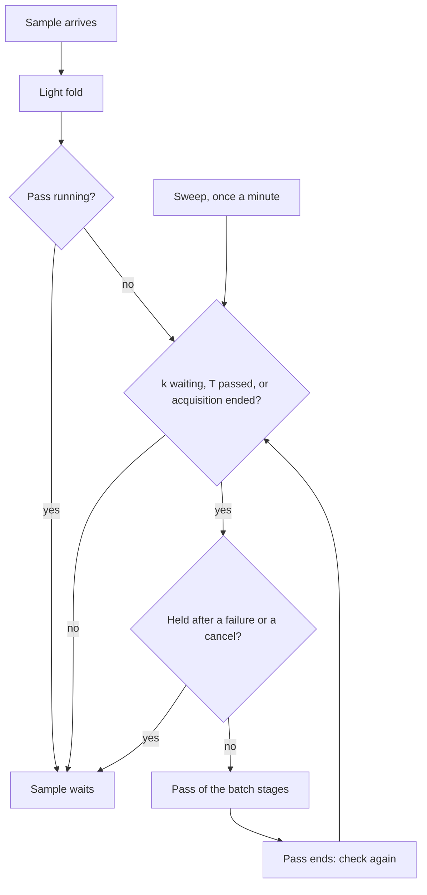

# Assignment performance: folding a sample in and assigning a batch

- **Status:** building
- **As of:** 2026-11-24
- **Tracked in:** [Assignment quality plan](https://linear.app/ultra-trace/project/assignment-quality-plan-553f4854192c)
  (Linear, MAS-1179 the measurement; the fold-in design was the Decision
  MAS-1187, decided 2026-11-24, and is section 8, MAS-1224, with its steps
  MAS-1231 to MAS-1233 and the Decision MAS-1230 on its defaults; the
  findings are GitHub issues, section 6)
- **What:** What peak assignment's two uses cost on the demo's largest batch, where the
  time goes down to the functions, what one arrival changes, and the design for
  folding samples in during continuous acquisition: a light fold on arrival and
  a pass of the batch stages deferred.

## 1. The two uses

Assignment is used two ways, and they ask different things of its speed.

1. **Fold-in, during continuous acquisition.** A sample arrives, ingest folds
   it into a batch that already has its batch peaks and decisions, and the
   batch stages bring the batch back to consistent. It has to finish before
   the next sample arrives, and must not grow without bound as the batch
   grows. **The bar (the owner, 2026-11-23): one sample folded in, everything
   included, in 20 s is the goal and 30 s is acceptable.**
2. **Whole batch, retrospectively.** The user presses **Assign batch** and
   comes back when it is done. Minutes are acceptable; it has to finish, show
   progress and scale sanely with the batch. No bar: faster is better.

What "everything included" means today: ingest folds the sample without a
run (`service.auto_assign_sample_peaks` -> `batch_fold.fold_sample_peaks_without_run`,
the default `peak_assignment_ingest_ledger = "batch"`). The fold marks every
batch stage stale (`batch_staleness.mark_every_stage_stale`), so the batch is
consistent again only after a pass of all nine stages
(`batch_stages.assign_batch`). Nothing starts that pass on its own today:
the user presses **Assign batch**, or the batch stays stale.

## 2. Method

`tooling/assignment_perf/perf.py` (its README has the recipe) runs both uses
in one process with the backend's code, against a copy of the public demo
dataset, on the demo's largest batch: the uronium batch, 81 samples. A batch
of N is its first N samples in acquisition order; the others wait in a
holding batch, and an arrival moves the next one in.

- **Whole batch at N:** `assign_batch(fold="always")` on a copy with nothing
  assigned: every sample folded without a run, then the nine stages.
- **Fold-in at N:** on the copy the whole batch left, the sample N+1 arrives
  as ingest folds it, then the pass that brings the batch back to
  consistent (`assign_batch()`, which runs from the first stale stage, here
  every stage).
- **Arrivals:** from a batch of 4 made consistent, arrivals one after
  another in three copies: a pass after every arrival (5 arrivals), after
  every 5th and after the 16th (16 arrivals); and in a fourth, 47 arrivals
  with the fold alone. The box's load cut the first and the last short.

Per step, stage, judging and pipeline stage it records the wall time, the
CPU time beside it (CPU over wall is the cores busy), the SQL time and
statement count with the reads that repeat an earlier read of the same
span, and the process's peak memory. A py-spy profile of each second run
(`profile_report.py`) names the functions.

**The box.** The agent box, 12 cores (24 threads), shared with other workers;
develop at `0ffcef511`. The runs went side by side, at a load of
7 to 47 on the 12 cores. Above 12, two runs share a core, and every
number here is about a third to a half higher than on an idle box: the same
N = 4 pass took 372 s at load 7 and 569 s at load 14, its CPU time rising
with it. Shares, ratios and growth with N hold either way; seconds are
upper bounds.

### 2.1 Repeat agreement, per step

The brief asks that two runs in a row agree within 10 % per step. Two pairs
were run one after the other at N = 4, each fold-in in its own copy of the
same consistent batch, and both meet it:

| pair | build | load | arrival fold | pass | stages over 2 s | ledgers |
| -- | -- | -- | -- | -- | -- | -- |
| the reviewer's, round 1 | the branch's base then | 15, 12 | 18.1 / 17.9 s (0.9 %) | 263.3 / 262.8 s (0.2 %) | all within 6 % | 0 members differ |
| round 2 | develop of round 2 | 10, 7 | 9.2 / 8.7 s (4.5 %) | 99.6 / 97.0 s (2.6 %) | all within 3.7 % | 0 members differ |

The pairs of sections 3 and 4 ran side by side instead, two copies at once
under different loads, the second under py-spy. Their totals agree within
0.2 to 7 %, but per step they miss the bar where the load moved between
them:

| pair, side by side | load | arrival fold | pass | stages over 2 s and over 10 % apart |
| -- | -- | -- | -- | -- |
| fold-in, N = 4 | 12, 24 | 16.9 / 21.3 s (20.5 %) | 5.8 % | series 14 %, co-variation 40 % |
| fold-in, N = 20 | 47, 40 | 26.7 / 28.2 s (5.2 %) | 2.4 % | five of the cheap ones (water ladders, known species, co-variation, ratio stability, checks), 12 to 35 % |
| fold-in, N = 40 | 26, 17 | 25.6 / 23.2 s (9.5 %) | 3.8 % | known species 24 %, series 12 %, two cheap ones |
| fold-in, N = 80 | 10, 19 | 17.5 / 26.5 s (34 %) | 2.3 % | known species 33 %, three cheap ones |
| whole, N = 4 | 7, 14 | - | 34.6 % | every costly stage, 21 to 50 % |
| whole, N = 20 | 12, 15 | - | 4.7 % | fold 23 %, known species 20 %, co-variation 22 % |
| whole, N = 40 | 12, 15 | - | 0.3 % | fold 14 %, known species 21 %, series 10 %, five cheap ones |
| whole, N = 80 | 13, 15 | - | 0.2 % | four cheap ones, 17 to 42 % |

So the script repeats to within a few per cent when the box's load holds.
The side-by-side pairs' per-step spread is the load's, and it is largest on
the short steps: the arrival fold, and stages of a few seconds. The
fold-in's ranking in section 6 rests on the pass, which agrees within 6 %
in every pair; the arrival fold is quoted as its range, 17 to 28 s.

The two pairs ran on newer builds than the note's `0ffcef511`. Both have
MAS-1172 (#3483), and the round-2 develop four changes more, one of them on
the settings a batch's sample runs read. The round-2 pass took 100 s where
the reviewer's took 263 s at a like load, and its whole pass at N = 4 took
151 s against 372 s at load 7. What made the difference was not measured
apart, so the note's numbers stay those of `0ffcef511`; measuring the curve
again on today's develop is [#3519](https://github.com/ultra-trace-systems/mascope/issues/3519).

## 3. Fold-in

One sample arrives into a batch of N that a pass left consistent: its fold
as ingest does it, then the pass that makes the batch consistent again. Two
runs per N, in separate copies, side by side (run 2 under py-spy):

| N | run | load | arrival fold | pass | total | judgings | SQL | cores | peak memory |
| -- | -- | -- | -- | -- | -- | -- | -- | -- | -- |
| 4 | 1 | 12 | 16.9 s | 294 s | **311 s** | 11 | 11 s | 0.99 | 692 MB |
| 4 | 2 | 24 | 21.3 s | 312 s | **334 s** | 11 | 11 s | 0.99 | 705 MB |
| 20 | 1 | 47 | 26.7 s | 1,333 s | **1,360 s** | 33 | 41 s | 0.96 | 1,414 MB |
| 20 | 2 | 40 | 28.2 s | 1,366 s | **1,394 s** | 33 | 41 s | 0.95 | 1,574 MB |
| 40 | 1 | 26 | 25.6 s | 2,719 s | **2,745 s** | 108 | 63 s | 1.00 | 1,775 MB |
| 40 | 2 | 17 | 23.2 s | 2,616 s | **2,639 s** | 108 | 60 s | 1.00 | 1,734 MB |
| 80 | 1 | 10 | 17.5 s | 5,355 s | **5,373 s** | 206 | 103 s | 0.99 | 2,961 MB |
| 80 | 2 | 19 | 26.5 s | 5,483 s | **5,510 s** | 206 | 109 s | 0.99 | 3,014 MB |

**Against the bar.** The 30 s line, and the 20 s goal, are crossed before
the smallest batch measured: at N = 4 one arrival costs ten times the
acceptable time, and the cost grows with N. The arrival's fold alone stays
under 30 s at every N (16.9 to 28.2 s here, and 18 to 35 s over 47 arrivals
in a row up to N = 51, flat in N; section 7.1); the pass is the cost.

**Which stages run again, and which only needed the new sample.** The fold
marks all nine stages stale, so the pass runs them all, over the whole
batch. Per stage (seconds, and the samples it judged again):

| stage | N = 4 | N = 20 | N = 40 | N = 80 | what the arrival needed of it |
| -- | -- | -- | -- | -- | -- |
| water ladders, known species | 1 s, 0 | 3 s, 0 each | 5 s, 0; 15 s, 1 | 7 s, 0; 10 s, 1 | almost nothing: one verdict moved at N = 40 and at N = 80 |
| search | 118 s, 3 | 512 s, 11 | 841 s, 25 | 1,353 s, 43 | the new sample's new peaks (32 at N = 4, 4 at N = 20, 2 at N = 40, 8 at N = 80); it searched every sample again, and 4 of 5, 20 of 21, 39 of 40 and 69 of 70 found nothing (#3505) |
| isotope lines | 62 s, 3 | 38 s, 1 | 836 s, 41 | 1,697 s, 81 | the new sample's members, and where a strip or stamp turned, the samples it turned in: every sample was judged again, for 108 isotope lines moved at N = 40 and 226 at N = 80 |
| series | 109 s, 5 | 766 s, 21 | 1,009 s, 41 | 2,268 s, 81 | few: 252 series or check records moved of 36,632 members at N = 20, 441 of 72,463 at N = 40, 803 of 142,433 at N = 80; every sample was judged again (#3504) |
| co-variation, ratio stability, checks, blends | 3 s | 9 s | 8 s | 15 s | batch-wide readings, cheap |

**What grows with N.** The judgings: the series stage judges every sample
(#3504), so its cost is N times a judging. The search searches every sample
(#3505). A judging itself costs about the same at every N (a later judging
15 s at N = 4, 25 s at N = 20 under twice the load; the readings it judges
grow 6 %). The fold grows with the members it reads (#3231), slightly here.
So a fold-in is about N judgings plus N searches: linear in N, about 67 s
for every sample already in the batch (1,360 to 1,394 s at N = 20, 2,639 to
2,745 s at N = 40, 5,373 to 5,510 s at N = 80, 1.5 hours). The two runs agree
within 2.5 % at N = 80 and at N = 20, 4 % at N = 40 and 7 % at N = 4 in
total; per step, section 2.1. Peak memory grows with N too: 3.0 GB at
N = 80, against 1.9 GB for the whole pass at the same N. About 0.2 GB of the
fold-in's figure is the script's own copy of the ledger's decisions, which
these runs held through the pass (233 MB of resident memory to load the
N = 80 one, against 31 MB without it); the backend's own peak is about
2.8 GB. The script now writes that copy to disk while the pass runs.

## 4. Whole batch

**Assign batch** from nothing on a batch of N: every sample folded without
a run, then the nine stages.

| N | run | load | fold | stages | total | per sample | judgings | of the time judging | SQL | cores | peak memory |
| -- | -- | -- | -- | -- | -- | -- | -- | -- | -- | -- | -- |
| 4 | 1 | 7 | 47 s | 325 s | **372 s** | 93 s | 16 | 56 % | 7 s | 1.03 | 651 MB |
| 4 | 2 | 14 | 62 s | 507 s | **569 s** | 142 s | 16 | 60 % | 9 s | 0.93 | 759 MB |
| 4 | 3 | 13 | 57 s | 515 s | **572 s** | 143 s | 16 | 60 % | 9 s | 0.93 | 775 MB |
| 20 | 1 | 12 | 287 s | 2,466 s | **2,753 s** | 138 s | 78 | 63 % | 34 s | 0.97 | 1,406 MB |
| 20 | 2 | 15 | 373 s | 2,514 s | **2,887 s** | 144 s | 78 | 64 % | 36 s | 0.96 | 1,292 MB |
| 40 | 1 | 12 | 607 s | 4,994 s | **5,601 s** | 140 s | 153 | 65 % | 63 s | 0.97 | 1,524 MB |
| 40 | 2 | 15 | 702 s | 4,915 s | **5,617 s** | 140 s | 153 | 62 % | 67 s | 0.96 | 1,585 MB |
| 80 | 1 | 13 | 1,237 s | 8,170 s | **9,407 s** | 118 s | 311 | 59 % | 108 s | 0.98 | 1,919 MB |
| 80 | 2 | 15 | 1,331 s | 8,099 s | **9,429 s** | 118 s | 311 | 58 % | 109 s | 0.97 | 1,958 MB |

Per stage, run 1 (seconds, samples judged):

| stage | N = 4 | N = 20 | N = 40 | N = 80 |
| -- | -- | -- | -- | -- |
| fold (every sample, without a run) | 47 | 287 | 607 | 1,237 |
| known species | 22, 4 | 129, 18 | 308, 33 | 598, 71 |
| search | 163, 4 | 1,083, 20 | 2,221, 40 | 4,382, 80 |
| isotope lines | 59, 4 | 520, 20 | 1,043, 40 | 1,553, 80 |
| series | 76, 4 | 723, 20 | 1,405, 40 | 1,622, 80 |
| the other five | 4 | 10 | 17 | 15 |

**How it grows.** Linear in N: 138 to 144 s a sample at N = 4 (under like
load), 20 and 40, and 93 s a sample at N = 4 on a quieter box (load 7). The
two runs at N = 80 agree within 0.2 %, at N = 40 within 0.3 %, at N = 20
within 5 %. Every stage
grows in step with N; none grows faster. At N = 80 the pass took 2.6 hours,
118 s a sample, the box's load having fallen during the run (from about 40
to 10).

**A sample judged more than once.** Each sample is judged about four times
in a pass: after known species (cheap, few members), after the search,
after the isotope lines and after the series. Judging is 56 to 64 % of
the pass; the three later judgings of a sample, each of every member, are
50 to 56 % of it (1,536 s of 2,753 at N = 20). MAS-1172 (#3483, in
flight) makes a later judging cheaper.

**Against PR #3484's 52 minutes.** That pass and this one start from different
places, and the difference is the search. PR #3484 timed a pass from the water
ladders over the 81 samples after each had its own engine run (35 minutes of
runs before it, not in the 52), so each sample's untargeted search had been
done by its run and the batch search had two samples left: 136 s. Assign
batch from nothing has no runs: its fold stands in for them (1,237 s at
N = 80) and the batch search does every sample's (4,382 s). The stages the
two share agree within the box's load: known species, isotope lines, series
and the rest took 3,788 s here and 2,979 s there, 27 % more under a load of
10 to 40. In all, from nothing to a consistent batch: 2.6 hours here, about
1.5 hours there counting its runs.

## 5. Where the time goes, both uses

A py-spy profile of each second run (`profile_report.py`), counted over
every thread's busy samples: since MAS-947 the engine's steps run in
`to_thread` workers while the event loop waits. Shares of the busy time
(py-spy under this load misses some samples, so its seconds run short of the
timed ones; the shares hold):

| | fold-in, N = 4 | whole batch, N = 4 | whole batch, N = 20 | whole batch, N = 80 | fold-in, N = 80 |
| -- | -- | -- | -- | -- | -- |
| `line_model.resolve_lines`, all callers | 50.0 % | 50.8 % | 51.8 % | 50.1 % | 55.0 % |
| the tiering caps' envelopes (`tiering.predicted_envelope`, under `Judging.cap`), mostly `resolve_lines` | 37.4 % | 39.6 % | 41.4 % | 37.8 % | 44.5 % |
| the target library's lines at the file (`target_ions_compute.lines_at_file`, in propose), mostly `resolve_lines` | 18.4 % | 16.9 % | 17.2 % | 18.3 % | 17.9 % |
| the election (`engine.invert_matches_to_peak_assignments`) | 9.0 % | 10.7 % | 12.7 % | 13.6 % | 9.6 % |
| pandas row access (`.loc`/`.iloc` on rows, `iterrows`, `apply` by row) | 3.2 % | 3.7 % | 4.5 % | 4.5 % | 3.6 % |
| the rest of pandas | 9.6 % | 10.6 % | 11.9 % | 13.0 % | 9.1 % |
| SQL (driver and SQLAlchemy) | 4.6 % | 2.4 % | 2.3 % | 2.1 % | 2.7 % |
| cores busy on average | 0.98 | 0.99 | 0.99 | 0.99 | 0.99 |

The answers to the brief's three questions:

- **Reading the same thing from the database again** is not where the time
  goes. SQL is 2 to 5 % of a pass; the reads that repeat an earlier read of
  the same step, same statement and same parameters, are about half of that
  (16.6 s of 33.6 s in the whole pass at N = 20): under 1 % of the pass.
- **pandas row access** is 3 to 5 %, most of it in the election
  (`engine.monoisotopic_row`, `invert_matches_to_peak_assignments`), which
  #3483 takes up.
- **One core works while the others stand idle.** Every run keeps one core
  busy, 0.93 to 1.03 cores on average: the pass does one sample at a time,
  and the engine's steps go to one worker thread at a time. On the 12-core
  box, 11 stand idle for the length of a pass.

Half of all the time is one library function, `resolve_lines`, which turns
an ion's fine structure into the lines a file shows: pure Python per line
(`group_unresolved_lines`, `_line_of`). Its two callers are #3483's (the
caps predict each ion's envelope again in every round) and #3500's (the
library's lines resolved anew for every sample). Those issues call it
less; making each call cheaper is a finding of its own (section 6).

**The single run's first judging (10 to 15 s).** In a pass the first
judging of a sample is the known-species stage's, and it is cheap here,
5 to 8 s, because the stage wrote few members (median 5 to 7 judged). The
expensive judgings are the later ones, after the search, the isotope lines
and the series, which judge about 1,150 members over about 1,300 readings:
median 15 s at N = 4 and 25 s at N = 20, of it the caps 8 to 15 s, the
election 4 to 6 s, propose 2 to 3 s, the score 0.3 to 0.8 s (the kept
measurement of MAS-1073). A fold-in's first judging of the new sample, which
scores every reading, took 23.5 s at N = 4: caps 11 s, score 5 s, election
4.5 s, propose 2 s. #3500 has the first judging, #3483 the later ones.

## 6. Findings, ranked

Each finding with its measurement, the code, and a first guess at the fix
and its size, in its GitHub issue. Ranked by the seconds it would save,
fold-in first: the fold-in at N = 20 (1,360 s, load 47) and the whole batch
at N = 20 (2,753 s, load 12). The estimates are upper bounds on what each
removes, taken from the measured spans; several act on the same time, so
the fold-in column takes them in order, each on what the ones above left.

**Fold-in**, against 30 s and then 20 s:

| rank | finding | what it removes at N = 20 | fold-in after it and the ranks above it | low-hanging |
| -- | -- | -- | -- | -- |
| 1 | Not running the batch stages on every arrival: the design choice of section 7, MAS-1187 (Decision) | the pass, 1,333 s | the fold alone, 27 s here and 18 to 35 s over 47 arrivals: **under 30 s at every N measured, about the 20 s goal on a quieter box** (16.9 s at load 12) | a decision, then a brief |
| 2 | [#3504](https://github.com/ultra-trace-systems/mascope/issues/3504) the series stage judges every sample again, its records rewritten with the pass's version | most of the series stage's 596 s of judging | about 760 s | yes, S |
| 3 | [#3506](https://github.com/ultra-trace-systems/mascope/issues/3506) `resolve_lines` is half the CPU, pure Python per line | a quarter of what is left if made 2x faster (half of the half it takes) | about 570 s | M |
| 4 | [#3505](https://github.com/ultra-trace-systems/mascope/issues/3505) the search searches again what the last pass searched and found nothing for | the search's own 164 s, but the new sample's | about 410 s | yes, S to M |
| 5 | [#3507](https://github.com/ultra-trace-systems/mascope/issues/3507) a pass runs on one core | with 4 workers, three quarters of the per-sample work | about 100 s | M to L |
| - | already filed: [#3483](https://github.com/ultra-trace-systems/mascope/issues/3483) (MAS-1172, merged since these runs) a later judging's caps and election, [#3500](https://github.com/ultra-trace-systems/mascope/issues/3500) a first judging's lines and fits, [#3231](https://github.com/ultra-trace-systems/mascope/issues/3231) the fold reads every member it joins, [#3468](https://github.com/ultra-trace-systems/mascope/issues/3468) (MAS-1161) worker threads hold the loop, [#3488](https://github.com/ultra-trace-systems/mascope/issues/3488) the kept measurement's memory | the judgings' caps, 40 % of the CPU (#3483); the first judging (#3500) | | |

Even with ranks 2 to 5 together, a full pass on every arrival stays over
30 s at N = 20, and it still grows with N: the stages are batch-wide by
nature (section 7.2). Only rank 1 brings a fold-in under the bar.

**Whole batch**, faster is better:

| rank | finding | what it removes at N = 20 |
| -- | -- | -- |
| 1 | [#3507](https://github.com/ultra-trace-systems/mascope/issues/3507) one core | with k workers, up to (k-1)/k of the fold, the search and the judgings, nearly all of the pass |
| 2 | [#3506](https://github.com/ultra-trace-systems/mascope/issues/3506) `resolve_lines` | half of 52 % of the CPU if made 2x faster: about 700 s |
| 3 | [#3483](https://github.com/ultra-trace-systems/mascope/issues/3483) the later judgings (filed) | of the 1,536 s of later judgings, the caps' part, about 60 % |
| 4 | [#3500](https://github.com/ultra-trace-systems/mascope/issues/3500) the first judging (filed) | the fold's and the first judging's lines at the file |

#3504 and #3505 do not act on a pass from nothing: there, every record is
new and nothing was searched before.

**Not findings.** SQL is 2 to 5 % of a pass, and the reads that repeat an
earlier read are under 1 %: reading the same thing again from the database
is not worth an issue. pandas row access is 3 to 5 %, inside the election,
which #3483 covers. Peak memory grows with N: 0.7 GB at N = 4, 1.4 GB at
N = 20, 1.5 to 1.6 GB at N = 40 in a whole pass and 1.8 GB in a fold-in, 1.9 to 2.0 GB at N = 80 in a whole pass and 3.0 GB in a fold-in
(about 2.8 GB without the script's copy of the ledger, section 3);
#3488 holds the kept measurement's share of it.

## 7. Fold-in as a design question

With a sample about once a minute, back-to-back samples mostly carry the
same assignments. It may not be right to run every batch stage on every
arrival. This section measures what that choice needs to know and lays out
the options; the choice was the owner's (MAS-1187 (Decision)). Decided on
2026-11-24: (d), the mix. Section 8 is the design.

### 7.1 How much one arrival changes

The batch's samples one at a time, in acquisition order, from a batch of 4
made consistent by a pass. "Decided" is a batch peak with a consensus
formula before the arrival.

**Where an arrival's peaks land**, with the fold alone after each arrival
(47 arrivals, the batch growing from 5 to 51 samples):

| batch size | arrivals | peaks per arrival | on a decided batch peak | on an undecided one | new batch peaks |
| -- | -- | -- | -- | -- | -- |
| 5 to 9 | 5 | 1,969 | 83.2 % | 8.0 % | 8.8 % (median 83) |
| 10 to 19 | 10 | 1,828 | 89.0 % | 10.4 % | 0.6 % (median 8) |
| 20 to 34 | 15 | 1,793 | 91.5 % | 8.2 % | 0.3 % (median 4) |
| 35 to 51 | 17 | 1,775 | 92.3 % | 7.5 % | 0.2 % (median 4) |

Past the first ten samples, an arrival brings a handful of peaks the batch
has not seen, and nine in ten of its peaks land on a batch peak whose
formula is already decided. The fold alone took 21.6 s (median; 18 to 35 s)
and did not grow with the batch.

**What the full stages change**, with a pass after every arrival: the
members the batch held before the arrival whose decision differs after its
fold and pass.

| arrival | batch size | members before | changed | consensus formula | tier | isotope line | series and records |
| -- | -- | -- | -- | -- | -- | -- | -- |
| 1 | 5 | 6,694 | 201 (3.0 %) | 3 | 89 | 2 | 156 |
| 2 | 6 | 8,363 | 251 (3.0 %) | 6 | 141 | 5 | 166 |
| 3 | 7 | 10,091 | 502 (5.0 %) | 16 | 184 | 7 | 405 |
| 4 | 8 | 12,287 | 484 (3.9 %) | 23 | 234 | 14 | 336 |
| 5 | 9 | 14,524 | 539 (3.7 %) | 32 | 347 | 34 | 307 |
| fold-in at N = 20 | 21 | 36,632 | 549 (1.5 %) | 0 | 387 | 0 | 252 |
| fold-in at N = 40 | 41 | 72,463 | 558 (0.8 %) | 108 | 279 | 108 | 441 |
| fold-in at N = 80 | 81 | 142,433 | 932 (0.7 %) | 226 | 355 | 226 | 803 |

**What a count includes.** A member's decision is its tier, role and
candidate, and its batch peak's consensus formula and ion, consensus and
engine tier, isotope line, role and records. Of the records, the series,
the batch checks, the stamped lines, the known-species claim, the water
ladder and the merged lines count by their words and flags (a verdict, a
reason, `stamped`, `claimed`, a unit), and the first three also by their
top-level counts. The numbers each sample read moves (an r, a ppm, a
share, the files holding a species) are left out, and so are the
co-variation and the flat-series flag, readings shown and never acted on.
The rows above were counted before the digest read the known-species,
water-ladder and merged-line records and the verdicts nested in the checks
and the predicted lines. The ledgers before each arrival are gone, so they
were not counted again, and they run short by those. At the 16th arrival
of section 7.3, where both ledgers are kept, the fuller count is 997
members against 744: 121 more in the series' units, 92 in the known-species
claim, 40 in the merged lines. Arrival 1, counted again with the fuller
digest on the round-2 develop (section 2.1), changes 262 members where the
table has 201: the same 3 formulas, 89 tiers and 2 isotope lines, and 220
records against 156.

Two passes over the same batch in two copies differ in about 30 members
(0.4 %, all in the series and records): that is the noise floor. The fuller
digest leaves it where it was: the repeat pairs' kept copies differ in 145
of 38,443 members at N = 20, 122 of 74,207 at N = 40 and 268 of 144,160 at
N = 80, the same counts as before, all in the records. So an
arrival moves 0.7 to 5 % of the batch's earlier decisions, mostly tiers and
series records, and few consensus formulas. That is the share of a pass's
work the arrival needed; the pass redoes all of it.

### 7.2 What each stage needs to see

Read from the code (paths under `server/backend/src/mascope_backend/api/new/peak_assignments/`).
Every stage decides on quantities pooled over the batch's samples, and every
pass runs each stage over the whole batch. None has a path that does only the
new sample's work; three have a narrow catch-up for a new sample's members,
but it runs inside the batch-wide pass.

| stage | decides on | a new sample can change, for the others | for the new sample alone, against the standing decisions |
| -- | -- | -- | -- |
| water ladders | a rung present in half a segment's spectra and 3x its decoys, per acquisition segment | the segments, and a rung's pass in them: claims added or withdrawn elsewhere | partly: the fold claims a passed rung for a sample inside a passed segment; a re-cut segment or a flipped rung needs the pass (`run_batch_water_ladders`) |
| known species | present in 2 or more files and half the partition's files, the vote | the verdict for species the new sample lacks, so claims everywhere | partly: the fold takes a present species on the batch's word; a flipped verdict needs the pass (`plan_batch`) |
| search | the unassigned anchors; the persistence split over every anchor's share of spectra; the brightest member | the split, so admission anywhere; the representative; a new anchor to search | yes for anchors already searched (`_readings_to_measure_again` proposes the standing reading); every still-unassigned anchor is searched again each pass |
| isotope lines, strip | the median intensity share over 3 or more samples, the mass scatter, the majority | the median, the window, the majority: a row stripped or held, a parent changed | partly: `strip_again` handles new members of rows already stripped |
| isotope lines, stamp | a track stamped where the ratio holds in a large enough share of samples | track verdicts, stamps elsewhere | not today; the per-sample judgement is separable, the share is not |
| series | a walk over every assigned and target anchor, decoy enrichment | families committed or not, records on or off | not today; a member that already reads the formula is skipped (`_takes_the_member`) |
| co-variation | Pearson r over shared spectra after the batch's common mode is removed | every pair's r and gate | no: batch-wide by nature (a reading, display-only) |
| ratio stability | each pair's ratio series over the samples both share | every pair's grade ("every new sample moves every pair's series", `continuity.py`) | no: batch-wide by nature (a reading) |
| batch checks | halogen lock over stamped samples, label twins, neutral pairs | all three facts | no |
| probable blends | the consensus vote, persistence hold, blend tests | every anchor the new sample has a member in | the anchors it has no member in cannot change; the fold already recomputes the ones it touches |

Two facts of the code bear on the options:

- **The fold already keeps the vote current** for the anchors the new sample
  joined (`batch_peaks_controller`'s consensus recompute at the end of a
  fold). After the fold alone, the new sample's members carry the batch's
  standing decisions and the consensus counts include it.
- **A pass judges more samples than changed.** `judge_again` judges the samples
  a stage wrote in. Most stages write only what changed, but the series stage
  writes every record again with the pass's version
  (`batch_series._write_records`, `batch_stages.stamp_versions`), so
  `batch_rejudge.series_corroborated` returns every sample whose member reads a
  standing series record: every pass judges almost every sample in the
  series stage, changed or not.

### 7.3 What skipping costs

Three sequences from the same start, in three copies: a pass after every
arrival, after every 5th, and after the 16th alone. Each arrival's ledger
compared with the every-arrival one (members both hold):

| arrival | every 5th: pass here | differ from every arrival | of them tier | formula | after 16 alone: differ |
| -- | -- | -- | -- | -- | -- |
| 1 | no | 1,365 of 8,363 (16 %) | 1,222 | 23 | 1,352 |
| 2 | no | 2,706 of 10,091 (27 %) | 2,429 | 72 | 2,688 |
| 3 | no | 4,537 of 12,287 (37 %) | 3,730 | 322 | 4,525 |
| 4 | no | 6,301 of 14,524 (43 %) | 5,031 | 627 | 6,292 |
| 5 | **yes** | **572 of 16,540 (3.5 %)** | 144 | 140 | 7,825 (47 %) |

- **In between, the waiting samples' rows are provisional.** At each
  deferred pass, the members of the samples that waited for it, and the
  older members:

  | pass | waiting samples | their members changed | of them tier | formula | older members changed |
  | -- | -- | -- | -- | -- | -- |
  | every 5th, at arrival 5 (N = 9) | 5 | 5,648 of 7,830 (72 %) | 4,909 | 603 | 726 of 6,694 (11 %) |
  | every 5th, at arrival 10 (N = 14) | 5 | 4,596 of 7,469 (62 %) | 4,464 | 80 | 912 of 16,540 (6 %) |
  | once, at arrival 16 (N = 20) | 16 | 20,053 of 28,126 (71 %) | 17,054 | 2,008 | 998 of 6,694 (15 %) |
  | every 5th, at arrival 15 (N = 19) | 5 | 4,477 of 7,233 (62 %) | 4,433 | 14 | 671 of 25,806 (3 %) |

  The deferred pass costs what a fold-in's pass costs at that N (1,122 s at
  N = 9, 1,364 s at N = 14, 2,547 s at N = 20, under this load). Most of what differs between passes is the
  waiting samples' own tiers: the fold judges a sample against the batch's
  standing decisions, but the stages that would claim, strip, stamp and
  corroborate its members have not run.
- **They converge once the pass runs**, to 3.5 % of the every-arrival ledger
  at the 5th arrival, against a noise floor of 0.4 %. At the 16th arrival,
  where the every-5th and the once-at-the-end sequences have both just run a
  pass, their ledgers differ in 997 of 36,632 members (2.7 %; 965 of them in
  the records, 93 tiers, 70 formulas), read from the two kept copies with
  the fuller digest of 7.1. The table's rows were counted with the earlier
  digest and run short by the known-species claims and the merged lines. The rest is the
  order of the passes: a ledger made by fewer passes is not exactly the one
  made by more.
- **What skipping saves.** Over the 16 arrivals from N = 5 to 20, a pass
  every 5th arrival cost 4,812 s of passes (four), once at the end 2,547 s,
  against about 14,000 s for a pass on every arrival (its passes measured
  315 s at N = 5 rising to 1,333 s at N = 20).

### 7.4 The options

Four ways to fold samples in during acquisition. The costs are the
measured ones of sections 3 and 7.1 to 7.3, at the load of section 2.

| | (a) everything on every arrival, made fast | (b) a light fold on arrival, the batch stages deferred | (c) the batch stages triggered by need | (d) a mix: (b) on arrival, (c) or a count as the trigger, a full pass at the end |
| -- | -- | -- | -- | -- |
| on arrival | the fold and a pass of all nine stages | the fold alone: the sample's own judging against the batch's standing decisions, and the consensus of the batch peaks it joined | the fold, then the pass when the arrival crosses a line | the fold; the pass on a count or a need |
| cost per arrival today | 311 to 334 s at N = 4, 1,360 s at N = 20, 5,373 s at N = 80, growing linearly with N | the fold: 21.6 s median, 18 to 35 s, flat in N up to 51 | the fold, plus a pass on the arrivals that cross the line | the fold, plus a pass every k arrivals: at k = 5 and N = 20, 27 s on four arrivals and 27 s plus a 1,333 s pass on the fifth |
| what it takes to meet 30 s | every finding of section 6 together, and the pass's cost no longer growing with N; not in reach with all of them at N = 20 | met today at every N measured | met on the arrivals that do not cross the line | met on the arrivals between passes |
| what the user sees | the ledger current after every arrival | the new sample's rows with the batch's standing decisions; the batch-wide readings (series, co-variation, ratio stability, checks, blends) as of the last pass | as (b), with a pass when it matters | as (b) |
| what it needs to decide | nothing new | when to run the pass: a timer, a count of arrivals, the end of acquisition (a sequence's last file, or the instrument idle) | a measure of need: new peaks, peaks on undecided batch peaks, tiers the fold moved, past a share | both |

**The state in between, for (b) to (d).** After a light fold a sample's
members carry the batch's standing decisions: each joined batch peak's
consensus is recomputed with the new member (section 7.2), and the sample's
tiers are what its own judging gives against them. What the sample does not
have yet is what only the batch stages decide: the claims a changed
known-species or water-ladder verdict would make, a search of its new peaks,
its isotope strips and stamps, its series records, and the batch-wide
readings. The stages are already marked stale by the fold
(`batch_stage` rows, served as the stages' standing), so the ledger has the
state to show; what it would need is to say it per sample: "folded, the
batch stages not yet run since", with the count of samples waiting, beside
the **Assign batch** control that runs the pass. A sample's rows in that
state are no different in kind from a batch whose stages are stale today.

**What the measurements say for the choice.**

- One arrival moves 0.7 to 5 % of the batch's earlier decisions (7.1), but
  a full pass redoes the whole batch to find them, and it costs ten to 180
  times the bar (section 3). The findings of section 6 together do not
  bring it under 30 s at N = 20.
- The light fold meets the bar at every N measured, and nine in ten of an
  arrival's peaks land on a decided batch peak. But the waiting samples'
  rows are provisional: the next pass moves 72 % of their members' decisions,
  most of them tiers (7.3). A ledger that shows them as final would be
  wrong for a while.
- Deferred passes converge: after the pass the ledger is within 3.5 % of the
  every-arrival one.

The choice was the owner's: MAS-1187 (Decision), decided on 2026-11-24 for
(d). Section 8 is the design.

## 8. The design: a light fold on arrival, the batch stages deferred

The owner chose (d) on 2026-11-24 (MAS-1187): a light fold on arrival, so
acquisition never falls behind, with the bar at 20 s the goal and 30 s
acceptable at any batch size. A pass of the batch stages starts on its own on
a count of arrivals or a timer, and always at the end of acquisition. The
samples folded since the last pass are shown as provisional until it runs. A
trigger by need, (c), is not built now; it can come later as one more
trigger. This section is that design, read from the code as it is on
develop and from the data of section 7. It builds nothing; its steps are
8.8.

Paths below are under `server/backend/src/mascope_backend/api/new/peak_assignments/`
unless they say otherwise.

### 8.1 The light fold

**The light fold is today's ingest fold, unchanged.** It is the arrival's
part of section 3's fold-in, without the pass a person had to press. What
runs on arrival, in order:

1. Matching, as for every sample (`match_compute_sample`, in
   `api/controllers/sample/files/process/service.py`).
2. The fold (`service.auto_assign_sample_peaks` ->
   `batch_fold.fold_sample_peaks_without_run`): the INGEST_FOLD path of
   `pipeline.py`. The pre-passes, Stage A on the known set, the judging
   rounds, the tiering rules and the identification level run as for a run
   of the sample with the untargeted search off.
3. The sample's rows become members of its batch's batch peaks
   (`batch_fold.keep_fold` -> `fold_sample_into_batch_peaks`). The consensus
   of every batch peak it joined is recomputed with it
   (`batch_peaks_controller`).
4. The model the fold scored at is kept for the sample
   (`model_readers.record_sample_model`).
5. Every batch stage is marked stale, reason `fold`
   (`batch_peaks_controller.py`, `batch_staleness.mark_every_stage_stale`),
   in the fold's own transaction under the batch's fold lock. A stage that
   is running keeps running, and ends stale (`batch_stages.finish_stage`).

It costs 21.6 s median, 18 to 35 s over 47 arrivals, flat in N (7.1).

**What does not run on arrival.** None of the nine stages. No untargeted
search of the sample's own peaks: ingest runs with `run_untargeted=False`,
and its new batch peaks wait for the batch search. No per-sample run row
under the default `peak_assignment_ingest_ledger = "batch"`. Nothing that
runs on arrival today stops running: the change is what runs after it.

**What marks the stages stale** stays the fold's mark. The batch's
assignment status already reads a fold's mark as no reason of its own where
`new_samples` explains it (`batch_assignment_status.stale_reason`), so the
status says *N samples added since the last assignment*, not *stages stale*.

### 8.2 A provisional sample

A sample is **provisional** from its fold until a pass covers it: it is
folded, in the batch, and not in the newest completed pass's `samples`
(`batch_stages.last_pass`, which records the samples a pass read as it
started). These are the **waiting** samples. The per-sample state and the
batch's count are read from this one set, so they can never disagree. A
failed or cancelled pass covers nothing.

**Folded** means the sample has a kept model (`sample_measurement_model`,
written by every run-less fold: `batch_fold.keep_fold` on ingest and the
ledger's rebuild) or a completed run of its own (`peak_assignment_run`,
status `completed`, which the `sample` ingest ledger and an explicit run
write, and which folds its rows into the batch peaks on completion). One
query against the batch's samples reads it.

**A sample that was never folded** is not waiting and not provisional. The
status read's `new_samples` holds it too, but the waiting set leaves it
out. Four ways lead there:

- the ingest peak ceiling skipped it (`peak_assignment_ingest_max_peaks`,
  in `service.auto_assign_sample_peaks`);
- its fold raised, which that function logs and swallows;
- it was ingested with `peak_assignment_on_ingest` off;
- the engine refuses it: `sample_inputs.ineligible_reason` gives a reason,
  and `batch_fold._fold_sample_peaks_without_run` logs it and writes
  nothing. The reason is a blank (`instrument_function_id` is None, as the
  converter records blanks on ingest) or an m/z calibration that is not
  verified (ingest records one when a calibration is withheld or fails).
  Both land in acquisition batches as a matter of course.

The first three can be folded by a person; the fourth cannot. A run of its
own is refused on the same check (the per-sample route answers 422 with
`SAMPLE_INELIGIBLE_CODE`), and **Assign batch** with `fold="always"` skips
it again in `backfill_sample_batch_peaks`. So the design names the two
kinds apart: **not folded** (the first three) and **refused** (the
fourth).

A pass does not fold it either: `fold="auto"` folds only on
`batch_stages.fold_reasons`, which looks at the batch, never at a sample
without members. The pass still records it in `samples`. So "covered by a
pass" alone would call it decided while it has no rows. The design keeps
the two apart:

- it does not count toward k, and does not start the timer (8.3);
- a pass started on its own does not fold it, as a person's **Assign
  batch** does not today: the ceiling skipped it on purpose, a fold that
  raised would likely raise again in the pass, and with ingest off the
  trigger is off (8.3);
- it carries words of its own, before and after a pass (8.6). A sample not
  folded reads *Not folded on arrival*, with the two ways to fold it a
  person has today: a run of its own, or **Assign batch** with every sample
  folded (`fold="always"`). A refused sample reads its reason and no remedy
  that would not work: *Blank sample: no peaks to assign*, or *m/z
  calibration not verified: recalibrate the sample, or accept its fit, to
  assign it*. Once its
  calibration is verified (a recalibration, or an operator's acceptance
  of a fit under `quality_gate: "enforce"`) it is an ordinary not-folded sample, and the two
  ways reach it;
- the batch's *N not folded* counts the not-folded samples only, the ones
  a person can act on. Refused samples are left out of every count: a blank
  is expected in an acquisition batch, and its own sample says why it has
  no rows.

What its rows carry, against what the batch will say after the pass:

| reading | on a provisional sample | the batch's word? |
| -- | -- | -- |
| the formula of a batch peak it joined | the consensus, recomputed with its member (8.1, step 3) | yes, as of now |
| known species and water ladders | the fold takes a species present and a passed rung on the batch's standing verdict (7.2) | yes for the standing verdicts; a verdict the sample would flip waits for the pass |
| its tier | its own judging against the batch's standing decisions | **no**: the claims, strips, stamps and corroborations a pass judges it under have not run. The pass after five light folds moved 62 to 72 % of the waiting members' decisions, most of them tiers (7.3) |
| series corroboration | none judged for its members | **no** |
| isotope lines | not stripped or stamped for it (`strip_again`, the stamp) | **no** |
| its new batch peaks (about 4 an arrival past ten samples, 7.1) | unassigned, not searched | **no** |
| co-variation, ratio stability, batch checks, probable blends | as of the last pass, without it | **no**: readings of the batch |

The older samples are not provisional, but a pass moves some of their
decisions too: 3 to 15 % after a deferred pass (7.3). The batch's status
covers that (*behind*); marking every member of a batch provisional would
say nothing.

### 8.3 The triggers

A pass starts on its own when the first of three things holds.

- **The count.** k samples are waiting (8.2: folded and not covered).
- **The timer.** The oldest waiting sample has waited T minutes, read off
  `SampleItem.sample_item_utc_created`. It bounds how long a sample stays
  provisional when samples come slowly.
- **The end of acquisition**, the first of: the newest waiting sample's file
  carries an acquisition record whose sequence does not loop and whose step
  is the last one (`SampleFile.acquisition`; `Sequence.loop` and
  `step_index` in `libraries/sdk/src/mascope_sdk/acquisition.py`); a newer
  file of the same instrument went to another batch; or no sample has
  arrived for Q minutes, the quiet period. An acquisition batch is one day
  of one mode (`acquisition_batch_name` in `process/service.py`), so the
  second catches the day's turn at the instrument's midnight and a change of
  mode. The quiet period catches the rest: a looping sequence stopped, an
  instrument switched off. Most acquisition loops, so the first is rare.

**Where the count lives: nowhere new.** It is the size of the waiting set
(8.2), read from what the last pass recorded and the batch's samples
(`batch_stages.batch_samples`), one query each. No counter is stored, so it
survives a restart, two workers read the same number, and any pass that
completes resets it, whoever started it. A batch with no completed pass yet
has every sample waiting: its first pass starts on its k-th sample, and the
status reads `folded_only` until then.

**Which batches.** Only ACQUISITION batches: ingest folds into those alone.
Only with peak assignment on, and on at ingest
(`config.peak_assignment_enabled`, `peak_assignment_on_ingest`). **Both
ingest ledgers** (`peak_assignment_ingest_ledger`): on `batch`, the fold
writes members and no run; on `sample`, `assign_sample_peaks` writes a run
and folds it into the batch peaks on completion (the comment in
`auto_assign_sample_peaks`). Either way the batch's stages go stale the same
way, through `fold_sample_into_batch_peaks`, and the sample is folded in
8.2's sense. A trigger on one ledger only would leave the other's batches
stale until a person presses **Assign batch**, for no reason the ledger
gives.

**Where it is checked.** After each fold commits, in the worker that folded
the sample. And by a sweep in every worker's lifespan (`app/fast.py`), once a
minute, over the batches with a waiting sample: the timer and the quiet
period fire when nothing arrives, so an arrival cannot be what checks them.
There is no scheduler in the backend today; the sweep is the smallest one.

**The pass it starts** is the pass a person starts: `batch_stages.assign_batch`
with `fold="auto"`, on the batch's own settings, action `assign`, so the
status, Details and Run history read it as a pass with no change. Its run
records why it started (`trigger`: `count`, `timer` or `end`, and the count
it saw) and no user. It runs as a task of the worker, in a set of its own
in the trigger's module, observed as the ingest pipelines' tasks are
(`_observe_background_task` in `process/service.py`), but **not in
`_background_tasks`**. That set is the one `drain_auto_process_tasks` waits
on at shutdown, for up to `AUTO_PROCESS_DRAIN_TIMEOUT_S` (60 s), before it
cancels what is left. A pass kept there would hold every deploy for that
minute and then be cancelled anyway. The lifespan (`app/fast.py`) cancels
the auto passes' set at once instead, before the drain (8.7).

**An arrival during a pass** folds as it does today, under the fold lock;
the pass reads unlocked and writes under the lock. The pass recorded its
samples as it started, so the arrival stays waiting, and the stages it
marked stale end stale. When the pass ends, the rule is checked again at
once. While samples come faster than a pass, the passes run back to back,
and the number waiting is the pass's length over the arrival interval, not
k.

**A person's Assign batch always works**, as it does today, and covers every
waiting sample, so the count resets when it completes. The trigger never
refuses it or waits for it. While a pass runs, whoever started it, a person's
press is refused with 409, as it is today (`batch_runs.start_run`); the
running pass covers what waited when it started, and the next starts on its
own when it ends if the rule holds.

### 8.4 The defaults, and what the data says

The data of section 7 does not settle the defaults. What it says:

- **The count barely moves where the ledger ends up.** After a pass at
  every 5th arrival, the ledger is within 3.5 % of the one a pass after every
  arrival makes; at the 16th arrival, a pass every 5th and one single pass
  leave ledgers 2.7 % apart, against a floor of 0.2 to 0.4 % between two
  identical passes (7.3).
- **The count sets how many samples are provisional, and the cost.** Over
  the 16 arrivals from N = 5 to 20, passes at every 5th arrival cost 4,812 s,
  one pass at the end 2,547 s, a pass after every arrival about 14,000 s.
- **During fast acquisition the count does not bite.** A pass at N = 20
  took 1,333 s on the measured build. MAS-1172 (#3483) has merged since, and
  cut the N = 4 pass from 263 s to 100 s (2.1); the curve over N was not
  measured again (#3519). MAS-1188 (#3504) saves nothing in a fold-in: every
  arrival moves series corroborations in every sample (MAS-1229). MAS-1189
  (#3505) saves at most the search's 164 s at N = 20. So a pass at N = 20
  likely takes 500 to 1,300 s on today's develop, and with a sample once a
  minute, 8 to 22 samples arrive during one pass.
- **Nothing was measured for the timer or the quiet period:** no site's
  arrival intervals.

**Proposed:** k = 5, the one cadence measured, which converged; T = 30
minutes; Q = 15 minutes; on wherever peak assignment is on at ingest. The
choice is the owner's: MAS-1230 (Decision), which lists a larger k and a
measurement first as the other options. What would settle the numbers:
#3519, the pass's curve on today's develop; an arrivals run at k = 5, 10 and
20 up to N = 40, read as 7.3 reads its runs; and the arrival intervals of a
site, which only a prod job can read.

### 8.5 Where the settings live

- **The instance's, in the runtime `[meta]` config**, beside
  `peak_assignment_on_ingest` (`libraries/runtime/src/mascope_runtime/config.py`,
  read in `config.py`): on or off, k, T and Q, with MAS-1230's defaults, in
  `docs/maintaining.md`. They are the defaults because acquisition batches
  are made by ingest one a day per mode, and a setting kept only on the
  batch would have to be set again every day.
- **A batch's own, where it differs** (MAS-1233): a column of its own on the
  batch, `SampleBatch.auto_pass`, edited in **Edit assignment settings**
  (`server/frontend/src/lib/dialogs/DialogBatchAssignSettings.vue`, MAS-1017)
  and saved through the batch's PATCH. Not inside
  `SampleBatch.assignment_settings`: those are hashed (`config.settings_hash`),
  and a pass on another hash runs every stage from the first and reads
  *settings changed* (`batch_stages.plan_pass`,
  `batch_assignment_status.settings_reason`). When a pass runs does not change
  what it computes, so saving it must not do that.

### 8.6 What the user sees

- **On the sample** (**This sample**, `AssignmentRunBar.vue` in
  `server/frontend/src/lib/panes/PaneBrowserMatch/`): *Folded on arrival · the
  batch stages have not run since*, and when the next pass is due (*after 2
  more samples*, *by 14:30*, *when acquisition ends*). In its ledger
  (`PaneBrowserAssignment.vue`), the tier marks of its rows carry a
  provisional mark, with a tooltip that says the tier may move at the next
  pass. Served on the fold's synthetic run of the sample (`fold_view.py`) as
  `provisional` and `folded_utc`, and on a run of its own that no pass has
  covered.
- **On a sample that was never folded** (8.2): *Not folded on arrival*, in
  place of the provisional line, with the two ways to fold it: a run of its
  own, or **Assign batch** with every sample folded. It says the same after
  a pass, which does not fold it. Served as `folded: false` beside
  `provisional`.
- **On a refused sample** (8.2: a blank, or an m/z calibration not
  verified): its reason in place of the provisional line, *Blank sample: no
  peaks to assign* or *m/z calibration not verified: recalibrate the
  sample, or accept its fit, to assign it*, and neither way to fold it. Served as `folded: false` with
  `refused` set to the reason `ineligible_reason` gives, read on the status
  read, not stored.
- **On the batch** (the batch assignment status of MAS-1015,
  `BatchAssignControl.vue` and `stores/batchAssign.js`): *5 samples waiting
  for the batch stages · next pass after 5*, or *by 14:30*, and *2 not
  folded* where the batch has samples a person can fold (refused samples
  are not counted), beside **Update
  assignment**, which runs the pass now. While a pass started on its own
  runs: *Assigning on its own · 5 samples arrived*, in place of *Another user
  is assigning this batch*. When the trigger holds after a failed pass: *Held
  after a failed pass*, with **Retry**. The status read serves these in a new
  `auto_pass` block (MAS-1231).
- **In Details and Run history** (MAS-1016, `BatchAssignDetails.vue`,
  `BatchRunHistory.vue`, `batchPass.js`): a pass started on its own says
  why, *started on its own: 5 samples arrived*, or *... at the end of
  acquisition*.
- The user page is `docs/user/how-it-works/peak-assignment.md`, "Assigning
  a batch", "Where the batch stands" and "Reading the ledger".

### 8.7 What can go wrong

- **A pass fails.** It stops at a stage, keeps the stages before it and
  leaves the rest stale (MAS-983, `batch_stages.assign_batch`); the batch
  reads `failed`. The trigger holds: it starts no pass on the same samples,
  which would fail again, and starts one only when the rule holds for
  samples that arrived after the failed pass started. A person's **Retry**
  works as it does today.
- **A pass is cancelled.** By a person: the same hold, so a cancel is not
  undone a minute later. By a shutdown: a pass started on its own is
  cancelled at once, not drained: a pass can take an hour, and a deploy must
  not wait for it. `drain_auto_process_tasks` waits up to 60 s for every task
  in `_background_tasks`, rematch tasks included, so the pass is kept in a
  set of its own that the lifespan cancels before the drain (8.3), then
  waits for a bounded grace, as the drain does for what it cancels
  (`_DRAIN_CANCEL_GRACE_S`, 10 s), so its task closes its run as cancelled.
- **A sample's fold fails, or never runs.** Ingest logs it and goes on
  (`auto_assign_sample_peaks`); the ceiling and ingest off skip it on
  purpose. The sample is not folded (8.2): it does not count, it does not
  hold the trigger, the pass does not fold it, and it reads *Not folded on
  arrival* until a person folds it.
- **The engine refuses a sample** (a blank, or an m/z calibration not
  verified; `sample_inputs.ineligible_reason`). Neither the fold, nor a run
  of its own, nor `fold="always"` writes its rows. It is never folded and
  never counted (8.2); it reads its reason with no remedy, or, for the
  calibration, that a recalibration or an accepted fit lets the sample be
  assigned.
- **A restart between a fold and its pass.** Nothing is lost: the count, the
  timer's start and the quiet period are read from the database (8.3), and
  the first sweep after the start finds the batch due. A pass interrupted by
  the restart is closed by its own task as cancelled, with
  `batch_stages.INTERRUPTED_ERROR`, on a clean shutdown; on a kill, startup
  closes it as failed, with `STUCK_BATCH_RUN_ERROR`
  (`reset_running_batch_peak_runs` in
  `db/admin/peak_assignments/reset_running_runs.py`). Either way the trigger
  reads it as interrupted, not held, and the sweep starts it again once.
- **Two workers.** Each checks after its own folds and sweeps every batch.
  Two that find one batch due race on `batch_runs.start_run`, which takes
  the fold lock and refuses the second (`BatchRunInFlightException`); the
  loser stands down. Two folds in two workers already serialise on the fold
  lock.
- **A batch that never ends, or grows faster than its pass.** An acquisition
  batch ends at the instrument's midnight. Inside the day, a pass's cost
  grows with N: about 67 s for every sample already in the batch on the
  measured build (section 3). With a sample once a minute, the passes run
  back to back from about N = 10, and the waiting set grows with the pass:
  about 90 samples at N = 80 on that build. One core is then busy all day,
  and a pass at N = 80 holds about 2.8 GB in the worker that runs it. The
  findings that shorten a pass are #3507 (one core) and #3506
  (`resolve_lines`). Whether a pass should stop starting on its own past a
  size is open (8.9).
- **A person curating while passes start on their own.** A pin made during a
  pass is kept and marks the stages stale (`batch_curation.py`), but the
  pass moves tiers under the person reading them, and the batch-level routes
  (a rebuild, a stage on its own) are refused while it runs
  (`batch_stages.check_no_run_in_flight`). The batch's own switch (MAS-1233)
  turns the trigger off for that batch.
- **Run history fills with passes started on their own.** A batch keeps its
  newest five runs (`BATCH_RUN_KEEP`, `batch_runs.py`), so at k = 5 a
  person's pass leaves the history after 25 arrivals. Open (8.9).
- **The snapshot.** Every pass snapshots the current run as it starts
  (`batch_runs.start_run`). Its cost at N = 80 was not measured apart from
  the pass's.

### 8.8 The steps

| issue | step | blocked by | user page |
| -- | -- | -- | -- |
| MAS-1230 | Decision: the defaults k, T and Q, and on by default | nothing | |
| MAS-1231 | the trigger and the pass started on its own, the instance's settings, the status read's `auto_pass` block | MAS-1224, MAS-1230 | `docs/user/how-it-works/peak-assignment.md`, `docs/maintaining.md` |
| MAS-1232 | the provisional state served per sample, and shown on the sample, in its tiers and beside **Assign batch** | MAS-1224, MAS-1231 | `docs/user/how-it-works/peak-assignment.md` |
| MAS-1233 | a batch's own setting in **Edit assignment settings**, kept out of the settings hash | MAS-1224, MAS-1231 | `docs/user/how-it-works/peak-assignment.md`, `docs/maintaining.md` |

MAS-1232 and MAS-1233 touch different files and can be built side by side
once MAS-1231 is in.

### 8.9 What stays open for the owner

1. **The defaults** of 8.4: MAS-1230 (Decision).
2. **A ceiling on the size** past which a pass no longer starts on its own,
   while #3507 and #3506 are open (8.7). Proposed: none now; the batch's own
   switch turns it off where a pass is too long, and #3519 says how long.
3. **Run history.** Whether passes started on their own count against the
   five runs a batch keeps, or are kept apart so a person's pass stays in the
   history. Proposed: they count, as any pass does; revisit if users miss
   their own passes.
4. **Who may stop it.** As designed, any editor may cancel a pass started on
   its own, and the cancel holds the trigger until new samples arrive.
5. **The trigger by need**, (c) of 7.4, once a measure of need is tested on
   the arrivals data. It would be one more reason in MAS-1231's rule.

## 9. Not measured

- **An idle box.** Every run shared the box with other workers (section 2).
  The seconds are upper bounds; a run on a quiet box would take about a third
  less.
- **Another batch or instrument.** One batch, the demo's uronium Orbitrap
  batch. The bromide batch, TOF data and batches of hundreds of samples were
  not run. #3231 has the fold on batches grown to 5,000 samples.
- **A sample's own engine run.** Ingest folds without a run, and so does the
  whole pass from nothing. The explicit run on one sample, with its
  untargeted search, was not timed here; the bench's control card times it.
- **The kept measurement's memory** alone (#3488): peak memory is measured
  for the whole process only.
- **A pass after every arrival beyond the 5th.** The box's load made each
  such pass take 5 to 22 minutes, so the every-arrival sequence stopped at
  5 arrivals, and the comparisons at the 10th to 16th arrival are between
  the every-5th and once-at-the-end sequences.
- **MAS-1172** (#3483) has merged since these runs, and changes a later
  judging's cost; these numbers are develop's before it. A pair on the
  develop that has it took 100 s for the N = 4 fold-in's pass against 263 s
  (section 2.1); the curve over N was not measured again on it
  ([#3519](https://github.com/ultra-trace-systems/mascope/issues/3519)).
