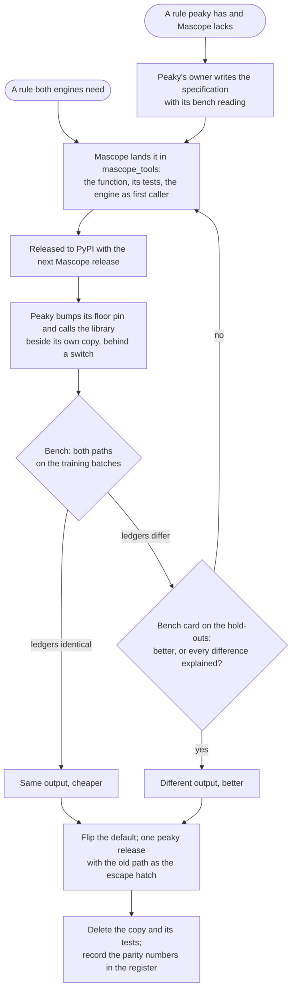

# The boundary between Mascope and peaky

- **Status:** building
- **As of:** 2026-10-30
- **Tracked in:** [Assignment truth corpus and bench](https://linear.app/ultra-trace/project/assignment-truth-corpus-and-bench-90d43812ff0f)
  and [Peaky, thinner: the research and reporting platform](https://linear.app/ultra-trace/project/peaky-thinner-the-research-and-reporting-platform-81db9b25bea2)
  (Linear, team Peaky, PKY-1 onward, filed from 2026-10-30); the Mascope-side
  steps in [Assignment quality plan](https://linear.app/ultra-trace/project/assignment-quality-plan-553f4854192c)
  (MAS-568 to MAS-570, MAS-581, MAS-582, MAS-609, MAS-610)
- **What:** One page on what Mascope owns, what peaky
  owns, how a finding moves between them, and what keeps peaky a usable
  research platform once the product engine is Mascope's.

## 1. Why this page

Peaky's owner wrote an assessment and refactoring plan of peaky in
October 2026. Its diagnosis is right: six noise floors, six mass models, two
verdict systems and the file as the unit of work, in a code base that has grown
past what one person can hold. Its remedy, rebuilding those as one each inside
peaky, would produce a second engine beside the one in Mascope. This page says
where each single implementation lives instead, so that the refactoring plan's
good parts start now and nothing is built twice. It does not revisit the
science in either engine; the
[assignment quality plan](assignment_quality_plan.md) does that, step by step,
and its decision 18 already holds: the reference is read, not targeted.
That is not a judgement on peaky's results. It says what the target is:
not either engine's output, Mascope's included, but the vetted corpus of true
and false readings of section 4, which both engines are judged against.
Peaky is read for what it has found; the corpus decides whether either engine
found it right, and a disagreement between the two is where to look, not who
is wrong.

## 2. The split

| Layer | Owner | Holds |
|---|---|---|
| Product engine | Mascope (`server/backend`, the `peak_assignment` package) | The one implementation of every rule a user's result rests on: the mass gate, the facts behind a tier, the tier and level vocabulary, the batch ledger as the unit of work, every sample assigned, verdicts and curation. |
| Shared maths | `mascope_tools` | Scoring, the per-sample scoring derivation, isotope prediction, the formula grid, plausibility, mechanism notation, profiles, calibration. One function per rule; both engines call it. |
| Transport | `mascope_sdk` | Every read and write either engine makes against a server. No engine carries a URL path of its own. |
| Research platform | peaky | Where a new rule is tried first: the fast experiment loop, offline replay, the bench and its corpus, reporting over any ledger. The interim producer of results until the matching Mascope step lands. |
| Chemistry as data | Peaky's owner authors it; it lives where its consumer reads it (decided 2026-10-30, PKY-35) | Reagent profiles and chemistry contexts, the reagent-cluster library, the reference lists and the known-species registry: in Mascope, as the library's presets and the server's cited reference sources (versioned rows once step 4.5 lands), read by peaky through the library and the SDK. The reference ions `peaky mass-qc` reads and the scorecard rosters: in peaky. The corpus's entry rules and its vetting: with the corpus. One copy wherever the bench would notice two disagreeing; register rows A9 to A12. |

The assessment's steps 0 and 1 (the corpus and bench; performance with
identical output) proceed in peaky as written. Its steps 2 to 6 (one noise
model, one mass model, one evidence table, propose-then-arbitrate, the trace as
the unit) are contracts, not rebuilds: peaky's owner writes the
facts, the line-status function and the mass model as specifications with their
bench readings; Mascope implements them where its stages already stand (the
mass gate, derived evidence, tiering with reasons, the batch ledger); the bench
decides whether the implementation is right.

## 3. How a finding moves

- **A fact or a rule moves as a specification with a bench reading**, reviewed
  per pinned peaky release (decision 29, MAS-66). Code never moves: the plan's
  "do not port the frame" stands, and the Mascope side is reimplemented on its
  own seam.
- **No peaky stage is declared superseded** until the matching Mascope step
  matches or beats it on the bench. Until Mascope's stage 4 ships, the batch
  isotope checks, the evidence levels, the axis lock model and the area-based
  isotope reading are why peaky's results are good, and peaky
  stays the tool that produces them, published into Mascope through the import
  contract (`sdk_peak_assignment.md` section 8).
- **A rule that both engines need lands in `mascope_tools` first**, with the
  engine and peaky as its two callers; peaky deletes its copy
  once the bench shows identical output. New rules in peaky are welcome; new
  infrastructure in peaky (a second grid, a second scorer, a second transport)
  is not.
- **A gap peaky worked around is an ask of Mascope**, filed as a GitHub
  issue and a Linear step in milestone 5, never a workaround kept.

## 4. The corpus and the bench

The corpus is the assessment's best idea and the one piece of tooling both sides
lack: a vetted table of true and false readings, one row per truth item, with
its source, truth class, brightness bin, reviewer and split, frozen with a hash,
with hold-outs chosen by whole batch. It is a file set kept outside the public
repository, like the testbed notes, because it holds recall truths no engine
proposed, sources from other laboratories and instruments, and a hold-out the
optimising agents must not read.

Mascope contributes three things. The scorer and the converters live in
`tooling/assignment_compare` as a truth mode of the existing comparison, so one
card judges a Mascope run, a published peaky run or a local run folder the
same way; today the comparison reports agreement between engines and says of
itself that it is not a ground truth. The verdict tables are the corpus's living
branch: a verdict an analyst records in the app, with its evidence level, exports
into the corpus with that level as its truth class (MAS-570 is the bulk read that
makes the export possible). And the gates G1 to G14, which count agreement and
plausibility, gain precision and recall against truth. The vetting pass is the
work of peaky's owner, because it is chemistry; the schema is agreed
between the two owners before the scorer is written, and is not decided here.

## 5. Keeping peaky useful

- **Thinner, not rebuilt.** Each piece that lands in `mascope_tools` replaces
  peaky's copy, verified on the bench. Peaky's publish transport can move now
  that the SDK has the per-sample import wrapper (MAS-345, merged 2026-10-30).
  Its reverse-engineered write client goes once its replacement, the AI
  layer's gated plan and apply, is reachable over MCP and one line to install
  (PKY-5, after MAS-544 and MAS-611); until then `curate` stays.
- **Offline first.** The batch snapshot the SDK writes (MAS-568, merged 2026-10-30) and
  peaky's offline sample registration together let a whole batch run from local
  files, which also removes every redundant load the assessment measured.
- **The report front-end for either engine.** Peaky's PDF, workbook, clustering
  and Van Krevelen reporting read Mascope's exported batch ledger as well as
  peaky's own.
- **The cheap guardrails from the assessment**: invariant tests on real ledgers,
  needs-and-provides asserted at startup, typed enums for free-text columns,
  dead code deleted.
- **Pinned both ways.** Peaky pins the SDK and the library at releases; Mascope
  reviews peaky per minor; a nightly compatibility run against Mascope's
  develop libraries catches drift, as `sdk-compat.yaml` does for the SDK.
- **Tests retire with the code they test.** Stage-local tests are not
  maintained for pieces that move; replay fixtures and the bench take over.

## 6. Platform asks: where they stand on 2026-10-30

| Ask | Step | State |
|---|---|---|
| The per-sample scoring derivation as one library function, and a bulk candidate scorer | 5.12, MAS-569, [#2758](https://github.com/ultra-trace-systems/mascope/issues/2758) | Merged 2026-10-29 ([PR 2767](https://github.com/ultra-trace-systems/mascope/pull/2767)); Stage A scores its frame in one pass, and peaky can import the derivation it re-implemented |
| The current verdicts of a batch or dataset in one read, in the SDK and the export | 5.13, MAS-570, [#2759](https://github.com/ultra-trace-systems/mascope/issues/2759) | Merged 2026-10-29 ([PR 2769](https://github.com/ultra-trace-systems/mascope/pull/2769)); the corpus's living branch has its export |
| The SDK's assign, verify and list_verifications wrappers | MAS-330 | Merged 2026-10-29 ([PR 2763](https://github.com/ultra-trace-systems/mascope/pull/2763)) |
| The SDK per-sample `import_run` and the round-trip notebook | MAS-345 | Merged 2026-10-30 ([PR 2774](https://github.com/ultra-trace-systems/mascope/pull/2774)); peaky's publish module needs no transport of its own |
| The width a run scored at, served on the run and sample records | 5.9, MAS-410 | Merged 2026-10-30 ([PR 2784](https://github.com/ultra-trace-systems/mascope/pull/2784)) |
| A batch's peak lists in one read, and the SDK parquet snapshot | 5.11, MAS-568, [#2757](https://github.com/ultra-trace-systems/mascope/issues/2757) | Merged 2026-10-30 ([PR 2764](https://github.com/ultra-trace-systems/mascope/pull/2764)) |
| The targeted matcher reads an isotope line over the scans that hold its anchor | 3.5c, MAS-581, [#2772](https://github.com/ultra-trace-systems/mascope/issues/2772) | Todo, filed 2026-10-29 |
| The stored scan presence count, served, and the scorer reading the corrected share | 3.5d, MAS-582, [#2773](https://github.com/ultra-trace-systems/mascope/issues/2773) | Todo, after 3.5c |
| A verdict on batch import rows, and the engine tier where the user looks | 5.6, MAS-71 | Backlog |

The 3.5c and 3.5d rows are one finding from this review: an Orbitrap isotope
line censored in part of a file's scans is stored at its sum over every scan,
so it reads low in proportion to the scans it misses (step 5.3 measured 0.94 of
its share missing none, 0.44 missing more than half). Both engines model that
with a per-file response curve, peaky's by area and Mascope's by height, and
the targeted matcher does not correct it at all, so its 20 percent ratio
tolerance drops true 13C lines. The cause is one number per peak the detection
already computes and throws away. The matcher fix needs no store change; the
presence count and the shared scorer are the first case of a rule landing in
the library for both engines, and the response curves become its fallback.

## 7. Decided, and the calls still open

**Decided 2026-10-30 by the plan owner: stage 4 of the plan, the batch, is
pulled ahead of the remaining stage 3 steps.** It is the stage peaky's
advantage rests on, and the batch isotope checks, evidence levels and series
it brings are what the merged ledger has that Mascope's does not. The plan
note records it as its next decision when it is next edited on develop, and
milestone 4's dependence on the stage 3 gate is lifted; 3.5c and 3.5d stay in
stage 3 because they are small and the matcher fix is overdue on its own.

**Also decided 2026-10-30, in the meeting:** the split of section 2 is accepted
as written (PKY-1); peaky stays the interactive AI data analysis and reporting
tool (PKY-2); the corpus comes first and peaky's owner builds it (PKY-3);
a parity run reads develop's library through a git-ref development extra
while releases keep the PyPI pin, and the old path stays one release behind
a switch (PKY-4, section 8).

**Decided 2026-10-30 after the meeting, by the plan owner, as the note
leaned:** the chemistry as data lives where its consumer reads it, and
peaky's owner authors it there. The profiles and contexts, the reagent-cluster
library, the reference lists and the known-species registry are one copy in
Mascope, which peaky reads; a change is a PR to the library until step 4.5
serves them as versioned rows, and a superseding row after. The reference
ions `peaky mass-qc` reads and the rosters stay peaky's, and an ion enters a
Mascope list only with a work that names it (PKY-35; section 2 and register
rows A9 to A12).

Still open, each a Decision issue in Linear:

- The corpus schema and its entry rules, agreed before the scorer is written
  (PKY-15). *Call for peaky's owner, with the plan owner.*
- Where the corpus lives and who holds the hold-outs (PKY-16). *Call for the
  plan owner and peaky's owner.*
- The acceptance rule for a code change judged on the bench (PKY-17). *Call
  for both owners.*
- The trace as the unit of work, decided on the bench after stage 4 (PKY-31).

## 8. How a rule moves: the protocol and the register

Peaky gets thinner one rule at a time, never in one refactor at the end.
Waiting would leave two diverging copies of each rule for months and the bench
unable to say which copy a result came from; a one-shot rewrite is what the
assessment itself argues against. Peaky has made this move once already, when
it replaced the network scorer with `mascope_tools` in process: a parity run,
the old path kept behind a switch, the default flipped, the switch removed.
That is the pattern, and the seam for it exists: only four peaky modules
import the library, all under `io`.

Two rules of the protocol were decided on 2026-10-30 (PKY-4). The parity run
does not wait for a release: peaky's development extras depend on the git ref
of develop's library subdirectory, while its releases keep the PyPI floor pin,
so shipped peaky stays reproducible and validation loses the release lag. The
old path stays one peaky release behind a switch after the default flips, then
the switch, the copy and their tests are deleted together. The two kinds of
move are kept apart as the assessment keeps them:
"same output, cheaper" is proven by a byte-level ledger diff, "different output,
better" by the bench card and the hold-outs, never by the training score.

Two rules keep the two repositories from working against each other:

- **Before a peaky module is refactored for its own sake, check the register.**
  If a library move is scheduled for it, do the move instead; the assessment's
  steps 2 to 6 must not polish code that is about to be deleted.
- **Pinned both ways, and watched.** Peaky pins the libraries at releases and
  bumps the floor per move; Mascope reviews peaky per minor (step 5.1); a
  nightly run of peaky's tests against develop's libraries catches drift before
  a release does, as `sdk-compat.yaml` does for the SDK.

The register is the coordination record: one row per rule here, and one issue
per row that moves in the Linear project *Peaky, thinner*: A1 is PKY-27, A2
PKY-28, A3 PKY-5, A4 PKY-6, A5 PKY-7, A6 PKY-29, A7 PKY-30, A8 PKY-32, A9
PKY-36, A10 PKY-37 and A11 PKY-38; A12 moves nothing and has none. The corpus
and the bench are PKY-15 to PKY-26 in *Assignment truth corpus and bench*, with
the baseline cards (PKY-25) the blocker of every move that changes output.

| Rule | Peaky today | Library | Mascope step | Library version | Peaky PR | Bench | State |
|---|---|---|---|---|---|---|---|
| A1 The per-sample scoring derivation | `io/io_mascope.py`, `scoring_for_sample` | `composition.scoring.pattern_scoring_for_sample` | 5.12, MAS-569 | the first `mascope-tools` after 2026.10.27 | | | library merged 2026-10-29; different output: Mascope's carries the resolution term |
| A2 Scoring a candidate list | `io/local_scoring.py`, `score_candidates_local` | `composition.scoring.score_candidates` | 5.12, MAS-569 | same | | | library merged 2026-10-29; same output expected |
| A3 Workspace, dataset, batch and sample writes | `io/curate.py` | retired: the AI layer's plan and apply | MAS-138, MAS-544, MAS-611 | `mascope_ai` on PyPI (MAS-611) | | | plan builders merged (MAS-138); waits for MAS-544 and MAS-611; delete, no parity needed |
| A4 The run publish transport | `io/publish.py`, the raw posts | `peak_assignments.import_run` | MAS-345 | the first `mascope-sdk` after 2026.10.28 | | | SDK merged 2026-10-30; translation and pre-validation stay in peaky |
| A5 The batch time series load | `io/io_mascope.py`, `fetch_batch_peaks` | `load_peaks` on the bulk route, with `save_path` | 5.11, MAS-568 | the first `mascope-sdk` after 2026.10.28 | | | merged 2026-10-30; same output |
| A6 The minor-line response | `assignment/iso_response.py` | the presence-corrected share in `score_pattern_v2` | 3.5d, MAS-582 | | | | Todo; the curve stays as the fallback for stores without the count |
| The formula grid, the width model, side lobes, the axis correction | `assignment/`, `batch/` | as stages 3 and 4 land each | | | | | not scheduled; one row each when they are |
| A7 Batch isotope checks, evidence levels, the axis lock model | `batch/iso_checks.py`, `assignment/levels/`, `batch/axislock.py` | specification first, by peaky's owner | stage 4 | | | | waits for stage 4; the reverse direction of the chart |
| A8 The MS2 source and the fragment composition rules | `ms2/sources.py`, `ms2/subformula.py` | the MS2 store's scans and window routes; `composition.ms2` | the MS2 project's phases 0, 1 and 5 (MAS-389, MAS-390; the core MAS-387 merged) | `mascope-tools` 2026.10.27 for the core, and the SDK release carrying the routes | | | the MS2 note's appendix A is this row's own register; same output, peaky's known answers as the proof; the binding class and replicates stay in peaky until MAS-401 |
| A9 Reagent profiles and chemistry contexts, as data | `chem/profiles.py`, `chem/contexts.py` | the presets in `composition.profiles`; the served rows after 4.5 | 4.5, MAS-65 (the rows; the presets are in since 1.1) | `mascope-tools` 2026.10.27 | | | same output expected, the presets were ported verbatim; peaky's `load_config` extras stay as its research overlay |
| A10 The reagent-cluster library | `chem/reagents.py`, `build_library` | `composition.reagents` and the profile's cluster grammar | 3.3 (built), 3.3d | | | | different output expected; an ion only peaky names enters the library with its citation first; the ledger-coupled labeler stays in peaky |
| A11 Reference peaklists and the known-species registry | `data/peaklists/`, the lists in `passes/directors.py` | the server's cited reference sources, through `client.reference` | 2.5a, 2.5b (built) | `mascope-sdk` 2026.10.28 | | | pass 0 stays in peaky and reads the server; a list Mascope lacks is loaded as a cited source first |
| A12 Reference ions for mass QC, and the rosters | `data/reference_ions/`, `chem/reference_ions.py`, `data/rosters/` | stays in peaky | MAS-177 reads the table as an input | | | | no move; an ion enters a Mascope list only with a work that names it; the rosters are corpus sources (PKY-18) |
