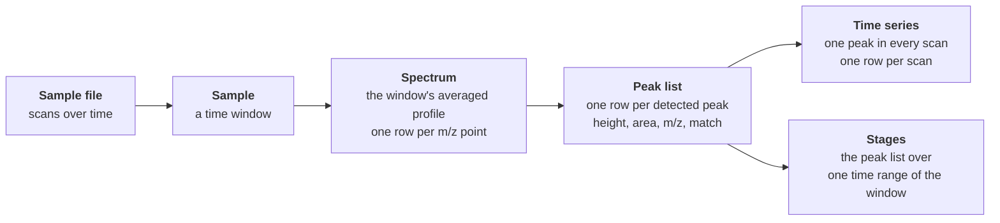

# Tables and columns

The Python SDK and the AI toolkit return Mascope's data as tables: a peak
list, a time series, a spectrum. This page says what each table holds, one
row at a time, and what each column in it means. It is for anyone who
computes from the tables rather than reads them in the app: a scientist in
a notebook, and an agent working through the toolkit, whose every table
handle carries these meanings beside the column names.

The objects the tables come from (workspace, dataset, batch, sample, target
collection) are explained in [Concepts](index.md); the processing that
produces the numbers in [How it works](../how-it-works/index.md).

## From a sample to its tables

A [sample](index.md#sample-files-vs-samples) is a time window of one raw
file. Mascope averages the window's scans into one **averaged spectrum**,
detects and calibrates **peaks** in it, and keeps for each peak, once
asked, its value in every scan of the window: the peak's **time series**.
Matching adds to each peak the target it was assigned to. Every table below
is a view of these three things.

| Table | One row is | SDK | Toolkit | Answers |
| --- | --- | --- | --- | --- |
| **Peak list** | one detected peak of one sample, or one peak and one isotope line it matched | `load_peaks`, `samples.get_peaks` | `load_peaks` | the sample's own values: how high a compound is in each sample of a batch, what was matched, what was not |
| **Time series** | one peak's value in one scan of one sample | `load_peak_timeseries` | `load_timeseries` | what happens inside a sample: a rise, a plateau, a wash-out, or the near-constant level a background peak holds |
| **Spectrum** | one point of the averaged profile: the raw signal, before any peak is detected in it | `samples.get_spectrum` | `load_spectrum` | the shape of the signal around an m/z: the apex, the width, a shoulder |
| **Stages** | one peak of one sample, averaged over one time range | `load_peaks_by_stage` | `load_peaks_by_stage` | one sample read as consecutive phases: a blank, a signal, a wash, or the concentration steps of a sensitivity calibration |
| **Match tree** | one isotope line of one candidate formula, with Mascope's scores | `matching` | `match_compounds` | whether a formula is in a sample, and on which peaks |

The spectrum is the raw signal; the peaks, or centroids, are the features
Mascope detects in it, and every other table is about them.

A batch's time series, as the app draws it, is **one point per sample**,
and that point is the ion's **summed matched intensity**: the sum over the
ion's matched isotope lines of each line's peak intensity, which is the
peak's height on an Orbitrap and its area on a TOF. In the match tree it is
`intensity_ion`. A single row's `height` in the peak list is one line's
value, so for a bromine ion on an Orbitrap the app's point is about twice
either line's height. The time series table is the scans *within* each
sample, and is not the same thing either.

## Height, area and intensity

Three columns say how much signal there is, and they are three different
numbers.

- **`height` in a peak list** is the peak's apex intensity in the sample's
  averaged spectrum: the mean over the window's scans of the peak's height
  in each (the sum, when the peaks are loaded with `average=False`). This
  is the sample's own value for that peak.
- **`height` in a time series** is the same peak's height in **one scan**,
  at `time` seconds on the sample file's clock (see
  [Clocks](#clocks-time-and-stage-bounds)). Averaging a peak's series over
  the window gives back the peak list's height.
- **`intensity` in a spectrum** is one point of the averaged profile. The
  highest point in an m/z window is the window's apex. It lies near the
  fitted peak's height, since peak detection fits the apex from several
  profile points ([Peak detection](../how-it-works/peak-detection.md)), but
  it is not the same number, and a sharp peak can sit between two profile
  points.
- **`area`** is the peak's intensity integrated over its m/z extent,
  aggregated over the scans like `height`.

**One unit per instrument.** Heights, time-series points and spectrum
points are all read off the same averaged spectrum and share its unit,
which is the instrument's: **counts on an Orbitrap, ions per second on a
TOF**. The average is over scans, never over time, so an Orbitrap value is
a count, not a rate, and scaling it by the sample's length would be wrong.
The spectrum route labels every instrument's values `counts/s` and the
exports write `cps`; read those as labels, not as the unit. An area is the
intensity summed over the peak's m/z extent.

**Which number Mascope calls the peak's intensity.** Where a result speaks
of a peak's *intensity* rather than its height or area, as the matching
and assignment results do (`sample_peak_intensity`, the intensity sums, the
exports' "Total peak intensity"), it is the peak's **height on an
Orbitrap** and its **area on a TOF**. The peak list carries both columns,
so a computation of your own can pick either; what Mascope has already
summed follows this rule.

A **stage** is a peak list averaged over one time range of the sample
only; its `height` and `area` are means over that range's scans. Its other
columns, `signal_to_noise` and `sparsity` among them, are the sample's
whole-window values. A stage has no `n_scans` and `n_scans_total` for now:
the whole window's `signal_to_noise` cannot be read against the counts of
the stage's own scans.

| To know | Load | Read |
| --- | --- | --- |
| how high a compound is in each sample of a batch | the peak list of the batch | `height` per `sample_item_id` |
| how a compound behaves within one sample | its time series | `height` against `time` |
| where exactly a peak's apex is and how high the profile reaches | the spectrum around the m/z | the row with the largest `intensity` |
| how high a compound is in the first minute of a sample | the stage `(t0, t0 + 60)`, with `t0` from the sample's `t_range_s` | `height` |

## Clocks: `time` and stage bounds

A sample is a window `[t0, t1]` of its file, and every time in these tables
is **on the file's clock**: seconds from the start of the file's
acquisition, the clock `t0` and `t1` themselves are on (the toolkit's
`describe` gives them as `t_range_s`). So:

- A time series' first point is at the window's start, not at 0. A sample
  cut from a longer file, one injection of an autosampler run say, can
  start thousands of seconds in.
- A stage's `t_min` and `t_max` are read on the same clock. A start before
  `t0` is moved to `t0` without a note; a stage that ends before `t0` is
  refused. "The first minute" of a sample is the stage `(t0, t0 + 60)`,
  never `(0, 60)`.
- The peak list's `datetime_utc` is the **file's** acquisition start. Every
  sample cut from one file shares it, and each window begins `t0` seconds
  later. A time series' `datetime_utc` is the absolute time of each point,
  the file's start plus `time`.

## Columns

### Identity

| Column | Meaning |
| --- | --- |
| `sample_batch_name` | The batch's name, as its owner wrote it. |
| `sample_item_id` | The sample's ID. Group by it: sample names repeat across batches. |
| `sample_item_name` | The sample's name, as its owner wrote it. |
| `datetime_utc` | In a peak list: the sample file's acquisition start, UTC; the sample's window begins `t0` seconds later. In a time series: the point's absolute time, the file's start plus `time`. |
| `peak_id` | Mascope's ID of the detected peak within its sample. In a peak list every peak has a row, matched or not, and a peak matched to several isotope lines has one row per line, so the ID repeats; in a time series it is the same on every point of the peak's series, one series per matched line; in a stage table there is one row per stage, repeated when the peak matched several lines. Counting rows does not count matched lines. |

### The peak

| Column | Meaning |
| --- | --- |
| `mz` | The peak's measured centroid m/z after [calibration](../how-it-works/calibration.md). In a spectrum, the profile point's m/z; in a time series, the peak's m/z repeated on every point. In the match tree, a theoretical value instead: see below. |
| `height` | See above. |
| `area` | See above. |
| `signal_to_noise` | The peak's height over its noise estimate ([Peak detection](../how-it-works/peak-detection.md#quality-control-filtering)). `NaN` where the file stores no estimate: an absent value, never a peak measured to be clean. |
| `sparsity` | The share of the sample's scans the peak is absent from, known once the peak's time series has been computed. A peak whose series has not been computed yet, typically one no target matched, also reads 0, so a 0 is "seen in every scan" only for a peak with a series. |
| `n_scans` | On an Orbitrap, how many of the scans averaged into the peak hold it ([scan presence](../how-it-works/peak-detection.md#scan-presence-orbitrap)), known for every peak. A scan keeps a peak only where it clears that scan's noise, so a dim isotope line is missing from part of the scans and its `height` is diluted by the share it missed: `height * n_scans_total / n_scans` is its mean over the scans that hold it, high for a line near the noise, whose kept scans are the ones its noise lifted. `NaN` for a TOF file and for one whose peaks were detected before the count was kept. |
| `n_scans_total` | On an Orbitrap, how many scans the peak is averaged over: the sample's scans of its polarity, or of its stream in a sample detected stream by stream. `NaN` where `n_scans` is. |
| `segment` | For a sample stitched from several scan streams, the stream the peak came from; intensities are not rescaled between streams. `None` for a sample that is not stitched. |
| `is_satellite` | Whether the peak is a side-lobe artifact of a stronger peak nearby rather than a compound ([satellite peaks](../how-it-works/peak-detection.md#satellite-peak-identification)). A peak list is read without its satellites, so the column is `False` throughout; a sum of zero means "none shown", not "none detected". |

### The match

A peak list carries its [matches](index.md#matching-and-match-scores)
flattened into columns. An unmatched peak has one row with these columns
empty; a peak matched to several isotope lines has one row per line. When
no peak in a load matched anything, the match columns are not empty but
**absent**: each read drops its all-empty columns, so look for the column
before reading it.

| Column | Meaning |
| --- | --- |
| `match_score_isotope` | Mascope's 0 to 1 score of this peak as the matched isotope line, from m/z error, isotope-pattern fit and intensity ([Matching](../how-it-works/matching.md)). |
| `match_score_ion` | In a peak list, the SDK's roll-up of Mascope's isotope scores: their sum weighted by relative abundance, per ion. In the match tree, Mascope's own ion score. |
| `match_score_compound` | In a peak list, the SDK's roll-up: the best ion score, per compound. In the match tree, Mascope's own compound score. |
| `relative_abundance` | The matched line's share of its ion's theoretical isotope pattern. An ion's lines sum to about 1, so its main line is below 1: about 0.98 for a small CHO ion, about 0.5 each for the two main lines of a bromine ion. |
| `target_isotope_id`, `target_isotope_formula` | The matched isotope line: one m/z of the ion's theoretical pattern. |
| `target_ion_id`, `target_ion_formula` | The matched ion: the compound with its ionization mechanism applied. An ion's rows are its matched isotope lines, so a statistic of `height` grouped by the ion takes its minor lines together with its main one and comes out low; take one line (`target_isotope_formula`) or sum the lines per sample, as the app's batch point does. The toolkit's `reduce` says `lines_mixed` when it took several. |
| `target_compound_id`, `target_compound_name`, `target_compound_formula` | The matched compound, by ID, name and neutral formula. Group by the ID: formulas repeat across compounds. A compound's rows are its ions' isotope lines, not samples. |
| `ionization_mechanism`, `ionization_mechanism_id` | The matched ion's [ionization mechanism](index.md#ionization-modes-and-mechanisms). A peak list carries the name only; the match tree carries both. |
| `target_collection_ids`, `target_collection_names` | The target collections the matched compound is in. The names are aligned with the IDs and are for display: group by the IDs. |

### Time series

| Column | Meaning |
| --- | --- |
| `time` | Seconds on the sample file's clock ([Clocks](#clocks-time-and-stage-bounds)); the sample's first point is at `t0`, not at 0. |
| `height` | The peak's height in the scan at `time`. |
| `datetime_utc`, `mz`, `peak_id`, `target_*` | As above: the point's absolute time, and the peak and its match repeated on every point. |

### Spectrum

| Column | Meaning |
| --- | --- |
| `mz` | The profile point's m/z. |
| `intensity` | The averaged profile's intensity at that m/z: counts on an Orbitrap, ions per second on a TOF, whatever the route's `counts/s` label says. |

### Stages

| Column | Meaning |
| --- | --- |
| `stage` | The stage's position in the list asked for, counted from 0. |
| `stage_name` | The stage's name, when one was given. |
| `t_min`, `t_max` | The stage's start and end, seconds on the sample file's clock ([Clocks](#clocks-time-and-stage-bounds)); a start before `t0` is moved to `t0`. |

A stage's `height` and `area` are the peak list's, averaged over the
stage's scans only; its other columns are the sample's whole-window values.
It has no `n_scans` and `n_scans_total` for now, since a count of the
stage's own scans would be read against the whole window's
`signal_to_noise`.

### Match tree

The tree Mascope returns for candidate formulas, one row per isotope line
it looked for, each row carrying its ion's and its compound's columns
beside its own. Every score, category and intensity in it is Mascope's,
where a peak list's `match_score_ion` and `match_score_compound` are the
SDK's roll-ups.

| Column | Meaning |
| --- | --- |
| `candidate`, `origin` | The formula as it was asked about, and where it came from: `given`, `mass_query` (Mascope's own proposal for the m/z) or `model`. |
| `mz` | The line's **theoretical** m/z. The measured one is `sample_peak_mz`. |
| `match_score_compound`, `match_score_ion`, `match_score_isotope` | Mascope's score at each level. |
| `match_category_compound`, `match_category_ion`, `match_category_isotope` | Mascope's category at each level: 2 probable, 1 possible, 0 unmatched. |
| `match_isotope_id` | The ID of the match record for the line. |
| `intensity_compound`, `intensity_ion` | Mascope's sum of the peak intensities of the compound's lines (all its ions) and of the ion's lines: heights on an Orbitrap, areas on a TOF. A line outside the m/z tolerance, or off its isotope ratio by 100 % or more, counts 0; a line outside only the isotope ratio tolerance by less, or under the minimum intensity, keeps its intensity in the sum though its score is 0 ([what a line keeps](../how-it-works/matching.md#the-tolerances-what-a-line-keeps)). `intensity_ion` is the point the app's batch chart draws, so that point includes a ratio-gated line and leaves out an m/z-gated one. |
| `sample_peak_id`, `sample_peak_mz` | The nearest peak to the line, by ID and measured m/z. The ID is kept even when that peak failed the tolerances, with `match_score_isotope` 0; a line is *found* only with a score above 0. A line with **no peak** holds placeholders: an empty ID and, as `sample_peak_mz`, the theoretical `mz` again. |
| `sample_peak_intensity` | That peak's intensity, the height on an Orbitrap and the area on a TOF. It is 0 when the line has no peak **and** when its nearest peak is outside the m/z tolerance or off the line's isotope ratio by 100 % or more, in which case the peak's ID and m/z are still there; a line outside only the ratio tolerance, by less, keeps its intensity with a score of 0 ([what a line keeps](../how-it-works/matching.md#the-tolerances-what-a-line-keeps)). |
| `sample_peak_intensity_relative` | The nearest peak's intensity over the main line's peak's: on an Orbitrap summed over the scans both are in ([how the ratio is read](../how-it-works/matching.md#instrument-specific-intensity-quantification)), on a TOF the ratio of the two means. It is read **before** the m/z tolerance is applied: on a line outside it, it still holds the nearest peak's ratio, often far above 1, though `sample_peak_intensity` reads 0. It is 0 when the line has no peak, when the ion's main line has none, and on an Orbitrap when the two share no scan. |
| `match_mz_error`, `match_abundance_error` | How far the peak's m/z is from the line's theoretical m/z, **in ppm**, and how far its relative intensity is from the line's theoretical abundance. A line with no peak holds 0 and 1: read with the empty `sample_peak_id`, not as a perfect match. |
| `resolution` | Which set of target lines the line comes from: `HIGH`, an Orbitrap's resolved lines; `LOW`, a TOF's merged ones. Not a resolving power. |
| `signal_to_noise`, `sample_peak_tof`, `is_satellite` | The found peak's own: its signal-to-noise ratio, its time-of-flight coordinate (TOF files only; -1 when no peak), and whether it is a satellite. |
| `n_scans`, `n_scans_total` | The nearest peak's own, as in the peak list: on an Orbitrap, how many of the scans averaged into it hold it, and how many those are. `NaN` when the line has no peak, and where the file keeps no count. |
| `instrument` | The instrument whose match parameters scored the ion. |
| `cas_number`, `inchi`, `inchikey`, `smiles` | The compound's identifiers, where its record has them. The match is on the formula and confirms no structure. |
| `target_compound_name`, `target_compound_formula` | The name is always empty in the tree: it scores formulas, not named compounds. The formula is the candidate's and is on every row, matched or not. `match_category_compound` says whether a candidate matched. |
| `target_isotope_*`, `target_ion_*`, `target_compound_id`, `ionization_mechanism`, `ionization_mechanism_id` | The line, the ion and the compound Mascope **looked for**, on every row, matched or not; the category columns say whether each matched. A list of the tree's isotope formulas is the lines searched, not the lines found. |
| `relative_abundance` | As in the peak list. |

## Rows that repeat, and rows that are missing

**One peak, several rows.** With matches loaded, a peak that matched more
than one isotope line appears once per line. Count peaks by `peak_id`, and
group matched intensity by `target_ion_id` or `target_compound_id`, never
by formula alone, or a compound that appears in two collections is counted
twice.

**A table says when rows are missing.** Every table the toolkit loads
reports whether each read behind it succeeded (`complete`) and names the
reads that failed (`failures`); the SDK keeps the same in the DataFrame's
`attrs`. An incomplete table has rows missing, which is not the same as the
data having none. One case is worth knowing: a time-ranged read (a stage)
is aggregated from each peak's time series, and leaves out every peak whose
series the server has not computed yet, typically the peaks no target
matched. Such a stage reports how many peaks it left out; computing the
missing series (`compute_timeseries` in the toolkit,
`compute_peak_timeseries` in the SDK) and reading again makes it whole.

## For agents

The AI toolkit puts these meanings where the model reads them. Every Frame
handle an MCP tool returns carries a `meanings` map beside its `columns`,
one line per column: what the number is, its unit, and what it is not. In
Python, `frame.column_meanings()` gives the same map. A table a `derive`
step computed keeps, for each column it carried over, the meaning of the
table it came from, so a time series filtered by time still says its
height is one scan's; a column the step computed says so and points to the
code that made it; and a column two inputs give different meanings, a
time series joined to its peak list both having a `height`, has none. When
a handle has no room for every meaning it keeps the numbers' first and
points to the rest in Python. A column neither the toolkit nor this page
knows is left out of the map, and is the first thing to document when a
loader gains one.
