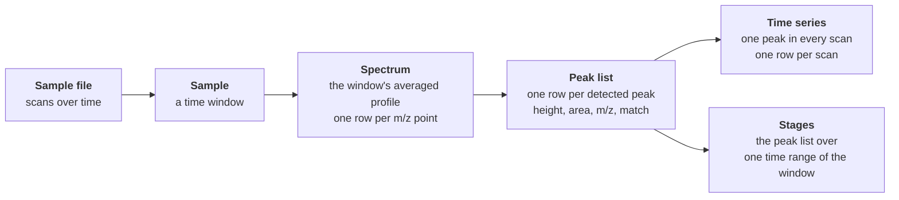

# Tables and columns

The Python SDK and the AI toolkit return Mascope's data as tables: a peak
list, a time series, a spectrum. This page says what each table holds, one
row at a time, and what each column in it means. It is for anyone who
computes from the tables rather than reads them in the app: a scientist in
a notebook, and an agent working through the toolkit, whose every table
handle carries these meanings beside the column names.

The objects the tables come from (workspace, dataset, batch, sample, target
collection) are explained in [Concepts](index.md); the processing that
produces the numbers in [How it works](../how-it-works/index.md).

## From a sample to its tables

A [sample](index.md#sample-files-vs-samples) is a time window of one raw
file. Mascope averages the window's scans into one **averaged spectrum**,
detects and calibrates **peaks** in it, and keeps for each peak, once
asked, its value in every scan of the window: the peak's **time series**.
Matching adds to each peak the target it was assigned to. Every table below
is a view of these three things.

| Table | One row is | SDK | Toolkit | Answers |
| --- | --- | --- | --- | --- |
| **Peak list** | one detected peak of one sample, or one peak and one isotope line it matched | `load_peaks`, `samples.get_peaks` | `load_peaks` | the sample's own values: how high a compound is in each sample of a batch, what was matched, what was not |
| **Time series** | one peak's value in one scan of one sample | `load_peak_timeseries` | `load_timeseries` | what happens inside a sample: a rise, a plateau, a wash-out |
| **Spectrum** | one point of the averaged profile | `samples.get_spectrum` | `load_spectrum` | the shape of the signal around an m/z: the apex, the width, a shoulder |
| **Stages** | one peak of one sample, averaged over one time range | `load_peaks_by_stage` | `load_peaks_by_stage` | one sample read as consecutive phases: a blank, a signal, a wash |
| **Match tree** | one isotope line of one candidate formula, with Mascope's scores | `matching` | `match_compounds` | whether a formula is in a sample, and on which peaks |

A batch's time series, as the app draws it, is **one point per sample**:
the sample's averaged peak from the peak list. The time series table is
the scans *within* each sample, and is not the same thing.

## Height, area and intensity

Three columns say how much signal there is, and they are three different
numbers.

- **`height` in a peak list** is the peak's apex intensity in the sample's
  averaged spectrum: the mean over the window's scans of the peak's height
  in each (the sum, when the peaks are loaded with `average=False`). Its
  unit is the instrument's: counts on an Orbitrap, ions on a TOF. This is
  the sample's own value, and the number behind the sample's point in a
  batch time series.
- **`height` in a time series** is the same peak's height in **one scan**,
  at `time` seconds from the sample's start. Averaging a peak's series over
  the window gives back the peak list's height.
- **`intensity` in a spectrum** is one point of the averaged profile, in
  counts per second. The highest point in an m/z window is the window's
  apex. It lies near the fitted peak's height, since peak detection fits the
  apex from several profile points
  ([Peak detection](../how-it-works/peak-detection.md)), but it is not the
  same number, and a sharp peak can sit between two profile points.
- **`area`** is the peak's intensity integrated over its m/z extent,
  aggregated over the scans like `height`.

A **stage** is a peak list averaged over one time range of the sample
only; its `height` and `area` are means over that range's scans.

| To know | Load | Read |
| --- | --- | --- |
| how high a compound is in each sample of a batch | the peak list of the batch | `height` per `sample_item_id` |
| how a compound behaves within one sample | its time series | `height` against `time` |
| where exactly a peak's apex is and how high the profile reaches | the spectrum around the m/z | the row with the largest `intensity` |
| how high a compound is in the first minute of a sample | the stage `(0, 60)` | `height` |

## Columns

### Identity

| Column | Meaning |
| --- | --- |
| `sample_batch_name` | The batch's name, as its owner wrote it. |
| `sample_item_id` | The sample's ID. Group by it: sample names repeat across batches. |
| `sample_item_name` | The sample's name, as its owner wrote it. |
| `datetime_utc` | In a peak list: when the sample's time window starts, UTC. In a time series: the point's absolute time, the sample's start plus `time`. |
| `peak_id` | Mascope's ID of the detected peak within its sample. A peak matched to several isotope lines has one row per line, so the ID repeats. |

### The peak

| Column | Meaning |
| --- | --- |
| `mz` | The peak's centroid m/z after [calibration](../how-it-works/calibration.md). In a spectrum, the profile point's m/z; in a time series, the peak's m/z repeated on every point. |
| `height` | See above. |
| `area` | See above. |
| `signal_to_noise` | The peak's height over its noise estimate ([Peak detection](../how-it-works/peak-detection.md#quality-control-filtering)). `NaN` where the file stores no estimate: an absent value, never a peak measured to be clean. |
| `sparsity` | The share of the sample's scans the peak is absent from; 0 means it was seen in every scan. |
| `segment` | For a sample stitched from several scan streams, the stream the peak came from; intensities are not rescaled between streams. `None` for a sample that is not stitched. |
| `is_satellite` | Whether the peak is a side-lobe artifact of a stronger peak nearby rather than a compound ([satellite peaks](../how-it-works/peak-detection.md#satellite-peak-identification)). |

### The match

A peak list carries its [matches](index.md#matching-and-match-scores)
flattened into columns. An unmatched peak has one row with these columns
empty; a peak matched to several isotope lines has one row per line.

| Column | Meaning |
| --- | --- |
| `match_score_isotope` | Mascope's 0 to 1 score of this peak as the matched isotope line, from m/z error, isotope-pattern fit and intensity ([Matching](../how-it-works/matching.md)). |
| `match_score_ion` | In a peak list, the SDK's roll-up of Mascope's isotope scores: their sum weighted by relative abundance, per ion. In the match tree, Mascope's own ion score. |
| `match_score_compound` | In a peak list, the SDK's roll-up: the best ion score, per compound. In the match tree, Mascope's own compound score. |
| `relative_abundance` | The matched line's theoretical abundance within its ion's isotope pattern; 1 is the most abundant line. |
| `target_isotope_id`, `target_isotope_formula` | The matched isotope line: one m/z of the ion's theoretical pattern. |
| `target_ion_id`, `target_ion_formula` | The matched ion: the compound with its ionization mechanism applied. |
| `target_compound_id`, `target_compound_name`, `target_compound_formula` | The matched compound, by ID, name and neutral formula. Group by the ID: formulas repeat across compounds. |
| `ionization_mechanism`, `ionization_mechanism_id` | The matched ion's [ionization mechanism](index.md#ionization-modes-and-mechanisms), by name and ID. |
| `target_collection_ids`, `target_collection_names` | The target collections the matched compound is in. The names are aligned with the IDs and are for display: group by the IDs. |

### Time series

| Column | Meaning |
| --- | --- |
| `time` | Seconds from the sample's start. |
| `height` | The peak's height in the scan at `time`. |
| `datetime_utc`, `mz`, `peak_id`, `target_*` | As above: the point's absolute time, and the peak and its match repeated on every point. |

### Spectrum

| Column | Meaning |
| --- | --- |
| `mz` | The profile point's m/z. |
| `intensity` | The averaged profile's intensity at that m/z, in counts per second. |

### Stages

| Column | Meaning |
| --- | --- |
| `stage` | The stage's position in the list asked for, counted from 0. |
| `stage_name` | The stage's name, when one was given. |
| `t_min`, `t_max` | The stage's start and end, seconds from the sample's start. |

The other columns of a stage are the peak list's, averaged over the stage's
scans only.

### Match tree

The tree Mascope returns for candidate formulas, one row per isotope line
it looked for. Every score and category in it is Mascope's.

| Column | Meaning |
| --- | --- |
| `candidate`, `origin` | The formula as it was asked about, and where it came from: `given`, `mass_query` (Mascope's own proposal for the m/z) or `model`. |
| `match_score_compound`, `match_score_ion`, `match_score_isotope` | Mascope's score at each level. |
| `match_category_compound`, `match_category_ion`, `match_category_isotope` | Mascope's category at each level: 2 probable, 1 possible, 0 unmatched. |
| `intensity_compound`, `intensity_ion` | Mascope's summed intensity of the peaks found at the compound's lines (all its ions) and at the ion's lines. |
| `sample_peak_id`, `sample_peak_mz` | The sample's peak the line was found at, and its m/z; empty when none was. |
| `target_isotope_mz`, `target_isotope_mz_error_ppm` | The line's theoretical m/z, and how far the peak's m/z is from it. |

## Rows that repeat, and rows that are missing

**One peak, several rows.** With matches loaded, a peak that matched more
than one isotope line appears once per line. Count peaks by `peak_id`, and
group matched intensity by `target_ion_id` or `target_compound_id`, never
by formula alone, or a compound that appears in two collections is counted
twice.

**A table says when rows are missing.** Every table the toolkit loads
reports whether each read behind it succeeded (`complete`) and names the
reads that failed (`failures`); the SDK keeps the same in the DataFrame's
`attrs`. An incomplete table has rows missing, which is not the same as the
data having none. One case is worth knowing: a time-ranged read (a stage)
is aggregated from each peak's time series, and leaves out every peak whose
series the server has not computed yet, typically the peaks no target
matched. Such a stage reports how many peaks it left out; computing the
missing series (`compute_timeseries` in the toolkit,
`compute_peak_timeseries` in the SDK) and reading again makes it whole.

## For agents

The AI toolkit puts these meanings where the model reads them. Every Frame
handle an MCP tool returns carries a `meanings` map beside its `columns`,
one line per column: what the number is, its unit, and what it is not. In
Python, `frame.column_meanings()` gives the same map. A column that a
`derive` step computed says so and points to the code that made it; a
column neither the toolkit nor this page knows is left out of the map, and
is the first thing to document when a loader gains one.
