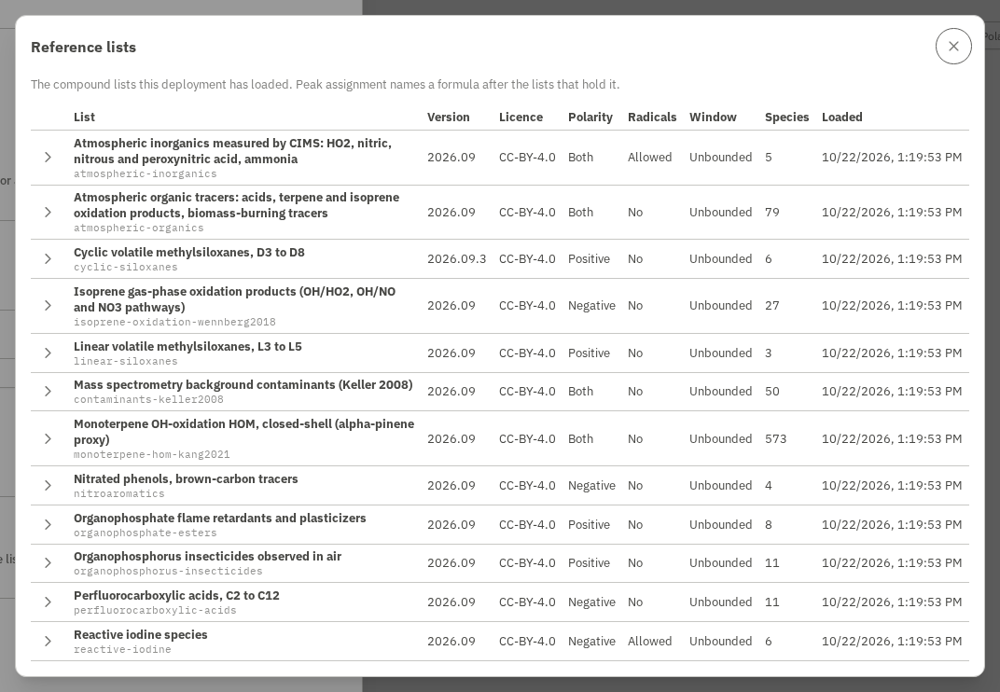

# Reference compound lists

Mascope annotates assigned formulas with **known compounds** that share the same
formula, pulled from mirrored reference databases. The public sources (PubChem,
EPA CompTox, ChEBI, ...) cover a lot, but not everything: in atmospheric science
in particular, whole families of compounds have been characterized in the
literature - published as **peak lists** in papers and supplements - long before
they land in a public database. HOMs (highly oxygenated organic molecules),
specific oxidation schemes, tracer lists, and in-house standards are common
examples.

This guide shows how to turn such a list into Mascope reference data, so those
compounds light up in [peak assignment](../how-it-works/peak-assignment.md) just
like public-database entries. How a loaded list is used is described under
[The two stages](../how-it-works/peak-assignment.md#the-two-stages); the
architecture behind the mirror (tables, query path, the public-database
adapters) is in the design note
[`public_database_integration.md`](https://github.com/ultra-trace-systems/mascope/blob/master/docs/dev/public_database_integration.md).

Loading a list needs access to the server that runs Mascope - either a monorepo
checkout with the developer CLI, or a shell on the server itself. Authoring the
list needs nothing but a spreadsheet.

## What you need

A table of compounds with, at minimum, a **neutral molecular formula** per row.
Anything else - name, structure, identifiers, the citation - is optional and
carried through to the annotation if present.

Mascope reads it through the built-in **`custom`** adapter, which takes a flat
CSV or TSV with this column schema (headers are case-insensitive; common aliases
are accepted):

| Column | Required | Meaning |
| --- | --- | --- |
| `formula` | **yes** | Neutral molecular formula, e.g. `C10H16O3`. Alias: `molecular_formula`. |
| `name` | no | Preferred compound name (shown in the assignment UI). Aliases: `compound`, `compound_name`. |
| `inchikey` | no | InChIKey. Enables cross-source de-duplication. |
| `smiles` | no | SMILES structure. |
| `inchi` | no | InChI structure. |
| `cas` | no | CAS number. Stored under `xrefs.cas`. Aliases: `cas_number`, `casrn`. |
| `reference` | no | Citation / DOI of the source list. Stored under `xrefs.reference`. Aliases: `citation`, `doi`. |
| `id` | no | Your identifier for the row. Falls back to `name`, then a row number. Aliases: `identifier`, `compound_id`. |
| `license` | no | Per-record license (defaults to `custom`). |

Only `formula` is needed. Rows without a formula are skipped.

### Formula notes

- **Neutral formula**, not the detected ion. Mascope compares against the neutral
  formula the composition engine assigns, so give `C10H16O3`, not `C10H15O3-`
  or the reagent adduct `C10H16O3.NO3`.
- **Any element order** works - formulas are canonicalized to Hill order on
  ingest (`C10H16O3`, `O3C10H16`, and `H16C10O3` all become `C10H16O3`), the same
  canonicalization the assignment engine uses, so keys always match.
- **Isotopes** are collapsed to the base element (`[13C]` -> `C`), matching how
  assigned neutral formulas are stored.
- The **monoisotopic mass** is computed for you on ingest - you do not need a
  mass column.

## Example: an atmospheric HOM peak list

Say a paper reports α-pinene highly oxygenated products. Put them in a CSV
(`apinene_hom.csv`):

```csv
name,formula,reference,inchikey
Pinonic acid,C10H16O3,10.5194/acp-example-2019,BFKGXSVWFIQNJS-UHFFFAOYSA-N
Pinic acid,C9H14O4,10.5194/acp-example-2019,
C10 HOM (C10H16O5),C10H16O5,10.5194/acp-example-2019,
C10 HOM (C10H16O7),C10H16O7,10.5194/acp-example-2019,
C10 dimer (C20H32O9),C20H32O9,10.5194/acp-example-2019,
```

Names are free-form - use the accepted trivial name where one exists, or a
descriptive label (`C10 HOM (C10H16O5)`) where the exact structure is unresolved.
Every row still becomes a queryable identity keyed on its formula.

!!! tip "A ready-to-load example"
    A larger example ships in the repository as
    [`libraries/reference/examples/atmospheric_organics.csv`](https://github.com/ultra-trace-systems/mascope/blob/master/libraries/reference/examples/atmospheric_organics.csv)
    (79 atmospheric organics - dicarboxylic acids, terpene and isoprene oxidation
    products, biomass-burning tracers) with a
    [README](https://github.com/ultra-trace-systems/mascope/blob/master/libraries/reference/examples/README.md)
    documenting its provenance. It is a good template and a quick way to see
    the reference path light up peaks.

!!! warning "Watch for commas in names"
    A plain CSV splits on every comma, so a name like
    `2-methyl-1,3,4-trihydroxybutene` would break the row. Quote such fields
    (`"2-methyl-1,3,4-..."`) or use a comma-free label.

## Load it

From a monorepo checkout (the `reference` command is a developer command):

```sh
mascope reference sync custom apinene_hom.csv --name apinene-hom-2019 --version 2019
```

- `custom` selects the flat-file adapter (`mascope reference sources` lists all).
- `--name` gives the load its **own provenance name**. Always set it for custom
  lists: it is what appears as the source of an annotation, and it keeps several
  lists from colliding (see below).
- `--version` tags the load for reproducibility (a DOI, a date, `v1` - your
  choice).

Check what is loaded:

```sh
mascope reference status
```

That is it. The compounds are now annotated wherever the assignment engine
produces a matching formula - the **Identity** column in peak assignment, and the
`known_only` suspect-screening prior on the composition query.

### How a loaded source may be matched

Every load records three things on its source row about how its compounds may be
matched:

- **A window**: the elements a formula may carry, its largest carbon count and
  its largest monoisotopic mass. Any of the three can be unbounded.
- **Whether its radicals may be matched**, read from each formula (a half-integer
  DBE), never from a flag on the row.
- **The polarity its compounds are detected in**: `positive`, `negative`, or both.

What a load writes depends on what the source is. A list someone authored - a
`custom` CSV, a list file, the lists Mascope ships - is its own bound and loads
unbounded, because every formula in it was chosen. A public database is not: it
holds hundreds of thousands of formulas no sample of these chemistries carries,
so `pubchem`, `comptox`, `chebi`, `hmdb`, `lipidmaps`, `coconut` and `norman`
load at the atmospheric window, C, H, N, O and S with at most 40 carbons and
700 Da. `mascope reference sources` names the window each adapter writes, and
`mascope reference status` shows what each load recorded.

Flags on the sync set any of it:

```sh
# Bound a hand-authored list to the elements it should match in.
mascope reference sync custom siloxanes.csv --name my-siloxanes -v 1 --elements C,H,O,Si --max-carbon 20

# Let a database's silicon and phosphorus formulas through; 'any' lifts a bound.
mascope reference sync norman susdat.csv -v 2024 --elements C,H,N,O,S,Si,P --max-mass any

# A CSV of radicals, matched as radicals.
mascope reference sync custom ro2.csv --name my-ro2 -v 1 --allow-radicals

# A list measured in positive mode.
mascope reference sync custom esi_background.csv --name my-background -v 1 --polarity positive
```

A list file's header says `allow_radicals` and `polarity` itself, and its
radicals are held back at ingest unless the header allows them, whatever the
flag says.

### Citing the list's publication

A load also records the publications the source comes from, and
`GET /api/reference/sources` cites the source by them. A list file's header
names them in its `references`, and its load records them.
A CSV names none, so give its publication when you load it: a citation with
its DOI, or its ISBN for a book.

```sh
mascope reference sync custom apinene_hom.csv --name apinene-hom-2019 -v 2019 \
    --citation "A. Author et al., A paper on HOMs. J. Example 1 (2019) 1-10." \
    --doi 10.1234/example.2019
```

The flags take the place of what a list file's header cites. A citation with
neither a DOI nor an ISBN, or a DOI or ISBN that is not a valid one, is refused
before anything is loaded.

Stage A of peak assignment reads all three for every source:

- **A formula is matched only inside the source's window**, intersected with a
  ceiling the sample's
  [chemistry context](../how-it-works/peak-assignment.md#the-chemistry-a-run-searches-under)
  sets. Every shipped context opens C, H, N, O, S, Si, P, F, Cl, Br and I at
  40 carbons and 700 Da, so a list brings its siloxanes, organophosphates,
  perfluorinated acids and iodine species in, while a database mirror stays
  inside its own window. The identity context `none` sets no ceiling. The run
  records the ceiling as `known_window` in its resolved profile.
- **A radical is matched only from a source whose row allows radicals.**
- **A source detected in one polarity is not matched against a sample measured
  in the other.** A list that says `both`, and a CSV, are matched in either.

A formula carries the identities of the sources that admit it and no others.

### On a server

`mascope reference` is a developer command: it pulls the chemistry dependencies
that are deliberately kept out of the lightweight operator CLI. Two ways to load
reference data into a running deployment, depending on how it was installed:

- **Deployment from a source checkout** - run the CLI command against the prod
  env directly (it connects to the deployment's database):

  ```sh
  mascope --env prod reference sync custom /path/to/list.csv --name my-list -v 2024
  ```

- **Any deployment (incl. a pip-installed operator CLI with no checkout)** - the
  backend image already ships the chemistry dependencies, so run the ingest
  **inside the backend container**. Mount your dump where the container can read
  it, then:

  ```sh
  docker compose exec backend \
      python -m mascope_backend.db.scripts.reference_sync \
      custom /data/list.csv --name my-list --version 2024
  ```

  It takes the same arguments as `mascope reference sync` (`source`, `file`,
  `--version`, `--name`, `--batch-size`, `--prune`, `--stage`, `--elements`,
  `--max-carbon`, `--max-mass`, `--allow-radicals`, `--polarity`,
  `--citation`, `--doi`, `--isbn`) and runs the
  identical versioned ingest - just where the dependencies live. The database
  is the one the backend is already configured for, so no connection flags are
  needed.

The operator documentation,
[Loading reference chemistry data](https://github.com/ultra-trace-systems/mascope/blob/master/docs/maintaining.md#loading-reference-chemistry-data),
has the server-side counterparts of the other commands in this guide (seeding
the shipped lists, deactivating a source) and the licence gate a deployment can
put in front of what assignment matches.

## Managing lists over time

**Several lists coexist.** Each `--name` is an independent source, so you can
load as many peak lists as you like and they all annotate together:

```sh
mascope reference sync custom apinene_hom.csv    --name apinene-hom-2019 -v 2019
mascope reference sync custom pfas_suspects.csv  --name norman-pfas       -v 2023
mascope reference sync custom lab_standards.csv  --name inhouse-standards -v 2024
```

**Re-loading replaces, versioned.** Syncing the same `--name` again creates a new
active version and deactivates the previous one; annotations immediately use the
new load. The old version stays on disk for reproducibility unless you pass
`--prune` (which deletes it):

```sh
mascope reference sync custom apinene_hom.csv --name apinene-hom-2019 -v 2020 --prune
```

**Stage without exposing.** `--stage` ingests a load without activating it (it
does not replace the current version) - useful to prepare an update and flip it
in later with `mascope reference activate <name> --version <version>`.

**Take a source out.** `mascope reference deactivate <name>` leaves no version of
the source active, so annotation and peak assignment stop reading it. Nothing is
deleted: `mascope reference activate <name> --version <version>` brings the load
back, and `mascope reference seed` loads a shipped list again. On a server, run
`python -m mascope_backend.db.scripts.reference_deactivate <name>` inside the
backend container.

**See what is loaded.** `mascope reference status` lists the sources on your
own machine. On a server, any signed-in user can ask the API:
`GET /api/reference/sources` returns each active source with its label,
version, licence, polarity, compound count and load date, the publications it
comes from (`references`), and `admitted`, which says whether the
deployment's licence gate lets peak assignment match it.
`GET /api/reference/sources/<name>/compounds` pages through what one source
holds (`page`, `limit` up to 1000, and `version` for a load other than the
active one). In the app, the same is under
[Reference lists](#see-the-loaded-lists-in-the-app).

**License / attribution.** Set a per-record `license` column if the list carries
one; it is carried through to every annotation, so results stay attributable.
Put the paper's DOI in a `reference` column and it travels with each compound.

## See the loaded lists in the app

Open the home menu, choose **Settings**, and press **Reference lists** under
**Data**. Any signed-in user can open it: the lists belong to the deployment,
not to a workspace, so everyone sees the same ones.



Each row is one loaded list:

- **List**: its label, and the source name it loads as under it.
- **Version** and **Licence**, as the load recorded them.
- **Polarity**: the polarity its compounds are matched in. *Both* matches
  samples of either.
- **Radicals**: whether its radicals may be matched.
- **Window**: the formulas it may contribute, as described in
  [How a loaded source may be matched](#how-a-loaded-source-may-be-matched).
  A list someone authored is *Unbounded*.
- **Species** and **Loaded**: how many compounds it holds, and when it was
  loaded.
- **References**: the publications the list comes from, each with its DOI
  linked to doi.org, or its ISBN. A list citing more than two shows the rest
  behind a button. They are what the list's load recorded: a list file's own
  references, or the publication a sync was given
  ([Citing the list's publication](#citing-the-lists-publication)). A list
  loaded with neither cites none.

Open a row with its arrow to page through its species by mass: name, formula,
monoisotopic mass and the DOI the list cites for it, linked to doi.org.

A list the deployment's licence gate leaves out still shows, with its licence
and a note that peak assignment does not match against it. The gate is
described under
[Loading reference chemistry data](https://github.com/ultra-trace-systems/mascope/blob/master/docs/maintaining.md#loading-reference-chemistry-data).

With no list loaded, the dialog says so and links this guide. An operator
loads the lists on the server, as described above.

## When to use a public-source adapter instead

If your data already comes as a public-database dump (a PubChem SDF, a CompTox
CSV, a ChEBI SDF, ...), use that source's adapter directly - it understands the
native format and identifiers:

```sh
mascope reference sync comptox DSSTox.csv --version 2024
```

Reach for `custom` when the compounds are **hand-authored or paper-derived** and
do not fit a public source's schema. The two live side by side; a formula matched
by both a public source and your custom list shows both identities (collapsed on
InChIKey where available).

The public sources, their licences and where to obtain their dumps are listed in
[`public_database_integration.md`](https://github.com/ultra-trace-systems/mascope/blob/master/docs/dev/public_database_integration.md#2-databases).

## The lists that ship with Mascope

Mascope carries a small curated seed of atmospheric CIMS lists: a monoterpene
HOM list, isoprene's oxidation products, mass spectrometry background
contaminants, and families of species no formula grid reaches, such as reactive
iodine, perfluorocarboxylic acids, cyclic and linear siloxanes and
organophosphates. They live in
[`libraries/reference/src/mascope_reference/lists/`](https://github.com/ultra-trace-systems/mascope/tree/master/libraries/reference/src/mascope_reference/lists),
one list per file, and nothing loads them unasked:

```sh
mascope reference seed --list                      # what ships, and what loads by default
mascope reference seed                             # load the default lists
mascope reference seed monoterpene-ro2-kang2021    # load an opt-in list by its id
```

On a server, run `python -m mascope_backend.db.scripts.reference_seed` inside
the backend container instead (see
[Loading reference chemistry data](https://github.com/ultra-trace-systems/mascope/blob/master/docs/maintaining.md#loading-reference-chemistry-data)).
Each list becomes its own source, named by its id and versioned by its
`data_version`, and seeding again loads only the lists whose version changed.
A list's row is written unbounded, with the radical allowance and the polarity
its header names, and seeding again brings the row of a list that is already
loaded up to date with them. A list that says it was measured in `both`
polarities is recorded as both.

The lists are curated in a JSON format (schema 2). A list's header says what
belongs to the whole list, and its species are neutral formulas:

```json
{
  "schema_version": 2,
  "id": "monoterpene-hom-kang2021",
  "label": "Monoterpene OH-oxidation HOM, closed-shell (alpha-pinene proxy)",
  "data_version": "2026.09",
  "license": "CC-BY-4.0",
  "references": [{"citation": "S. Kang, ... 2021.", "isbn": "978-3-95806-596-3"}],
  "polarity": "negative",
  "native_detection": "[M+NO3]-",
  "applies_to_contexts": ["monoterpene_ox", "biogenic_soa"],
  "species": [
    {"formula": "C10H16O7", "conditions": ["pure", "NOx"], "evidence": "formula"}
  ]
}
```

- **The header.**
  - `id` is the source name: lower-case words joined by hyphens, and the file's
    name as well.
  - `license` is one of the licence tags the Stage A gate knows.
  - Every entry in `references` carries a DOI or an ISBN.
- **A species** may add a `name`, its own `reference`, an `evidence` grade
  (`standard`, `ms2` or `formula`), `conditions` and a `note`.
  - Its own `reference` is a DOI, for a list compiled from several papers.
  - Only the name, that DOI and the list's `tags` reach the database.
    Everything else stays in the file, because the identities Stage A matches
    are copied into the provenance of every row they match.
- **`tags` say how a reader should take the list's compounds**, from a fixed
  vocabulary the checks hold a list to. The one tag is `background`: the
  cyclic siloxanes carry it, because they are a background of most inlets and
  an analyte of indoor air, so a row they name says the list reads them as
  background. The row shows the tag beside the list's name; the tier does not
  weigh it, and whether the compounds are background in a dataset is the
  batch's question. A tag reaches every record the list loads, so changing it
  needs a new `data_version`.
- **Radical status is read from the formula.** A neutral with a half-integer
  DBE has an unpaired electron.
  - Only a list that says `"allow_radicals": true` may hold one. In any other
    list such a formula is held back at ingest.
  - A `"radical"` field on a species is allowed only as a claim, and the checks
    hold it to the formula.
- **`"load_by_default": false` makes a list opt-in.** The monoterpene RO2
  radicals are opt-in, because a radical competes with the closed-shell molecule
  for the same peak.
- **`provenance` says where the list came from:** what it was extracted or
  compiled from, its caveats, and, for a list taken from one work, the licence
  statement its `license` tag rests on. It stays in the file; the references
  are the one part of this provenance a load records on the list's source row.
- **`polarity` is recorded on the list's source row**, and Stage A matches the
  list only against samples measured in that polarity (`both` matches either).
- **`applies_to_contexts` and `always_active` are read, but nothing acts on them
  yet.** They say which chemistry contexts a list belongs to, and whether it
  should match in every context; the cyclic siloxanes, for example, are a
  background of every inlet. Until a source row records them, Stage A matches
  every loaded list in every context, under that context's ceiling.

The repository's test suite holds every shipped list to these checks, so a list
that breaks one fails CI instead of loading.

The same `peaklist` adapter reads a list file of your own, and schema 1 files
too, which is the format peaky's lists use:

```sh
mascope reference sync peaklist my_list.json --name my-list --version 2026-09
```

A schema 1 list names no licence, so its rows carry `custom`, and its radicals
are held back.
