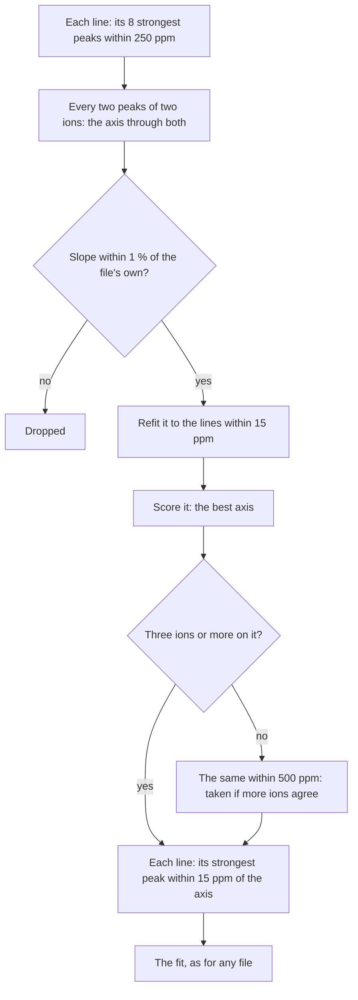
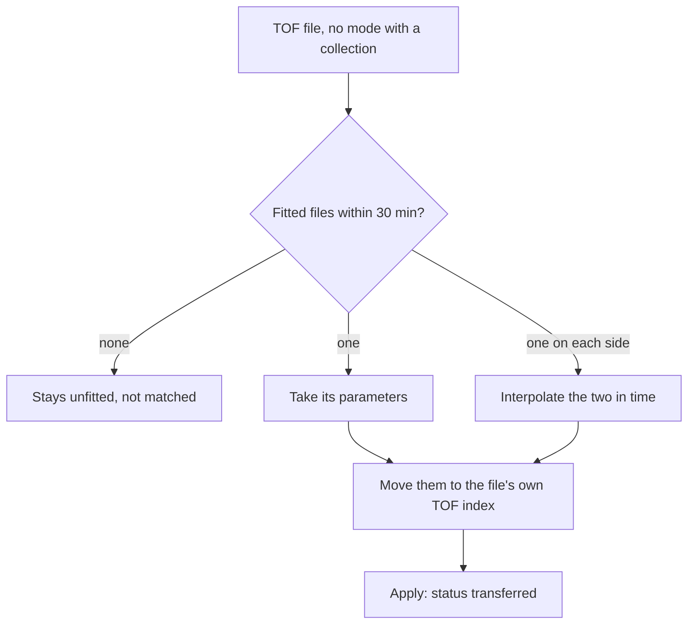
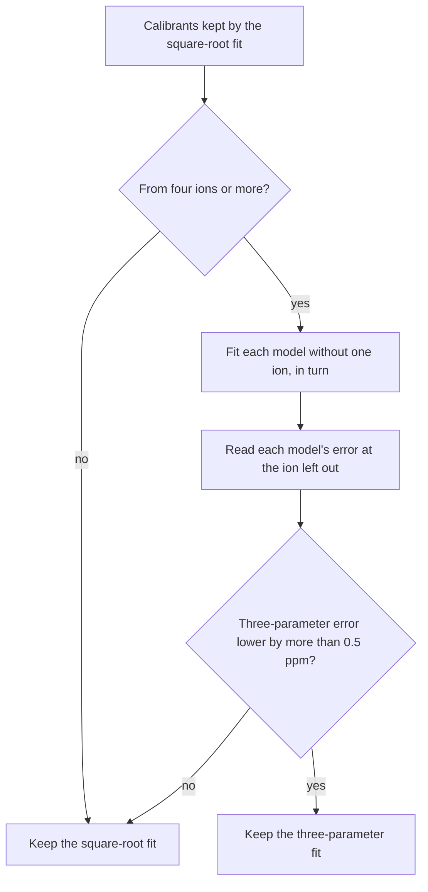

# Mass Calibration

Mass-to-charge ratio ($m/z$) [calibration](https://github.com/ultra-trace-systems/mascope/blob/master/server/backend/src/mascope_backend/api/controllers/calibration/lib/calibration_mz_fit.py) is a critical procedure required to ensure high mass accuracy by aligning known peaks (such as reagent ions) m/zs with their theoretical m/zs.

## Candidate Selection and Matching

Prior to executing instrument-specific regressions, a unified data-cleaning and matching pipeline isolates high-confidence reference points.

Detected peaks are extracted from the sample file and filtered based on their signal-to-noise ratio. 

Reference compounds are pulled from a calibration target collection, generating a list of exact theoretical isotopic masses based on the designated ionization mechanisms and instrument.
The chemistries Mascope ships bring their own when they have a reagent: the reagent ion and its clusters, such as `[Br]-`, `[Br2]-` and `[Br3]-` for bromide, `[NO3]-` with one and two nitric acids for nitrate, or the fluoranthene ion of an Orbitrap's EASY-IC source for the charge-transfer (EASY-IC) chemistries.
They are in every collection list, named after their chemistry (*Bromide, negative calibrants*), each beside a *reagent ions* collection that is matched in every file of the chemistry to follow the source.
Each compound in them is named for the ion it stands for.
A cluster series gives an Orbitrap the one point it needs, and a TOF fit its three points at the low end of the range and no more.
The series ends at $m/z$ 188 for nitrate and 381 for iodide, so the rest of a TOF's range is extrapolated, and one bad match fails the fit or keeps the wrong point.
Give the ionization mode a calibration collection of your own when its files reach well above the clusters, when their spectra do not show every cluster, or when the scan range starts above them, as you would any mode.
Mascope brings a shipped collection up to date with each release until you edit it, and leaves an edited one as you left it.
Peaks are only retained if their observed mass coordinates lie within a parts-per-million refinement window relative to any target isotopic mass.

On Orbitrap data, a local-dominance guard additionally rejects any candidate that lies close to a much stronger peak.
Fourier-transform centroiding of short transients produces weak sidelobe ("satellite") peaks around every intense centroid; these can carry a high signal-to-noise ratio while being orders of magnitude weaker than their parent, and would otherwise anchor the calibration to a slightly shifted mass whenever the true calibrant falls outside the refinement window.

To avoid isobaric interference, adjacent candidate peaks are checked for Full-Width at Half-Maximum (FWHM) overlap.
Each peak is given an expected width envelope, and any overlapping pairs are discarded to keep only clean calibration points.

On a TOF file the numbers are these, and the calibrants are found another way.
A calibrant's isotopes are kept when their relative abundance is at least 0.15.
Peaks of the mode's polarity with a signal-to-noise ratio of at least 10 are candidates within 500 ppm of where the file's own axis puts each line: the search window. The search looks within 250 ppm of it first, as below.
A peak that overlaps a neighbour within one FWHM by the instrument's resolution function is dropped, and so is the neighbour; the local-dominance guard is an Orbitrap rule and is off for TOF.
A TOF peak is 110 to about 430 ppm wide, so on a TOF file the overlap test looks for the neighbour no further than 100 ppm: as far as it looked when only the peaks within the 100 ppm refine window reached it.
Each line keeps its eight strongest remaining peaks in the window, by time-averaged peak area, and the search below decides which of them is the calibrant.
A fit needs at least three matched points; fewer leaves the file with the warning *Not enough calibration peaks*.
The three-parameter model below is tried only where the points kept come from four ions or more.
The residual rule that keeps or drops a point in the fit below is 15 ppm, and a fit whose mean post-fit residual exceeds 15 ppm, or whose points all come from one ion, warns *Calibration inaccurate*.

### How a TOF file's calibrants are found

A TOF fit is absolute: it fits each calibrant peak's time-of-flight index to the calibrant's exact mass (the model below).
The axis the acquisition software wrote is used for one thing only, finding the calibrants, and on the TOFs Mascope has measured it reads 14 to 245 ppm off.
Looked for within a 100 ppm window of where that axis puts them, as up to version 2 of the calibration step, the calibrants go unmatched once the axis is further off than the window, and peaks beside them that happen to agree are fitted instead.
So a TOF file's calibrants are found by the axis on which most of them agree, wherever the file's own axis puts them.
This is a random sample consensus ([Fischler and Bolles, 1981](https://doi.org/10.1145/358669.358692)), exhaustive rather than random, since a collection offers a handful of lines and a few candidates each:

- Every two candidates of two different ions make a hypothesis: the square-root axis through both. A hypothesis whose slope $p_0$ is more than 1 % from the slope of the file's own axis is dropped: a drift of 300 ppm moves the slope by 0.015 %, and two candidates of nearby lines can make an axis of any slope.
- Each hypothesis is refitted by least squares to the lines it puts a candidate within the 15 ppm residual tolerance of, since the axis through two candidates is only as good as those two.
- The hypotheses are ranked by how many calibrant ions have a candidate within 15 ppm of them. Among those that hold as many, the one that holds the most ions within 5 ppm, a third of the tolerance, wins: real calibrants sit that close to a good fit, while peaks that line up by chance spread over the whole tolerance. After that, the brighter lines win, then the smaller mean error.
- Each line then takes its strongest candidate within 15 ppm of the winning axis. A line with none is left out, and a collection of one ion finds no axis at all: both end in *Not enough calibration peaks* when too few lines are left. The fit, its residual rule and the verification below then run as for any file.
- The winning axis need not hold the reagent ion. The collection marks no ion as the reagent, and agreement is the evidence: four or five ions within 15 ppm of one axis do not line up by chance. A reagent line further than the tolerance from the axis the others agree on would be dropped by the fit's residual rule anyway.
- The pre-fit error the record keeps, and the acquisition-drift warning over 50 ppm, are still measured against the file's own axis, so an operator still sees the acquisition calibration drift.
- The automatic pipeline retries a fit that warns at twice the tolerance, up to six times; the search then counts the lines within the wider tolerance.
- The search looks within 250 ppm first, the largest drift measured on a TOF, and takes the best axis there when at least three ions agree on it: two ions always make an axis, so agreement starts at the third. Only when fewer do does it look within the whole search window, 500 ppm, and it takes the axis it finds there only when more ions agree on it than on the one within 250 ppm.
- The wider the window, the more axes peaks that are no calibrant's agree on by chance. On a dense spectrum with a collection of many ions, a window of 2,000 ppm found five ions agreeing on an axis 1,200 ppm off, where the right axis held three. On a drifting TOF's 814 nitrate files, searched within 500 ppm at once, five fits took peaks 380 to 475 ppm from where the file's earlier fit put its calibrants, where an axis within 250 ppm held as many ions, or one fewer. Searched within 250 ppm first, those five fit within 45 ppm of the earlier fit, as most files of their day did.
- A file whose axis is further off than 250 ppm is fitted on its calibrants only where fewer than three ions agree on an axis within 250 ppm, and on a dense spectrum three may do so by chance. A file whose axis is further off than 500 ppm has none of its calibrants among the candidates. On a sparse spectrum it then ends in *Not enough calibration peaks*. On a dense one, three or more ions may still agree on an axis by chance, and the file gets a fit on peaks that are not its calibrants. The [verification](#verification)'s 40% share of the collection's lines may flag such a fit, but need not. The acquisition-drift warning flags a drift over 50 ppm long before either.
- On a TOF file, the calibration dialog's **Refine window** does not limit the search: the search window does, and it is not a setting.

## Quality Assessment and Scoring

Each target isotope is matched to the highest-intensity sample peak located within the chosen mass tolerance range.
A peak can be matched by several target ions of the collection: an ion reached through two ionization pathways, or the main line of one calibrant that is also a minor isotope line of another, such as a labelled reagent beside its unlabelled compound.
Such a peak contributes one point, read as the line with the highest relative abundance among its matches, so a calibrant's main line is not discarded for also being another ion's minor line.
Matches of equal abundance are separated by their mass error and isotope formula, never by anything that differs between servers, so the same file and collection give the same calibrants everywhere.

To evaluate the quality of candidate calibration assignments, a multi-parametric statistical assessment is performed on each matched target isotope.
For each distinct target ion, a principal reference point is defined by isolating the "main isotope" - the configuration with the maximum theoretical relative abundance.
The observed intensities are normalized against the selected main isotope reference to calculate relative observed intensities $I_{\text{rel}}$.
Normalized theoretical abundance $A_{\text{norm}}$ is derived by scaling the theoretical isotopic abundance against the theoretical abundance of the main reference isotope.
Abundance error $E_{\text{abundance}}$ is evaluated as the relative difference between the measured and theoretical normalized distributions:

$$E_{\text{abundance}} = \frac{I_{\text{rel}}}{A_{\text{norm}}} - 1.0$$

The mass accuracy of the observed peak is checked by tracking its displacement from the theoretical position.
The localized $m/z$ error ($E_{m/z}$) is converted to $\text{ppm}$ units to provide a standardized metric for comparison across the mass range:

$$E_{m/z} = 10^6 \times \frac{m/z_{\text{observed}} - m/z_{\text{theoretical}}}{m/z_{\text{theoretical}}}$$

To combine the metrics into a single confidence indicator, the algorithm applies a multiplicative joint scoring routine.
Both the abundance and mass components are bounded to protect the system from extreme outliers.
Penalty scaling is capped so that an abundance error of $1.0$ ($100\%$) or greater drops the abundance component score to zero:

$$\text{Component}_{\text{abundance}} = 1.0 - \min\left(1.0, |E_{\text{abundance}}|\right)$$

Mass accuracy component is evaluated using a linear penalty coefficient of $10^{-2}$ ($1\%$) per $\text{ppm}$ of deviation, with a floor constraint preventing negative values:

$$\text{Component}_{m/z} = \max\left(0.0, 1.0 - 10^{-2} \times |E_{m/z}|\right)$$

The final aggregate match score represents the product of these two components, yielding a value strictly bounded within a $[0.0, 1.0]$ interval where $1.0$ indicates an ideal experimental-to-theoretical alignment:

$$\text{Match Score} = \text{Component}_{\text{abundance}} \times \text{Component}_{m/z}$$

The resulting pairs are filtered using four strict quality control filters: a minimum relative isotopic abundance, a minimum absolute peak intensity, a maximum allowable baseline mass error, and a minimum match score.

### The brightest calibrants are left out

The brightest lines are the worst calibrants on an Orbitrap.
A line that carries a large share of the ion current reads high against the weaker lines of its own file.
Space charge in the trap is the usual explanation for such a shift ([Kharchenko et al., 2012](https://doi.org/10.1007/s13361-011-0325-3)); Mascope does not model it, it leaves those lines out.
The Orbitrap fit is the median of its lines, so a calibration collection that holds the reagent's own base peak lands between the bright line and the weak ones.

So the fit leaves out a calibrant brighter than a cap, as it leaves out one below the minimum intensity.
The cap is two optional parameters, and a line over either is left out:

- `calibrant_tic_share_max`: the largest share of the total ion current one calibrant line may carry. A file calibrated range by range measures each line against the ion current of its own scan range; any other file, against the ion current of the sample's polarity. A line's intensity is its height averaged over those scans, and the ion current is their mean per scan.
- `peak_intensity_max`: the largest intensity, beside the minimum intensity.

On an Orbitrap the share cap is 28 % by default, and there is no intensity cap.
On a TOF neither is set.
The 28 % comes from a measurement on the assignment gate's Orbitrap files, two instruments, each calibrant held against the trend over m/z of its own file's assigned analytes:

| Share of the ion current | Lines | Error against the analytes' trend |
|---|---|---|
| 16 % or less | 106, on 38 files | -1.0 to +0.7 ppm, 0.3 ppm apart |
| 32 % or more | 5, on four sets | +0.6 to +4.0 ppm |

The cap sits between the two.
The only lines in between are one bromide set's two calibrants, at 13 to 24.6 %, which are all that set's files hold.
The cap sits at 28 %, in the empty gap from 24.6 to 31.8 %, so that no file of that set lands just above or below it.

A cap that would leave fewer lines than the fit needs is set aside, and the fit is made on every line as if there were no cap: one line for an Orbitrap, three for a TOF.
That fit is the one the file had before the cap, and the verification below still judges it.

The fit's record says what the cap did, under `calibrant_cap` in its quality block: the cap in effect (`tic_share_max`, `peak_intensity_max`), how many lines it left out (`n_excluded`), and whether it was set aside (`fell_back`).
A file calibrated range by range has the same block for each range, and the file's counts the lines left out across them.
The calibration dialog has no field for the cap, so a fit from the dialog uses the instrument's default.
Through the API, either parameter can be set in the request body of `POST /api/calibration/mz_fit`, and of the `mz_calibrate` routes for a sample or a batch.
A parameter that is left out or `null` takes the instrument's default, so `null` does not turn the cap off.
To turn the share cap off, send a `calibrant_tic_share_max` of 1 or more: no line carries more than the whole ion current.

Peak assignment's mass gate reads the source's own lines by the same cap.
A reagent line brighter than it does not anchor the gate's calibration, and the run's record counts such lines as `reagent_capped` ([peak assignment](peak-assignment.md)).

## Outlier Rejection and Model Fitting

To insulate the calibration from false matches, the pipeline splits its outlier rejection strategy based on the size of the qualified match pool.

### Large Match Pool (More than 5 Points)

The entire dataset is initially fitted to the calibration model.
Elements whose resulting post-calibration residual errors exceed the set mass error tolerance are pruned, and the remaining clean subset is passed to the final fit.

### Small Match Pool (5 or Fewer Points)

An exact Random Sample Consensus (RANSAC) routine brute-forces every mathematically viable subset down to the instrument's minimum required calibration points.
Each subset is evaluated by fitting the model and scoring the results according to the number of retained points and then minimized mean internal residuals.
The highest-scoring consistent subset is chosen.
If no sub-group cleanly decouples in-tolerance points from outliers, the calibration is aborted.

A subset no larger than the model can absorb is fitted exactly and has no internal residual to be scored by.
A TOF model is never fitted on so few points: it takes one point more than it has parameters, three for the square-root model and four for the three-parameter one.
This is the case for an Orbitrap file whose calibrants all disagree with one another by more than the tolerance: each one alone is a perfect one-point fit.
Between such subsets the one that asks for the smallest correction is kept, the calibrant closest to its theoretical mass before the fit, because a mass axis is far more likely to be nearly right than far off and a match that needs a large correction is more likely a neighbouring peak than the calibrant.
The verification below still judges the result: a one-point fit is trusted only while its correction is small.

## Calibration Models

Once a clean set of paired calibration points is established, the pipeline branches into instrument-specific regression models.

### Time-of-Flight (TOF) Multi-Point Calibration

The [TOF architecture](https://github.com/ultra-trace-systems/mascope/blob/master/libraries/tofwerk/src/mascope_tofwerk/calibration.py) maps ion arrival times to mass coordinates using a multi-point regression that requires a minimum of 3 calibration points. 
An initial guess for the relationship is established by computing a linear least-squares regression between the square root of the exact target masses and their corresponding observed time-of-flight values.
A non-linear least-squares minimization is executed using the Trust Region Reflective algorithm.
The optimization minimizes a residual function defined as:

$$\text{Residual} = p_0 \sqrt{m} + p_1 - \text{TOF}$$

where $m$ is the exact mass, $\text{TOF}$ is the measured time-of-flight, and $p_0, p_1$ are the coefficients being optimized.
The optimization utilizes a soft $L_1$ loss function to handle minor residual deviations.
The optimized parameters are used to re-calculate the mass axis according to the following analytical form:

$$m = \left( \frac{\text{TOF} - p_1}{p_0} \right)^2$$

A TOF fit is absolute.
Applying it recomputes the m/z axis from the stored time-of-flight index of every point of the spectrum and every detected peak, and nothing depends on the axis the file had before (an Orbitrap fit, by contrast, rescales the stored axis by a cumulative factor).
So re-calibrating needs no peak re-detection, an earlier fit is restored exactly from its parameters, in either model, and applying the same fit twice changes nothing.
Applying a fit clears the file's matches and marks its batches for rematching; a batch still waiting on a recalibration stays marked for it.
Editing the compounds of the calibration collection a mode already uses marks every batch holding that mode's files for recalibration, as pointing the mode at another collection does. Their status icon then offers to re-calibrate the batch. The files stay on their old calibration until someone re-calibrates them: recalibrating the batch refits them on the collection as it is now and leaves the batch marked for rematching. Renaming the collection, or attaching it to batches, changes no fit and marks nothing for recalibration. A collection no mode calibrates on is matched only, and editing it marks its batches for rematching.
A TOF file that has never been fitted carries the axis the acquisition software wrote, stamped `unfitted` in its calibration record.

#### Modes without calibrants: a calibration transferred from neighbouring files

Some modes of a multi-scheme TOF have no calibration collection: an ambient or a zero mode, run between the reagent modes within minutes.
Their spectra hold too few known ions to fit on, and the axis the acquisition software wrote can be 100 ppm off or more.
Such a file takes its calibration from its neighbours instead:

- **The neighbours** are files of the same instrument and polarity whose own fit cleared the quality bar. A fit below the bar, a failed one, and another transferred calibration never lend theirs. Times are each file's centre, its start plus half its length.
- **Within 30 minutes**, centre to centre. The nearest neighbour before the file and the nearest after it are taken. With both, their parameters are interpolated linearly in time; with one, its parameters are taken as they are. With none, the file stays unfitted and is not matched, and its processing status says why.
- **The time-of-flight index.** Each file's stored spectrum starts where the converter cut off the samples below 10 Th, and where that is depends on the file's own acquisition axis. One sample is about 20 ppm at 100 Th. So each neighbour's offset $p_1$ is moved to the raw spectrum's index by its own cut before the interpolation, and to the file's index by the file's cut after it. The cuts are read from each file's Tofwerk `.h5`; a file stored without one gets no transfer.
- **Models.** The square-root model is the three-parameter one at $p_2 = 0.5$, so a square-root and a three-parameter neighbour are interpolated in the three-parameter model.

The record says `status: "transferred"`, and keeps under `transfer` each source file's id with its signed time gap in seconds (`gap_s`, negative before the file) and its weight, the gap to the nearest source, the window (`window_s`), and the file's own cut (`raw_index_offset`).
A transferred calibration is verified: the sample is matched and assigned on it.
It has no quality block of its own and does not appear on the calibration trend.
A fit of the file itself replaces it as soon as its mode has calibrants, and a transfer never replaces a fit of the file itself or a failed fit's marker.
Processing the file again makes the transfer again, from the neighbours it has then.

A file is processed when it arrives, and the neighbour after it has usually not arrived yet, so a new file mostly takes the calibration of the one before it.
Processing it again once its later neighbour is in interpolates between the two.

#### The three-parameter model

In an ideal time-of-flight analyser the flight time grows with the square root of m/z ([Guilhaus, 1995](https://doi.org/10.1002/jms.1190301102)), which is the model above.
A real instrument departs from it a little, and on a well-spread calibrant set the square-root fit leaves a bow of a few ppm across the calibrants: on one production TOF, −8 ppm at 41–58 Th and +2 to +4 ppm at 100–150 Th.
Tofwerk's acquisition software offers a three-parameter model, which it numbers mode 2:

$$\text{Residual} = p_0 m^{p_2} + p_1 - \text{TOF}$$

with the mass axis

$$m = \left( \frac{\text{TOF} - p_1}{p_0} \right)^{1/p_2}$$

The square-root model is this one at $p_2 = 0.5$.
The fit starts from the square-root fit's coefficients and $p_2 = 0.5$, and uses the same soft $L_1$ loss.

With a parameter more, the three-parameter model always fits the calibrants at least as closely, so its own residuals cannot say whether it reads the axis better.
The pipeline judges it by leave-one-out cross-validation ([Stone, 1974](https://doi.org/10.1111/j.2517-6161.1974.tb00994.x)):

- The calibrants are those the square-root fit keeps, by the rules above.
- Each model is fitted on the lines of every calibrant ion but one, in turn, and its error is read at the lines of the ion left out. An ion's lines are left out together: the two lines of a bromide ion lie 2 Th apart and read the axis at one place.
- The three-parameter fit is kept when its mean held-out error is more than 0.5 ppm below the square-root model's. Otherwise the square-root fit is kept, as it is when the calibrants come from fewer than four ions.
- A three-parameter fit whose offset $p_1$ lies at or past the first time-of-flight sample is not kept either: it would give the samples before the offset no mass.

#### What a TOF record says

Beside its parameters and the counts and mean errors of its quality block, a TOF fit's calibration record says what the fit was made on:

- **Points**: every calibrant line the fit chose from, the ones it left out included. Each has its ion, its exact and observed m/z, its residual under the fit in ppm, the signal-to-noise ratio of its peak, and whether the fit kept it. The residual is the fit's m/z at the peak's time-of-flight index against the exact m/z, as the TOF calibration audit reads it. A line the search found no peak for within 15 ppm of its axis, or the matching turned down, never reached the fit and is not listed.
- **Span**: the exact m/z of the lowest and the highest line kept. Peaks outside it are on an extrapolated axis.
- **Strong peaks**: how far the file's strong peaks reach: those of the fit's polarity with a signal-to-noise ratio of 20 or more, read at the fifth lowest and the fifth highest, so that a stray peak at the end of the axis does not decide it. The record keeps their count beside it. The [verification](#verification) holds this reach against the span.
- **Lines**: how many distinct lines the collection offered above the abundance floor, matched or not. A line two ions share counts once.
- **Collection**: the calibration collection, and a hash of the isotopes it offered under the mode's ionization mechanisms: their formulas, exact m/z and abundances. Editing the collection's compounds changes the hash, so files fitted on different versions of one collection can be told apart. The hash is the same on every server.
- **Model**: the model kept, by Tofwerk's number: 0 for the square-root model, 2 for the three-parameter one. Its equation is in Tofwerk's names, `i = p1*sqrt(m) + p2` or `i = p1*m^p3 + p2`: `i` is the time-of-flight index, `p1` and `p2` are $p_0$ and $p_1$ above, and `p3` is $p_2$. Beside it, `compared` lists each model's mean held-out error in ppm, and `min_gain_ppm` the 0.5 ppm the three-parameter model has to gain. `compared` is empty (`null`) when the calibrants came from fewer than four ions, and a model whose fits failed has no error in it.
- **Search**: how the calibrants were found: the window the winning axis was found in, in ppm (`window_ppm`): 250, or 500 where the search had to look further, and how many lines, of how many ions, the winning axis held within the tolerance (`n_lines`, `n_ions`). The record keeps the refinement window it was given as well, which no longer limits a TOF search.
- **Node version**: the version of the calibration step that made the fit. Version 1 fitted the square-root model alone; version 2 also tries the three-parameter one; version 3 finds the calibrants by the search above, where versions 1 and 2 matched each within the refinement window of where the file's axis put it.

The calibration dialog lists the points of the fit it previews, a line the fit left out in muted text, and the badge of a calibrated TOF sample names the span.
A sample list (`GET /api/samples`) leaves the points out of each sample's record, so a large batch's list stays small; the rest of the record is there. `GET /api/calibration/mz_calibration` answers one sample's whole record, points included.
A record written before these were kept has the counts and mean errors only, and reads and applies as it always did.

### Orbitrap One-Point Scaling Calibration

The Orbitrap pipeline applies a localized, linear adjustment based on a single-point scaling approach, requiring a minimum of 1 calibration point.
Rather than adjusting multiple coefficients, the algorithm determines the median ratio between the exact target masses and the observed sample masses across all accepted matches:

$$\text{Scaling Factor} = \text{median}\left(\frac{m_{\text{target}}}{m_{\text{observed}}}\right)$$

The instrument's new operational calibration factor is calculated by scaling its pre-existing calibration factor (which defaults to 1.0 if no prior calibration exists):

$$\text{Calibration Factor}_{\text{new}} = \text{Calibration Factor}_{\text{old}} \times \text{Scaling Factor}$$

Calibrated mass values are computed by directly multiplying the observed mass values by the scaling factor:

$$m_{\text{calibrated}} = m_{\text{observed}} \times \text{Scaling Factor}$$

#### The offset it reports

A factor moves every line by the same ppm.
An axis can also carry a constant offset in millidaltons, which is more ppm at low m/z: one gate set reads -0.11 to -0.14 mDa, and no factor removes that.
So beside its factor, an Orbitrap fit also fits the line

$$\text{error}_{\text{ppm}} = a + b \times \frac{1000}{m/z}$$

over the calibrants it kept, each line's error taken of the m/z the instrument recorded.
$b$ is the offset in mDa and $a$ the factor term in ppm.
With no offset, $a$ is the recorded axis' error, about the fit's axis correction with the sign turned.
A file calibrated range by range is fitted over the calibrants of all its ranges together, since one narrow range can barely tell an offset from a factor.

The offset is reported, not applied: the record stays a factor.
The quality block's `offset` has `offset_mda`, `factor_ppm`, the offset's standard error `offset_se_mda`, how many lines it was fitted on (`n_lines`) and the exact m/z of the lowest and the highest (`span`).
The line is fitted only where the calibrants can tell the two terms apart: three lines or more, spread so that $1000 / (m/z)$ differs by at least 3 across them.
Across that spread an offset of 0.1 mDa moves the error by 0.3 ppm, the scatter of the calibrants measured above.
Elsewhere both terms are null and `reason` says why.

### The Orbitrap Axis Fingerprint

An Orbitrap measures how often each ion oscillates in the trap, and converts that frequency $f$ to m/z with the instrument's mass calibration, $m/z = B/f^2 + C/f^4$ ([Makarov, 2000](https://doi.org/10.1021/ac991131p); the [OpenTFRaw format documentation](https://github.com/Sigilweaver/OpenTFRaw/blob/main/docs/docs/format/10-frequency-to-mz.md)).
On some Orbitrap models, the Q Exactive Plus among them, the data system divides the frequency axis into bands about 16 kHz wide.
Each mass calibration of the instrument stores one small m/z offset per band, on top of a smooth trend.
After a good calibration the offsets are a fraction of a ppm to a few ppm; after a poor one they can reach tens of ppm.
The instrument does not report them, and a lock mass cannot remove them: it scales a whole scan by one factor, while the offset steps from band to band.

The raw file keeps these offsets: it stores one m/z correction with each stretch of a scan's profile ([OpenTFRaw changelog](https://github.com/Sigilweaver/OpenTFRaw/blob/main/CHANGELOG.md), 1.4.1).
When Mascope converts a raw Orbitrap file, it reads the offset of each frequency band back from the spacing of the stored profile points, for each acquisition mode of the file, and records which lock mass each scan was corrected with.
This per-file description is the file's **axis fingerprint**.
It is stored with the file and served through the API and the SDK ([The axis fingerprint of an Orbitrap file](../sdk/index.md#the-axis-fingerprint-of-an-orbitrap-file)), for clients that correct the mass axis band by band themselves, such as [Peaky](https://github.com/ultra-trace-systems/peaky).

Mascope itself changes no m/z with the fingerprint.
Its own Orbitrap calibration is the one-point scaling above: one factor per file, or per scan range, multiplied into every m/z.
On a model whose data system uses no such bands, as on the Exploris models measured, the fingerprint shows no steps between bands.
On a model whose FFT step is not a power of two in kHz, such as the Exploris MX, each mode carries the flag `fft_step_not_power_of_two`.
Its spacing is then read against the measured step rather than the nominal one.
So every absolute level of such a mode, such as `s_ppm`, `levels` and `s_lock_eff_ppm`, is off the correction the file stores by one constant per file: 2.4 to 4 ppm on the files measured.
The steps between its bands are not affected.
A file converted before the fingerprint existed has none until an operator runs the backfill script for it.

The measurement, its quality flags and the code are described in the [reader pipeline notes](https://github.com/ultra-trace-systems/mascope/blob/master/libraries/thermo/docs/reader_pipeline.md#71-the-axis-fingerprint).

## Verification

A fit that runs to completion is not necessarily a good one: two calibrants that disagree are split down the middle, and a single calibrant fits itself perfectly.
Matching and peak assignment trust a calibrated file's mass axis, so after a fit is applied it is checked against a quality bar:

| Criterion | Orbitrap | TOF |
|---|---|---|
| Mean post-calibration $\lvert m/z \rvert$ error | at most 1 ppm | at most 10 ppm |
| Correction made by a fit nothing corroborates (one point, or two isotopes of one ion) | at most 10 ppm | at most 10 ppm |
| Distinct calibrant ions, for a fit on 3 or more points | at least 2 | at least 2 |
| Share of the collection's lines the fit kept | not checked | at least 40% |
| How far the strong peaks reach past the lines kept | not checked | at most 1.25 widths of the span, on the square-root scale |

One or two calibration points are common for narrow mass ranges and EasyIC.
Two points from different ions check each other, so such a fit is judged on its error alone.
A single point (or two isotopes of one ion) cannot, so it is trusted only while the correction it makes is small: a single calibrant that moves the axis tens of ppm has most likely been matched to the wrong peak.
The correction is measured from the axis the instrument wrote, so recalibrating a file an earlier fit moved does not hide it.

A TOF fit must also keep at least 40% of the lines its calibration collection offers.
Up to version 2 of the calibration step, when the axis the instrument wrote was further off than the refine window, a calibrant's own peak was not where matching looked for it.
A line of a sample ion among dense peaks then found a neighbouring peak instead, and three such neighbours fitted the model with a small error.
Kept on a few of many lines, such a fit can sit hundreds of ppm from the right axis.
The search of version 3 finds the calibrants wherever that axis puts them, and the check still holds a fit to a share of its collection's lines.
Most right fits keep most of their collection's lines: on production TOFs, three in four keep 60% or more.
So a right fit on few of a long collection's lines can also be flagged.
A collection of 7 lines or fewer is never caught by this check, since a TOF fit needs 3 points.
A record written before fits counted their collection's lines is not judged on it.

A TOF fit holds between the lines it kept; past them its axis is extrapolated.
A record can look healthy and still leave most of the file's peaks there: on one instrument, a set calibrated on 41–148 Th, in files with strong peaks to about 450 Th, read 10 to 21 ppm low above 160 Th with a mean error of 3–5 ppm after the fit.
So a TOF fit is flagged *extrapolated* when the file's strong peaks reach far past its span at either end, and the message names both: "Calibrated on 41–148 Th; peaks to 450 Th are extrapolated."

The distance is measured on the scale the model is a straight line on, $\sqrt{m/z}$, and in widths of the span on that scale.
The error of a straight line fitted on points grows with the distance past them, in units of how far apart the points lie ([Draper and Smith, 1998](https://doi.org/10.1002/9781118625590), the variance of a predicted value).
The fit is flagged when the strong peaks reach more than 1.25 widths past either end.
That limit lies between the cases measured on the fleet:

| Set | Strong peaks to | Widths past the top | Flagged |
|---|---|--:|---|
| 41–148 Th, the set that read 10–21 ppm low | 450 Th | 1.57 | yes |
| 41–228 Th, its corrected set | 450 Th | 0.70 | no |
| 41–228 Th | 611 Th | 1.10 | no |
| 62–188 Th, nitrate | 500–700 Th | 1.5–2.2 | yes |

The corrected set clears the check up to 674 Th, and a nitrate set on 62–188 Th up to 441 Th.
On a sample of two sites' files over 60 days, the old 41–148 Th set is flagged on 17 of 36 files: those whose strong peaks reach past about 375 Th.
The corrected set is flagged on none of them; the farthest sits 1.12 widths past.
On the negative modes, the 62–188 Th nitrate set is flagged on 399 of 612 files, the more often the higher their strong peaks reach (up to 1,300 Th).
At the low end, the check flagged only records whose lowest line sat at 79 Th or higher.
A fit flagged *extrapolated* is no worse inside its span: its error there is still the one it reports.
The lasting fix is a calibrant higher up the axis, an ion in every file of the mode.
A record written before fits kept the reach of their strong peaks is not judged on it; re-calibrating the file records it.

A file stitched from several scan ranges is calibrated range by range, and each range fitted on calibrants of its own is checked against the bar on them, as well as the file as a whole.
A range fitted on a single calibrant (or on two isotopes of one ion) is corroborated by another range of the same file when that range is fitted on calibrants of two or more ions, clears the bar itself, and makes a correction within 2 ppm of the first range's.
The two ranges then read the same offset of the instrument's axis, where a single calibrant matched to the wrong peak would move its range tens of ppm away from the others.

A fit that misses the bar is still applied, since it is usually closer than the axis the instrument wrote, and the sample gets an amber badge whose tooltip gives the reasons.
What happens next is a server setting, `calibration_quality_gate` in the `[backend]` section of the server configuration:

- `"warn"` (the default): the sample is matched and assigned as usual. Treat its mass errors with care until the calibration is fixed.
- `"enforce"`: the sample is left out of matching and peak assignment until it is recalibrated, or until an operator accepts the fit in the calibration dialog. An accepted fit is used downstream, and the sample keeps a warning badge saying so.

Run on `"warn"` first and look at which ionization modes the amber badges gather in.
Usually the lasting fix is in the calibration collection: two calibrants that disagree by a couple of ppm need a third, so that three or more points from at least two ions are found across the mass range.
Once the badges are rare, switch to `"enforce"`.

TOF files arrive carrying the axis the acquisition software wrote.
Until a fit replaces it, that axis is unverified and the sample is not matched.
A file in a mode without a calibration collection takes its neighbours' calibration where it can ([Modes without calibrants](#modes-without-calibrants-a-calibration-transferred-from-neighbouring-files)).
If the ionization mode had no calibration collection when the files were uploaded, calibrate them from the batch menu once a collection is set.

## Calibration Trend of a TOF Instrument

One record says how one file was fitted. Read across an instrument's files, the records show what no single one does: a calibrant that starts to read off, an axis that drifts before the fit corrects it, and the times the calibrant collection changed.

To see it, open the **Raw files** tab, select a TOF instrument in the instrument selector, and click **Calibration trend** beside it. The dialog reads one polarity over a window of acquisition times, the last 90 days unless you choose 30 or 365, and draws one panel per measure on one time axis:

- **Axis offset before the fit**: the signed mean error of the calibrant lines the fit kept, before it, in ppm. On a file's first fit this is how far off the acquisition software wrote the axis. A refit reads its peaks on the axis the previous fit set, so its offset is near zero; the record does not keep the acquisition's own axis to read it again.
- **Mean residual after the fit**: the mean size of the kept lines' error under the fit, in ppm, as the quality bar reads it.
- **Lines kept of the lines matched**: how many calibrant lines the fit kept (filled), and how many it chose from (open). A cross at zero is a file whose calibration failed.
- **One panel per calibrant line**, by m/z: its residual under the fit in each file that lists it. A filled point is a line the fit kept, an open point one it left out as disagreeing with the others.

A point's colour says which calibrant collection fitted the file, the first three collections each in a colour of their own and any further ones in grey. A dashed line through every panel marks a change of collection, numbered at the top and listed above the chart:

- **edited**: the first file fitted with a new version of a collection: what it offers the fit changed, its compounds or the ions the mode's mechanisms make of them (the record's collection hash, [What a TOF record says](#what-a-tof-record-says));
- **first used**: the first file fitted with a collection no earlier file was fitted with, while files before it were fitted with another.

A version some file acquired before the window was fitted with is not new, and the first collection on record is no change. Files are placed by when they were acquired, not by when they were fitted, which no record says: refitting older files with a new version moves its mark back to the earliest of them.

A file fitted before records listed their lines shows on the mean residual and the counts only, and the dialog says how many such files the window holds. A file still on the acquisition's axis, never fitted, is not shown and not counted.

### Busy instruments: medians per hour or day

A busy TOF instrument acquires 130 to 160 files a day, and points that many overlap until a panel is one solid band. So the trend sums files up in bins: per hour in a window of 30 days or fewer, per day in a longer one, and per collection, so that the day a collection changed has a bin in each colour. For each bin it takes the median and the first and third quartiles, each read linearly between the two values nearest it ([Hyndman and Fan, 1996](https://doi.org/10.1080/00031305.1996.10473566), their definition 7). The median is drawn as a line over a shaded band from the first quartile to the third, the middle half of the bin's files. Line and band break where three bins in a row or more have no file.

- **Up to 5,000 fitted or failed files** in the window, the dialog draws every file. A panel with more than 300 points draws the lines kept as small, faint points under the median line and its band. The lines left out stay open and opaque, as do the crosses of failed calibrations: they are the few.
- **More than 5,000 files**, the window is summed up in the database and the dialog draws the medians and bands alone, with a dot on each median. It says how many files they sum up. For a calibrant line, the median and quartiles are taken over every file that lists the line, kept or left out, and its hover says how many files list it and how many of those kept it. The lines matched are a dashed median beside the lines kept, and a day or hour with failed calibrations has a cross at zero. Choose a shorter window to see each file.

A binned window reads at most 100,000 files, the latest; one that holds more says so. That is 20 months of the busiest instrument.

**Export CSV** downloads the window's files as a table, one row per calibrant line of each file, also where the chart shows bins: its acquisition time, name, status and collection version, the fit's counts and errors, and the line's ion, exact and observed m/z, offset before the fit, residual, signal-to-noise ratio and whether the fit kept it. A file whose record lists no lines has one row. The table lists at most the latest 20,000 files of the window, and the dialog says so when the window holds more.

The trend is served by `GET /api/calibration/trend` and the table by `GET /api/calibration/trend/export`, each with the `instrument`, the `polarity` (`+` or `-`) and the window (`datetime_min`, `datetime_max`). The trend says whether it is `binned`, the `bin` width, and `n_files`; it serves either `files` one by one or `bins`, with each calibrant line's values aligned with them. Both are open to a guest of the instrument's acquisition workspace. A collection in a workspace you are not a member of is shown without its name, as is one deleted since: both read **Hidden or deleted collection**.

## Calibration Status Badge

The sample browser shows each sample's calibration outcome in the calibration column:

| Badge | Meaning |
|---|---|
| Green | Calibrated and verified. |
| Faint green | Calibration transferred from neighbouring fitted files of the instrument, for a mode without calibrants. Verified and matched; the tooltip says from how many files and how far away. |
| Teal | Calibrated and verified, but the file's own axis was far off before calibration (acquisition drift). The data is fine; the instrument needs retuning. |
| Amber | Calibrated below the quality bar. Matched anyway (warn-only servers), accepted by an operator and used, or left out of matching - the tooltip says which, and why the fit missed the bar. |
| Amber | Calibrated on an older version of the calibration collection: its compounds changed since the file was fitted, or the mode now calibrates on another collection or with other ionization mechanisms. Recalibrate the batch to fit the file on the current calibrants. A fit already amber for its quality says this in its tooltip too. TOF fits only: their record names the collection version (the **Collection** hash of [What a TOF record says](#what-a-tof-record-says)). |
| Red | Calibration failed; the sample is uncalibrated and not matched. |
| Grey | Not calibrated (a TOF file still on its acquisition axis), or not verified. |
| Faint grey | Calibration does not apply: no calibration collection, or a blank file. |

Click a badge to open the calibration dialog for that sample.
For a transferred calibration the dialog says where it came from, and that a fit saved there replaces it.
