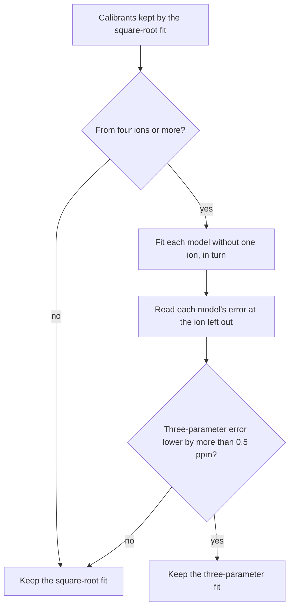

# Mass Calibration

Mass-to-charge ratio ($m/z$) [calibration](https://github.com/ultra-trace-systems/mascope/blob/master/server/backend/src/mascope_backend/api/controllers/calibration/lib/calibration_mz_fit.py) is a critical procedure required to ensure high mass accuracy by aligning known peaks (such as reagent ions) m/zs with their theoretical m/zs.

## Candidate Selection and Matching

Prior to executing instrument-specific regressions, a unified data-cleaning and matching pipeline isolates high-confidence reference points.

Detected peaks are extracted from the sample file and filtered based on their signal-to-noise ratio. 

Reference compounds are pulled from a calibration target collection, generating a list of exact theoretical isotopic masses based on the designated ionization mechanisms and instrument.
The chemistries Mascope ships bring their own when they have a reagent: the reagent ion and its clusters, such as `[Br]-`, `[Br2]-` and `[Br3]-` for bromide, `[NO3]-` with one and two nitric acids for nitrate, or the fluoranthene ion of an Orbitrap's EASY-IC source for the charge-transfer (EASY-IC) chemistries.
They are in every collection list, named after their chemistry (*Bromide, negative calibrants*), each beside a *reagent ions* collection that is matched in every file of the chemistry to follow the source.
Each compound in them is named for the ion it stands for.
A cluster series gives an Orbitrap the one point it needs, and a TOF fit its three points at the low end of the range and no more.
The series ends at $m/z$ 188 for nitrate and 381 for iodide, so the rest of a TOF's range is extrapolated, and one bad match fails the fit or keeps the wrong point.
Give the ionization mode a calibration collection of your own when its files reach well above the clusters, when their spectra do not show every cluster, or when the scan range starts above them, as you would any mode.
Mascope brings a shipped collection up to date with each release until you edit it, and leaves an edited one as you left it.
Peaks are only retained if their observed mass coordinates lie within a parts-per-million refinement window relative to any target isotopic mass.

On Orbitrap data, a local-dominance guard additionally rejects any candidate that lies close to a much stronger peak.
Fourier-transform centroiding of short transients produces weak sidelobe ("satellite") peaks around every intense centroid; these can carry a high signal-to-noise ratio while being orders of magnitude weaker than their parent, and would otherwise anchor the calibration to a slightly shifted mass whenever the true calibrant falls outside the refinement window.

To avoid isobaric interference, adjacent candidate peaks are checked for Full-Width at Half-Maximum (FWHM) overlap.
Each peak is given an expected width envelope, and any overlapping pairs are discarded to keep only clean calibration points.

On a TOF file the numbers are these.
A calibrant's isotopes are kept when their relative abundance is at least 0.15.
Peaks of the mode's polarity with a signal-to-noise ratio of at least 10 are candidates, and the refinement window is 100 ppm around each calibrant.
A peak that overlaps a neighbour within one FWHM by the instrument's resolution function is dropped, and so is the neighbour; the local-dominance guard is an Orbitrap rule and is off for TOF.
Each calibrant then takes the strongest remaining peak in its window, by time-averaged peak area.
A fit needs at least three matched points; fewer leaves the file with the warning *Not enough calibration peaks*.
The three-parameter model below is tried only where the points kept come from four ions or more.
The residual rule that keeps or drops a point in the fit below is 15 ppm, and a fit whose mean post-fit residual exceeds 15 ppm, or whose points all come from one ion, warns *Calibration inaccurate*.

## Quality Assessment and Scoring

Each target isotope is matched to the highest-intensity sample peak located within the chosen mass tolerance range.
A peak can be matched by several target ions of the collection: an ion reached through two ionization pathways, or the main line of one calibrant that is also a minor isotope line of another, such as a labelled reagent beside its unlabelled compound.
Such a peak contributes one point, read as the line with the highest relative abundance among its matches, so a calibrant's main line is not discarded for also being another ion's minor line.
Matches of equal abundance are separated by their mass error and isotope formula, never by anything that differs between servers, so the same file and collection give the same calibrants everywhere.

To evaluate the quality of candidate calibration assignments, a multi-parametric statistical assessment is performed on each matched target isotope.
For each distinct target ion, a principal reference point is defined by isolating the "main isotope" - the configuration with the maximum theoretical relative abundance.
The observed intensities are normalized against the selected main isotope reference to calculate relative observed intensities $I_{\text{rel}}$.
Normalized theoretical abundance $A_{\text{norm}}$ is derived by scaling the theoretical isotopic abundance against the theoretical abundance of the main reference isotope.
Abundance error $E_{\text{abundance}}$ is evaluated as the relative difference between the measured and theoretical normalized distributions:

$$E_{\text{abundance}} = \frac{I_{\text{rel}}}{A_{\text{norm}}} - 1.0$$

The mass accuracy of the observed peak is checked by tracking its displacement from the theoretical position.
The localized $m/z$ error ($E_{m/z}$) is converted to $\text{ppm}$ units to provide a standardized metric for comparison across the mass range:

$$E_{m/z} = 10^6 \times \frac{m/z_{\text{observed}} - m/z_{\text{theoretical}}}{m/z_{\text{theoretical}}}$$

To combine the metrics into a single confidence indicator, the algorithm applies a multiplicative joint scoring routine.
Both the abundance and mass components are bounded to protect the system from extreme outliers.
Penalty scaling is capped so that an abundance error of $1.0$ ($100\%$) or greater drops the abundance component score to zero:

$$\text{Component}_{\text{abundance}} = 1.0 - \min\left(1.0, |E_{\text{abundance}}|\right)$$

Mass accuracy component is evaluated using a linear penalty coefficient of $10^{-2}$ ($1\%$) per $\text{ppm}$ of deviation, with a floor constraint preventing negative values:

$$\text{Component}_{m/z} = \max\left(0.0, 1.0 - 10^{-2} \times |E_{m/z}|\right)$$

The final aggregate match score represents the product of these two components, yielding a value strictly bounded within a $[0.0, 1.0]$ interval where $1.0$ indicates an ideal experimental-to-theoretical alignment:

$$\text{Match Score} = \text{Component}_{\text{abundance}} \times \text{Component}_{m/z}$$

The resulting pairs are filtered using four strict quality control filters: a minimum relative isotopic abundance, a minimum absolute peak intensity, a maximum allowable baseline mass error, and a minimum match score.

### The brightest calibrants are left out

The brightest lines are the worst calibrants on an Orbitrap.
A line that carries a large share of the ion current reads high against the weaker lines of its own file.
Space charge in the trap is the usual explanation for such a shift ([Kharchenko et al., 2012](https://doi.org/10.1007/s13361-011-0325-3)); Mascope does not model it, it leaves those lines out.
The Orbitrap fit is the median of its lines, so a calibration collection that holds the reagent's own base peak lands between the bright line and the weak ones.

So the fit leaves out a calibrant brighter than a cap, as it leaves out one below the minimum intensity.
The cap is two optional parameters, and a line over either is left out:

- `calibrant_tic_share_max`: the largest share of the total ion current one calibrant line may carry. A file calibrated range by range measures each line against the ion current of its own scan range; any other file, against the ion current of the sample's polarity. A line's intensity is its height averaged over those scans, and the ion current is their mean per scan.
- `peak_intensity_max`: the largest intensity, beside the minimum intensity.

On an Orbitrap the share cap is 28 % by default, and there is no intensity cap.
On a TOF neither is set.
The 28 % comes from a measurement on the assignment gate's Orbitrap files, two instruments, each calibrant held against the trend over m/z of its own file's assigned analytes:

| Share of the ion current | Lines | Error against the analytes' trend |
|---|---|---|
| 16 % or less | 106, on 38 files | -1.0 to +0.7 ppm, 0.3 ppm apart |
| 32 % or more | 5, on four sets | +0.6 to +4.0 ppm |

The cap sits between the two.
The only lines in between are one bromide set's two calibrants, at 13 to 24.6 %, which are all that set's files hold.
The cap sits at 28 %, in the empty gap from 24.6 to 31.8 %, so that no file of that set lands just above or below it.

A cap that would leave fewer lines than the fit needs is set aside, and the fit is made on every line as if there were no cap: one line for an Orbitrap, three for a TOF.
That fit is the one the file had before the cap, and the verification below still judges it.

The fit's record says what the cap did, under `calibrant_cap` in its quality block: the cap in effect (`tic_share_max`, `peak_intensity_max`), how many lines it left out (`n_excluded`), and whether it was set aside (`fell_back`).
A file calibrated range by range has the same block for each range, and the file's counts the lines left out across them.
Set the parameters in the calibration dialog's request, or leave them out to take the instrument's default.

## Outlier Rejection and Model Fitting

To insulate the calibration from false matches, the pipeline splits its outlier rejection strategy based on the size of the qualified match pool.

### Large Match Pool (More than 5 Points)

The entire dataset is initially fitted to the calibration model.
Elements whose resulting post-calibration residual errors exceed the set mass error tolerance are pruned, and the remaining clean subset is passed to the final fit.

### Small Match Pool (5 or Fewer Points)

An exact Random Sample Consensus (RANSAC) routine brute-forces every mathematically viable subset down to the instrument's minimum required calibration points.
Each subset is evaluated by fitting the model and scoring the results according to the number of retained points and then minimized mean internal residuals.
The highest-scoring consistent subset is chosen.
If no sub-group cleanly decouples in-tolerance points from outliers, the calibration is aborted.

A subset no larger than the model can absorb is fitted exactly and has no internal residual to be scored by.
A TOF model is never fitted on so few points: it takes one point more than it has parameters, three for the square-root model and four for the three-parameter one.
This is the case for an Orbitrap file whose calibrants all disagree with one another by more than the tolerance: each one alone is a perfect one-point fit.
Between such subsets the one that asks for the smallest correction is kept, the calibrant closest to its theoretical mass before the fit, because a mass axis is far more likely to be nearly right than far off and a match that needs a large correction is more likely a neighbouring peak than the calibrant.
The verification below still judges the result: a one-point fit is trusted only while its correction is small.

## Calibration Models

Once a clean set of paired calibration points is established, the pipeline branches into instrument-specific regression models.

### Time-of-Flight (TOF) Multi-Point Calibration

The [TOF architecture](https://github.com/ultra-trace-systems/mascope/blob/master/libraries/tofwerk/src/mascope_tofwerk/calibration.py) maps ion arrival times to mass coordinates using a multi-point regression that requires a minimum of 3 calibration points. 
An initial guess for the relationship is established by computing a linear least-squares regression between the square root of the exact target masses and their corresponding observed time-of-flight values.
A non-linear least-squares minimization is executed using the Trust Region Reflective algorithm.
The optimization minimizes a residual function defined as:

$$\text{Residual} = p_0 \sqrt{m} + p_1 - \text{TOF}$$

where $m$ is the exact mass, $\text{TOF}$ is the measured time-of-flight, and $p_0, p_1$ are the coefficients being optimized.
The optimization utilizes a soft $L_1$ loss function to handle minor residual deviations.
The optimized parameters are used to re-calculate the mass axis according to the following analytical form:

$$m = \left( \frac{\text{TOF} - p_1}{p_0} \right)^2$$

A TOF fit is absolute.
Applying it recomputes the m/z axis from the stored time-of-flight index of every point of the spectrum and every detected peak, and nothing depends on the axis the file had before (an Orbitrap fit, by contrast, rescales the stored axis by a cumulative factor).
So re-calibrating needs no peak re-detection, an earlier fit is restored exactly from its parameters, in either model, and applying the same fit twice changes nothing.
Applying a fit clears the file's matches and marks its batches for rematching.
Editing the calibration collection a mode already uses only marks its batches: the files stay on their old calibration until someone re-calibrates them.
A TOF file that has never been fitted carries the axis the acquisition software wrote, stamped `unfitted` in its calibration record.

#### The three-parameter model

In an ideal time-of-flight analyser the flight time grows with the square root of m/z ([Guilhaus, 1995](https://doi.org/10.1002/jms.1190301102)), which is the model above.
A real instrument departs from it a little, and on a well-spread calibrant set the square-root fit leaves a bow of a few ppm across the calibrants: on one production TOF, −8 ppm at 41–58 Th and +2 to +4 ppm at 100–150 Th.
Tofwerk's acquisition software offers a three-parameter model, which it numbers mode 2:

$$\text{Residual} = p_0 m^{p_2} + p_1 - \text{TOF}$$

with the mass axis

$$m = \left( \frac{\text{TOF} - p_1}{p_0} \right)^{1/p_2}$$

The square-root model is this one at $p_2 = 0.5$.
The fit starts from the square-root fit's coefficients and $p_2 = 0.5$, and uses the same soft $L_1$ loss.

With a parameter more, the three-parameter model always fits the calibrants at least as closely, so its own residuals cannot say whether it reads the axis better.
The pipeline judges it by leave-one-out cross-validation ([Stone, 1974](https://doi.org/10.1111/j.2517-6161.1974.tb00994.x)):

- The calibrants are those the square-root fit keeps, by the rules above.
- Each model is fitted on the lines of every calibrant ion but one, in turn, and its error is read at the lines of the ion left out. An ion's lines are left out together: the two lines of a bromide ion lie 2 Th apart and read the axis at one place.
- The three-parameter fit is kept when its mean held-out error is more than 0.5 ppm below the square-root model's. Otherwise the square-root fit is kept, as it is when the calibrants come from fewer than four ions.
- A three-parameter fit whose offset $p_1$ lies at or past the first time-of-flight sample is not kept either: it would give the samples before the offset no mass.

#### What a TOF record says

Beside its parameters and the counts and mean errors of its quality block, a TOF fit's calibration record says what the fit was made on:

- **Points**: every calibrant line the fit chose from, the ones it left out included. Each has its ion, its exact and observed m/z, its residual under the fit in ppm, the signal-to-noise ratio of its peak, and whether the fit kept it. The residual is the fit's m/z at the peak's time-of-flight index against the exact m/z, as the TOF calibration audit reads it. A line the matching turned down never reached the fit and is not listed.
- **Span**: the exact m/z of the lowest and the highest line kept. Peaks outside it are on an extrapolated axis.
- **Lines**: how many distinct lines the collection offered above the abundance floor, matched or not. A line two ions share counts once.
- **Collection**: the calibration collection, and a hash of the isotopes it offered under the mode's ionization mechanisms: their formulas, exact m/z and abundances. Editing the collection's compounds changes the hash, so files fitted on different versions of one collection can be told apart. The hash is the same on every server.
- **Model**: the model kept, by Tofwerk's number: 0 for the square-root model, 2 for the three-parameter one. Its equation is in Tofwerk's names, `i = p1*sqrt(m) + p2` or `i = p1*m^p3 + p2`: `i` is the time-of-flight index, `p1` and `p2` are $p_0$ and $p_1$ above, and `p3` is $p_2$. Beside it, `compared` lists each model's mean held-out error in ppm, and `min_gain_ppm` the 0.5 ppm the three-parameter model has to gain. `compared` is empty (`null`) when the calibrants came from fewer than four ions, and a model whose fits failed has no error in it.
- **Node version**: the version of the calibration step that made the fit. Version 1 fitted the square-root model alone; version 2 also tries the three-parameter one.

The calibration dialog lists the points of the fit it previews, a line the fit left out in muted text, and the badge of a calibrated TOF sample names the span.
A sample list (`GET /api/samples`) leaves the points out of each sample's record, so a large batch's list stays small; the rest of the record is there. `GET /api/calibration/mz_calibration` answers one sample's whole record, points included.
A record written before these were kept has the counts and mean errors only, and reads and applies as it always did.

### Orbitrap One-Point Scaling Calibration

The Orbitrap pipeline applies a localized, linear adjustment based on a single-point scaling approach, requiring a minimum of 1 calibration point.
Rather than adjusting multiple coefficients, the algorithm determines the median ratio between the exact target masses and the observed sample masses across all accepted matches:

$$\text{Scaling Factor} = \text{median}\left(\frac{m_{\text{target}}}{m_{\text{observed}}}\right)$$

The instrument's new operational calibration factor is calculated by scaling its pre-existing calibration factor (which defaults to 1.0 if no prior calibration exists):

$$\text{Calibration Factor}_{\text{new}} = \text{Calibration Factor}_{\text{old}} \times \text{Scaling Factor}$$

Calibrated mass values are computed by directly multiplying the observed mass values by the scaling factor:

$$m_{\text{calibrated}} = m_{\text{observed}} \times \text{Scaling Factor}$$

#### The offset it reports

A factor moves every line by the same ppm.
An axis can also carry a constant offset in millidaltons, which is more ppm at low m/z: one gate set reads -0.11 to -0.14 mDa, and no factor removes that.
So beside its factor, an Orbitrap fit also fits the line

$$\text{error}_{\text{ppm}} = a + b \times \frac{1000}{m/z}$$

over the calibrants it kept, each line's error taken of the m/z the instrument recorded.
$b$ is the offset in mDa and $a$ the factor term in ppm.
With no offset, $a$ is the recorded axis' error, about the fit's axis correction with the sign turned.
A file calibrated range by range is fitted over the calibrants of all its ranges together, since one narrow range can barely tell an offset from a factor.

The offset is reported, not applied: the record stays a factor.
The quality block's `offset` has `offset_mda`, `factor_ppm`, the offset's standard error `offset_se_mda`, how many lines it was fitted on (`n_lines`) and the exact m/z of the lowest and the highest (`span`).
The line is fitted only where the calibrants can tell the two terms apart: three lines or more, spread so that $1000 / (m/z)$ differs by at least 3 across them.
Across that spread an offset of 0.1 mDa moves the error by 0.3 ppm, the scatter of the calibrants measured above.
Elsewhere both terms are null and `reason` says why.

### The Orbitrap Axis Fingerprint

An Orbitrap measures how often each ion oscillates in the trap, and converts that frequency $f$ to m/z with the instrument's mass calibration, $m/z = B/f^2 + C/f^4$ ([Makarov, 2000](https://doi.org/10.1021/ac991131p); the [OpenTFRaw format documentation](https://github.com/Sigilweaver/OpenTFRaw/blob/main/docs/docs/format/10-frequency-to-mz.md)).
On some Orbitrap models, the Q Exactive Plus among them, the data system divides the frequency axis into bands about 16 kHz wide.
Each mass calibration of the instrument stores one small m/z offset per band, on top of a smooth trend.
After a good calibration the offsets are a fraction of a ppm to a few ppm; after a poor one they can reach tens of ppm.
The instrument does not report them, and a lock mass cannot remove them: it scales a whole scan by one factor, while the offset steps from band to band.

The raw file keeps these offsets: it stores one m/z correction with each stretch of a scan's profile ([OpenTFRaw changelog](https://github.com/Sigilweaver/OpenTFRaw/blob/main/CHANGELOG.md), 1.4.1).
When Mascope converts a raw Orbitrap file, it reads the offset of each frequency band back from the spacing of the stored profile points, for each acquisition mode of the file, and records which lock mass each scan was corrected with.
This per-file description is the file's **axis fingerprint**.
It is stored with the file and served through the API and the SDK ([The axis fingerprint of an Orbitrap file](../sdk/index.md#the-axis-fingerprint-of-an-orbitrap-file)), for clients that correct the mass axis band by band themselves, such as [Peaky](https://github.com/ultra-trace-systems/peaky).

Mascope itself changes no m/z with the fingerprint.
Its own Orbitrap calibration is the one-point scaling above: one factor per file, or per scan range, multiplied into every m/z.
On a model whose data system uses no such bands, as on the Exploris models measured, the fingerprint shows no steps between bands.
On a model whose FFT step is not a power of two in kHz, such as the Exploris MX, each mode carries the flag `fft_step_not_power_of_two`.
Its spacing is then read against the measured step rather than the nominal one.
So every absolute level of such a mode, such as `s_ppm`, `levels` and `s_lock_eff_ppm`, is off the correction the file stores by one constant per file: 2.4 to 4 ppm on the files measured.
The steps between its bands are not affected.
A file converted before the fingerprint existed has none until an operator runs the backfill script for it.

The measurement, its quality flags and the code are described in the [reader pipeline notes](https://github.com/ultra-trace-systems/mascope/blob/master/libraries/thermo/docs/reader_pipeline.md#71-the-axis-fingerprint).

## Verification

A fit that runs to completion is not necessarily a good one: two calibrants that disagree are split down the middle, and a single calibrant fits itself perfectly.
Matching and peak assignment trust a calibrated file's mass axis, so after a fit is applied it is checked against a quality bar:

| Criterion | Orbitrap | TOF |
|---|---|---|
| Mean post-calibration $\lvert m/z \rvert$ error | at most 1 ppm | at most 10 ppm |
| Correction made by a fit nothing corroborates (one point, or two isotopes of one ion) | at most 10 ppm | at most 10 ppm |
| Distinct calibrant ions, for a fit on 3 or more points | at least 2 | at least 2 |
| Share of the collection's lines the fit kept | not checked | at least 40% |

One or two calibration points are common for narrow mass ranges and EasyIC.
Two points from different ions check each other, so such a fit is judged on its error alone.
A single point (or two isotopes of one ion) cannot, so it is trusted only while the correction it makes is small: a single calibrant that moves the axis tens of ppm has most likely been matched to the wrong peak.
The correction is measured from the axis the instrument wrote, so recalibrating a file an earlier fit moved does not hide it.

A TOF fit must also keep at least 40% of the lines its calibration collection offers.
When the axis the instrument wrote is further off than the refine window, a calibrant's own peak is not where matching looks for it.
A line of a sample ion among dense peaks then finds a neighbouring peak instead, and three such neighbours fit the model with a small error.
Kept on a few of many lines, such a fit can sit hundreds of ppm from the right axis.
Most right fits keep most of their collection's lines: on production TOFs, three in four keep 60% or more.
So a right fit on few of a long collection's lines can also be flagged.
A collection of 7 lines or fewer is never caught by this check, since a TOF fit needs 3 points.
A record written before fits counted their collection's lines is not judged on it.

A file stitched from several scan ranges is calibrated range by range, and each range fitted on calibrants of its own is checked against the bar on them, as well as the file as a whole.
A range fitted on a single calibrant (or on two isotopes of one ion) is corroborated by another range of the same file when that range is fitted on calibrants of two or more ions, clears the bar itself, and makes a correction within 2 ppm of the first range's.
The two ranges then read the same offset of the instrument's axis, where a single calibrant matched to the wrong peak would move its range tens of ppm away from the others.

A fit that misses the bar is still applied, since it is usually closer than the axis the instrument wrote, and the sample gets an amber badge whose tooltip gives the reasons.
What happens next is a server setting, `calibration_quality_gate` in the `[backend]` section of the server configuration:

- `"warn"` (the default): the sample is matched and assigned as usual. Treat its mass errors with care until the calibration is fixed.
- `"enforce"`: the sample is left out of matching and peak assignment until it is recalibrated, or until an operator accepts the fit in the calibration dialog. An accepted fit is used downstream, and the sample keeps a warning badge saying so.

Run on `"warn"` first and look at which ionization modes the amber badges gather in.
Usually the lasting fix is in the calibration collection: two calibrants that disagree by a couple of ppm need a third, so that three or more points from at least two ions are found across the mass range.
Once the badges are rare, switch to `"enforce"`.

TOF files arrive carrying the axis the acquisition software wrote.
Until a fit replaces it, that axis is unverified and the sample is not matched.
If the ionization mode had no calibration collection when the files were uploaded, calibrate them from the batch menu once a collection is set.

## Calibration Status Badge

The sample browser shows each sample's calibration outcome in the calibration column:

| Badge | Meaning |
|---|---|
| Green | Calibrated and verified. |
| Teal | Calibrated and verified, but the file's own axis was far off before calibration (acquisition drift). The data is fine; the instrument needs retuning. |
| Amber | Calibrated below the quality bar. Matched anyway (warn-only servers), accepted by an operator and used, or left out of matching - the tooltip says which, and why the fit missed the bar. |
| Red | Calibration failed; the sample is uncalibrated and not matched. |
| Grey | Not calibrated (a TOF file still on its acquisition axis), or not verified. |
| Faint grey | Calibration does not apply: no calibration collection, or a blank file. |

Click a badge to open the calibration dialog for that sample.
