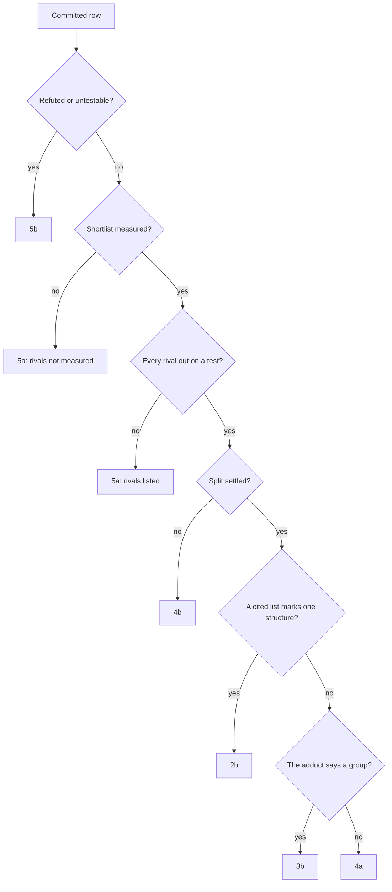
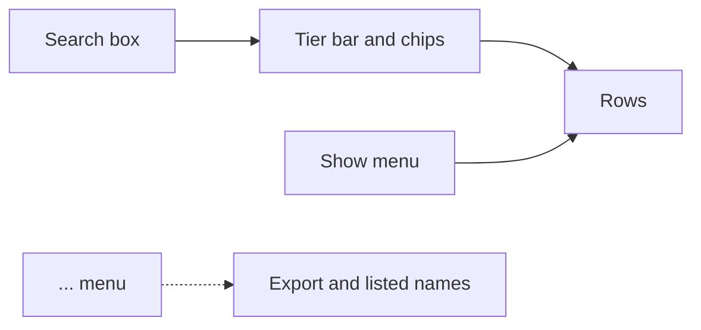
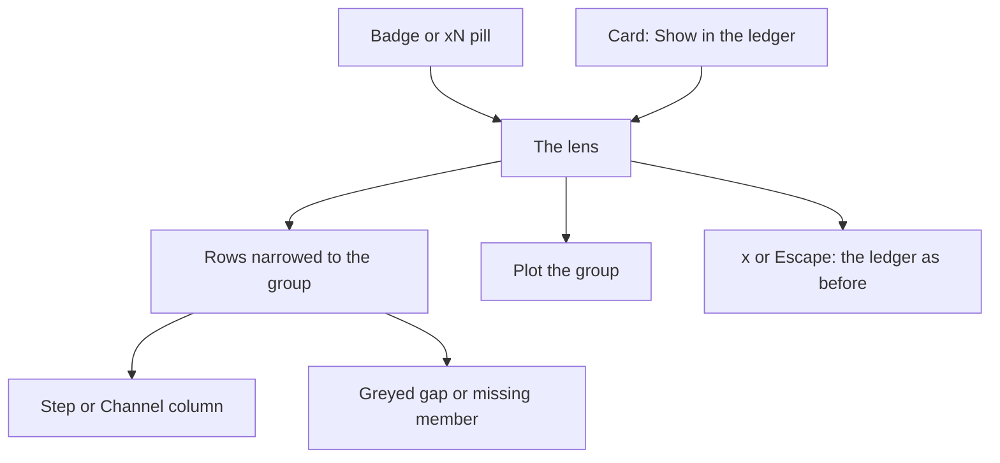
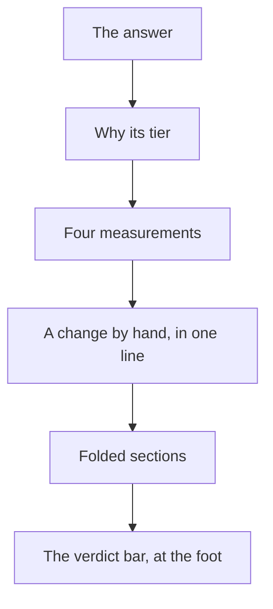
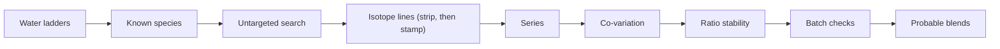

# Peak Assignment & Identification Confidence

Where [target matching](matching.md) answers *"do these known compounds appear in the
sample?"*, **peak assignment** answers the inverse, peak-first question: *"for every
observed peak, what is the most likely chemical composition, and how confident are we?"*
Each peak gets exactly one assignment per run, together with a **fit score** and a
**confidence tier**.

!!! note "Peak assignment is off by default"

    Targeted matching keeps working exactly as before either way — peak assignment is
    an addition, not a replacement. Target collections, ion tables, the batch overview
    and the Match tab are all unaffected. With it on, a sample is assigned against the
    known target library as it is processed, the assignment views appear, and the
    composition search reports assignment confidence.

    A deployment switches it on by setting `peak_assignment = true` under `[meta]` in
    the environment's config toml and restarting the stack — that is the whole
    procedure, and setting it back to `false` undoes it. With it off nothing is
    assigned when a sample is processed, the composition search reports the familiar
    match score, the Sample tab keeps its peak ledger, and the API refuses to launch
    assignment runs (the write routes return 403; reads stay open, so results from a
    period when it was on remain visible).

The design rests on a foundational result of the field: **accurate mass alone — even at
sub-ppm — cannot uniquely determine an elemental composition**, and isotope-pattern
information is worth more than another order of magnitude of mass accuracy
([Kind & Fiehn 2006][kf06]). Identification is therefore treated as *accumulating
independent evidence* and *arbitrating between candidates that all fit the mass*.

```
   measurement              evidence layers                    decision
 ┌──────────────┐   ┌────────────────────────────┐   ┌────────────────────────┐
 │  FIT SCORE   │ → │ chemistry (plausibility) ·  │ → │  assignment + a         │
 │ how well the │   │ (spectral context, later)   │   │  confidence + a tier    │
 │ data fit one │   └────────────────────────────┘   └────────────────────────┘
 │  candidate   │
 └──────────────┘
```

--8<-- "_help/assignment-evidence.md"

## The two stages

Every peak is assigned in a two-stage engine:

- **Stage A — database-first.** The peak is matched against the sample's known target
  library (the compounds and ions of [target matching](matching.md)) and
  against any [reference lists](../guides/reference-lists.md) your deployment has
  loaded; the best-fitting known composition wins the peak. Each ion's isotope lines
  are the peaks your instrument resolves at the file's own resolving power, predicted
  as the untargeted search predicts a candidate's (*a predicted line*, under
  [the fit score](#the-fit-score-a-pure-measurement)): one formula's lines are the same
  lines whichever stage reads it. Target matching reads a TOF file's lines merged at
  one resolving power for every file, and an Orbitrap file's one isotopologue per line. A reference list is matched only within its own element,
  carbon and mass window, under a ceiling the sample's chemistry context sets; only in
  the polarity it is detected in; and it contributes radicals only if it allows them.
  The target library is read through the ionization mechanisms of the sample's mode; a
  reference list also through the channels the run opens for itself (*A list through
  the channels a run opens*, below). Every mechanism of the mode is read, a dimer
  (`[2M+H]+`), a doubly charged ion (`[M+2H]2+`) and a neutral loss (`[M+H-H2O]+`,
  `[M-H-H2O]-`) among them; only a stored mechanism that reads as no notation is
  left out of the run, and the server logs it once.
- **Stage B — untargeted.** Peaks that Stage A left unexplained are run through a
  bounded composition search that enumerates every elemental formula whose ion lands
  within the mass tolerance — the classic mass-decomposition problem
  ([Böcker & Lipták 2007][bl07]) — and scores each candidate the same way.
  Through a mechanism that holds `n` molecules and gives the ion a charge `z`, an
  ion at m/z holds molecules of mass (|z| × m/z − shift) / n, where the shift is
  what the mechanism adds less what it loses. The ion's formula is the `n`
  molecules with the species added or removed and the neutral loss taken off
  after, as target ions are built, so a molecule with no water to lose is never
  read through `[M+H-H2O]+` or `[M-H-H2O]-`, and one with no hydrogen (C6O6) never
  through `[M-H]-`, nor one with no chlorine through `[M-Cl]-`. A series step
  (*Detect series*) proposes no such molecule either. Its isotope lines are predicted at its own charge:
  those of a doubly charged ion sit half a mass unit apart, and the mass window is
  the same ppm of the ion's m/z. Where a dimer and one molecule make the same ion,
  as two C3H6O3 and C6H12O6 do with a proton, the run reads the one molecule and
  keeps the dimer as another reading of the ion.

**A list compound meets the search.** When a run searches formulas, every peak Stage A
assigned is put to Stage B too, with the list's compound as one of its candidates. The
compound's place on a list counts for it: a closed-shell formula from the search takes
the peak only where its evidence (fit × plausibility, see
[Arbitration](#arbitration-competing-the-candidates)) is more than twice the compound's,
and ahead of it by more than a tie. It must also explain the compound's own isotope
lines, the ones the spectrum shows where the compound predicts them, at an expected
signal-to-noise the run counts an absent line at, and whose mass error follows the
compound's own within three of the sample's mass widths, the bar the mass gate reads an
isotopologue at: the fit charges a
reading for a line it predicts and the spectrum lacks, but never charges a rival for a
line the spectrum holds and the rival leaves unexplained. A siloxane's silicon lines, or
the bromine line of a bromide adduct, keep the list's compound on its peak against a
formula without them. A compound of your own target library keeps its peak in any case.
Where a rival does take the peak, the row shows the search's formula, with the list's
compound first among its alternatives, so promoting it by hand restores the list's
reading. The compound's isotope lines leave the ledger with it, and the search's own
pattern can hold them. Where the compound keeps its peak, the search's rivals still count
against it (*rivals left standing*, below).

Peaks that neither stage explains are recorded as *unassigned*, so a run is a complete,
queryable ledger: one row per observed peak.

**Single owner, within tolerance.** Each peak has exactly one owner per run, and a peak is
only owned by an isotopologue whose measured m/z is *within tolerance* of the prediction.
A predicted isotopologue that has no real peak is left unmatched rather than being pinned to
a nearby, out-of-tolerance peak — that peak is released to the untargeted stage (or left
unassigned) so it can get its own correct assignment instead of being mislabelled as a
poorly-fitting isotopologue of something else.

## The chemistry a run searches under

A run searches under two presets:

- **A chemistry profile:** how the sample was ionized. It decides which ions the source
  makes of itself, and which elements the sample's compounds can be built from.
- **A chemistry context:** what was sampled.

**What they set.** A run first sets aside the ions a CIMS or charge-transfer source makes
of itself - its reagent's own clusters, the ions of the air it ionizes, an Orbitrap's
calibrant beam - as *reagent* peaks, so neither stage reads them as compounds (*The ions a
source makes of itself*, below). An electrospray profile has neither a reagent nor a
discharge, and sets none aside. Then:

- the profile gives the untargeted stage its element grid, its m/z window on each
  instrument class, and the extra channels a source of its kind produces;
- the context narrows that grid, never widening it;
- the context also rejects formulas whose hydrogen, oxygen, nitrogen or
  ring-and-double-bond count per carbon no such sample holds, in the manner of the
  element-ratio rules of [Kind & Fiehn 2007][kf07];
- the context caps the window a reference list is matched in.

A **Formula range** left empty follows the profile's grid, whatever the profile becomes.
**Use profile grid**, beside the field in Peak assign and in the composition search, fills
the field with that grid as a value to edit, for example to add one element. Emptied
again, the field follows the profile once more. The button is off where a batch's samples
search different grids.

| Profile | Polarity | Recognised by | Context it takes |
|---|---|---|---|
| Bromide CIMS | negative | `[M+Br]-` | Ambient air |
| Uronium (urea) CIMS | positive | `[M+CH4N2O+H]+` | Uronium |
| Nitrate CIMS | negative | `[M+NO3]-` | Ambient air |
| 15N-nitrate CIMS | negative | `[M+^NO3]-` | Ambient air |
| Iodide CIMS | negative | `[M+I]-` | Ambient air |
| Charge transfer (EASY-IC), positive | positive | electron transfer, `[M]+.`, and no reagent, on an Orbitrap | Ambient air |
| Charge transfer (EASY-IC), negative | negative | electron transfer, `[M]-.`, and no reagent, on an Orbitrap | Ambient air |
| Positive ESI / APCI | positive | no diagnostic mechanism | none |
| Negative ESI / APCI | negative | no diagnostic mechanism | none |

The contexts are ambient air, chamber, indoor air, object headspace, combustion, water,
food and beverage, and uronium. Each describes itself where it is chosen.

**Auto.** Both presets default to **Auto**. The profile is read off the sample's
ionization mechanisms: a mode carrying the bromide mechanism is a bromide source, whatever
the mode is called. On an Orbitrap, a mode with no reagent whose mechanisms include
electron transfer, `[M]+.` or `[M]-.`, is a charge-transfer source, the way that
instrument's EASY-IC source is declared: it searches a hydrocarbon-sized grid under the
ambient prior, its reagent pass claims the fluoranthene beam, and the channels such a
source also runs, hydride abstraction (`[M-H]+`), proton transfer and methyl loss
(`[M-CH3]+`, what charge transfer leaves of alpha-pinene at m/z 121 and of a cyclic
siloxane at its base peak) in positive mode and deprotonation in negative, are opened as
secondary ones where the spectrum shows the source runs them (or where the acquisition
could not have shown it), and capped at candidate without corroboration. A channel the
mode declares itself, proton transfer beside electron transfer, is the mode's own and is
not capped. An ion such a channel reads
is often one electron transfer reads too, as a different molecule: the tropylium ion is
protonated C7H6 or toluene
less a hydride, and the search's own preference for the heavier mechanism would take the
proton. So an opportunistic reading stands only where the sample commits its molecule
through one of the mode's own channels; otherwise the mode's reading is the row's, and
between two opportunistic readings the one whose molecule the sample shows wins. Toluene
is seen through electron transfer, so tropylium reads as toluene. The reading set aside stays
on the row, marked as not borne out, and does not count against the one that was. Where the
sample shows both molecules, the one it shows more strongly wins, whichever mechanism
carries more mass: the molecule whose brightest peak through the mode's own channels is
the brighter, among the rows committed at *candidate* or better. The tier is only that
bar, since the passes after this rule can still lower a row, and a peak's height they
cannot change. On a certified mixture holding toluene and not C7H6, electron transfer
sees both, toluene 27 to 31 times as strongly, and tropylium reads as toluene less a hydride.
The weaker reading stays on the row as well. Where its molecule's peak is a tenth as
bright or less, it is marked as outweighed and the row counts the question as settled;
closer than that, it is still a rival the sample shows, and the row is held at
*candidate* with it named (*ambiguous adduct*, below): a reading the sample shows seven
times as strongly is the better one, not a certain one. A reading through one of the
mode's own channels is never outweighed this way and keeps its formula; a rival the
sample shows is weighed against it by the same margin, read from the other side: the
rival has to be shown ten times as strongly to hold it at *candidate* (*ambiguous
nitrogen* and *ambiguous adduct*, below). The rule reads the run's mass gate, so a partner
is a reading that gate leaves committed, and the gate holds a reading the rule swaps in
under the same ceiling as every other reading of its peak. The rule only settles which
reading a row is; whether that reading reaches *assigned* is the cap after it (*What lets
a secondary channel's reading reach assigned*, below). A batch search reads the rule, and
that cap, over its own rows. On any other instrument electron transfer names an
ambient-ion mode as readily, and such a mode keeps the ESI profile of its polarity; so does
a mode with only protonation or deprotonation and no reagent. A secondary channel is
searched only where the deployment holds its mechanism, so Mascope ships the mechanism of
every channel a profile can open, hydride abstraction's `[M-H]+` and methyl loss's
`[M-CH3]+` among them (*The chemistry every deployment holds*, below). A reading through
methyl loss stands, as one through hydride abstraction does, only where the sample commits
the molecule it proposes through one of the mode's own channels: pinene less a methyl is
also protonated C9H12. The context is the one the sample's batch or dataset names, and
otherwise the one the profile is normally used with (*A context the dataset or batch
names*, below).

**Formate.** Every negative reagent profile (nitrate, 15N-nitrate, bromide, iodide) can
open a formate adduct channel, `[M+HCOO]-`, the way it opens carbonate: where the spectrum
shows formate, its dimer with formic acid, or its cluster with the reagent's acid. On a
nitrate source the channel also stays on where the acquisition starts above every
formate carrier the source makes, since that silence is the window's, not the
chemistry's; a halide profile claims only what it can show. A peak that reads both as a
deprotonated acid and as the formate adduct of a molecule 46 Da lighter is one ion read
two ways, and every acid reads that way. The formate reading is the row's only where the
lighter molecule is itself committed through one of the mode's own channels, which also
corroborates it; otherwise the acid reading stands, and the formate reading stays on the
row as one the sample did not bear out. The channel is searched through the `[M+HCOO]-`
mechanism, which Mascope ships with the rest.

**The chemistry every deployment holds.** A run searches a channel only where the
deployment holds its ionization mechanism, since an assignment names the mechanism it was
read through. So Mascope ships every mechanism its chemistry needs, and a server creates
the ones it lacks when it starts: those the ionization modes Mascope ships declare (the
nitrate, 15N-nitrate, bromide, iodide, urea, ammonium and 15N-ammonium reagents,
protonation, deprotonation, and electron transfer in either polarity), and every
secondary channel a profile can open (hydride abstraction, methyl loss, proton transfer,
deprotonation, carbonate, formate, the dibromide and diiodide clusters, ammonium, sodium
and potassium). A fresh server searches under the same chemistry as any other from its
first run, so a run on one set of samples reads the same wherever it is repeated. Each
mechanism is created the way one added under Ionization mechanisms is, with an ion for
every compound already in the library, so the start that first creates them takes longer
on a large library, once. A mechanism the server already holds, in either spelling, keeps
its own row. These mechanisms cannot be deleted, since the next start would only create
them again. The run's snapshot lists a channel as unavailable where its mechanism is
missing all the same, which on a current server means the start could not create it, and
its log says why.

**What lets a secondary channel's reading reach assigned.** A formula the search reads
through a secondary channel, carbonate on a nitrate source or ammonium on a uronium one,
is capped at *candidate* unless something says which molecule clustered with the
channel's carrier: a loaded reference list or your target library names the molecule, or
the sample shows the same molecule: a row of either stage commits it at *candidate* or
better, after the mass gate's check, through one of the mode's own channels. That is the
same test the opportunistic readings are settled by (*Auto*, above), and the cap reads it
once, after they are settled and before the other caps. The reading's own isotope lines
are not enough on their own. A 13C line proves how many
carbons the ion holds, never which molecule clustered: benzene and methanol read through
the carbonate channel reached *assigned* on that line alone. The lines still count for
the reading as any line does, in its fit and as a second peak of its ion (*one peak
only*, below). The row's verdict records whether it had them.

**A list through the channels a run opens.** A reference list names a compound, not the
channel it is seen through, so Stage A reads a list through the channels the run opened
for itself as well as through the mode's own mechanisms. On a charge-transfer source,
whose mode declares electron transfer alone, a cyclic siloxane's methyl-loss ion, its
base peak there, and its protonated molecule beside it are named from the list. A
reading through an opened channel is capped at *candidate* unless its own isotope lines
corroborate it, or the sample shows the same compound through one of the mode's own
channels as above. The list
already names its molecule, which is what a search's reading has to find elsewhere, so
here an isotope line is enough. Through a channel
that needs the compound shown elsewhere (hydride abstraction, proton transfer, methyl
loss, deprotonation on the charge-transfer source, formate on a reagent source), it
stands only where the sample commits the compound through one of the mode's own
channels. The list's compound stays the row's either way: where another reading of the
ion would have taken a search's row, the list keeps its compound on the row, and the
other reading stays on it as a rival that holds it at *candidate* where nothing settles
which. Your own target library is read through the mode's mechanisms alone, since its
compounds were named for the modes its collection is attached to; to read it through
another channel, declare that channel in the mode. A secondary channel the mode
declares, such as carbonate, is part of the mode's mechanisms, and a list read through
it keeps its tier as before.

**No profile and No context.** *No profile* switches the layer off: the run searches
the engine's original wide grid at a fixed 10 ppm window. *No context* applies no
matrix prior.

**A context the dataset or batch names.** A run on *Auto* reads the profile off the
sample, but nothing in a sample says whether it was drawn from the open air or a smog
chamber, so a chamber experiment searched as ambient air. A dataset or a batch can name
its context once: **Chemistry context** in the dialog that creates or edits it. A run on
*Auto* then takes the batch's, else the dataset's, else the profile's own. A copy of a
batch keeps the context the original names. A context
named for the run wins over all three, and *No profile* keeps no context. The run
records where its context came from, and the launcher says when the batch or the
dataset named it.

**Priors of an atmosphere.** Ambient air, chamber and indoor air hold two formula
shapes only where something besides the mass fit saw them: sulfur, and two or more
nitrogens with fewer than two oxygens per nitrogen. An atmosphere's organic sulfur needs
a sulfur source, and its organic nitrogen arrives as nitrate and nitro groups, two or
three oxygens per nitrogen. A mass fit reaches either shape easily by spending the same
mass on another element: sulfur formulas were 5 % of the assigned compounds of
alpha-pinene chamber runs with no sulfur source, and a nitrogen-rich C2 family a fifth to
a third of a nitrogen-free certified mixture's. Uronium holds the sulfur prior alone,
since reduced-nitrogen bases are what a urea source detects. How a row meets a prior is
under *needs corroboration here*, below.

**On a TOF, the window the sample's width allows.** A TOF searches within 10 ppm of a
peak, ten to fourteen times the scatter of its own mass errors. Where the run measured
that scatter on the sample's known ions, the window is narrowed to six of its widths
beyond the sample's own offset: a formula further out is one the run's mass gate would
hold below assignability whatever its fit (*off calibration*, below). The window never
widens past 10 ppm, an Orbitrap's 3 ppm is not narrowed, and a window you set for the
run stands. The run selector's tooltip shows the narrowed window and the 10 ppm it came
from. A batch's *Search untargeted* narrows it the same way, by the width the sample's
latest run measured.

**Organonitrates on a nitrate run.** An organonitrate group (-ONO2) or a nitro group
(-NO2) adds a nitrogen, two oxygens and a double bond to the carbon skeleton it hangs on
[Perring et al. 2013][per13]. A dinitrate's oxygen-to-carbon ratio and a nitroaromatic's
double bonds per carbon then sit outside windows written for compounds of carbon,
hydrogen and oxygen, and a dinitrate's eight oxygens on five carbons look like the oxygen
lattice of a mass fit. So on a nitrate or 15N-nitrate run on an Orbitrap, in a context
that makes organonitrates (ambient air, chamber, combustion, water), the context's
windows and the oxygen lattice also read the formula with up to three groups taken off:
a nitrate read as its alcohol, a nitro group off an aromatic skeleton as the bare ring.
A formula passes where either reading does. A row only that reading admits is held at
*candidate* (*organonitrate skeleton*, below): the reading widens what the run commits,
not what it stands behind.

**Chlorine and bromine from their twin line.** A chlorine atom puts a second line 1.997
Da above its own at a third of its height, a bromine atom one at nearly its full height
[Meija et al. 2016][mei16]. No other element makes that pair, and the formula search
cannot use it: its grids hold chlorine on few profiles, its ratio rule refuses one
chlorine atom under twenty carbons, and on a 15N-nitrate run a chlorinated ion has the
same mass as a nitrate cluster with two more carbons. So a searched peak, unexplained or
read as a formula with no halogen, whose twin sits unexplained within 2 ppm of that exact
offset at about one atom's ratio is searched again over carbon, hydrogen, oxygen and one
atom of that halogen. Its reading replaces the peak's only where it explains the twin as
its own line, clears the run's candidate bar, passes the context's windows and sits on the
sample's calibration. The twin is then committed as its isotope line, which is the second
observation the top tier asks for. A halogen is read where the context allows it
(ambient air, indoor air and water name both), or where a list the run read holds a
compound carrying it and the context does not exclude it, as uronium does. A
bromide source's own bromine is never read this way: a peak with one bromine's twin
there is an analyte clustered with the reagent, which the search reads through the
mode's own channel. The replaced reading leads the row's alternatives. A certified cylinder's chlorobenzene is
read this way on a charge-transfer source, whose grid holds no chlorine.

**In the launcher.** *Assign sample* offers the two presets, and says what *Auto*
resolves to for the sample. The formula range and m/z precision fields show the grid and
the window the run would search at. *Assign sample* opens on the settings of the
sample's batch, and *Edit assignment settings* edits those, for every pass of the batch
(*Assigning a batch*, below). *Find other formulas for this peak* - the composition
search in the Sample tab - keeps its own m/z precision and formula range, remembered
between visits. Where they are empty it searches the grid and the window of the
profile and context the batch's settings name, as a run of the sample would.

A named profile applies to every sample it reaches. The launcher warns when that profile
belongs to the other polarity from the samples. *Reset to defaults* puts both presets back
on *Auto*.

**In the run selector.** Each in-app run names the profile it searched under beside its
engine. Hovering the name shows:

- whether the profile was read off the mechanisms or named for the run;
- the context;
- the element grid and the m/z window;
- the extra channels searched;
- any channel the spectrum showed but the deployment has no mechanism for.

### The ions a source makes of itself

Before either stage, a run sets aside the peaks its source made rather than its sample,
as *reagent* peaks: a row that names the ion and no compound, so it votes on no batch
consensus and weighs on no tier. Each ion the pass knows belongs to a family and carries
the works that name it, and the row records both, so a claim can be checked against a
paper rather than against Mascope's word. A work is cited for an ion only where it names
that ion. A source ion only the sample's batch says is there is set aside later, once
both stages have read the sample, so the run can keep a reading the batch's own claim
keeps (*A sample's run reads what the batch decided*, under
[the batch stages](#the-batch-stages)).

- **The reagent's own ladder.** The ion a CIMS source is dosed with and what it makes of
  itself: nitrate, its clusters with nitric acid [Jokinen et al. 2012][jok12] and its
  hydrates [Skalný et al. 2004][ska04], [2007][ska07], with every nitrogen labelled on a
  15N-nitrate source [Zhang et al. 2026][zha26]; bromide, its hydrates and its dimer
  [Sanchez et al. 2016][san16], [Rissanen et al. 2019][ris19], [Wang et al. 2021][wa21];
  iodide and its hydrate [Dörich et al. 2021][dor21], and its dimer and trimer [Gómez
  Martín et al. 2022][gom22]; protonated urea and its dimer [Shcherbinin et al.
  2025][shc25].
- **The air's ions.** What a discharge makes of nitrogen, oxygen, water and carbon dioxide
  before any reagent or analyte is involved. On a charge-transfer source they are the
  source; on a reagent source, its background.
    - Positive: N2+, N3+ and N4+ [Good et al. 1970a][good70], [Kolakowski et al.
      2004][kol04], the first also [Shcherbinin et al. 2024][shc24]; O2+ [Good et al.
      1970b][good70b], [Shcherbinin et al. 2024][shc24], [Dusanter et al. 2025][dus25];
      NO+ [Shahin 1966][sha66], [Sabo & Matejčík 2012][sab12], [2013][sab13], [Dusanter
      et al. 2025][dus25]; NO2+ [Shahin 1966][sha66], [Shcherbinin et al. 2024][shc24];
      the hydrates of O2+, NO+ and NO2+ [Shahin 1966][sha66]; and the protonated water
      ladder from H3O+ to (H2O)5H+ [Good et al. 1970a][good70], [Shahin 1966][sha66],
      [Hansel et al. 1995][han95], [Pfeifer et al. 2020][pfe20].
    - Negative: OH- and its water clusters [Fujishima et al. 2023][fuj23], [Sekimoto &
      Takayama 2011][sek11], [Takayama 2026][tak26], which one corona source reads and
      another argues become bicarbonate before they reach the analyser [Asakawa &
      Hiraoka 2023][asa23], so they are claimed where a spectrum shows them; O2-
      [Skalný et al. 2004][ska04], [2007][ska07], [Sekimoto et al. 2012][sek12] and its
      hydrate [Sekimoto & Takayama 2011][sek11]; O3- and its hydrate [Shahin
      1969][sha69]; O2- carrying carbon dioxide [Matas et al. 2023][mat23]; carbonate and
      its hydrates [Skalný et al. 2004][ska04], [2007][ska07], [Shahin 1969][sha69];
      bicarbonate [Nagato et al. 2006][nag06], [Sekimoto et al. 2012][sek12]; nitrite and
      its hydrates [Skalný et al. 2007][ska07], [Ewing & Waltman 2009][ewi09], [Matas et
      al. 2023][mat23]; nitrate, its hydrates and its cluster with nitric acid [Skalný et
      al. 2004][ska04], [Nagato et al. 2006][nag06], [Ewing & Waltman 2009][ewi09]; and
      bicarbonate's cluster with nitric acid [Nagato et al. 2006][nag06]. On an iodide
      source nitrite and nitrate are left to the stages (below).
    - On a 15N-nitrate source the plain nitrate ions are left to the reagent's own
      envelope, whose 14N remainder they are first: the envelope claims them where their
      height fits the label's purity.
- **The calibrant beam.** An Orbitrap's EASY-IC source is a fluoranthene beam, its radical
  cation at m/z 202.0777 and its radical anion at 202.0788 [Thermo Fisher Scientific
  2018][easyic], [Leborgne et al. 2023][leb23], [Ashbacher et al. 2026][ash26], [Martens
  et al. 2016][mar16]. Beside the cation it carries the ion one hydrogen lighter, the
  protonated ion and the ions two and three hydrogens heavier where the source is humid
  [Shcherbinin et al. 2024][shc24], [West et al. 2018][wes18], and the cation's own
  fragments, less H2 and less one and two acetylenes, which its electron-ionization
  spectrum shows [NIST WebBook][nist]. It also carries two polycyclic aromatic ions one
  CH2 apart, C14H10+. and C15H12+., claimed on what the test spectra show (below). C14H10
  is anthracene's and phenanthrene's ion, so on this source a PAH of these compositions
  is not read as an analyte.

Seven of these ions are named by no work found. They are claimed on what Mascope's test
spectra show instead, and each row says so: bromide's trimer Br3-, in all 15 files of the
three bromide sets at 1.5 to 35% of the base peak; its oxide BrO-, in 11 of the 15 at up
to 1.8%; bromate, BrO3-, and bromide's cluster with HBr, in every file of one set at 0.6%
and 0.06%; protonated urea's trimer, in every file of one of the two uronium sets at
0.08%; and the beam's C14H10+. and C15H12+., in all 19 files of the three
certified-cylinder sets, zero air among them, at up to 4.3% and 6%.

**What is left to the stages.** An ion a work reads as an analyte's is not claimed,
however much it looks like the source's, and neither is an ion no work names that the
test spectra do not show:

- ammonia's ions, NH4+ and its hydrates: how a protonated-water source measures ammonia
  [Pfeifer et al. 2020][pfe20]; ammonia with urea is the urea source's reading of it
  [Shcherbinin et al. 2025][shc25];
- bromide with HO2, the HO2 radical's own reading [Sanchez et al. 2016][san16];
- on an iodide source, nitrate and nitrite, their hydrates and nitric acid on nitrate
  and on bicarbonate: bare nitrate at m/z 62 is how an iodide source shows nitric acid,
  and N2O5, the nitrate radical and the halogen nitrates beside it [Dörich et al.
  2021][dor21], and nitrite goes with it as its pair. On a bromide source no work found
  reads either as an analyte's, so there they are the air's;
- formate, acetate and their clusters with their acids: formic and acetic acid
  deprotonated, which is how an acetate source measures them [Veres et al. 2008][ver08],
  [Bertram et al. 2011][ber11]. On a chamber's nitrate source they are the chamber's acids,
  read through the deprotonation the mode declares;
- trifluoroacetate, and CF3- and CF3O-, which ride with it: trifluoroacetic acid is an
  analyte a nitrate or iodide source measures, and a claim before the stages cannot ask
  whether it is in the sample. As its fragments the two would be claimed after the
  stages, against the acid committed, but no work found gives either as its fragment
  with a height a claim could be held to, so neither is claimed;
- the cyclic siloxanes. They are a background of most instruments, from laboratory air
  and the inlet [Schlosser & Volkmer-Engert 2003][sch03], and the analytes of an indoor-
  or urban-air study, and a claim before the stages cannot tell the two apart. They are
  named from the shipped cyclic-siloxane list, which reads them as background: the row
  shows the list's *background* tag beside the name, the tier does not weigh it, and
  whether they are background in a dataset is for the batch and its blanks to say. A list
  is read through the mechanisms the mode declares and the channels the run opens, so on
  a charge-transfer source a siloxane's methyl-loss ion, its brightest there, and its
  protonated molecule are named from the list, each held to the rules of the channel it
  is read through (*A list through the channels a run opens*, above);
- the rest of what the ladders' grammar would enumerate: the higher bromide and iodide
  clusters and their hydrates, the iodine oxide clusters, a bromide precursor's anion, the
  urea multimers above the trimer and those carrying ammonium, the fluoranthene dimer,
  and C13H8+., the PAH rung below the beam's two, which the test spectra show in one
  file of nineteen.

**Fragments of an analyte.** A charge-transfer or proton-transfer source breaks some of
what it ionizes, and a fragment has an ordinary composition, so the formula search reads it
as a molecule of its own: a partner, a second channel and a rival for everything else at
its mass. The monoterpenes are the case: alpha-pinene's C7H9+, C6H9+, C6H8+., C6H7+,
C6H5+ and C5H7+ ([NIST WebBook][nist]; [Wang et al. 2003][wan03]; [Schoon et al.
2003][scn03]; [Materić et al. 2017][mat17]; [Tani et al. 2003][tan03]; [Kari et al.
2018][kar18]; [Ishihara et al. 2026][ish26]). A fragment is claimed after the stages,
since what licenses it is a commit, where three things hold:

- the monoterpene is committed through one of the mode's own channels, at any tier, since
  the claim asks of it its height, not its fit;
- the fragment is no taller, against the parent's ion, than three times what the
  literature gives it. For the ions electron ionization makes that is alpha-pinene's
  electron-ionization spectrum, the hardest ionization a monoterpene meets, so a softer
  source breaks it less and there is no lower bound; for C6H9+, which proton transfer
  makes beside the protonated molecule, it is the ion's share of a proton-transfer
  spectrum at the harder of two drift fields [Kari et al. 2018][kar18];
- no reading of the fragment's ion names a molecule the sample shows on a peak of its own,
  at *candidate* or better through one of the mode's own channels. That is what tells a
  monoterpene's C6H7+ from protonated benzene: where the sample shows benzene's radical
  cation, the ion stays benzene's.

The claim reads the ledger as the opportunistic readings leave it, after the mass gate's
check, by the same test of what the sample shows. A claim takes the fragment's rows off
and the readings are settled again without them, so a fragment is never the partner that
settles another reading.

The ladder leaves out C7H8+., C7H7+ and C8H9+, though the monoterpene's spectrum has them
strong: they are toluene's radical cation and toluene and xylene less a hydride, and a
component all of whose ions sat on the ladder would have nothing left to be shown on. The
row names the fragment's ion, the parent it was read against and what the stages had read
the peak as; a compound of your own target library keeps its peak.

**Ladders of the source's own.** A positive source carries solvent vapour, and builds
clusters of it: two molecules sharing a proton, a molecule on a hydronium, a molecule
less a hydride holding a second one. Ethanol's dimer at m/z 93.091 implies a neutral,
C4H12O2, that is no molecule, so no stage can read it; acetone's dimer at m/z 117.091 is
also protonated C6H12O2, an ordinary acid or ester, and a stage reads it as one. A
source's solvent is not the sample. The charge-transfer and urea sources list water,
methanol, ethanol and acetone, and the pass claims the rungs of their ladders that a work
names: methanol's protonated dimer to tetramer [Grimsrud & Kebarle 1973][gri73], [Larson
& McMahon 1982][lar82]; ethanol's protonated dimer and acetone's to its tetramer [Larson &
McMahon 1982][lar82]; each solvent's protonated molecule with one water [Meot-Ner
1984][mot84], and methanol's dimer with one; and ethanol and acetone less a hydride
holding a second molecule, all in the ion clustering data of the [NIST WebBook][nist]. A
mixed cluster of two solvents, ethanol's trimer and methanol less a hydride are named by
no work found and left to the stages.

A ladder claims a rung on its own shape, not on a name alone, and every one of these must
hold:

- **the ladder grows from an ion the spectrum shows**: the protonated solvent, or the
  solvent less a hydride where the run searches hydride abstraction, at its mass and at a
  thousandth of the base peak or more. That ion is not claimed: protonated acetone is the
  sample's acetone to the stages;
- **the ladder is contiguous from it**: the ion one step below the rung is in the
  spectrum, so a dimer stands on its monomer and a trimer on its dimer;
- **every rung's mass fits at the run's precision**, against the masses the source's own
  ions corrected, and so does the step: the two peaks are one solvent's or one water's
  exact mass apart;
- **the heights fall along the ladder**: a rung stands no more than three times the rung
  below it. A proton-bound dimer is the more stable ion where the vapour is dense, so the
  fall is not asked to the count; a rung several times taller carries something else;
- **a rung displaces a molecule only where its ladder outweighs it.** Where the rung's ion
  also reads as a molecule through one of the run's channels, a closed-shell formula with
  carbon in it, the rung takes the peak only if the ion it grew from stands at least ten
  times taller than any peak that molecule shows of its own through another of the run's
  channels. Acetone's dimer displaces C6H12O2 on a spectrum where protonated acetone is
  loud and C6H12O2's radical cation is not there; where the molecule shows its own ion,
  the stages read the peak;
- **a rung holding water never displaces a molecule.** A humid source hydrates every ion
  it makes, the proton's own ladder first [Good et al. 1970a][good70] and the analytes'
  ions with it [Sunner et al. 1988][sun88], so a step of one water is the commonest
  spacing in a spectrum and no evidence that the lower peak is a solvent's. Ethanol on a
  hydronium, whose neutral is no molecule, is claimed on its ladder; acetone on a
  hydronium, which is also protonated C3H8O2, is left to the stages.

On a nitrate source the reagent's acid dimer core, (HNO3)2.NO3- [Jokinen et al.
2012][jok12], is rung zero of a water ladder of its own, on any instrument: its first
three hydrates are claimed under the same rules, one water at a time above it. No work
found names them, and their rows say what shows them: the ladder in the spectrum. How far
a reagent's water ladder reaches over a batch is the batch's question, not one spectrum's.

A rung's row names its ion and the works that name it, as a library ion's does, with its
ladder beside them: the ion it grew from, the rung below and the step between them, and
the molecules its ion also reads as, each with the peak that molecule showed elsewhere if
it showed one. Where one ion is a rung of two ladders, methanol's dimer and ethanol on a
hydronium among them, the row names the first ladder that holds and lists the other. A
rung's isotope lines are claimed with it.

**How the rows read.** A reagent row names no compound, so the sample's assignment ledger
shows its ion in the formula column instead, written with its charge (`Br-`, `C16H10+`),
and the inspector heads the card with it; the *reagent* chip beside it says the source
made it. An ion's isotope lines are claimed with it and are its family, as an analyte's
isotopologues are the analyte's. A line is one peak your instrument resolves: on a TOF,
the peak one mass unit above the ion is its 13C, 15N, 2H and 17O lines together, claimed
as one line at their combined height. A line takes the peak nearest to where the ion's
own error puts it, as every check reads a line, when that peak is at most three times its
predicted height. The lines fold under the ion's monoisotopic row,
counted beside its caret, and the inspector lists them in the ion's isotopologue
table against the abundances its isotope pattern predicts. A fragment's lines fold under
the fragment the same way. The *reagent* count above the ledger still counts every peak
the source accounts for, the lines included. If you assign a compound to an ion's peak by
hand, its lines are unassigned with it, as an analyte's isotopologues are when their
compound is replaced. A run made before Mascope linked the lines to their ion lists them
as rows of their own and writes the ion without its charge; running the assignment again
links them.

## The fit score — a pure measurement

The **fit score** measures exactly one thing: *how well does the observed data fit the
predicted spectrum of this candidate?* It is on `[0, 1]` (1.0 = perfect fit), computed
per ion from its isotopologue peaks, and is deliberately:

- **competitor-blind** — it knows nothing about alternative formulas;
- **not a probability of correctness** — because mass alone cannot prove a composition
  ([Kind & Fiehn 2006][kf06]);
- **deterministic and reproducible** — the same spectrum always yields the same score.

Rather than scoring the monoisotopic mass alone, the fit score scores the **whole isotope
pattern**: each predicted isotopologue contributes a mass likelihood (a Gaussian in ppm,
its width set by the instrument's *measured* mass accuracy — and widened for weak peaks,
whose centroids are legitimately less precise — so the score is fair on both
high-resolution Orbitrap and lower-resolution TOF instruments) and an intensity
likelihood (its tolerance set by the peak's own signal-to-noise). A predicted peak that is
**absent but should have been detectable** counts against the assignment; one that is
below the noise is simply excluded. The per-peak likelihoods are combined as an
abundance-weighted geometric mean. This construction follows the probabilistic
isotope-pattern matching of **SIRIUS** ([Böcker et al. 2009][bo09]; [Dührkop et al.
2019][du19]), adapted to centroided industrial spectra by adding detection-limit
awareness. The full mathematical model is in the developer reference,
`libraries/tools/docs/fit_score.md`.

The Gaussian's width and centre come from the run's **measurement model**: where the
sample's masses sit and how widely they scatter, and how closely a line's height follows
its share (below). One run has one model, and every part of it reads that model: Stage
A's scores, the composition search's ranking, the re-score of the search's readings, the
mass gate's *mass z* and its caps, and the identification level. The run measures the
model at two points.

- **After Stage A.** The model is fitted on the lines of your target library that the
  run matched. That takes at least eight lines, of at least eight different ions. A
  bright ion can match many lines alone, but they all share its own mass error: counted
  as lines, a few such ions would put the sample's centre at their own error and its
  width at how well their lines agree. Below either count, the width is the instrument
  class's, and the centre is the median mass error of the reagent ions the run claimed,
  if it claimed at least three and their offset exceeds that width; otherwise the
  sample is scored on its nominal masses. The reagent ions stand in only there: they sit
  at the low end of the mass range and need not agree with the offset your library
  measures. The composition search ranks its candidates at this model, and the re-score
  of its readings measures them there too: they fit no width or centre of their own.
- **After the readings are elected.** The model is fitted again on the readings the run
  has more than a mass fit for, and on the source's own ions, as the mass gate always
  measured the run (*off calibration*, below). There the centre can follow the mass
  range. Where this second fit moves the centre or the width by more than a quarter of
  the first one's width anywhere over the masses the run assigned, or where the first
  one stood in for a measurement the second one makes, every row is scored again at the
  second model, before any cap. A row scored again takes its new fit score, evidence and
  tier, its P(correct) read again off the curve at that evidence, and the fits of the
  alternatives it stores. A secondary channel's cap comes after this, so it reads the new
  evidence (*What lets a secondary channel's reading reach assigned*, above): a reading
  that now reaches *assigned* with nothing behind it stays at *candidate*. So does a peak
  read as a neighbour's line (*read as a neighbour's line*,
  below): it takes the neighbour's new evidence, but not a tier above *candidate*, and it
  falls with the neighbour. A reading a batch decision proposed at *candidate* (the batch stages,
  below) falls no lower at its new evidence: only a cap takes it lower. Which formula
  won the peak stays as the first model ranked it, as the search's ranking does. How
  many formulas its evidence could not separate, its confidence and whether it is a
  tie are read again at the second model, from its peak's rivals (*Arbitration*,
  below).
  Otherwise the run stays at the first. Either way a row's
  fit score and its *mass z* are read at the same centre and width. Where the centre
  follows the mass range, the width at a row's m/z is never under 0.03 mDa: below the
  lowest mass the centre was fitted on, it is held there and may be wrong by an amount
  nothing measured. On an Orbitrap that widens it below about m/z 50 only, and the fit
  score reads the same width there as the *mass z*. A run whose readings are too few to
  fit the second model scores and caps at the first.

The run records its model once, with the version it scored and capped at
(`measurement_model` in the run's configuration). A formula measured on its own - a
batch peak's *Use this*, the inspector's measured evidence and its alternatives, the
batch's *Search untargeted* (below) and what it propagates - is scored at the model the
sample's latest run in Mascope recorded, its width, centre and line tolerance from that
one run. The inspector's alternatives for a row read the model of the row's own run. An
imported run does not count, and a decoy run (below) is never that run. A sample with no
such run, one only folded into the batch ledger, is read at the model the fold fitted
and kept for it. A sample with neither is read as a run whose library matched too
little: at the instrument class's width and its own reagent ions' centre.

How closely a line's height must follow its predicted share is the run's own, too. By
default a clean line is held to 5% of its share, and a missing line counts against the
formula wherever its expected signal-to-noise - the main line's times the share - is at
least 3. On an Orbitrap that is too strict for a weak line. Each scan keeps a peak only
where it clears that scan's noise, and the file's peak list averages the scans, so a
faint 13C line reads low or is missing altogether. How much depends on the file and on
how it was acquired, its number of microscans among them. So each run measures it on
the envelopes its lists confirmed: for every range of expected signal-to-noise, how far
below its share a 13C line reads in that file, and how often it is there at all
([Barlow et al. 1972][ba72] for the monotone fit). A line then costs nothing anywhere
between that low reading and its full share, and a missing line counts only where that
file's lines are usually present. Wherever the run reads a formula's lines, in Stage A,
in the composition search and in the re-score of the search's readings, a peak more than
40% off its line's share is taken for another compound's and the line counts as missing.
On a file with a measured response (its own, or one pooled from the files near it), the
lower end of that cut moves down to the file's low reading, so a faint 13C line is found
rather than counted against the formula. Above the share the 40% cut stays. The isotope
ratio tolerance of the match parameters (0.2 on an Orbitrap) is target matching's own:
assignment reads the same lines by this one cut, so a line is the ion's on the same test
in either stage. A file with too few confirmed lines takes the measurement pooled with
the six files of its batch acquired nearest it in time at the same settings, and failing
that the defaults. Each of the six is measured afresh, the way the run measures its own
lines and under the run's own settings, never read from a run of its own. So the pooled
measurement is the same whichever files of the batch were run first, or at the same
time. A blank, or a file with no peak list, takes no place among the six. Nor does a
sample that reads some of the same scans, such as a copy of the file in its batch, though
another time window of the same file, one that shares no scans with it, counts as one of
the six. A window includes the scans at its start and its end, so two windows that touch,
one ending at the time the next starts, count as sharing the scan at that time and are
not each other's neighbours. Measuring them
adds about a minute to a thin file's run, though thin files run at the same time share
the measurements they have in common. The run records which files it pooled, the lines
each gave and the time they span. On a TOF the run measures one offset and one
spread of how its lines read against their shares, since a TOF's signal-to-noise column
is not read that way yet. The run records which of these it used, and a formula measured
on its own afterwards - *Use*, the inspector's evidence - is read at the tolerance
in the model the sample's latest run in Mascope recorded, or the one its fold kept.

An Orbitrap file whose peaks record the scans they are present in (*Scan Presence* on
[Peak Detection](peak-detection.md)) needs no such measurement for its lines: it
counts the loss instead. Its lines are read by the count, and the run's measurement
is what a file without the counts reads:

- **A line is read at its mean per scan**, against the main line read the same way. A
  scan keeps a line only where it clears about twice its noise, so the scans that keep
  a dim line are the ones its noise lifted, and its mean over them reads high: 1.4
  times its share where half the scans keep it. The fit score instead estimates the
  line's mean over every scan from how many scans kept it and how far above the noise
  they read it, the censored-normal estimate ([Tobin 1958][tob58];
  [Amemiya 1984][ame84]). A line in every scan reads as the peak list has it. The line
  is then held to its share at the default 5%, since the shortfall the measurement
  allows for is gone. A line some scans missed and that has no signal-to-noise keeps
  the measurement.
- The untargeted search's 40% window, which keeps a line only near its share, reads
  the share by the count too. Its lower end stays at 40% below the share and does not
  move down to the file's low reading, since the count has already taken that out.

On simulated files of 20 to 100 scans, the estimate reads a line at 0.99 to 1.00 of its
share, the median whatever share of the scans keeps it. On the demo raws, 13C lines
missing one or two of their main line's four scans read 0.77 of their share in the peak list, 1.08 over the scans that keep them, and 0.90 by
the estimate, where lines in every scan read 0.96. The 81Br line of the demo's bromine
ions reads within 0.2 of its natural share for 97.4% of 2,908 lines, from 96.6%; the 85
that read differently are closer to natural for 93% of them.

A missing line counts as on a file without the counts: from the signal-to-noise the run
measured its lines to be present at. The count could set that threshold too, from where
the scans holding the main line would have put the line in the peak list. As a yes-or-no
rule it charged lines the peak list holds only about half the time: the demo's lists hold
42% of the predicted 13C lines at an expected signal-to-noise of 4.2 to 5, the rule's
threshold on a file of four scans. It ranked the demo's true formulas a little lower, so
it is not used.

The estimate assumes a line's level is the same in every scan. Where a compound varies
within the file, the scans that keep its dim line are also the scans where there is most
of it, and the line reads high. A compound present in only part of the file is read as if
the scans without it were below the noise.

A predicted line is a peak your instrument can resolve, not a single isotopologue. On a
TOF, the peak one mass unit above a compound holds its 13C line and also its 15N, 2H and
17O lines, a few mDa apart. The untargeted search reads that peak against the sum of all
four, at the resolving power recorded for the file, and so do Stage A, the re-score of
the search's readings, the composition fit the API serves, the reagent pass and every
check that reads a line, the check that reads a peak as a neighbour's isotope line
(*a neighbour's isotope line*, below) among them. On an Orbitrap the same holds at its
resolving power: lines closer than half a peak width, such as a 13C and a 17O line, are
one line. What that line predicts depends on what the file's intensity is:

- **On a TOF**, a peak's intensity is its area, which holds every line under the peak.
  The merged line is the sum of its members' shares, at their abundance-weighted m/z.
- **On an Orbitrap**, a peak's intensity is its height, and the peak sits on its
  brightest member. A member nearly half a peak width away is on that member's flank
  and adds little to the top of the peak. So the merged line is its brightest
  member: that member's m/z and share, plus the shares of members within a fifth of a
  peak width of it, such as a 13C and a 17O line. The members further off are still
  named on the line, and the peak is still theirs, but they add nothing to its
  predicted height. On the demo's siloxanes, the `[30Si]` line with a `[29Si]2` line
  0.44 peak widths above it measures 0.97 to 0.98 of the `[30Si]` member alone, and
  0.81 to 0.85 of the two members' sum.

A line too faint to predict on its own still counts when it sits less than one peak
width from a line that is predicted, since one peak that wide holds both. Two such
faint lines less than one peak width apart can also be predicted as one line, when they
are bright enough together. Here too the two instrument types differ:

- **On a TOF**, the faint line is added to the predicted line, which moves to their
  abundance-weighted m/z. Two faint lines are predicted as one when their summed share
  clears the floor.
- **On an Orbitrap**, the faint line is named on the predicted line and adds nothing
  to its height or its m/z: it sits on the peak's flank. Two faint lines are predicted
  as one only when the height they make together clears the floor, which their members
  rarely do once they sit more than a fifth of a peak width apart.

A file with no recorded resolving power is read one isotopologue per line.

**A consequence users see:** a lone mass-only match (one peak, no isotopic corroboration)
scores *low* by design, while a fully corroborated isotope envelope scores near 1.0. This
is intentional — mass alone is weak evidence.

**M0, M+1, M+2.** Throughout Mascope, **M0** is the monoisotopic peak — the ion built from
each element's most abundant isotope — and the offsets count from it, as in an isotope
table. It is the row that carries a compound's assignment, the peak its isotopologues
fold under in the ledgers, and the peak a verdict is recorded on. For most ions it is
also the tallest peak of the cluster; for a bromine- or chlorine-rich ion it is the
lightest, and the tallest peak is its M+2. For an ion made with an isotopically labelled
reagent, such as 15N-nitrate, the labelled atom is at its label: the M0 is the labelled
peak, and the reagent's unlabelled remainder, a small peak one mass unit below it, reads
M-1. Abundances in the inspector are fractions of the family's most abundant
isotopologue, so nothing reads above 100 %.

## Chemical plausibility — the Seven Golden Rules

Most mass-degenerate formulas are chemically impossible or implausible. Mascope scores
each candidate's **chemical plausibility** on `[0, 1]` from the **Seven Golden Rules**
([Kind & Fiehn 2007][kf07]), combining three referenced factors:

1. **Valence feasibility (Lewis/Senior).** The ring-and-double-bond equivalents must be
   non-negative and the atoms must be able to form a connected molecule; an over-saturated
   formula (more hydrogens than any structure can carry) is driven to zero.
2. **Element-ratio plausibility (Rules 4–5).** The ratios of H, N, O, P, S, halogens to
   carbon are graded against the *common / extended / extreme* ranges the paper derived
   from tens of thousands of real formulas (its Table 2).
3. **Heteroatom co-occurrence (Rule 6).** Simultaneous high counts of N, O, P and S are
   improbable; graded against the paper's multi-element restrictions (its Table 3).

Plausibility is **conservative and fail-open**: it *grades* candidates rather than
hard-rejecting them, and unusual-but-real chemistry (radicals, exotic elements) is never
penalised — only the provably impossible is.

## Arbitration — competing the candidates

For a single peak, the surviving candidates are competed by their combined **evidence =
fit × plausibility**: a candidate must both fit the data *and* be chemically sensible.
Mascope reports, per candidate, a **confidence** (its evidence share among the peak's
candidates) and is **honest about ties** — when two candidates are genuinely
indistinguishable it says so rather than inventing a winner. On the reference dataset,
folding chemistry into the ranking this way resolves markedly more of the hard,
mass-degenerate cases than the fit score alone, because it demotes the spectrally-plausible
but chemically-implausible decoys the fit score is (by design) blind to.

**One set of rivals per peak.** A committed row's rivals are the other ions the run
measured on its peak: the list compounds matched there, the formulas the search scored
for the peak and could not separate from the row's reading, another reading's isotope
line that sits on the peak, and, where the run measured it, the shortlist below. Each is
measured once, the way a list compound is measured, at the model the run's caps read:
the second model where the run took it, the first otherwise. The row's confidence, its
tie, how many formulas its evidence could not separate (*rivals left standing*, below)
and the rivals its identification level lists are all read off that one set
(`provenance.rival_set`, with the version of the model it was measured at).

**The untargeted stage's winners.** A database-stage row always reports its confidence
and whether it is a tie. An untargeted row reports them only from a run started with the
`stage_b_confidence` setting on, through the API or the Python SDK; it is off by default
while its cost is measured. The untargeted search shortlists every composition whose mass
fits a peak, but keeps only their formulas, so there is no measured fit to take a share
of. With the setting on, the run measures that shortlist for its most intense winners,
up to `stage_b_confidence_peaks` of them (200 by default), and each formula joins its
winner's set of rivals before the run's caps read it. It is the measurement the peak
inspector makes of one peak's close alternatives, run on the whole ledger at once. A
winner then shows a **confidence** in the inspector like a database-stage row. A winner
past that number shows none. A measured formula that ties the winner counts among the
formulas its evidence could not separate. The run's configuration records how many
winners were measured and how long it took (`search_scope.winner_confidence`).

This is the "which of the well-fitting compositions is most likely" problem — the core of
identification. Reliability at scale is estimated with **target–decoy** methods, the
established approach for large-scale MS annotation ([Scheubert et al. 2017][sch17]).

## Calibrated confidence (probability of being correct)

**P(correct)** is the assignment's evidence calibrated into an actual probability of
being correct, on a curve fit per instrument class from assignments whose truth is known
&mdash; so of everything reported at 0.9, about 90% would really be right.

**The app does not show it yet.** The one curve that ships is provisional, fit on a
preliminary reference set nobody has verified, and a probability read off it would be
the one number on the page a reader takes at its word. So the peak browser has no
P(correct) column and the peak inspector no P(correct) row while the curve is
provisional. The engine still computes it, and the API and the Python SDK still serve it
on every row that has one (`p_correct`, with `p_correct_provisional` saying the curve
behind it is provisional), so a script can read it with that caveat in hand. It returns
to the app when a curated curve replaces the provisional one.

The evidence score ranks assignments, but a raw evidence of 0.85 is not "85% likely
correct" — the calibration that closes that gap is **Platt scaling** ([Platt
1999][platt]), a logistic curve `P = sigmoid(a·evidence + b)` fit on assignments
whose truth is known.

In practice:

- **It is per instrument.** The same raw evidence means different things on an Orbitrap
  (sub-ppm, high resolution) than on a lower-resolution TOF, so each instrument class has
  its own curve. The label data comes from **confident identifications** — most strongly,
  compounds confirmed by a **reference standard** (the basis of a Level‑1 identification,
  [Schymanski et al. 2014][sch14]) — versus near-mass decoys. This is why calibration is
  tied to your **reference dataset**, and why you can, in principle, **calibrate your own
  instrument** by running known standards.
- **An uncalibrated assignment carries no probability**, only its evidence: nothing is
  made up for an instrument without a curve, or for a formula the formula search or a
  person chose, which the curve never scored. Today one **provisional** Orbitrap curve
  ships (fit on a preliminary reference set); it will be replaced by a curated fit, and
  TOF is uncalibrated until a TOF reference set exists.
- **Labels weigh what their evidence is worth.** A refit from verdicts weighs each one
  by the evidence its verdict states. A reference standard or an MS/MS spectrum is truth
  from outside the fit and weighs 1. An orthogonal technique weighs 0.6, the
  isotope/adduct pattern 0.4, and a visual check, or a verdict that states no evidence,
  0.25. The weaker the evidence, the more a label can only echo the score it was made
  beside. Weak labels are down-weighted rather than left out: on a young instrument they
  are most of the record. The curve records the weights it was fit under, and its
  calibration error is measured under the same weights. The curve stays provisional
  until enough confirmations come from a reference standard or MS/MS.
- **A refit can read one reagent profile.** An administrator refits a curve from the
  verdicts through `POST /api/peak-assignments/calibration/{instrument}/recalibrate`,
  optionally with `profile=` to read only the verdicts of runs under that reagent
  profile. The curve records the profile its verdicts share. A run under another
  profile still reads the instrument's curve, and its record says so
  (`profile_mismatch`). Verdicts on rows the formula search assigned count from engine
  0.5.0 on, the first version that scores them on the same scale as the rest.
- **A worse refit is not put in force.** Each refit reports its calibration error before
  and after, on the same held-out verdicts. If the new curve's error is the larger, the
  curve in force stays, and the answer says why.
- **The adduct lift is measured, not assumed.** A real compound rarely appears as a single
  ion — it also shows up through other adducts (e.g. `[M+H]⁺` alongside `[M+NH₄]⁺`, or
  `[M−H]⁻` alongside `[M+Br]⁻`), and each adduct's corroborating worth is *measured*: a
  chemically distinctive adduct like bromide corroborates strongly, while a generic one
  (ammonium, protonation) barely moves it. The lift is bounded, and — like the calibration
  curve — the per-adduct weights are specific to your instrument's reagent chemistry.
- **A profile's verdicts refit its adduct weights.** When a refit reads one reagent
  profile, each adduct's weight is refit from its verdicts. The weight is the log of how
  much likelier a confirmed assignment's compound is than a rejected one's to be assigned,
  or held as a candidate, through that adduct as well: a likelihood ratio, the *weight of evidence* of
  [Good (1950)][good50]. Each of the two rates gets half a count of each outcome
  ([Jeffreys 1946][jef46]), so an adduct seen only beside confirmations gets a large,
  finite weight. Only verdicts on Stage A rows of a target library compound count here,
  and only that compound's other Stage A rows, since only those rows get the weight in a run.
  An adduct needs 5 verdicts that saw it, and the profile 10 verdicts of
  each kind, before its weight moves; the others keep theirs.
- **Two more readings of the companions are recorded, not weighed.** The run reads, for
  each compound seen through two channels, the ratio of its two peaks against the same
  ratio over the sample's other compounds, and it groups the possible in-source fragments
  (*Why a row holds its tier*, below). Each was measured the way the adduct lift was, and
  neither earned a place in the probability: a real compound's two channels sit near the
  sample's typical ratio less often than a chance pair's do, because each compound's
  chemistry sets its own ratio. The API and the SDK serve both readings with the row's
  cross-channel record (`intensity_consistency`, `in_source_fragment_of`,
  `in_source_fragments`); the ratio is the single-sample point of the one
  [ratio stability](#ratio-stability) grades across a batch.

## Confidence tiers

--8<-- "_help/assignment-tiers.md"

The tiers are the product-facing summary of the confidence layer, and the quantity
underneath them is the **evidence** — fit × plausibility, the same product the candidates
were competed on, rather than the fit alone. A tier therefore reflects both how well the
measured isotope pattern matches *and* how chemically plausible the formula is: a
composition that fits the mass beautifully but describes an unlikely molecule no longer
earns the top tier on the strength of the match. The band a row lands in is read off the
same quantity that won it the peak in the first place, so the tier and the arbitration
cannot disagree.

The chip carries no percentage because the evidence is not a probability: *P(correct)* is
the calibrated one, which the app does not show yet (above). The fit score is unchanged — still recorded, still shown in the
inspector as the pure measurement, beside the evidence — so the two stay visible apart. A
*batch peak*'s consensus tier is a weighted vote over what the batch's samples each
concluded about the peak, not a threshold on any single number.

Beside the tier, each row carries a community-standard **identification level**
([Schymanski et al. 2014][sch14]; MSI reporting standards, [Sumner et al. 2007][sum07]),
since that is how the field communicates identification certainty: *Identification level*,
below.

> **Note.** The fit score is a pure measurement and stays one. Chemistry, spectral context
> and calibration are *layers on top* of it and are never folded back into the score —
> tiering reads the fit and the plausibility together, but the fit score itself is the
> measurement alone, unchanged, which keeps it reproducible while the confidence layers
> evolve. The current tier thresholds are provisional and will be recalibrated per
> instrument; tying a tier to a calibrated probability of being correct is still where this
> is heading, and still waits on calibration coverage across instruments. The rules that
> read a tier are still being built too, which is why the tier column and the inspector's
> tier row carry a *provisional* mark.

### Why a row holds its tier

The evidence sets the highest tier a row can reach. A second pass then asks each committed
row the questions the evidence cannot answer, and it can only lower a tier, never raise
one. So the order its checks run in decides which of them a row names, never the tier the
row ends on. The one thing it does besides is to read a peak as another compound's isotope
line, which replaces the row's reading rather than raising it: the line is *candidate* at
most (below). The peak inspector lists
its answers in its **Why** box ([the peak inspector](#the-peak-inspector)): every committed
row carries at least one, naming either what capped it at *candidate* or what it kept its
tier on. A click on a reason shows the run's own sentence about that row.

A row whose evidence is under the top band says so first: **evidence band** gives its
evidence, the fit and plausibility it is the product of, and the band it falls short of -
*evidence 8% (fit 8% x plausibility 100%) is under the candidate band of 45%*. The
band is where the row stands before any rule, so the reasons after it say what else holds
it down, or what it has going for it: a row can be seen through a second channel and
still stand below assignability on a poor fit.

A *candidate* row's **Why** box opens with one line that says what holds it there, before
the evidence bar: *Held at candidate: expected line absent (15N)*. A high fit at
*candidate* reads as a mistake until its reason stands beside it, and the reasons below
it list what the row kept as well as what holds it. The line names:

- the rules that cap the row, each with the isotope line or the number it turned on;
- the evidence band, when fit × plausibility is under the assigned band: a fit of 90 % at
  a plausibility of 70 % is evidence of 63 %, under a band of 75 %;
- for an isotopologue no rule of its own caps, what holds its M0, its evidence band with
  the M0's evidence and the rules that capped it (*Held at candidate with its M0*);
- the batch's decision, for a listed compound the batch put at *candidate*.

A row the run judged that names nothing holding it reads *no reason recorded*. That is
the engine's to answer. The tier chip names the same rules when you hover it, on the card
and in the ledger.

What caps a row at candidate:

- **radical neutral** — the committed neutral breaks the even-valence rule, the first of
  the SENIOR rules among [Kind & Fiehn 2007][kf07]'s checks: its ring-and-double-bond count
  is a half-integer, so it has an unpaired electron and names a radical rather than a
  molecule. Radicals are real chemistry, but a formula search chooses a radical reading of
  an ion rather than measuring it against a closed-shell one. A curated identity is exempt,
  because it was matched to a compound somebody authored rather than chosen by the search.
- **no oxygen to cluster on** — the peak was read as nitrate clustered with a neutral that
  has no oxygen. Nitrate holds on to a molecule by hydrogen bonds from its oxygen-bearing
  groups, and quantum-chemical modelling of what a nitrate source detects puts the bar at
  two such hydrogen-bond donors ([Hyttinen et al. 2015][hy15]); a neutral with no oxygen
  offers none of them. The row keeps its formula, since its mass and isotope pattern
  still fit. The rule covers every form of the nitrate channel: the plain and the
  15N-labelled ion, and their clusters with nitric acid. Carbonate clusters are not
  judged this way. A second ionization channel does not lift the cap. A compound of your
  own target library is exempt; a formula from a loaded reference list is not, since a
  list names a compound rather than the channel it is seen through.
- **polyhalide: air or source** — the peak was read as a halide attached to a neutral
  made only of halogens: IBr read through bromide is the polyhalide anion IBr2-. A
  halide source measures the air's halogen molecules exactly this way, and it also makes
  them from its own, from impurities in its halogen supply and from species its walls
  give back ([Wang et al. 2021][wa21]), so the mass and the isotope pattern cannot tell
  the air from the source. The row keeps its formula; only how the peak moves over time
  can settle where it came from. A second ionization channel does not lift the cap, and
  a compound of your own target library is exempt.
- **rivals left standing** — the peak's own evidence could not separate the committed
  formula from at least one other, no second ionization channel of the run committed
  the same neutral, and no homologous series of the batch names it (*Detecting series*,
  below). A compound matched from a list is asked this too. Two list compounds that make
  one ion through two channels, a hydroxy acid with bromide and its bromo acid
  deprotonated, are one candidate, not two: the same mass and isotope pattern, so the
  spectrum cannot tell them apart. The other stays on the row as another reading of its
  ion. When the run
  searches formulas, the search also looks at that compound's peak: the formulas its
  element ranges hold for the mass are scored beside the list's, and any the search
  cannot tell apart are measured the way the list compound was, at the model the caps
  read. Those the evidence then cannot separate count as rivals, named in the reason. A radical does not count,
  since the run never holds one at *assigned*. A list's presence is evidence for a
  formula, not a label on it, so a list compound is only held at *assigned* where
  nothing plausible competes with it.
- **one peak only** — the formula search found the formula on one peak, and nothing
  else in the run saw it: no line of its own isotope pattern is committed beside it, no
  second ionization channel committed the same neutral, no homologous series of the
  batch names it, and it was not matched from a list. However well it fits, one line is one observation. A faint line matches its
  isotope pattern perfectly by having no other line to match, and on a TOF its mass
  error is judged against a width of several ppm, so the top tier asks for a second
  one: the isotope or adduct evidence [Schymanski et al. 2014][sch14] ask of a formula
  before calling it unequivocal. An isotope line whose mass error does not follow the
  row's (*off its M0*, below) does not count, since it is more likely another peak
  inside the matching window; a line *in doubt* does. A formula matched from your
  target library or a reference list is not asked: the list is its second
  observation. A series counts only on a peak with a signal-to-noise of 4 or more.
  Under 4 the formulas a series lifted agreed with the reference engine clearly less
  often than the run's own *assigned* formulas, on both the demo's bromide and uronium
  batches. Such a row stays a *candidate*, and the reason names the series, the floor
  and the peak's signal-to-noise. The row still shows its series. A row whose peak has
  no signal-to-noise recorded is lifted as before.
- **needs corroboration here** — the formula meets a prior of the run's chemistry
  context (*Priors of an atmosphere*, above): it carries sulfur, or two or more
  nitrogens with fewer than two oxygens per nitrogen. Such a formula stays at
  *candidate* until a second ionization channel commits the same neutral, a series of
  the batch names it, or a line of that element's own heavy isotope is committed beside
  it: 34S for sulfur, 15N for nitrogen. A 13C line is not enough here: it proves how
  many carbons the ion holds, never whether the sulfur or the nitrogen is there, which
  is the isotope evidence [Kind & Fiehn 2007][kf07] ask of a heteroatom. A formula
  matched from a list is not asked.
- **organonitrate skeleton** — on a run that reads organonitrates' carbon skeletons
  (*Organonitrates on a nitrate run*, above), the formula passes the context's windows,
  or escapes the oxygen lattice, only with its groups taken off. The reason names the
  skeleton. A batch's *Search untargeted* holds such a reading at *candidate* too.
- **expected line absent** — the formula's isotope pattern predicts a line the
  spectrum should show, and no peak is there. A line is expected where the fit
  score would count it missing (above): where its expected signal-to-noise, the main
  line's times the line's share, reaches the threshold the run measured for that
  file, or 3 where it measured none; on a peak with no signal-to-noise, where the line
  is at least 10% of the main line. It is looked for within the run's matching
  window, both about where the formula puts it and about where the main line's own
  mass error moves it. The fit only weighs a missing line by its share, so a bromide
  reading whose 81Br line, almost as tall as its main line, is missing could still
  reach the top band; isotope patterns are a constraint on a formula, not a
  decoration of it ([Kind & Fiehn 2007][kf07]; [Böcker et al. 2009][bo09]). Every
  committed formula is asked, one from your target library, a reference list or your
  own hand included, and a second channel does not lift the cap: it says the molecule
  is in the sample, and cannot put a missing line into the spectrum. A formula you
  assign by hand is asked when you assign it, at the threshold and window its run
  asked the run's own rows at; this is the one rule a hand assignment is asked, since
  the others weigh how the run chose between readings. A peak you assign by hand as
  one of a compound's isotopologues, such as its 81Br line, is not asked: the rule
  reads a formula's lines from its main one. On a run made before Mascope looked for
  missing lines, a hand assignment is not asked either. A line where the
  only peak is one the run set aside as an *artifact*, a side lobe of a bright
  neighbour, is not tested: an artifact neither confirms a line nor refutes it, and
  where a side lobe and another peak share the window, the other peak is read as the
  line. Neither is a line beyond the first or last peak of the spectrum, which the run
  takes as the ends of what it measured. On a TOF a bromine or chlorine reading must
  show its own M+2 line however faint the pattern, since its mass alone cannot tell
  the halogen. The isotopologue table lists the lines that were not found under the
  ones that were, and the spectrum draws them as empty circles at their predicted
  heights.
- **peak not separated** — another peak sits so close to this one that the instrument did
  not separate the two. Two lines of one width show as two peaks only where their sum has
  two maxima, and how far apart that takes depends on their heights: 0.85 widths at half
  maximum for two lines of equal height, 1.65 for a pair at 1:50, and further still for a
  small line on a tall one's flank ([Robertson & Fryer 1969][rf69];
  [Schilling et al. 2002][sw02]). Closer than that, the sum is one peak with a shoulder.
  The peak picker of a TOF fits several lines to one such peak and can report both, but
  then neither one's centroid nor its height is a single ion's own: the mass and the
  intensity the fit scored are a blend. The width is the one the file's resolving power
  gives at the peak's m/z, the width detection fitted the file's lines with, and a file
  the run read no resolving power for is not asked. Every other peak of the spectrum
  counts as a neighbour, a source ion or a peak nothing explains included, except a line
  of the row's own isotope pattern and a peak under 0.3 of this one's height. So the
  shorter peak of a pair is always asked, and the taller only beside a neighbour at least
  0.3 of its height. Two lines 0.85 widths apart blend into one maximum. Beside a line 0.95
  as tall, that maximum sits a quarter of a width off the taller line and 19% over its
  height; beside one half as tall, 0.07 widths and 8%; beside one at 0.3, 0.04 widths and
  4%. On the TOF spectra the rule was read on, a shoulder under 0.3 of the height moves the
  taller peak's maximum a median 1.5 ppm, about that peak's own mass error. One from 0.3 to
  half moves it a median 7 ppm, and for one pair in ten by the whole match window. A small
  mass error does not clear such a peak, since the formula may have followed the blend.
  Under 0.3, a shoulder on a TOF can also be the peak's own tail, which the picker's fit
  split off, and on an Orbitrap its ringing. The reason names the nearest neighbour that
  counts, how many widths away it is and how tall against this peak, and the inspector
  links it: click **neighbour at m/z** beside the reason to focus that peak. One thing
  lifts the cap: another ionization channel of the run committing the same neutral on a
  peak the instrument did separate, whose mass and height were measured, by the same test:
  a partner that is the taller peak of a lopsided pair lifts it. A partner the instrument
  did not separate either does not lift it, and neither does a list naming the compound or
  a homologous series of the batch, since the doubt is about the measurement and not about
  the formula. A hand assignment is not asked. On an Orbitrap, whose lines are a few ppm
  wide, the rule seldom fires.
- **a neighbour's isotope line** — a committed neighbouring compound's isotope pattern
  predicts a line on this peak, and the peak is no more than twice as tall as that line,
  so the line could account for all of it. The neighbour must itself be a reading the
  run stands behind, at *candidate* or above. A line is one peak of the file: on a TOF,
  the neighbour's 13C, 15N, 2H and 17O lines one mass unit up are one line, at their
  combined height.
- **read as a neighbour's line** — where that neighbour is held at *assigned*, the peak
  is read as its isotopologue instead, at *candidate*: the run first committed it as a
  compound of its own, which is exactly the doubt. A peak the run held below
  assignability stays there, since this reading never raises a tier: whether its own
  evidence held it there or a cap did, such as *off calibration* on a peak far off the
  run's calibration. The formula it held before is the
  first of its close alternatives, so assigning it by hand puts it back. The peak stays
  what it was, with the reason saying why, where the neighbour is at *candidate*, where
  the peak is a compound of your own target library, where another ionization channel
  of the run committed its neutral, where the neighbour already has a line there, or
  where the peak's mass error does not follow the neighbour's even allowing for what the
  line can deliver (next item). The peak's own isotope lines go with it where the
  neighbour's pattern predicts them too, and are left unassigned where it does not.
  Every check then runs again over what the run now holds, so the calibration is no
  longer measured with the peak as a compound of its own.
- **line in doubt** and **off its M0** — an isotope line's mass error should follow its
  M0's, since both are measured on one axis. Within the instrument's precision it does,
  and the line corroborates the M0. A faint line is placed less well - its own noise
  widens the margin by the square root of how much fainter it is than a line at a
  signal-to-noise of 15 - and a line with another peak within two peak widths of it is
  pushed off its place, by up to a quarter of a width for a neighbour at least as tall
  (read off the file's resolving power). A line that misses its M0 by no more than that
  is in doubt: it is held at *candidate*, and not taken lower for a distance from the
  calibration that the same causes explain. A line that misses by more is off its M0,
  and is held at *candidate* at least, like any row off calibration beyond that. Neither
  corroborates its M0.
- **oxygen lattice** and **carbon-free formula** — shapes a mass search produces rather
  than a source: more than 1.3 oxygens per carbon with at least five oxygens, or no carbon
  at all without being one of the small inorganics these sources make. A curated identity
  is exempt here too, for the same reason: both shapes describe what a search arrives at,
  and a curated row was not arrived at by one.
- **ambiguous nitrogen** and **ambiguous adduct** — the committed ion reads just as well
  as another molecule through another of the run's ionization channels, and no second
  channel of the run settles which. Dimethylformamide with a proton is the same ion as
  acrolein with ammonium: the same mass, the same isotope pattern and the same fit, so the
  spectrum cannot choose between them. *Ambiguous nitrogen* is where the two readings put
  a different number of nitrogen atoms on the compound - an ammonium, urea or nitrate
  adduct against a plain channel, or two such adducts against each other; *ambiguous
  adduct* is the rest, such as a bromide cluster against the deprotonated molecule that
  holds the hydrogen bromide, or a formate adduct against the deprotonated acid that holds
  the formic acid. The row keeps its formula. A radical reading is no rival,
  since the run never holds a radical at *assigned*, and a compound of your own target
  library is exempt, since your curation chose the reading. A second channel settles the
  question only where the sample does not also commit the other molecule through one of
  the mode's own channels: where it does, each reading has an observation of its own, and
  the two are weighed as two opportunistic readings are (*Auto*, above). Where the
  sample shows this row's molecule on a peak at least ten times as bright as the other's,
  the question is settled. Short of that, what decides is the channel the row is read
  through. Through a channel the run opened for itself, the row is held at *candidate*.
  Through one of the mode's own channels - the channels you declared as what the source
  does - the row is held only where the sample shows the other molecule on a peak at
  least ten times as bright as this one's, or shows this molecule through no other of the
  mode's channels at all; otherwise its second channel settles the question, and the
  sentence says the sample shows the other molecule too. The same margin is asked of a
  rival as of the stronger reading of two opportunistic ones. On a nitrate source,
  pinonic acid deprotonated also reads as nopinone with formate: nopinone seen twice as
  brightly as the acid leaves the acid *assigned*, and formaldehyde seen a hundred times
  as brightly as glycolic acid holds that acid at *candidate*. Either way the row keeps
  its formula, and a held row's sentence says the sample shows the other molecule too and
  how the two compare. The row's own peak is
  the one ion both readings explain, so it counts for neither, and neither does another
  peak of the same ion, however it was read. So on a mode with one channel of its own,
  such as protonation in ESI, the row's molecule has no other peak through that channel to
  be weighed on, and a rival the sample shows holds the row at *candidate* however faint
  the rival is. A formula from a loaded reference list is asked too: the run gives it the
  other readings of its ion that the formula search would have considered, shown with its
  close alternatives. A compound of your target library carries them as well, for you to
  see, and stays exempt.
- **off calibration** and **minor channel only** — caps the run applied earlier, restated
  here so every reason is in one place: a mass error far from the run's own fitted
  calibration with nothing corroborating it; and a commitment through a channel the
  ionization mode treats as secondary with nothing naming its molecule: for the formula
  search's results, no second channel and no list behind it, however many isotope lines
  it has; for a list's reading through a channel the run opened, no isotope line and no
  second channel. The calibration check
  exempts only a line one of whose isotopologues tracks its mass error: your library's
  lines help measure the calibration, but a list names a compound rather than where each
  of its lines has to sit, so a line of it far off calibration with no isotopologue
  behind it is capped like any other. A formula from a loaded reference list is a prior
  matched against every sample rather than a list assembled for your data, and its
  matches play no part in measuring the sample's own mass accuracy. The source's own
  ions do: the monoisotopic lines the run set aside as *reagent* peaks (*The ions a
  source makes of itself*, above) are the best-known masses in the file, and they
  measure the calibration beside the run's corroborated assignments. On a
  charge-transfer source they are the mode's calibration compounds, and on a sample
  with few corroborated assignments they can be what lets it measure a calibration
  at all. A source's brightest lines read above its analytes, so on an Orbitrap a
  line carrying more than 28 % of the ion current is left out of the
  calibration, by the cap the m/z calibration puts on its calibrants
  ([mass calibration](calibration.md#the-brightest-calibrants-are-left-out)); the
  run's record counts such lines as `reagent_capped`. On a sample stitched from
  several scan ranges, a line's share is of the ion current of its own range, the
  scans it is averaged over, as the m/z calibration measures each range's
  calibrants. Where the lines under the cap
  are much of what the run measures on, the constant centre can still lean toward them.
  The calibration's centre can follow the mass range: where the run's assignments show their mass error changing with m/z the
  way a fixed offset in millidaltons does, growing in ppm as the mass falls, each ion is
  measured from the centre at its own m/z, so a small ion a couple of ppm out can sit
  exactly on calibration.

What a row that keeps its tier kept it on: **second channel** (the same neutral committed
through two or more of the run's ionization channels), **second line** (a line of its own
isotope pattern committed with it, named with its m/z), **in a series** (a homologous
series of the batch proposed the formula: *Detecting series*, below, which the reason
names with its step and the assigned compound the series starts at), **on a list** (matched from your
target library or a reference list, named with the list's compound; the formula search
did not elect it), **same ion, settled** (the ion
reads as another molecule too, and something settled which: a second channel - for a
reading through one of the mode's own channels, even where the sample shows the other
molecule too, short of ten times as brightly - the sample showing this molecule
decisively more strongly than the other (see *Auto* above), your target library, or the
other reading being a radical - the sentence says which; where the ion reads as several
molecules, it names one the sample shows before one it does not, with how brightly), **no close
rival** (the evidence separated the formula from every other candidate the run competed
for the peak; where the ion reads another way, it separated the ion from every other ion,
since two readings of one ion are one measurement), or **not measured** (nothing the pass
reads was recorded for the row, which is a statement of absence rather than a finding). An isotopologue **follows its M0**: it is the M0's ion
seen at another isotope, so it takes the M0's answer and loses the top tier with it, and
the inspector shows the M0's reasons beneath its own. What was found about its own line -
in doubt, off its M0, read as the M0's line - is listed above that.

One reason neither caps a row nor is what it kept its tier on, and the inspector marks it
with an info sign: **possible in-source fragment**. An ion can shed a small neutral in the
source - water, carbon monoxide or dioxide, formic acid, methanol, nitric acid from an
organonitrate, sulfur trioxide from an organosulfate - and the fragment shows as a second,
lighter peak of the same compound ([Xu et al. 2015][xu15]; [Domingo-Almenara et al.
2019][da19]). Where the run commits a neutral through a channel and also commits that
neutral less one of these losses through the same channel, on a shorter peak, the lighter
row names the heavier one, the loss, and how tall its peak is against the heavier one's. A
lighter peak as tall as the heavier or taller is not named: a fragment's ions come from its
precursor's. Nor is a pair through a channel whose ion holds two or more molecules, such as
`[2M+H]+`: those ions are the loss once per molecule apart, and a dimer that sheds one water
is `[2M+H-H2O]+`, not the lighter compound's dimer. Nothing in one spectrum tells a fragment from a compound of its own, so this is
a grouping to know about, not evidence: measured on the demo dataset, a peak one loss below
a real ion turns out to be nearly as likely as a peak the same neutral above it, which is
the spectrum's family of related formulas rather than fragmentation, nitric acid aside. On a
dense spectrum many rows carry it. The tier is left as it was.

The ledger lists each reading of a neutral as a row of its own, at its own m/z, so a
compound seen through two channels is two rows far apart in the table. The **×N** pill
beside the ionization shows them together, in a lens on the ledger, and **Group by**,
**Compound**, in the ledger's **Show** menu, sets each neutral's readings under one group
line, with the tier of its strongest reading (*Seeing a group*, below). The tier chips
and the verdict filter apply to each reading, and the counts above the ledger still count
readings. A reagent's ion or a peak nothing explained names no neutral of the sample and
is never grouped.

The inspector reads the same rows. A row whose neutral the run committed through more
than one channel carries a ***Supported by N channels*** badge, and clicking it opens
the neutral's other readings in this ledger, strongest first: each names its channel,
its m/z and its tier, and clicking one focuses its peak. A focused isotopologue opens its
M0's. The badge counts what the run recorded, and the links are the ledger's rows of
that neutral, so a ledger that holds none of them, such as one the batch serves, leaves
the badge as a count only. Where the batch has read how the neutral's channels follow
each other across the batch, the inspector says so in its *Across the batch* section
([reading co-variation](#reading-co-variation)), and the *second channel* reason lists the
batch's channels of the neutral.

A run keeps the peaks it read. Finding a sample's peaks gives every peak a new id, so
when they are found again after a run - peak detection run again, an operator's refit of
the peaks, a filestore restored from a snapshot - the run's rows name peaks the sample no
longer has. Re-processing a file is not one of these: it replaces the file's samples, and
their runs go with them. The run selector marks such a run ***old peaks*** before it is
opened, and the runs listing the SDK reads says the same in `peaks_current`. Open it and
the rows still show what the run stored, but there is no peak to focus: the ledger dims
them and says how many there are above the table, and the inspector lists such a reading
without a link. Run the assignment again to read the current peaks.

**Beside the reasons.** The peak inspector also names what the row is, and shows two
measurements the reasons read.

- The ***ionization*** leads the ion line under the formula: the mechanism the ion was
  read through (*[M+H]+*, *[M+NH4]+*, *[M-H]-* ...), then the ion it made. The neutral and
  the ion formula imply it, but it is half of the assignment, and hovering it spells out
  the reaction.
- ***reference list***, above the formula, is what a reference list calls the formula,
  with the list it comes from: the compound the run matched it from, or - marked
  *potential* - a compound a list holds for a formula the run reached through the formula
  search, which is a lead to check rather than a match the run made. A list names a
  formula only where a run of the sample could have matched it from
  that list: in the sample's polarity, inside the list's window, and a radical only from
  a list that allows radicals. A formula match names candidate compounds, not an
  identification. Hovering lists the compounds by name, up to 25, and says how many more
  the lists hold. The same names appear beside the other readings of the ion and beside
  the close alternatives.
- ***target***, beside it, is the compound of your target library the row was matched
  to: its name, and the InChIKey it declares where it declares one. It is what the target
  stands for, a candidate as a list's name is, not what the peak is. Where a list's
  compound has the same InChIKey the two are one candidate, shown once as ***target ·
  reference list*** with the list's name for it. A key that no loaded list carries is
  marked *unlisted*: a compound the lists do not know. A target with no structure shows
  its name alone, and hovering says it declares none. A target that declares neither a
  name nor a structure says nothing beyond the formula, so the row shows no target
  candidate. Hovering says which candidate is
  which. The tier does not weigh either, and the row's level does not move with it.
  The ledger shows the run's own match in its **Compound**
  column, under the formula, folded to the first name cut short, with the list's tags
  beside it; hovering it gives the first name whole, its list, the tags and how many more
  names the run matched, so a row's list reading is there without opening the inspector. A row matched
  to a target shows the target's mark there, or *target* and its name written out, and
  *unlisted* where no list carries its key. **Write
  listed names in full**, in the ledger's **...** menu, writes the name and the list
  out in the cell, in this ledger and in the *Batch peaks* ledger both, and keeps the
  setting across a reload. A lead is not shown there - it is looked up when a row is inspected.
- ***mass z*** sits beside the m/z error. It is the row's distance from the centre of
  the run's measurement model at its m/z, counted in the model's widths: the centre and
  width the row's fit score was read at too. Hovering it gives the run's centre and
  width, and the distances at which *off calibration* caps a row.
  The value is marked when it is past the distance that caps a row at *candidate*.
- ***Same ion, read another way*** sits under the reasons. It lists the other neutrals
  the committed ion reads as through the run's other channels, which *ambiguous
  nitrogen*, *ambiguous adduct* and *same ion, settled* are about. Two such readings
  have the same mass and isotope pattern, so the spectrum cannot choose between them; a
  second channel of the run can.

The close alternatives mark three kinds of entry that are not simply runners-up:

- *same ion*: another reading of the same ion;
- *earlier reading*: what the run first read the peak as, before a neighbour's isotope
  line claimed it;
- *list compound*: a list's compound that a formula from the search took the peak from.

*Use* on either of the last two puts that reading back.

A reason can name a rule that lowered nothing: a row its evidence already put below
*candidate* keeps that tier, and the rule still says what it found. The run records the
rule set's version and thresholds with its configuration, because a tier can only be
compared between two runs together with the rules that produced it.

## Identification level

--8<-- "_help/assignment-level.md"

The tier and the level answer different questions. The tier says how well the evidence
supports the formula the run committed. The level says what a reader may state of the
peak: whether every other formula that fits its mass was put out by a test, and whether
the molecule behind the ion is known. They can disagree. A row can hold *assigned* while
a rival whose 13C line is too dim to test leaves it at 5a, and a row the tiering holds at
*candidate* can read 4a. Neither is derived from the other.

The scale is the one Mascope and its reference engine share. The numbers keep the meaning
[Schymanski et al. (2014)][sch14] gave them, and the letter names the kind of evidence,
not a rank inside the number: 3c is not weaker than 3a, it rests on something else.

| Level | Meaning | Mascope states it from |
|---|---|---|
| 5b | A measured mass, the reading refuted or untestable | an absent isotope line, a formula no molecule has, an unseparated peak |
| 5a | A measured mass, rivals listed | a rival on the shortlist no test excluded |
| 4b | The ion's formula, the molecule-adduct split open | every rival excluded; another reading of the ion unsettled |
| 4a | The neutral formula, the split pinned | every rival excluded; the split settled |
| 3b | A tentative candidate: one functional group | a 4a row whose adduct says a class of molecule, from the reagent profile's class table |
| 3a, 3c, 3d | A tentative candidate: data and list agree, a context list, a homologue series | coming: context lists, co-variation |
| 2b | A probable structure: diagnostic evidence | a 4a row whose formula a cited list marks as having one plausible structure; MS/MS fragments are coming |
| 2a | A probable structure: a library spectrum | coming: MS/MS |
| 1 | A confirmed structure | a person, in review, only: a reference standard and an independent line ([Naming the structure](#naming-the-structure)) |

**How a level is read.** Each committed row is asked, in order:



- **Refuted or untestable.** A line of the formula's own isotope pattern that the spectrum
  should show is absent (the *expected line absent* reason above); the formula fails the
  structural rule no molecule breaks, its plausibility under the floor of the
  [Seven Golden Rules][kf07] layer; or the instrument did not separate the peak from a
  neighbour, so neither its mass nor its height was measured.
- **The shortlist.** The other formulas that fit the peak's mass through the run's
  channels. A peak the target library or a reference list matched carries the list's
  candidates the run competed for it, each with its fit, and the formula search's rivals
  it could not separate. Those include the formulas whose fit ties the list's and that
  only their chemical plausibility put behind it: plausibility excludes nothing, so they
  are listed, *open*. The search scores at most 64 ions a peak, nearest in mass first,
  and one reading of each: an ion two neutrals or channels can make takes one place, as
  the untargeted search counts it. Where its window held more ions, the ones it did not
  score are counted as rivals not tested,
  and the row reads 5a with *candidates of the formula search past its limit, not
  scored*. A run that does not search, or a peak the search could not read,
  competed it against the lists' formulas alone, so it reads 5a with *rivals not
  measured*. A peak the formula search elected carries its shortlist measured only where
  the run measured its winners' shortlists, which is a run option that is off by
  default; until then such a peak reads 5a with *rivals not measured* too, since the
  level does not assume an exclusion it did not see.
  Nor does it assume one of a rival the run stored no entry for: a run keeps at most
  *Max alternatives* per peak, and the rivals past it count as untested where nothing
  measured them. On a peak the formula search elected, the rivals past it are of two
  kinds. The search's own shortlist names carry no fit, so they count as untested. The
  other readings whose isotope lines sit on the peak were measured there, among the
  peak's rivals, so the level tests them as it tests any rival, and counts one as
  untested only where the run measured it on no line of the peak.
- **A rival is out** on a named test: by **mass** (its fit at the run's width, mass and
  isotope pattern together, below the committed formula's by more than the tie margin of
  the arbitration, or no adduct of the run puts it on the peak at all); by **isotopes** (a
  line of the formula's own pattern is committed and tracks it, and names an element the
  rival does not have, such as a 34S line against a sulfur-free rival, or a line the
  rival's own pattern predicts is absent where the detection threshold says it would
  show); or by a **second channel** (another ionization channel commits the formula's
  molecule on a separated peak, and no channel commits the rival's). A rival kept down
  only by its chemical plausibility, or by a prior of the chemistry context, is not out:
  it stays listed as *open*, with what held it back.
- **The split.** An ion can read as more than one molecule with more than one adduct:
  a nitrate cluster as the deprotonated nitrate ester, an ammonium adduct as the
  protonated amide. Where the run found another reading of the ion and nothing settled
  which, the level is 4b. It is 4a where a second channel, the stronger partner, the
  target library or the other reading being a radical settled it, where the reagent is
  labelled so its atoms are told from the molecule's, where a second channel commits the
  molecule on a separated peak (not on a TOF, as for a rival), or where the ion has one
  plausible decomposition: its formula cannot hold the
  unit another channel of the run adds (no nitrogen under nitrate, whose cluster brings
  one; no bromine under bromide; fewer than two nitrogens under uronium, whose urea brings
  two). Otherwise the split is open and the level is 4b. A row that earns two letters of
  one number shows one, 5b before 5a, and names the other in its evidence.
- **Past the formula.** Only a row at 4a is read for a structure: a structure is said of
  a molecule, and below 4a the molecule is not pinned. Two pieces of chemistry data can
  then say more, each entry citing the work it rests on, which the row's evidence line
  names.
    - **3b, one functional group.** Some adducts form only on a molecule with a given
      group: a nitrate reagent deprotonates a molecule with an acidic hydrogen, a uronium
      reagent protonates one with a basic site. Each reagent profile carries a class
      table, one entry per adduct, and a row read through an adduct the table names
      states the class: *an acid of this formula*. It names no compound.
    - **2b, one plausible structure.** A few formulas have one plausible structure in the
      chemistry Mascope reads, as trifluoroacetic acid and sulfuric acid have. A reference
      list can mark such a formula, citing the work that says so
      ([Reference compound lists](../guides/reference-lists.md#the-lists-that-ship-with-mascope)).
      A row whose formula a list marks states the structure at 2b, the list and the work
      named. A structure database's entry, or a list's compound without the mark, raises
      nothing: it is a candidate of the formula, not a statement of its structure.
    - A row that earns both shows 2b and names the class in its evidence. The shipped
      reagent profiles and lists carry no entries yet: they are being written, each with
      its citation, so until they are in no row reads 3b or 2b.
- **A context list** (3c, and 3a where a second channel agrees) comes with sample
  environments. A list that the samples' environment selects for the study will lift a
  row to 3c. A background list that every run reads, such as the contaminants, will
  lift nothing.

**On a TOF** most rows read 5b. On three published TOF nitrate datasets Mascope is
benchmarked on, 68 to 85 % of the committed rows read 5b, 13 to 27 % read 5a, and
under 7 % read 4. What puts most of them at 5b is an absent isotope line, nearly
always the 13C line: 50 to 81 % of the committed rows. An unseparated peak comes next,
at 13 to 47 %, and a row can carry both. No row there reads 5b as implausible. Most of
these rows also earn 5a, and their evidence line says so. Whether the absent-line rule
reads a TOF's lines too strictly is open
([#3301](https://github.com/ultra-trace-systems/mascope/issues/3301)). A second channel
excludes no rival on a TOF and pins no split, until two channels can be shown to move
together across a batch. **On an Orbitrap** a rival left by the resolution is decided
by its isotope lines where they are testable; where they are under the file's detection
threshold the row stays 5a, and its lift says *more signal*.

**Where it shows.** The peak inspector shows the level as a chip beside the tier, and its
**Identification level** section, folded until you open it, shows **why** the row holds it, what **would lift it** and the **rivals**, each
with its test or *open*. The sample ledger has a **Level** column, with a filter in its
header, and on a run imported from another engine that stated levels it shows the
engine's level as an outlined chip in that column while **Show › Engine tier and level**
is on. The *Batch peaks* ledger's **Level** column shows the level most of a batch
peak's members' runs stated for its formula (a tie reads as the weaker level) until the
batch states one of its own, and a batch import from another engine that carried its
own levels shows the engine's beside it, as an outlined chip, while **Show › Engine tier
and level** is on. The column shows only once a row of the ledger carries a level. When
the ledger is narrow, as it is beside the spectrum or the batch chart at the usual
split, the **Level** column gives way, but the level stays: each row shows it as a
compact chip beside its tier chip, with the same hover, and the engine's level beside
the engine's tier. The level's filter and sort are then under **Show › Level**, which
also offers them at any width. An
isotope line carries none of its own: its main peak's row shows it. A reagent or artifact peak, an unassigned peak, a run imported from
another engine and a run made before the level show none. A peak you assign by hand
reads 5a with its rivals not measured, or 5b where its lines refute it.

**From a batch row's level to its samples.** A batch peak's level is the one most of its
samples' runs stated, so it comes from a set of samples, and some of them may state a
better one: 4a in three samples and 5a in forty reads 5a. Click the level chip in the
*Batch peaks* ledger, or press Enter or Space on it, to see where it comes from:

- how the samples split over the levels, the one shown marked;
- **why** the shown level holds and what **would lift it**, as most of its samples' runs
  wrote it, with how many wrote that where they differ;
- the best level any sample states, where it is better than the one shown: those
  samples are the nearest answer to what would raise the row;
- how many samples state no level, and why: no run of their own, or a run that reads
  another formula on the peak. An editor can run **Assign batch** from there.

**Open a sample** beside a level opens the brightest sample at that level with the peak in
focus, where the inspector's **Identification level** section shows the full evidence,
the rivals and the lift; **Other samples** on the card then steps through the samples at
that level. **All** lists them, with their acquisition time and intensity, to open
another. Where a live batch-level verdict states the level, the popover says so first,
with its evidence and lift, and the samples' split under it. An earlier run's ledger
keeps no levels per sample, so there the popover says to open the current run. The row's
own action, the arrow at its end, still opens the brightest sample of all: that is where
the species is best measured, not where its level comes from.

**A verdict's level comes first.** Where a live verdict states a level, the chip beside
the tier, the **Identification level** section, the sample ledger's **Level** column and
its filter show the verdict's level in place of the engine's. That verdict is the peak's
own, else the batch-level verdict that reaches it. The chip's hover says whose level it
is, *claim* or *engine*, and under a claim what the engine read. **Why** and **would lift
it** are then the claim's, and the rivals, which the engine's level was read against,
are not listed. A level-1 batch claim reaches only the samples inside its window: a
sample outside it reads the engine's level. The *Batch peaks* ledger's **Level** column
shows the level of the batch-level verdict on the batch peak's present formula, the
window aside, and its hover says what the members' runs stated. A claim recorded before
the scale's letters shows its number alone, *3* rather than *3a*, and its hover says
why: no letter is guessed for it.

A run imported per sample can state its engine's own level for each row, as
`engine_level` beside its `engine_tier`. The inspector shows it as a second level chip,
whose hover names it as the engine's and says how it stands against Mascope's level.
Mascope states no level of its own for an imported row, so on such a row it is the only
level chip. The engine's level moves no tier. It goes with its formula through a hand
edit as the engine's tier does: a new formula clears it, and an undo puts it back.

The ledger export (`level`, `level_evidence`, `level_lift` on each member row, beside the
batch peak's `engine_level`), the SDK's ledger frames and the API carry the same three
fields; the sample ledger's rows also carry their own `engine_level`. The run records the version of the rules that read its facts into a level with its
configuration, because a level, like a tier, is only comparable between two runs
together with the rules that stated it.

## The assignment ledger

A sample's **Assignments** ledger and a batch's **Batch peaks** ledger are one ledger in
two scopes: a formula at an m/z with a tier, for each peak of the sample or each batch
peak of the batch. Where something means the same in both, it has the same column, the
same mark and the same words.

- **The header line** names the ledger and counts what it lists: the sample's peaks, or
  the batch's batch peaks. A batch peak count is of species, an isotope line counted with
  its compound, and hovering it says how many lines are folded. The batch and the sample
  are the ones the sidebar and the sample's filter chip name; removing that chip returns
  to the batch.
- **Batch peaks**, with a back arrow at the right of a sample's header line, returns to
  the batch's ledger. It shows once the batch has batch peaks. The batch's ledger comes
  back as you left it: its filters, its sort and its selection. When you opened the
  sample from a batch peak's row, that row is also selected and scrolled into view.
  The step is one of the browser's history, so the browser's **Back** button goes from
  a sample opened from a row back to the batch's ledger, and **Forward** opens the
  sample again.
- **The columns** keep one name and one order in both (*The columns*, below). Formulas
  are set in the monospaced face. A cell with nothing to say is blank, with no dash and no
  *unassigned*: the tier chip says what the row is.
- **The rows** open sorted by intensity, brightest first, in both ledgers, so the order
  matches the spectrum and a row keeps its place when a new run changes its tier. Click a
  column header to sort on it; the sort you pick is kept for that ledger, through a switch
  between the two and a reload. In the batch's ledger the intensity is the brightest
  sample's.
- **Isotopologue lines** fold under their compound's row. The caret before the formula,
  with the count of the lines, unfolds one family; **Show › Isotopologue lines** unfolds
  them all, and a caret then folds one. A line is a quiet sub-row: it shows its label, its
  m/z and its intensity, and repeats nothing of its compound's row, so it has no plot box,
  ion, tier, level or verdict of its own. A line is named by its substitution, such as
  *[13C]*, *[34S]* or *[81Br]*, wherever it is known. In a sample's ledger the run's own
  isotope match names it. In the batch's, the batch's stamp, its strip, or the compound's
  own record of its predicted lines names it. *M+1* or *M+2* names a line only where
  nothing names its substitution.
- **Clicking an m/z** opens the peak in the inspector, on the *Sample* tab. In a sample's
  ledger that is the sample's own peak. In the batch's it is the batch peak in its
  brightest sample, the sample where the species is best measured. The sample ledger's
  rows can show before the sample's peaks have loaded: a row clicked then stays selected
  and its peak opens once they are in. Another click, or a switch to another sample,
  before then replaces it.
- **A row's action** shows at the row's end on hover, while the row or one of its
  controls has the keyboard focus, and on the selected row: **Curate** in a sample's
  ledger, which opens the formula search for the peak beside the inspector, and in the
  batch's, the button that opens the brightest sample.
- **The filter bar and the tier bar** above the table narrow it: see *The filter bar*,
  below. The **Tier** column has no filter of its own, and the **Compound** column none
  either: the search box finds a formula or a listed name.
- **The Verdict column** sorts in both: confirmed first, then rejected and unsure, and the
  rows nobody has judged last. A sample's row sorts on the verdict it shows, its own or the
  batch-level one reaching it.
- **A ledger whose rows fail to load** says so where the table would be, with *Retry*, and
  the filter bar, the tier chips and the bar above stay usable. The header line shows no
  count and the chips no numbers until the rows load, since the ones on screen would be an
  earlier load's. An empty ledger says what fills it.

### The columns

| Column | A sample's ledger | The batch's ledger |
|---|---|---|
| **Plot** | a box that puts the species in the batch chart | the same box: the rows ticked are what the chart draws |
| **m/z** | the peak's m/z | the batch peak's anchor m/z |
| **Compound** | the formula, and under it what a list or a target names it | the consensus formula, and under it the same |
| **Ion** | the ionization mechanism, and a **×N** pill where the sample's rows read the neutral through N channels | the ion formula the batch peak is, and a **×N** pill where the batch reads the neutral through N channels |
| **Intensity** | the peak's intensity | **Max intensity**: the brightest sample's |
| **Tier** | the tier chip, a down arrow on it where a rule holds it down | the consensus tier, the same arrow |
| **Level** | where any row has one | the members' level, where any row has one |
| **Samples** | | how many of the batch's samples hold the species |
| **Across the batch** | | the batch's readings, as badges |
| **Verdict** | an icon once someone has judged the row | the batch-level verdict, the same |

- **Compound** shows the neutral formula in both ledgers, so two channels of one compound
  read alike there, and the **Ion** column tells them apart. In a sample's ledger the
  **×N** pill counts the sample's rows of the neutral, whatever the filters hide. A batch
  peak is one ion, so the two channels of a compound are two rows of the batch's ledger,
  and there the pill counts the batch peaks of the neutral, as the batch's groups list
  them. Clicking the pill shows the channels together (*Seeing a group*, below). What a list calls the formula is the cell's second line, folded to the
  name cut short: **Write listed names in full**, in the **...** menu, writes the name and
  its list out.
- **Intensity** is a compact number, three digits with *k* for thousands and *M* for
  millions (*8.31k*, *1.20M*), the exact value on hover, and a bar on a log scale beside
  it. The bars are drawn over every row the ledger holds, the faintest a sliver and the
  brightest whole, so a decade brighter is a step longer and a bar keeps its length while
  the filters narrow the rows.
- **Tier**: a down arrow on a chip says a rule holds the tier down, such as *one peak
  only* or *persistence only*. Hover it for the rules and what they did; the inspector says
  why at length.
- **Engine readings.** After an import that carried an engine's own tiers or levels,
  **Show › Engine tier and level** draws the engine's tier as a second, outlined chip in
  the **Tier** cell, and its level as an outlined chip in the **Level** cell, in both
  ledgers. They have no columns of their own: Mascope's chip is the one the table sorts,
  filters and rolls up on, and a row whose two chips differ is the one worth opening.
- **The verdict** shows nothing until someone judges the row; the empty cell is still the
  button that records one.

#### Across the batch

The batch's readings of a batch peak, one square badge each, from the steps of its pass:
a homologous series, channels that co-vary, isotope lines stamped or stripped to it,
ratio stability, the batch facts, persistence, a probable blend, a flat series, a reagent
decided and a hand's curation. A badge's glyph says which reading it is and its colour
what the reading does to confidence (the tier help card's legend has each): green
supports it, amber holds it back, teal drifted, grey moves nothing, and an outline is a
person's act.

- At most three badges show on a row. The ones that hold the reading back come first,
  then the others in a fixed order, and **+n** counts the rest, naming them on hover.
- The ratio-stability badge opens the pairs behind its grade (*Ratio stability*, below).
- The badges whose reading is about other rows open those rows together: the series badge
  its series, the co-variation badge the pair it read, and the batch facts badge the line,
  twin or partner a check names (*Seeing a group*, below).
- The column sorts the rows with the most that holds them back first, then the most
  badges, a row with none last.

#### Narrow ledgers

As the ledger's column narrows, it drops cells in a fixed order, the least read first:
the **Level**, then **Samples**, then **Across the batch**, then the intensity's bar. The
m/z, the compound, the ion, the intensity's number and the tier stay at every width.

### The filter bar

The filter bar sits above the table, the same in both ledgers. Every choice in it is kept
for that ledger: it holds when a sample is opened and closed again, which swaps the two
ledgers, and after a reload. A sample's ledger and the batch's keep their own.



- **The search box** finds a formula, a name a list or a target gives the row, or an
  m/z. Text matches anywhere in the formula or the name, in either case. A number is an
  m/z, and also finds a compound by one of its isotope lines:
  - in a sample's ledger, within the run's own mass gate: three of the widths the run
    fitted to its mass errors, about the centre it fitted. Hovering the box says the
    window. A run that states no width, such as an import that disclosed none, searches
    within 5 ppm.
  - in the batch's ledger, within 5 ppm. Its rows come from many runs, so no one run's
    window applies; 5 ppm is the window an imported batch result is matched to batch
    peaks at.
- **The tier bar** draws each tier's share of the rows as a thin bar in the tiers' colours,
  over the tier chips with their counts. The chips filter, several at once in both
  ledgers: each chip turned on adds its tier, and with none on, every row shows. A tier
  with no rows has no chip. The role chips, **reagent** and **artifact**, sit apart after
  the tiers and are not in the bar: they are no confidence. A sample's ledger keeps its
  **to verify** chip at the right (*The verification queue*, below).
- **Show** holds what the rows show:
  - *Rows*: **Isotopologue lines** unfolds each compound's lines under it, **Roles**
    shows or hides the reagent's and the artifacts' peaks and their chips, and in the
    batch, **Stripped rows** keeps the compounds that took rows as their isotope lines.
  - *The batch's flags*: **Probable blends**, **Flat series**, and **Carrying the
    badge**, which keeps the batch peaks with one kind of badge in **Across the batch**,
    one kind at a time. Click the kind again to drop it.
  - *Engine readings*, after an import that carried the engine's tiers or levels:
    **Engine tier and level**, which shows the engine's own tier and level as a second
    chip in the **Tier** and **Level** cells and counts the chips by its tier, and in the
    batch **Engine disagrees**.
  - **Verdict** narrows the table to one verdict, in both ledgers.
  - **Group by**: *None*, *Compound* or, in the batch's ledger, *Series*
    (*Seeing a group*, below).
- **...** holds **Export ledger (CSV)** in the batch's ledger, and **Write listed names
  in full**, one switch for both ledgers.

### Seeing a group

Several readings are about more than one row: a homologous series, the channels of one
neutral, a co-variation pair, the line, 14N twin or urea partner a batch check names. The
ledger shows those rows together, rather than naming them in a tooltip. Which rows
belong to a group is the server's, worked out once for the whole batch, so the ledger, its
lens and the inspector count the same members whatever the filters hide. Isotopologue
lines are no such group: they stay folded under their compound's caret.



**The lens.** Clicking a series, co-variation or batch facts badge in **Across the batch**,
or the **×N** pill in the **Ion** column, narrows the ledger to the group's rows:

- A bar above the table names the group, such as *CH2 series from C8H13NO9, through
  [M+NO3]⁻, 4 batch peaks, one step with no peak*. Its **×** closes the lens, and so does
  Escape, and the ledger is as it was: the same sort, the same chips, the same search.
- The rows come in the group's own order: a series from its lightest step to its heaviest,
  channels by m/z. A **Step** column labels each row of a series by its place, *root*,
  *+1 CH2* or *−1 CH2*; for any other group a **Channel** column names its ion, or what a
  check calls the partner, such as *14N twin*.
- A step of a series that no batch peak stands at stays in the list, greyed, with the
  formula it would have and *no batch peak*. A gap is counted apart from the batch peaks.
- The lens lists every member whatever the tier chips, the search or **Show** hide, and
  gives the filters back when it closes. A sort picked while it is open orders the members
  by that column, the greyed lines after them, and lasts only as long as the lens: closing
  it gives back the sort the ledger had before.
- In the batch's ledger, **Plot the group** draws the group's batch peaks in the batch
  chart, in place of what it drew.
- In a sample's ledger, the pill reads the row's detail for the batch's groups, so the
  lens lists every member the batch holds: the sample's own row where it holds the member,
  and a greyed *not in this sample* line where it does not, counted apart from a gap.
  Where the batch has no batch peaks yet, the lens lists the sample's own rows of the
  neutral, channels only.
- The inspector's lists of a reason's rows offer **Show in the ledger**, which opens the
  lens on the sample's ledger, and **Plot them**.

**Group by**, in **Show**, draws every group at once: a group line over its members,
naming the compound or the series, how many rows it holds, and the tier of its best
member. Click a line, or press Enter or Space on it, to fold its members and unfold them
again. The rows in no group sit under an *Ungrouped* line at the end.

- *Compound* groups the channels of one neutral: in the batch's ledger the batch peaks the
  batch reads it through, in a sample's ledger the sample's own rows of it.
- *Series* groups each homologous series, in the batch's ledger only: grouping by series
  needs every row's groups at once, which only the batch's ledger reads. A batch peak in
  two series is listed under the first, and named again, greyed, under the other.

## The peak inspector

Select a peak in the spectrum or in the **Assignments** ledger, and the peak inspector
beside the spectrum shows its assignment as one card. The card answers first and explains
after, so its first screen holds the answer, why the row holds its tier, and the verdict.



- **The answer.** What a reference list or your target library calls the formula, and the
  list it comes from; the formula, large; then the ion line: the mechanism, the ion it
  made, the peak's m/z and which line of the ion the peak is, as in
  *[M+HCOO]- → C3H3O4- · m/z 103.0035 · M0*. One row of chips follows: the tier, the
  [identification level](#identification-level) and the verdict, once there is one. A
  caption under them, *tier rules provisional*, says the tiering is still being built.
- **Why its tier.** A box titled for the tier: *Why assigned*, *Why candidate*, *Why below*.
  A bar draws the row's evidence against the run's own two bands, marked where *candidate*
  and *assigned* begin (45 % and 75 % unless the run set others). Under it the product
  line, *fit 30 % × plausibility 100 % = 30 %*, gives the two numbers the evidence is made
  of. Evidence just under a band takes a decimal more, *74.6 %* under 75 %, so it never
  reads as the band it misses. Then one line per [reason](#why-a-row-holds-its-tier): the rule's name with the
  number or formula it turned on. Click a reason to read the run's own sentence about the
  row. What holds the tier back comes first, in the warning colour; what the row kept its
  tier on follows, in the support colour. A reason that spans other rows lists them: a
  *second channel* lists the neutral's other channels, and *in a series* the members of
  the row's own series, each by its step from the root in the series' unit. Each m/z there focuses its peak where the
  sample holds one. Under the list, **Show in the ledger** narrows this sample's ledger to
  those rows (*Seeing a group*, above), and **Plot them** draws their batch peaks in the
  batch chart, in place of what it drew. The ***Supported by N channels*** badge and the other readings of the
  same ion are in this box too.
- **Four measurements**, each a small box titled with what it measures, a value and a
  caption in words:
  - **Mass error**: the m/z error in ppm, and under it how many widths of the run's own
    mass calibration it sits from the run's centre;
  - **Isotope lines found**: the lines found of those predicted, such as *3 of 4*, with
    the abundance error and the lines not found or not tested. On the M0 the abundance
    error reads *-*: the other lines are measured against it, so it has no error of its own;
  - **Confidence**: the formula's share of the evidence among the peak's candidates,
    with a tie written out;
  - **Batch**: two lines, *Samples it is in* (the samples its batch peak is in) and
    *Batch readings* (how many of the batch's readings the card lists for it, under
    *Across the batch*).

  A box with nothing to show reads *—*, and its caption and tooltip say why: no m/z
  error recorded, a confidence the run did not record, a sample count not served for
  the row, or no batch peak holding the peak, because the batch pass has not run yet or
  did not take it. Hover a value for what it counts.
- **A change by hand** is one line with its action: *Assigned by hand in place of C3H4O4 ·
  Undo*, or *Curated for the batch in place of C3H4O4 · Release*. Hover the line for the
  whole account of what changed and what undoing it brings back. *Undo* is *Use* on the
  assignment the change replaced, the first of the alternatives.
- **Sections**, folded until you open them, each with a summary on its folded line. A
  section stays as you left it while you move between the lines of one isotope pattern,
  and folds again when the card moves to another reading:
  - **Isotope pattern**: a stick plot of each line's predicted share, drawn as an outline,
    against its measured share, filled beside it. A line the run asked for and did not
    find, or could not test, is drawn hollow. The list under it gives each line's m/z,
    m/z error and predicted share ([the fit score](#the-fit-score-a-pure-measurement)).
    Click a line, or reach it with Tab and press Enter, to focus its peak. A line not
    found or not tested has no peak: clicking it moves the spectrum to its predicted m/z
    and draws a stick where it was expected, and the focused peak stays as it was. Click
    it again to take the stick away.
  - **Alternatives**: the close alternatives with their fit, mass error and kind, and
    *Use* on each one that can be committed ([assigning a peak
    yourself](#assigning-a-peak-yourself)).
  - **Across the batch**: what the [batch stages](#the-batch-stages) read of the peak's
    batch peak, each reading as the badge the *Batch peaks* ledger draws, with its line in
    words. The badges show on the folded line.
  - **Identification level**: the level, why it holds it, what would lift it, and the
    rivals.
- **The verdict bar** stays at the foot of the card while the rest scrolls: *Confirm*,
  *Reject* and *Unsure* ([verifying assignments](#verifying-assignments)), or the recorded
  verdict with *Change*. Under them, *Find other formulas for this peak* opens the
  composition search ([searching one peak](#searching-one-peak)).

In a narrow column the four measurements stand one above another, and the chips wrap.

### What the inspector shows in other states

- **Another run than the sample's result.** The run selector over the ledger can show any
  of the sample's runs. On any run but the sample's latest completed one, a notice under
  the answer names the run for what it is:
  - an earlier run: *Read only: an earlier run, run #1 of 2, completed* and the date;
  - a newer run that has not completed: *Read only: a newer run still running, run #3 of
    3, started* and the date. A newer run that failed, was cancelled or waits to start
    says so instead;
  - the batch ledger, listed as **Batch ledger** in the run selector: *Read only: the
    batch ledger, derived from the batch peaks, last written* and the date of the last
    change to a batch peak the sample is in. The batch ledger is not a run of the sample, so its date
    does not make it older or newer than the sample's runs.

  The verdict bar's buttons are disabled, and a line under them says why: verdicts and
  changes are recorded on the latest completed run. *Use* and *Undo* are hidden, and so is
  a batch pin's *Release*. The hand button of *Find other formulas for this peak* is
  hidden too ([searching one peak](#searching-one-peak)). A verdict already recorded
  still shows. Select the latest run again to record one.
- **A decoy run.** A notice names the [arm](#decoy-runs), *A decoy run, arm
  mz_shift_ppm=+9*. A decoy is never the sample's result, so the card is read only, as on
  any other run that is not the result.
- **The viewer role.** The card checks your role in the workspace before it offers
  anything. A viewer sees the recorded verdict and no *Confirm*, *Reject*, *Unsure* or
  *Change*. Where no verdict is recorded, a line says verifying needs editor access.
  *Use*, *Undo* and *Release* are not offered either, nor the composition search's hand
  button.
- **Loading.** While the row's detail is on its way, the Why box, the four measurements
  and the folded sections are grey placeholder lines. The answer and the verdict bar show
  at once. A row from the batch ledger draws its measurement tiles the same way while its
  isotope pattern is measured against the sample.
- **A peak with no ledger row.** A peak the run on view has no row for reads *No
  assignment*, with its m/z and intensity, and offers *Find other formulas for this peak*.
- **Opened from the batch.** The button on a *Batch peaks* row that opens the brightest
  sample opens the batch peak in its brightest sample. A line under the chips then names
  the batch's reading first, then the sample, then whether the sample agrees:
  *Batch: C3H6O3 · candidate · in 3 samples, 67% of their formulas agree. Showing sample
  A, the brightest. This sample agrees.* The share is over the samples whose run reads a
  formula on the peak. The formula that heads the card is the sample's own run's, which
  may not be the batch's: the line then says *This sample's run reads* that formula. It
  says when the sample's run reads no formula there, and where the batch's consensus is
  not settled it says so instead of *agrees*. On a sample with no run of its own the card
  shows the batch's reading, so the line says nothing of agreeing. *Other samples* opens
  the next sample, by intensity, with its peak in focus, and wraps round from the dimmest
  to the brightest; the line then reads that sample's agreement. Opened from a sample's
  own ledger, the card has no such line.

## Assigning a peak yourself

--8<-- "_help/assignment-curation.md"

A hand assignment says "this candidate is the better reading of the evidence"; a
verification says "I have evidence of *this grade* that it is right". Keeping the two
apart is what keeps the calibration honest: the labelled record that future confidence
curves are fit on stays a record of stated evidence, not of preferences. It is the same
reason an override drops the engine's calibrated P(correct), which the API serves,
instead of carrying it over
&mdash; the curve was fit to score the engine's arbitration, and a probability quoted
beside a formula it never scored would be a number with nothing behind it.

The run-scoped lifetime follows from what a run is: one reading of the sample, computed
from the data at a moment. Editing a row of it corrects that reading; it is not a
standing instruction, so the next run starts from the data again and knows nothing about
it. Verifications are the layer built to outlive a run &mdash; keyed on the peak, formula
and ionization mechanism rather than on a run &mdash; which is why they carry over a
re-assignment and an override does not.

### Searching one peak

*Find other formulas for this peak*, at the foot of the inspector, searches the focused
peak on its own: every formula of the grid whose ion,
under one of the chosen ionization mechanisms, puts a line within the m/z window of the
peak, each matched against the sample and scored as a run scores it. A peak with very
many candidates lists the 500 that fit it best; the count beside the peak still says
how many compositions the search found.

Which line of the ion the peak is decides what can be found. Read as the monoisotopic
line of every candidate, a peak that is another line of a compound's ion never finds
that compound: a dibromide shows its 79Br81Br line twice as bright as its monoisotopic
79Br2 line, and a peak one mass unit above a compound is its 13C line. So the search
reads the peak as any line of each candidate's ion at least 1% of the brightest: the 13C
line one unit above a compound, a 34S or 37Cl line two above, a 15N reagent's unlabelled
remainder one below. A labelled reagent's adduct is read at its labelled line, the one
the reagent makes most of - the 15N-nitrate adduct of a compound at its [15N] line.

A candidate found at another line than its monoisotopic one is tagged with that line
(`[13C]`, `[81Br]`, `[14N]`), its m/z error is against it, and assigning it by hand
records the peak as that isotopologue of the compound. Reading every line finds about
twice as many candidates as reading the monoisotopic line alone; most of the extra ones
are compounds whose monoisotopic line the spectrum does not hold, which the fit score
ranks low.

The hand button on a result assigns that composition to the peak
([assigning a peak yourself](#assigning-a-peak-yourself)). It follows the inspector's
rule. A viewer of the workspace is not offered it. Nor is anyone on a run that is not
the sample's result: an earlier run, a newer one that has not completed, the batch
ledger or a decoy. A lock stands where the button would be, and its tooltip says why.
The search itself works on any run.

### Curating a species for the whole batch

In a sample served from the batch ledger (its runs list shows *Batch ledger*), the
inspector's close alternatives are the other identities the batch has seen at that
peak, each with the share of the batch's evidence behind it. *Use* on one of them
acts on the batch peak rather than on the sample: the chosen identity is pinned as the
species for the whole batch, then measured in every sample that holds the peak. A sample
where it can be measured now reads it with a fit of its own; one where it cannot keeps
what it had. The batch peak claims the pinned formula whatever the samples' vote says -
and says so when the two disagree - and a hand badge in the *Batch peaks* ledger's
**Across the batch** marks it, an outline in the text colour, as every change a person made is. *Release*, on the inspector's one-line note of the pin, undoes it: the samples that
were re-measured go back to what they read before, and the batch decides again.

Each of those identities was measured in the sample that brought it, not in the one
you are looking at. So before you pin one, the inspector measures it on this sample's
peak the way the pin will. The alternative then shows the fit, the m/z error, the tier
the pin would give it here and how many of its isotope lines this spectrum holds. Its
tooltip adds the plausibility, the evidence and what the sample reads now. These are
the numbers the pin then writes for this sample.

A pin is your choice, as an assignment by hand on one sample is, and both are judged
alike: the tier is read off the evidence, and then the spectrum is asked whether it
holds the isotope lines the formula predicts. A pin is asked this in every sample. Where
the sample's assignment run recorded the gate it asked its own rows at, the pin is asked
at that gate. A sample with no such run, one only folded into the batch ledger, or one
whose run was made before Mascope looked for missing lines, is asked at the gate a run
of that sample would ask at: the window, envelope floor and detection threshold of the
measurement the sample is read at. That is the gate a reading the batch carries into
the sample by itself, such as a series member's, is asked at, so your choice is never
checked less than an automatic one. A line that should be there and is not holds the
pin's reading at *candidate* in that sample, as it holds a hand assignment. Nothing
else a run asks is asked of a person's choice: those rules
weigh rivals, channels and lists, which a choice is not. When the identity's isotope
pattern does not reach this peak, the alternative says *not reached here*: a pin leaves
this sample as it is. Nothing is saved by looking. The pin's note keeps what was measured
before it was made.

An identity that reads the peak as an isotope line of a compound, such as its 13C line,
cannot be pinned there. The line is part of the compound's envelope, not an ion of its
own. *Use* on it says which batch peak holds the compound's monoisotopic line;
pin the compound on that batch peak instead.

## Verifying assignments

--8<-- "_help/assignment-verification.md"

The evidence levels follow the field's identification-confidence ladder
([Schymanski et al. 2014][sch14]): a reference standard, with an independent line beside
it, is a Level-1 identification, and each weaker level is worth correspondingly less as a
label. Verdicts deliberately
capture the *evidence* behind a judgment rather than echoing the model's own score,
so the labelled record stays informative for recalibration.

Verdicts are recorded from the peak inspector, or from the ledger's Verdict column. In the
inspector, each verdict opens a small dialog for an optional note, and *Confirm*'s also
asks for the evidence level. In the ledger the cell is a button, as in the *Batch peaks*
ledger, so an unverified row's cell, which shows nothing until someone judges it, opens a
verdict form in place. A
verdict is about the compound, so it is recorded on the family's M0 whichever member the
row is.

### The verification queue

Verdicts are the labels the confidence curve is refit from, and a verdict anybody could
predict teaches the curve little. A row whose evidence sits far above the *assigned*
band, or far below the *candidate* band, is one of those. The curve is least certain
near the band edges, so that is where a verdict is worth most. Choosing what to label
next by where the model is least sure is *uncertainty sampling* ([Lewis and Gale
1994][lg94]; [Settles 2009][set09]).

The **to verify** chip at the end of the ledger's tier strip counts the run's queue.
Click it and the table shows only those rows, in this order:

1. **Judge again**: a verdict recorded before this run, on a peak the run reads
   differently. Either it now assigns another formula or mechanism there, or the same
   one with other evidence. The row asks for a verdict on what the run reads now. On
   a row with other evidence, the old verdict counts at the score it was given until
   the row is judged again; the new verdict then replaces it. On a row with another
   formula or mechanism, the old verdict judged something else, and it stays.
2. **Near a tier edge**: rows with no verdict whose evidence is within 0.1 of a band
   edge. The closest come first, and so do the rows where the instrument holds few
   verdicts at similar evidence (within 0.05). Those verdicts are counted for the
   sample's instrument class and the run's reagent profile, the verdicts a refit for
   that profile reads.
3. **Spot check**: every fifth place is a row drawn at random from the rest. A
   ranking only finds what it looks for; a random draw guards its blind spots. The draw
   is fixed per run, so the queue reads the same on every visit, and a verdict on one
   spot check leaves the others in place.

A column shown only in the queue says which of the three a row is; hover it for the
detail. A verdict takes its row out of the queue. While the queue is shown, a column
sort is cleared, the tier chips still narrow it, and the verdict filter does not apply.
A decoy run and an imported run have no queue: a decoy's rows take no verdict, and a
verdict on an imported run's row does not reach the confidence curve.

The queue never shows a probability, and in it the tier chip's hover leaves out the
evidence as well: a number beside the row would become the anchor of the judgment, and
the labels would echo the model instead of correcting it.

### Naming the structure

A formula is not a compound. Many compounds share one formula, and a reference list's
name beside a peak is a candidate, not an identification. A confirmation can say which
compound it is: an **identification claim**. Once you pick an evidence level, the form
shows a **Structure** choice:

- the structure the row's target compound declares, first, labelled *target*;
- the compounds the row's reference lists name for its formula, each with its list;
- **Unlisted**, last: an InChIKey of your own, with a name. Use it for a compound no
  loaded list names.

A list's key that is not an InChIKey's shape, such as `N/A` or a bare first block, is not
offered: the server would refuse it. Changing a verdict starts from the structure it
names, so a new note or evidence level keeps the claim unless you pick another.

Once you pick the evidence level, the form asks what that evidence showed, and that
decides the level the confirmation states. The level speaks the scale of the
[identification level](#identification-level): a number after [Schymanski et al.
2014][sch14], and a letter for the kind of evidence behind it.

| Evidence | What the form asks | Level |
|---|---|---|
| Reference standard: an authentic standard on this instrument, with the same reagent chemistry | **Independent line** beside it: MS/MS, a separation, or another instrument | 1: confirmed structure. With no line, 2b, and what would lift it is "an independent line" |
| MS/MS | **What it showed**: a library spectrum match, two or more fragments that fit one structure, or one loss | 2a, 2b, or 3b: a class |
| Orthogonal | **What it showed**: a separation that leaves one structure, the data and a list agree, a class, a context list, or a homologue series | 2b, 3a, 3b, 3c or 3d |
| Isotope/adduct pattern | **What it showed**: which molecule and reagent make the ion is open, or pinned | 4b, or 4a. Open unless you say pinned |
| Visual | nothing | none of its own |

A level of 1, of 2, or of 3 naming a candidate is a statement about a structure, so
confirming on it needs one. The form picks the first candidate for you, and *Confirm*
waits until a structure is chosen. A **class** claim, 3b from one MS/MS loss or from
orthogonal evidence for a class, names a class rather than a structure: the form asks
for the class by name, such as *a carboxylic acid*, and takes no InChIKey. On the
isotope/adduct pattern or a visual check naming a structure is optional, and none is
picked; an empty *Unlisted* key there names none. MS/MS and orthogonal evidence must
say what they showed before *Confirm* is offered.

Level 1 is the only level that says *is*, not *consistent with*, and only a person
states it, never the engine or an import. It is scoped, because next week the same mass
may be another isomer:

- a verdict on a sample is scoped to that sample;
- a batch-level verdict at level 1 names a **time window**: the first and last
  acquisition time the standard covers. The form starts from the batch's first and last
  acquisition, for you to narrow. A sample acquired outside the window keeps the
  verdict on the formula, but not the structure: its row names none and reads the
  level the engine gives it, and the badge's hover says why.

A standard that disagrees is a result too. Reject the row with **Reference standard** as
the evidence, or in the inspector tick **A reference standard disagrees** in the
*Reject* dialog: the rejection records the confirmation it refuted, its level and its
structure, and the row reads the engine's level again.

The level is fixed when you confirm, so your statement reads the same later. A structure
named on a pattern or a visual check is kept, but it raises nothing: that evidence is
about the formula. A rejection or an unsure verdict states no level, and neither does a
visual confirmation; the row then reads the level the engine gives it. The verdict badge
shows the level, its letter, and the structure's or the class's name. Hover it for the
evidence, the InChIKey, what earned the level, what would lift it, and a level-1 batch
claim's window.

A claim is part of its verdict. A later verdict on the same peak replaces it, and a
retracted batch-level verdict takes its claim off every sample it covered. Verdicts
recorded before claims existed keep their evidence level, name no structure and read as
level 4. A claim made before the letters (version 1 of the mapping, when a reference
standard alone stated 1 and any MS/MS 2) keeps its level, with no letter. Naming a
structure, or a level, changes nothing in the labelled record that confidence
calibration is fit on: a confirmation counts once, whatever level it states, and a
refutation counts as the rejection it is.

### Batch-level verdicts

--8<-- "_help/batch-peak-verdicts.md"

The *Verdict* column of the *Batch peaks* ledger is where a batch-level verdict is
recorded: click the cell to judge the species, change the verdict or retract it. The
samples it covers show it as a borrowed badge - the verdict's own icon with a small
**#**, the batch's mark, at its corner, in the assignment ledger and the inspector both -
and the assignment ledger's verdict filter
counts them under it, so *Unverified* lists only rows that show no badge at all. A
per-sample verdict always wins: verifying one of those samples yourself records an
exception, and where the two disagree the per-sample badge says so.

Confirming or rejecting names the formula you judged. If the consensus has moved since
the ledger was read - another sample's fold can move it - the verdict is refused and the
row reloads, so you never confirm a formula you did not see. A verdict whose formula the
consensus has since left stays on record, outlined as stale, until you judge the new
formula or retract it. Batch-level verdicts are kept apart from the labelled record that
confidence calibration is fit on: one judgment fanned out over a batch would count as
many correlated labels, so it counts as none.

### The verdicts of a batch or dataset

The verdicts leave the app as one table for a whole batch or dataset: the *Verifications*
sheet of the batch data spreadsheet ([Export files](../reference/exports.md#verifications)),
and the SDK's `peak_assignments.verifications_for_batch` and `verifications_for_dataset`.
It has one row per judged peak, as each sample's assignment ledger shows it: the sample's
own current verdict, or the batch-level verdict it borrows, marked so. The sample's own
verdict wins before any filter applies, so asking for the confirmed verdicts never lists a
borrowed confirmation on a peak the sample itself rejected. Each row names the sample's
file and acquisition time, the peak's m/z, the evidence level, the structure a
confirmation names and the level it states and, on the sample's own verdict, the score it
was given when it was judged.

## Assignment runs

--8<-- "_help/assignment-runs.md"

Publishing a run from another engine is what makes the two comparable on the same
sample: both live in the same run history, so selecting one and then the other
switches the ledger between them peak for peak. What an imported run may assert
stops short of what Mascope presents as its own judgement &mdash; it declares the
tier bands it used and every row is checked against them, it discloses what it
calibrated against, and it writes no calibrated P(correct) on its rows.
The in-app engine's name is reserved, so the chip cannot be forged. Verifications
recorded against an imported run are kept and shown, but stay out of the
instrument-wide confidence calibration, whose labels come only from runs this
server computed.

### Decoy runs

How well a run agrees with another engine, and how plausible its formulas look,
says nothing about how many rows it would still call *assigned* if the sample's
chemistry were wrong. A **decoy run** measures that. It is the engine run again
on a sample it has already assigned, its *control*, with one thing made wrong
on purpose, and what still reaches *assigned* there is a bound on what the
engine assigns falsely. This is the target-decoy idea of large-scale mass
spectrometry annotation ([Elias and Gygi 2007][eg07],
[Scheubert et al. 2017][sch17]), applied to the whole run; the reference
engine, peaky, checks each of its releases with the same arms.

A decoy run takes one of three arms:

- **A ppm shift** (`mz_shift_ppm`, 9 either way on an Orbitrap): every peak's
  m/z is scaled by a few ppm. The spectrum is the same, its lines sit in the
  same crowded mass-defect band, and no true formula is on them. A shift
  inside the window the control searched and matched in is refused, since the
  true formula would stay in reach: on a TOF, which searches 10 ppm and
  matches lines at 15, the arm is the next one.
- **A dalton shift** (`mz_shift_da`, 0.35 on a TOF): every peak keeps its
  nominal mass and loses its mass defect. Below about m/z 350 that puts the
  lines in the gap no CHNOS formula sits in.
- **Swapped adducts** (`swap_adducts`): each channel of the sample's
  ionization mode is searched through an adduct of the same polarity that the
  chemistry profile does not make (sodium, ammonium, potassium on a positive
  source; chloride, iodide, bromide on a negative one, in that order), and no
  secondary channel is opened. The ions are where they were and every neutral
  read off them is wrong, except where the swap reads an ion the control
  already reads as another neutral, which the comparison counts apart. The
  source's own lines are not swapped: the reagent pre-pass climbs the
  solvent's ladders through the mode's own channels, so the decoy is offered
  the peaks its control is.

Every stage of a decoy run reads the arm: the peak table, the targeted
matcher, the untargeted search, the mass gate and the tiering. And every stage
scores and caps at the control's measurement model, as the control recorded it,
rather than measuring its own: fitted on rows that are wrong on purpose, the run
would measure the shift back out of the spectrum, or fail to calibrate and judge
with its mass gate off. A line's height is read at the control's envelope
tolerance for the same reason: the few envelopes a decoy confirms are wrong
formulas, and too few to measure one of its own. A control recorded before the
model was one record has none to give, and a decoy of it is refused: run the
sample again first.

A decoy searches under its control's chemistry context. A run on *Auto* takes the
context its batch or dataset names, read when the run starts. A decoy reads what they
named when its control ran, not what they name now, so renaming the batch's context in
between does not put the decoy under another context than its control. A decoy whose
reagent profile or context would still differ from its control's, because the sample's
ionization mode has since changed or the context no longer exists, is refused, with the
reason.

A shift moves the sample's formulas, not the source that made the spectrum.
So a shifted run looks for the source's own ions where they are stored: it
opens the secondary channels its control opened, and claims the reagent lines
its control claimed. Looked for on the moved axis, a dalton shift would put
both out of reach. The run would search fewer channels than its control, and
offer the source's brightest ions to the stages as analytes.

A decoy is launched through the API, as an assign request whose config carries
a `decoy` block and every other setting as the control's: no setting may
differ, or the arm would bound another run. A decoy the sample's latest
completed run cannot be the control of is refused before any run exists, with
the reason. A decoy run is never read as the sample's result: the run selector
and the runs listing leave it out unless asked (`include_decoys`), a ledger
read that names no run reads the control, the batch fold and its consensus
never see it, its rows take no verdict, and the confidence calibration never
reads one. `tooling/assignment_compare/compare_runs.py --decoy` reads a set's
decoy runs against their controls and reports, per arm, the share of the
control's assigned rows and of their intensity the arm still holds, below and
above m/z 350.

A sample whose peaks are in the batch ledger but that has no run of its own &mdash; its
runs were deleted or pruned, or it was folded into the batch without one &mdash; is shown
from the batch ledger instead. The run selector lists it as **Batch ledger**; the
ledger carries what the batch knows about each peak (formula, adduct, tier, fit and
isotopologue family), and the inspector's close alternatives are what
the rest of the batch saw at that m/z. Where this sample's peak was matched to a
target compound, **Compound** and the inspector show *target* and that compound's
name, as the batch ledger does. Two samples whose peaks were matched to two isomers
through the same ion, glucose in one and fructose in the other, each show their own.
A peak folded into the batch before the batch kept each sample's target, or one a
batch step such as *Search untargeted* or a pin on the batch peak has re-read since,
shows the target another member of the batch matched the same identity to, which this
peak itself may not have been matched to; folding the sample again (*Re-assign from
scratch*) shows its own. It carries no mass error or isotope label, and
it cannot be edited by hand &mdash; assign the sample for a ledger of its own. Verdicts
can still be recorded against it.

A sample served from the batch ledger (its run reads *Batch ledger*) carries each peak's
fit and tier, but not the numbers a run would have stored beside them: the m/z and
abundance error of each isotopologue, the isotope labels, the chemical plausibility, the
evidence the tier was read off. The peak inspector measures those on demand when you focus
such a peak - the family's composition is scored against the sample's own peaks, through
its M0 - and fills them in a moment later. They are computed for the view and never stored;
run an assignment on the sample to persist a full ledger of its own.

The inspector's *confidence* tile stays in place for such a sample, so the card reads the
same whichever way a sample is served. The arbitration confidence, which only a run of the
sample computes by weighing the peak's candidates against each other, reads as a dash with
that explanation.

When such a sample has no run of its own, the inspector says so under the answer: *No run
of its own: this is the batch's reading for this sample, from the batch ledger.* Beside it,
**Assign sample** opens the same run configuration as the button in the bar above the
ledger, and the browser switches to **Assignments** to show it. A viewer sees the button
disabled, with the reason. A run of the sample fills what the batch ledger cannot, and the
card says why each part is missing in its own place:

- **Why the tier** lists no reasons and no *Supported by N channels* line. A note there says
  both come from a run of the sample.
- **Isotope pattern** shows the lines measured for the view. It lists no line as *not
  found*, since no run of the sample asked which lines it expected. A note says so.
- **Identification level** reads *none: the batch ledger states no level*. No level chip
  shows in the answer.
- In the **Sum spectrum**, the crimson circles of the predicted pattern appear once the
  inspector has measured it. Their hover reads *Predicted, not measured in this sample by a
  run of its own*.

Nothing of the batch's other samples stands in for these parts. Run **Assign sample** for
the full card. A sample that has a run of its own, read on **Batch ledger** in the run
selector by choice, gets the read-only notice instead. Select its own run to go back. Its
parts still read as above, since the row shown is the batch ledger's.

The isotopologue table always lists the main peak, even when the pattern has no other
peaks, so the focused peak's m/z is read in the same place on every card. Its labels
count from the monoisotopic peak, the way an isotope table does - a bromine-rich ion reads
M0, M+2, M+4, M+6, with M0 the lightest peak of the cluster rather than the tallest - and
its abundances are fractions of the most abundant isotopologue, so nothing reads above
100 %. Where a line's isotopologue formula is known, the line is named by how it differs
from the monoisotopic peak instead, such as `[13C]` or `[81Br]2`. A line that holds several
isotopologues, because one peak at the file's resolving power holds them all, names each
of them in order of mass: an Orbitrap ion's 13C line often reads `[13C]/[17O]/[2H]`. For
an ion made with a labelled reagent such as 15N-nitrate, whose monoisotopic peak is the
labelled one, the reagent's unlabelled remainder - its M-1 - reads `[14N]`, its labelled
atom at 14N. When
none of the predicted isotopologues pairs with the family's main peak, the card keeps the
pattern's numbers and adds a *main peak* line saying which prediction came nearest, how
far away it lies, and whether it paired with a peak elsewhere.

Under the lines the run found, the table lists the lines it expected and did not
(*expected line absent*, above): each at its predicted m/z and abundance, reading
**not found**, or **not tested** where only an artifact's peak sat there or the line
fell beyond the spectrum. The spectrum draws the same lines as empty circles at their
predicted heights, beside the theoretical sticks of the lines that were found. A run
made before Mascope looked for missing lines lists none.

--8<-- "_help/assignment-status.md"

The badge sits in a column of its own, after the sample name by default; the
table-controls cog moves or hides it like any other column.

## Batch peaks

--8<-- "_help/batch-peaks.md"

Every processed sample folds into the batch peaks as it arrives - assigned from the
known compositions, without a per-sample run of its own - and so does every completed
assignment run. A batch built that way holds *known compositions only*: the stages that
read the batch as a whole have not run. **Assign batch** runs them, as one pass
(*Assigning a batch*, below). It folds every sample again where the ledger cannot be a
starting point (a blank, or a sample whose m/z calibration is not verified, is skipped),
then runs the batch stages in their fixed order: it recognises the source's own ions,
finds the compositions, and cross-checks them across the batch. There is no batch-wide
assignment run: the untargeted search runs once per batch peak instead, and a species
is curated once at its batch peak rather than sample by sample. The sections after
*The batch stages* take the stages one by one, in the order a pass runs them.

### Assigning a batch

--8<-- "_help/batch-assignment.md"

At batch level, with **Assignments** chosen in the switch above the ledger, the right
end of that bar says where the batch stands and offers **Assign batch**. What it says
is the server's (*Where the batch stands*, below), so two people, or two tabs, see the
same state. The button is filled when the batch needs a pass and outlined when it does
not:

| Where the batch stands | The bar says | The button |
|---|---|---|
| No batch peaks | *Not assigned* | **Assign batch**. The empty ledger offers it too, and the bar then leaves it to the ledger. |
| Folded at ingest, no pass yet | *Known compositions only*, with a grey dot: the untargeted search and the batch checks have not run | **Assign batch** |
| Your pass is running | the phase it is in, and *Step 3 of 4* | **Cancel** |
| Another person's pass is running | *Another user is assigning this batch*, its step and when it started | none: the server would refuse a second pass |
| Up to date | when the last pass ended, *up to date*, the samples it covered, and the change in assigned rows where this tab saw the pass | **Re-assign**, outlined: every stage again |
| Behind | the first reason, in words: *12 samples added since the last assignment*, *Target collections or reference lists changed since the last assignment*, *Assignment settings changed since the last assignment*, *Assigned by an older engine (0.7.0)* | **Update assignment** when new samples are the only reason, else **Re-assign** |
| Stopped | *Stopped at* the stage: the stages before it were applied | **Retry**: the pass again from that stage |
| Viewing an earlier run | *Viewing run #3 · 14 Nov 09:30 · read-only* | **Back to current**: the live ledger again |

A viewer of the workspace sees the same status. The button is disabled, and says what
enables it: *Ask an editor of this workspace to assign it*.

*Known compositions only* is grey, not the colour of *behind*: every batch the folds at
ingest build starts there, and marking them all would mark nothing.

The four phases group the stages without reordering them:

| Phase | Stages |
|---|---|
| Gather samples | the fold of every sample, only when it is needed (*A pass is one batch run*, below) |
| Recognise source ions | water ladders, known species |
| Find compositions | untargeted search, isotope lines, homologous series |
| Cross-check across the batch | co-variation, ratio stability, batch checks, probable blends |

The arrow beside the button opens its menu:

- **Assignment settings…** opens *Edit assignment settings*, the batch's own settings
  (below).
- **Re-assign from scratch** folds every sample again before the pass. It is slower; use
  it for an imported ledger, an old one, or a ledger you suspect is wrong.
- **Run history** opens the batch's runs (*Batch runs*, below).
- **Export ledger** downloads the whole ledger as CSV, as the ledger's **...** menu does
  (*Reading the ledger*, below).
- **Advanced › Run from a stage** lists the stages under their phases. Each starts the
  pass at that stage and runs it to the end. It shows only with **Show assignment
  stages** on, under **Assignment** in **Settings**, which is off by default: it is for
  checking a stage. A stage is never run alone from the app, because the stages after
  it read what it writes.

**Details**, beside the status line, opens the pass the batch stands on: the one
running, else the newest that stopped, else the last that completed. It is there
once a pass has run, and while an earlier run is on screen. It holds:

- **The stages, under their phases**, each with where the pass left it: *Done*,
  *Running* with the share of the stage done where the stage reports one, *Failed*
  with its error, *Cancelled*, *Out of date* with why (*Samples were folded in
  since*, *Detect series ran again since*, ...), *Waiting* for a stage the pass has
  yet to reach, or *Not run*, a stage before the one the pass started at. A fold the
  pass did not need reads *No rebuild needed*, and one it ran says why. While your
  pass runs the list moves with it, stage by stage. A stage that could not read some
  of the batch's samples names them: *Skipped 1 sample it could not read: ...*.
- **A one-line result for each stage that finished**, from the counts the pass
  kept: *24 samples folded*, *52 of 80 batch peaks assigned a composition*, *38 rows
  folded under their compound, 14 isotope lines stamped*. A stage that found
  nothing to read says so.
- **The change to the tier counts**, as chips: *+12 assigned*, *−9 candidate*. They
  compare the ledger as the pass found it, the snapshot of the run before it, with
  the ledger as it left it, isotope lines aside, as the status line counts them.
  They are left out while the pass runs and while an earlier run is on screen.
- **The settings the pass ran under**: the chemistry profile and context, the m/z
  precision, the formula range, the peak ceiling, the intensity threshold, the
  alternatives kept and the tier bands, and whether they were the batch's own or
  given to that one run. **Change settings** beside them opens *Edit assignment
  settings*.
- **Run history**, the batch's runs (*Batch runs*, below).

**Edit assignment settings** holds the batch's own settings, which every pass of the
batch runs on, whoever starts it: the chemistry profile and context, each *Auto* naming
what it resolves to for the batch's samples, the m/z precision, the formula range, the
peak ceiling, the intensity threshold and the alternatives kept. It opens on what the
batch saved, and on the defaults for every field it did not. It offers no switch for the
untargeted search: the pass is that search. *Reset to defaults* puts the fields back on
the defaults, and nothing is kept until **Save**.

- **Save** writes the settings onto the batch and starts nothing. A field you change is
  saved; one you put back on its default is no longer kept, so it follows the default.
  The status then says *Assignment settings changed since the last assignment*, and the
  next **Re-assign** runs every stage on them.
- **A viewer** sees the settings read-only, with the reason: an editor of the workspace
  changes them.
- **Assign sample** opens on the batch's settings too. A change made there is that one
  run's: the run records it, and the batch keeps its own.

A pass is one entry in the progress strip. When it ends, the status line and the
ledger's tier chips change in place, and nothing else is said while the bar is on
screen. If you have moved on, to a sample or another batch, one toast titled *Batch
assignment* gives the samples and the change in assigned rows. A pass that stops is a
warning naming the stage, unless you stopped it yourself.

### The batch stages

The steps below that read or rewrite the batch peaks are stages of one list, run in a
fixed order, as one pass. Each reads what the stages before it wrote, so the order decides
the ledger, not the order anything was asked for in:



Two rules give the order. A stage runs after every stage whose claims or records it reads:
the search skips what the source's claims took, the series walks from what the search
committed, the ratio stability grades a drift by the co-variation, the batch checks read the
stamps and the co-variation. And every stage that rewrites members runs before every stage
that only records a reading: a record stands only while its batch peak reads what it was
made for. The series rewrites members after the isotope lines are recorded, so it moves
no reading an isotope line's record stands on to another ion (*Detecting series*,
below), and a completed pass leaves every stage current.

- **Assign batch starts the list at its first stage that is not current**, and every
  stage after it runs too, on what it wrote. On a batch that is up to date, *Re-assign*
  runs them all from the first. A pass started at a stage - *Advanced › Run from a
  stage*, or each step's own API route - runs that stage and every stage after it: one
  started at the series runs the series, then the co-variation, the ratio stability, the
  batch checks and the probable blends. Where a stage before it is stale or has never
  run on the batch, the list starts there instead: no stage runs on what an earlier
  stage has not settled. So a pass started at the co-variation right after a sample is
  folded in runs every stage, and the order stages are asked for in leaves no mark on the
  ledger. The API's `POST /api/batch-peaks/batch/{id}/assign` and `.../run-stages` start
  it at a stage you name, with the same rule, or at the first stage that is not current.
- **One pass at a time.** While the stages run, a second pass, each step's route, a
  rebuild of the ledger and an import answer that the batch stages are running, and name
  the stage (409). That holds for the whole pass, from its first stage to its end.
  *Assign batch* offers no second pass meanwhile: its menu holds nothing that starts one,
  and for another person's pass the button is gone.
- **The settings belong to the batch.** The search's settings - m/z precision, formula
  ranges, the peak ceiling, the intensity threshold, the alternatives kept, the profile
  and the context - and the tier bands are saved on the batch, so a pass runs on the
  same settings whoever starts it. *Detect series* reads the m/z precision and the tier
  bands from them, and every stage that rewrites members judges its samples again under
  those bands. A batch that saved none runs on the engine's defaults. They are edited
  in *Edit assignment settings* (*Assigning a batch*, above), and through the API (`assignment_settings` on `PATCH /api/sample/batches/{id}`, or
  `mascope.batches.update(batch_id, assignment_settings=...)` in the SDK) and served on
  the batch's read. A copy of the batch keeps them as the original saved them: a setting
  the original leaves to the engine's default is left to it in the copy too, and the
  copy's settings change apart from the original's. A setting the engine does not know, or a value out of its bounds, is
  refused, naming the setting. Saving does not start a pass. It marks the batch behind:
  the batch's assignment status (`GET /api/batch-peaks/batch/{id}/assignment-status`)
  names `settings_changed`, *Assign batch* says *Assignment settings changed since the
  last assignment*, and the next pass runs every stage, from the first, on the new
  settings. A pass *Assign batch* starts sends no settings, so it runs on the batch's.
  Settings given to one request instead - a `config` sent to `run-stages`, `assign` or a
  step's own route - are what that pass runs on in place of the batch's. Its run records
  that they came from the request, and the batch stays behind until a pass runs on its
  own settings again. A pass made before batches kept settings counts as one on the
  defaults.
- **New members are brought up to the batch's readings.** A sample folded in after a
  stage ran, or folded again from a new run of its own, reads its own rows. Running the
  stages again claims the passing water-ladder rungs and the present known species in it,
  strips its member of a row the strip already took to the parent's line, and measures the
  reading the untargeted search assigned a batch peak on its member there that reads
  nothing. A member that reads a reading of its own keeps it.
- **Stale stages.** The ledger says where each stage stands (`stages` and `stale_stages` on
  the ledger read): current, running, stale with the reason, or never run. A sample folded
  in again, a rebuild, an engine's batch result imported (*Importing an engine's batch
  result*, below), and a pin on a batch peak or its release make every stage that ran
  stale, since all of them read the members these rewrite. A pin re-points the batch peak's
  members in every sample and changes the reading the search, the series and the claims
  start from. An import, or a pin, that stops partway still does: the samples it reached
  keep what it wrote. A stage that runs makes the stages after it stale until they run.
  A stage that stops partway keeps what it wrote and is stale itself. Running the stages
  again starts at the first stale one.
- **Skipped samples.** A stage that cannot read one of the batch's samples, such as a
  sample whose peak file has moved or whose spectrum does not read, skips it, goes on
  with the others and keeps what it wrote. It is current all the same, and it records
  the samples it skipped (`skipped_samples` on each stage of the ledger read and the
  batch's assignment status). Running it again would fail on the same samples, so no
  later step runs it again for them. A skipped sample whose peak list did not read
  then and reads now, its file put back, makes the stage stale (*A sample it skipped
  reads again*), and the next pass reads it. A sample processed again, or a new one,
  is folded in, which makes every stage stale anyway, and the run after that records
  the samples it skips then. A sample whose peak list reads but that the stage still
  could not use, a failure further into its reading, stays skipped until something
  else makes the stage stale; the server's log has its error.
- **Judged as a run judges.** A stage that rewrites a sample's members - a water-ladder rung
  or a known species claimed, the search's or a series' reading measured, a row stripped
  to a parent's isotope line - then judges that sample again through the same stages a run
  of the sample goes through, with every reading the sample's members carry proposed
  together. Each member the batch wrote takes the tier the run's rules give its reading:
  another channel of the same compound, the mass gate, the lone-peak rule. A reading
  the sample's lists hold is fitted as the run fits that list's ion: without its lines
  on peaks the reagent or artifact pass claimed, so such a line counts neither as found
  nor as missing. Any other reading is fitted as the search fits its own, with those
  lines, and is then kept off the claimed peaks. A listed
  compound the batch decided present is proposed at candidate, and the run's caps may
  lower it; its evidence alone does not, even where the sample's own commits refit the
  measurement model. A series that proposes the formula a member already reads is a
  second observation of it, so the member is judged again too, with no new run. The
  members a sample's own run wrote keep its tiers.
  A reading through a secondary channel that the member's sample did not open is judged
  as a reading through an opened channel. Ammonium read on one sample of a uronium batch
  is an example: another sample may show no ammonium carrier, so a run of it never opens
  the channel. Measured on that sample's member, the reading is held at *candidate*, as
  it is on the sample that opened the channel. A list naming its molecule lifts it, and so
  does the sample showing the molecule through one of the mode's own channels (*What
  lets a secondary channel's reading reach assigned*, above). Through a channel that needs
  the molecule shown elsewhere, it stands only where the sample shows it. Its evidence
  alone never takes it to *assigned*. The channel is not opened for the rest of that
  sample: its other readings are judged through its own channels alone, as a run of it
  judges them. They gain no rival through ammonium, and the ammonium reading is no
  second channel for them: it corroborates none of the sample's own readings of its
  molecule.
  A pass judges a sample again after each stage that wrote in it, and keeps what it
  measured of the sample's readings in between: a later judging fits only the readings
  a stage wrote or changed, and those the claim stage's new claims touch, and takes
  every other reading's fit from the earlier judging. The tiers come out as if every reading were fitted again, since each
  reading is fitted on its own at the sample's recorded measurement model. A sample
  whose run recorded no measurement model, one from before that record, is fitted
  whole every time, and the stage's result line says how many such samples it judged.
  The pass also keeps what it read of the sample. That is the file's resolving power,
  what the sample's lists hold, and each ion's predicted isotope envelope. A later
  judging reads none of them again. It reads the lists again only where it judges a
  reading through a channel the earlier judgings did not, and it reads everything
  again if the sample's peaks changed.
- **Records are kept, marked stale.** When a batch peak's reading moves off what a stage's
  record was made for, the record is kept, marked stale, and served by no reader. The stage
  that wrote it reads it again when it runs, and a reading that comes back finds it
  standing again. Every record carries the version of the stage's run that wrote it.
- **A sample's run reads what the batch decided.** A sample assigned again, and one folded
  in at ingest, reads the batch's decisions about it once, before its first stage, and
  each enters the run where it decides something:

  | Decision | Where the run reads it | A decoy run |
  | -- | -- | -- |
  | A known species, a library ion decided present | claimed for the source once its target library and search have read the sample | claims it where its control did |
  | A water-ladder rung | claimed so too | claims it where its control did |
  | A listed compound decided present | committed on its peak at candidate | commits it, as its control does |
  | A row stripped as another row's isotope line | read as that row's line before the run judges it | does not read it |
  | A series | a second observation of the reading it proposed | does not read it |

  A rung is claimed only in a sample acquired inside a stretch of the batch's acquisition
  it passed in, the stretch's first sample to its last. A sample acquired after the last
  stretch, before the first, in a gap between two, or in a stretch the rung did not pass
  in claims none: a rung is evidence about the stretch it was measured in. A listed
  compound and a strip are read through the sample's own members, so they reach a sample
  the batch already holds; a sample folded in for the first time is brought up to them by
  the next pass of the stages. So is a sample whose peaks were detected again: a decision
  about a peak it no longer has is left, and the run's record counts it. The run keeps
  what the batch's own claim keeps (see each step below), and judges what it read as it
  judges every row: a cap may hold the listed compound lower, and the row then says why.
  A source ion is claimed after the target library and the search have read the sample,
  not before them as the reagent pass claims the reagent's own ions: only then can the
  run ask of the peak what the batch's claim asks, so a sample the batch kept is kept by
  its next run too, and the two ledgers agree. A decoy run claims a source ion on the
  peaks its control claimed it on, and its own lines decide everything else.
  Each run records the version of each stage whose records it read, read before the
  records themselves, and what they did to its rows, under `batch_decisions` in its
  configuration, so a run that read an older decision than the batch now holds can be told
  apart.

#### A pass is one batch run

A pass through the stages is recorded as one batch run (*Batch runs*, below), however
many stages it runs: one snapshot of the ledger as it found it, and one entry in the
history.

- **Its stages are inside it.** The run's summary lists every stage in order, with its
  status - done, failed, cancelled, or not run - when it started and ended, and the
  result line and counts of each of its steps. A pass started at a later stage lists the
  stages before it as not run. A pass a step's own API route starts is named after that
  step; one started as a whole (*Assign batch*, the API's
  `POST /api/batch-peaks/batch/{id}/assign`, the SDK's `mascope.batch_peaks.assign`) is
  an *Assignment*.
- **It folds every sample first where the ledger cannot be a starting point**, the
  *Gather samples* phase: where the batch has no batch peaks, where an engine's
  imported result is the current run, where a target collection or reference list the
  batch reads changed since the last pass, or where the last pass ran under another
  engine version. Only a fold reads the libraries, so only a fold brings a changed one
  in. The pass then runs every stage from the first. It can be asked to fold whatever the
  ledger holds: *Re-assign from scratch*, the API's `fold: always`. The fold's own ratio stability is left to the pass's stage,
  which grades it after the co-variation. The run records what it read: the samples it
  covered, the engine version, and the target collections and reference lists.
- **One entry in the progress strip.** The pass reports one process, with each stage's
  start as a step of it (*Assigning the batch: Detect series (5/9)*), and the ledger
  reloads after each stage that rewrites members and at the end. While a stage judges
  its samples again, the bar moves through that stage's share sample by sample, and the
  batch's status read gives the same progress to another tab.
- **Cancel stops it between stages.** *Cancel* in the bar, the API's
  `POST .../assign/cancel` and the SDK's `cancel_assign` stop the pass at its next stage, or inside the untargeted search at
  its next sample. Nothing is rolled back: the pass is recorded as cancelled, what its
  stages wrote stands, and the stages it did not finish are stale, so the next pass starts
  at the first of them. A pass whose task the server stopped, at a shutdown, is closed
  the same way, never left running.

#### Where the batch stands

One read says where a batch's assignment stands, so two users, or two tabs, see the same
thing. The bar beside *Assign batch* says what it reads (*Assigning a batch*, above), and
reads it again as the ledger reloads and, while a pass runs, every half minute. It is the
API's `GET /api/batch-peaks/batch/{id}/assignment-status`, the SDK's
`mascope.batch_peaks.assignment_status`. Any member of the workspace can read it, also
where the feature is off. Its `state` is the first of these that holds:

| State | What it means |
|---|---|
| `running` | A pass, or a rebuild or an import, is rewriting the ledger. The read names its stage, which of how many, when it started and who started it. |
| `failed`, `cancelled` | The newest pass stopped, and the read names the stage it stopped at. What its stages wrote stands. |
| `none` | The batch has no batch peaks. |
| `folded_only` | No pass has completed: the ledger holds known compositions only, as the folds at ingest built it. |
| `behind` | Something the last completed pass read has changed since. The reasons are listed. |
| `current` | Nothing has. |

A batch is *behind* its last completed pass for these reasons. Each is listed with how many
it counts, and the samples or the collections it names:

- **New samples.** Samples the batch holds now that the pass did not cover, such as
  samples processed after it. They hold known compositions only.
- **Removed samples.** Samples the pass covered that are no longer in the batch.
- **Re-run samples** (`resampled`). Samples the pass covered that were re-run since it
  started, where the newest such run read older batch decisions than the batch holds
  now. Each run records the version of every batch stage it read. When a stage has
  decided again since, the sample is behind. So is a sample whose run read a stage
  while the pass was still running it. A run made after the pass that read its
  decisions is not. A run from before runs kept that record counts by its time alone.
  Each such run folds the sample in again. Decoy runs and imported runs do not count.
- **Library changed.** A target collection attached to the batch, detached or edited, or
  a reference list loaded or dropped, since the pass. Only a fold reads the libraries, so
  the next pass folds every sample first: the read's `needs_fold` says so, and
  `fold_reasons` says why.
- **Engine changed.** The pass ran under another engine version than the server's.
- **Stages stale.** A stage stale for any other reason, such as a rebuild since the pass,
  a stage the pass itself left stale, or a sample a stage skipped that reads again
  (`read_again`).

Samples a stage skipped are no reason: the stage is current with them, and each
stage's `skipped_samples` names them, by id and name.

A curation, a verdict and an import are not reasons. Each acts on the current run by
design, and an import is a run of its own. A pin on a batch peak, or its release, still
marks the stages stale, so `stale_stages` lists them, and the next pass starts at the
first.

### Placing a target's batch peak at the target ion's m/z

A batch peak's m/z is frozen when it is made, and the first sample whose peak lands
there makes it: the batch peak sits where that sample measured the peak, after the
sample's own mass offset is taken off. For a target ion, the batch knows a better
place: the ion's own m/z. With seeding on, a sample's peak that makes a new batch peak,
and that the sample's assignment matched to the monoisotopic line of a target ion of the
batch's collections as a candidate or an assignment, makes it at the ion's m/z instead. A
match the assignment ranks lower, such as a line too far off the sample's calibration,
makes its batch peak where the peak is. It does so only where the peak lies
inside the window a batch peak at the ion's m/z would have, and where no batch peak
already holds that m/z; otherwise the batch peak sits at the peak, as without seeding.
The ion's m/z is the line its instrument is matched at: the exact line on an Orbitrap,
the merged line on a TOF. Each such target's trace then sits at the ion's own m/z, not
wherever its first sample put it, and later samples' peaks join it there. A batch peak
made this way is marked `seeded` in the ledger.

Only evidence makes a seeded batch peak. A target ion that no sample's peak was matched
to gets none, so a long target list adds no empty rows. A target first matched in a
late sample still gets its batch peak at the ion's m/z, unless an earlier sample's
unmatched peak already made a batch peak there: the late match then joins that batch
peak, which stays where the earlier peak put it. An isotope line, a reagent line,
an untargeted reading and an unmatched peak make their batch peaks where they are.
Once made, a seeded batch peak is like any other: it is removed when its last sample's
peak leaves it.

Seeding is off by default. It is a setting of the batch, `seed_batch_peaks`, set when
the batch is created or edited through the API (`PATCH /api/sample/batches/{id}`).
A copy of the batch keeps it, so the copy of a seeded batch is seeded too.
Turning it on for a batch whose ledger already exists moves no batch peak, because
batch peaks are never moved once made: only the batch peaks made from then on are
placed this way, by a new sample or by a pass that folds every sample.

### Measuring water ladders

A soft-ionization source carries its reagent ions hydrated: Br-.(H2O)n, NO3-.(H2O)n,
HNO3.NO3-.(H2O)n. How far a ladder reaches moves with the source and the humidity. On a
long TOF batch a ladder that ends at a few waters before an instrument restart can run
past fifteen after it. A sample's reagent pass claims a hydrate only as far as a work
names it, and one water above a peak is no evidence on its own: a humid source hydrates
every ion it makes [Good et al. 1970a][good70], [Sunner et al. 1988][sun88] (*The ions a
source makes of itself*, above). So on a humid stretch the high rungs read as organics,
or as nothing at all. The water ladders stage, *Measure water ladders*, the first of the
list, reads each ladder on the batch's own samples instead, per ionization mode and instrument type:

- **The cores.** The profile a sample of the partition resolves to names the cores whose
  ladder is read. On a bromide source these are Br-, its dimer and trimer, and its cluster
  with HBr. On a nitrate source they are NO3-, its two acid clusters and nitrite, and on a
  15N-nitrate source its labelled cores. A positive source names none: its hydrates are the
  solvents' and the air's, which the reagent pass climbs. Each core is read on each bright
  line of its own envelope: a bromide on its 79Br and its 81Br line, a trimer on its four
  lines. Each line is a ladder of its own.
- **The stretches.** The samples are put in acquisition order and cut where two of them
  are more than an hour apart and more than five times the batch's usual spacing: an
  instrument restart, a night off. A stretch of fewer than ten samples joins the one it
  is closer to in time. Every rung is read per stretch.
- **A rung passes** where it, its core and every rung between them are each in half the
  stretch's samples or more, so the ladder is unbroken from its core. Each rung is
  core.(H2O)n, up to 45 waters, and the ladder ends at its first rung in fewer. It must
  also be in its samples at least three times as often as at the masses beside it, where
  only chance puts a peak: 0.02, 0.035 and 0.05 Da either side on an Orbitrap, two to five
  line widths either side on a TOF, whose picker reports weak satellites within a width
  of a bright line. A mass at another ladder's line is that ladder's, and is not read. On
  a TOF a hydrated cluster and an organic share a nominal mass, and the line one mass
  unit up tells them apart. Where the rung is bright enough that a five-carbon ion's 13C
  line would clear the sample's local floor, the line one unit up is no taller than the
  cluster's own 2H, 17O and 15N lines and five carbons' 13C. That is not asked where the
  line blends with another ladder's line the stretch shows.

A batch peak at a passing rung is the reagent's ion in the samples of the stretches it
passed in. There its member becomes the rung, and so does the sample's row on that peak
in its latest in-app run. The row reads the ion and no compound, at tier *unassigned*,
with the batch's reading of the rung as its reason. The reading it carried is kept first
among its alternatives (**earlier reading**, which *Use* puts back). The row's
isotope lines go with it. A peak at the rung's 81Br line, read on its own, becomes that
line, owned by the rung's peak. Where the rung's peak is not the rung in that sample, the
81Br line's peak keeps its reading: with no peak to belong to, it would read as the
hydrate itself at the wrong mass. The samples of other stretches keep their readings:
the same mass there can be another ion. The batch peak then reads what its samples' vote
reads.

A sample is kept as it is where a person assigned the peak, where the target library or a
reference list named its reading, where the peak is another ion's isotope line or another
source ion's claim, and where its reading carries an isotope line the hydrate cannot
have, such as a 13C line under a carbon-free cluster. A run imported from another engine
is never rewritten, and a batch peak curated by hand is never claimed.

A hydrate the measurement claimed in a sample is the batch's word there, not that
sample's own finding. *Decide known species*, run after it, does not count such a sample
as one whose own test held, whether or not the sample has a row of its own on the peak,
and whatever became of the rung's own record since: the mark that the batch claimed the
member lives on the member. So a hydrate that passed in one stretch is not decided
present over the batch and claimed in the others. A sample whose own run claimed the
hydrate still counts. A rung a later measurement no longer passes withdraws its claims:
the members and in-app rows it rewrote read again what they read before, but for a row
a person assigned by hand since.

A batch peak at a passing rung carries a drop badge in **Across the batch**, the one a known
species decided wears, in grey. On hover it shows the rung, the stretches
it passed in out of the batch's stretches, how often it and the masses beside it were
seen there, how many samples the claim took, what the batch peak read before, and the
samples kept with their readings.
The ledger route and `batch_peaks.list` carry it as `water_ladder` for as long as the
batch peak reads what the measurement left it reading. Each measurement replaces every
one before it. A sample assigned again, and one folded in after the measurement, claims
the rungs that passed in the stretch it was acquired in, on the sample's corrected mass
and with the rung's isotope lines, where its own reagent pass did not; each row names the
measurement and the stretch. It claims a rung after its target library and its search
have read the sample, and keeps their reading where the measurement's claim keeps a
sample's: the target library or a reference list names the peak, the peak is another
reading's isotope line or another claim's, or the reading carries an isotope line the
rung cannot have. A line of the rung is claimed with it only on a peak no other reading
of the run holds. The row of a claimed rung keeps the reading it displaced first among
its alternatives. A sample acquired outside every stretch the measurement read
claims none until a measurement reads it. Its summary, in the pass's run, gives per ionization mode and
instrument type the stretches, how far each core's ladder reached in each, the rungs
tested and passed, the batch peaks claimed, the samples they were claimed in, and the
analyte rows that left the ledger. It also gives the share of the batch's signal that no
committed reading, source role or isotope line explains, before and after.

### Deciding known species

Some species a run knows before it reads the sample: the ions of the source's own
library (the reagent's ladder, the air's ions, an Orbitrap's calibrant beam, a solvent
ladder's rungs; *The ions a source makes of itself*, above) and the compounds a reference
list tags as background, the cyclic siloxanes first. Each sample's run decides on its own
whether such a species is there. The reagent pass claims a library ion where that
sample's spectrum puts it on its corrected mass above the pass's height floor, or where
the ladder below it holds; the stages read a listed compound where that sample's lines
commit it. So a species present across a batch is claimed in some samples and read as an
analyte, or left unread, in the others. The known species stage, *Decide known
species*, decides each such species once, on the evidence of all the batch's
samples of its ionization mode and instrument type:

- **The species.** A batch peak is a library species where a sample's reagent pass
  claimed it as an ion of the library. A fragment of an analyte is not one: it is claimed
  only where its parent is committed in the same sample. A batch peak is a listed species
  where a member matched a formula from a list that tags it *background*. A sample's own
  test held where its run claimed the ion, or read the listed formula at candidate or
  better, on its own. A sample that reads the species on the batch's word is not one: its
  row was rewritten by an earlier decision, or claimed by a run on the batch's decision,
  or its batch peak's member carries the mark a batch stage leaves on what it rewrote.
  A sample with no row and no mark to say which, folded without a run or from an
  imported run before the marks, counts where the decision before this one counted it.
  So the batch's own claims never keep a species present.
- **Present.** The species' peak is in two samples or more, in half the samples or more,
  and one sample's own test held. The species is the batch's.
- **Absent.** The peak is in enough samples, and no sample's own test held. The mass alone,
  at the batch's tolerance, does not say the peak is the species.
- **Unpooled.** The peak is in fewer samples than that. A species seen in one sample is
  that sample's own reading, and each sample keeps its own.

Where the batch decides a species present, it claims it in every sample its peak is in.
The sample's member becomes the species, and so does the sample's row on that peak in its
latest in-app run. A library ion's row becomes the reagent pass's claim: the ion and no
compound, its tier *unassigned*, with the batch's decision as its reason, and the ion's
isotope lines go with it. A listed compound's row reads the list's formula, through the
ion and ionization the samples that committed it read it through, at *candidate* and with
no fit: the batch's samples say the compound is there, and this sample's own lines did not
commit it. A sample whose run read the compound's own formula below candidate keeps its
reading, its fit and its isotope lines, and is lifted to *candidate*. In a batch folded
without runs the reading comes off the batch peak's own record of the list's identity, at
the ion's exact mass. The reading a row carried is kept first among its alternatives (**earlier
reading**, which *Use* puts back).

A sample is kept as it is where a person assigned the peak there, where the workspace's
target library named it, where the peak is another ion's isotope line or another source
ion's claim, and where the sample's reading carries isotope lines of its own that the
species cannot have: for a listed compound any of another formula, for a library ion one
of an element it does not hold, or of more atoms of it than the ion holds, such as a 13C
line under a carbon-free ion, or a 13C2 line under an ion of one carbon. A run imported
from another engine is that engine's record and is never rewritten. A batch peak curated
by hand is never claimed, and neither is one whose reading the samples the claim may take
would not turn. Where the fold split a species' trace over two batch peaks and both are
decided present, only one claims it, and the other is held: its mark names the m/z of the
batch peak that claims. A sample that reads the species on the other batch peak is kept,
so no sample gets a second copy of it. The batch peak in the most samples claims, or on
a tie the first by its id. Where keeping those samples leaves its claim unable to turn
its reading, the other claims in its place; where neither can, neither claims.
Nothing else is claimed: an analyte
that is no known species is never read as one through the batch.

The batch peak carries the decision: a drop badge in **Across the batch**, in grey, as a
reagent decided moves no tier, and on hover the species, the verdict, the samples
its peak is in and those whose own test held, how many samples the claim took, and the
samples it kept with their readings. Where the batch did not decide a species present,
the samples whose own claim stands are listed instead. An earlier decision's claims are
withdrawn: each member it rewrote, and each in-app row, reads again what it read before
the claim, and the sample is judged again (*The batch stages*, above). A row a person
assigned by hand since the claim is left as the person left it. The ledger route and `batch_peaks.list` carry the decision as
`known_species`, which stays for as long as the batch peak reads what the decision left
it reading. The co-variation of a species' trace with its core is recorded beside the
verdict and decides nothing, as *Read co-variation* decides nothing: a library ion is read
against the ion its ladder grew from, else against the source's brightest reagent or
calibrant ion, and a listed compound carries its own *Read co-variation* reading.

A sample's next run takes the batch's word for a library ion: it claims a present ion on
the sample's corrected mass where its own reagent pass did not, with no height floor and
no ladder below it, and the row names the batch's decision as its reason. It claims the
ion after its target library and its search have read the sample, and keeps their
reading where the decision's claim keeps a sample's: the target library named the peak,
the peak is another reading's isotope line or another claim's, or the reading carries an
isotope line the ion cannot have. A claimed ion's row keeps the reading it displaced first
among its alternatives (**earlier reading**), and the ion's isotope lines go with it,
each only on a peak no other reading of the run holds. Where
the fold split an ion's trace over two batch peaks decided present, the run claims the ion
once, as the batch peak in the most samples. A
listed compound decided present is committed on its peak by a sample's next run, as the
decision's claim writes it: the list's reading at candidate, the reading it displaced
first among the row's alternatives and the decision among its tier reasons. A run that
reads the compound below candidate on its own is lifted to candidate and keeps what it
measured. The run keeps its own reading where the decision's claim keeps a sample's: the
target library named the peak, the peak is another reading's isotope line or a source
ion's claim, its reading carries isotope lines of another formula, or it reads the
compound's formula, at any tier, on another batch peak of the compound's split trace:
committing it here too would give the sample a second copy. A run that commits
the compound on its own names no decision, and the next *Decide known species* counts it
as that sample's own test; a row the decision wrote it never counts. Each run replaces every decision
before it. Its summary, in the pass's run, counts the species read, present,
absent, unpooled, held and claimed per ionization mode and instrument type, lists each
species with its verdict, and names the thresholds.

### Searching untargeted

The untargeted search, *Search untargeted*, is the first stage that finds compositions.
It runs on the search's settings - m/z precision, formula ranges, the peak ceiling, the
intensity threshold and the number of alternatives kept, the same settings as a
per-sample run's untargeted stage, applied to the whole search (*The settings belong to
the batch*, above) - the untargeted composition search
for the batch peaks nothing has assigned yet &mdash; once per species, on its brightest
peak in that sample's own spectrum &mdash; and then measures the composition it found
against every other sample the species was seen in, so each carries a fit of its own.
A batch peak that one sample's search reads as an isotope line of another batch peak's
composition reads as that line, as it would within one sample. That holds even where the
line is brightest in a sample of its own, whose search read it as a compound: the line
reading wins, and that sample is searched again without the peak.
A reading through a secondary channel is held as a run of the sample holds it (*What lets
a secondary channel's reading reach assigned*, above): the search matches no list, but a
loaded reference list or your target library that names the molecule still lifts the cap.
It writes no per-sample runs: the results appear in the batch ledger and in each
sample's view, marked as untargeted. An assignment run on a sample still takes
precedence for that sample.

**A batch peak the search found nothing for is not searched again.** The search
remembers each batch peak it searched and found nothing for, and the next search leaves
it out while nothing it read for that peak has changed: the search's settings, your
target library and the loaded reference lists, the ionization mechanisms and modes, the
engine version and the Mascope version the server reports (so an upgrade searches every
batch peak again, except on a deployment that tracks `latest`, whose version reads the
same before and after), and the peak it searched on - the same peak of the same sample, from
the same run, at the same height. Whether the peak recurs across the batch (*A faint
peak that recurs is searched too*, below) must not have changed either. Any of these
changed, the batch peak is searched again. So is a batch peak a sample folded in since
gives a brighter peak: the search then runs on that one. A new peak that is not the
brightest changes nothing the search reads. A sample left with nothing to search is not
searched at all, which after a fold-in is most of the batch. Under a peak cap (the
**Max untargeted peaks** setting) nothing is left out, since which peaks a capped search
takes depends on all the others. The search's message counts the batch peaks it left
out, and so does the search's line in the checklist of **Assign batch**'s **Details**:
*2 of 12 batch peaks assigned a composition, 186 not searched again*. A batch peak that
takes a reading by any other way, a pin say, loses the record, also once the pin is
released.

**The search judges as an assignment run does.** Each sample's search takes the same
steps, in the same order, as an assignment run of that sample: it reads the sample's
chemistry, sets aside the peaks the source made (its reagent lines and the detector's
ringing), searches, reads a chlorine or bromine twin again (*Chlorine and bromine from
their twin line*, above), measures every reading it commits, and then asks each reading
every rule a run asks: the mass calibration, the partner and second-channel checks, and
the rules under *Why a row holds its tier*. It reads the measurement model the sample's
latest assignment run recorded, its width, centre and line tolerance read together from
that one run even where another run completes meanwhile; a sample only folded is read at
the model its fold kept, and a sample neither has assigned at its instrument's width and
its reagent lines' centre. A peak the
batch ledger already explains is neither searched nor read as a twin. Measuring the
composition in the other samples does the same: each sample's peak takes the tier an
assignment run of that sample gives the same reading, not its fit alone. A run finds
such a reading by searching, so it is judged as the search's reading in each sample,
unless one of that sample's lists holds the ion through that adduct: a run then
matches it from the list, and it is judged as the list's match. So a reading that
stands on one peak, with no line of its isotope pattern beside it, is held at
*candidate* (*one peak only*), in the batch ledger as in a run.

**A faint peak that recurs is searched too.** The intensity threshold and the peak
ceiling decide which batch peaks the search takes by height, as a run's untargeted
stage does. Beside them, the search takes every batch peak whose peak is present in
more of the batch's spectra than the batch's own split, however faint: noise does not
come back at one m/z in most of a batch's spectra, and ions do. The split is read off
the batch. Each batch peak is one trace, and the share of the spectra its peak is in
makes a distribution with two clear modes: traces in a few spectra and traces in
nearly all of them. The split is the threshold that separates the two best, by
Otsu's method [Otsu 1979][ots79], read per ionization mode and instrument type. On
batches of 87 to 547 samples it falls between 48 and 56 % of the spectra. It is held
between 25 and 75 %, since the method splits even a batch with one mode. A batch of
fewer than 10 spectra has no split, and its search takes peaks by height alone.

Persistence says an ion is there, not which formula it is. At a few counts its isotope
lines are under the peak picker, and nothing in the peak tells the formula the search
elected from the others the window holds. So a batch peak the search took on
persistence alone, where the threshold or the ceiling would have left it out, holds
the reading the search elected at *candidate* (**persistence only**), in the
batch ledger and in every sample's view of the batch peak. The cap never raises a
reading: one the samples' vote already puts below candidate stays there, and the
reason is still named. Something
besides the peak lifts it: a line of its isotope pattern committed in a sample, the
same neutral through another channel of the batch, or a homologous series of the
batch (*Detecting series*, below). A better fit does not. The batch peak's formula
carries a repeat badge, amber where persistence alone holds the reading at candidate and
grey where something else has seen it: hover it for the share of the spectra the peak is
in, the split it cleared and what the reading stands on. A down arrow on its tier chip names
the reason that holds it, and a sample's inspector shows the share under the row.
With the threshold at 0 and no ceiling set, the defaults, every batch peak is taken
by height and none on persistence alone.

### Stripping isotopologue rows

Each sample's run reads its peaks on its own. Where a run does not read a dim isotope
line as its compound's, it can commit the line as a compound of its own, and the fold
merges that reading into a row of the *Batch peaks* ledger that is no compound. The run
itself reads such a line as its neighbour's where the neighbour is assigned and the
line no taller than its envelope allows (**read as a neighbour's line**, in *Why a row
holds its tier*); a dim line it cannot tell from noise in one file stays as it was. The batch can tell. A true isotope line sits at its compound's predicted mass and
holds its predicted share of the compound's height in nearly every sample that shows
both; another compound at that mass does so in few. The isotope lines stage reads every
row so, in its first half, *Strip isotopologue rows*:

- **The lines.** Every batch peak whose consensus commits a formula predicts its 13C
  line and its diagnostic lines (15N, 18O, 34S, 29Si, 30Si, 37Cl, 81Br), at the
  median m/z of its members and its anchor's resolving power, as the stamping predicts
  them [Łącki et al. 2017][lac17] [Meija et al. 2016][mei16]. A line a peak of that
  width cannot show on its own is not read.
- **At the line.** A row that commits a formula of its own is read against a brighter
  compound below it where its median m/z is within four times the batch's mass scatter
  of the compound's line, and never under 1 ppm. The mass scatter is how far the batch's
  members sit from their rows' median m/z: the scaled median absolute deviation over the
  rows of five or more members [Rousseeuw and Croux 1993][rc93]. A bromine or chlorine
  line can be taller than its compound, and such a compound counts as brighter as far as
  its line's share allows.
- **At its share.** In every sample that holds both, the row's height over the
  compound's is read as a factor of the line's predicted share, by area on a TOF and by
  height on an Orbitrap. The row is the compound's isotope line where the median factor
  over three or more samples is 0.4 to 1.4, with fewer than one sample in ten above
  twice the share. The band reaches further below one than above: near the detection
  floor an Orbitrap scan keeps a dim line only where it clears that scan's noise, so the
  summed peak list reads it low. A row whose factor is often twice its share is another
  compound sitting at the line's mass, and stays.
- **Never stripped.** A row curated by hand for the whole batch, a row any sample of
  which was assigned by hand, a row whose own 13C line the batch already folds under it,
  and a row too few of whose samples hold the compound's reading for its samples to
  follow. Each is listed in the run's summary with its reason.

The rows are read from the lowest m/z up. A row stripped is no compound for the rows
above it, and a row two compounds' lines reach goes to the one whose median factor is
nearest one.

A stripped row leaves the ledger as a compound of its own. In each sample that holds
both, the row's member becomes the compound's isotope line, and so does the sample's
row on that peak in its latest in-app run: an isotopologue of the sample's row on the
compound's peak, at that row's tier and fit, with the reading it displaced kept first
among its alternatives (**earlier reading**, which *Use* puts back). Both rows of
the sample record the rewrite. A sample is left as it was where the compound's peak
reads another formula there, where the reagent or artifact pass claimed the row's peak,
or where the row carries isotope lines of its own in that sample. A run imported from
another engine is that engine's record and is never rewritten. The batch peak then
folds under the compound as any isotopologue does, named by its line in place of its
offset and outlined (**[13C]** rather than *M+1*); its tooltip says what the samples' runs had read it as. The
compound carries the three-bars badge of its isotope lines, which also lists the rows it
took. **Stripped rows**, in the
ledger's **Show** menu, keeps only those compounds.

The ledger route and `batch_peaks.list` carry the stripped row's record as
`merged_isotopologue_of` (its compound, the line, the share read and what the row was)
and the compound's as `merged_isotopologues`. The row keeps its record for as long as
its members read it as the compound's line. The compound lists the row for as long as
the row keeps its record, and keeps its list for as long as its consensus reads the ion
the lines were read against; read another way to that ion, the list and the rows'
records name the reading it holds now. A row released from the compound
(its samples assigned again, folded again or curated) leaves the list, and a compound
with no row left loses them from its badge and leaves **Stripped rows**. The rewrite
stays: a later *Strip isotopologue rows* reads the rows not yet stripped, and a
sample assigned again reads the strip. Its run reads its row on the row's peak as the
compound's isotope line, where its own row on the compound's peak reads the compound,
and the row carries no isotope line of its own (*A sample's run reads what the batch
decided*, above). Its summary, in the pass's run,
counts the rows read, at a line, stripped, held, off their share and on too few
samples per ionization mode and instrument type, lists the stripped and the held pairs,
and names the thresholds.

### Stamping isotopologues

A compound's heavier isotope lines say which elements it holds and how many. The 15N,
18O, 34S, 29Si, 30Si, 37Cl and 81Br lines are the diagnostic ones: each is one atom of
the element in its heavier isotope, at a mass defect no carbon line shares, at a height
that grows with the element's count [Kind and Fiehn 2007][kf07]. Most are dim. One
nitrogen's 15N line is 0.37 % of its parent, one oxygen's 18O line 0.2 %. In most files
of a batch they sit below the peak picker's edge and stand only where a plume lifts the
parent, so a sample's own run seldom reads them as the compound's lines. The batch still
holds them: wherever one stood, it folded into a batch peak, unassigned or read as some
other compound. The isotope lines stage reads them there, in its second half, *Stamp
isotopologues*:

- **Predicted.** For every batch peak whose consensus commits a formula, the ion's
  envelope is predicted to its faintest diagnostic line [Łącki et al. 2017][lac17], with
  the isotope masses and abundances of the IUPAC tables [Meija et al. 2016][mei16]. Each
  diagnostic line sits its predicted offset above the parent's m/z: the median of the
  parent's members across the batch. A labelled reagent's atom, the 15N of a 15N-nitrate
  adduct, is the label's: it adds no 15N line, and the offsets are measured from the
  labelled line.
- **Resolved.** A line that a peak of the file's width cannot show on its own is not
  read. On a TOF the 15N line sits inside the 13C peak. On an Orbitrap at a low resolution
  the 18O line of a large ion merges with its 13C2 line. A line is read on its own where
  it carries at least half of the peak it falls in, at that peak's height.
- **Found.** The batch peak whose members sit within its own m/z tolerance of the
  predicted mass is the line.
- **Judged in each sample.** In every sample that holds both peaks, the line's height
  over its parent's is read against the predicted ratio, the way the fit score reads an
  isotope line: inside the band the sample's run fitted for its envelope (see *The fit
  score*), the two peaks' noise read off the sample's peak list. The ratio holds within
  two of the line's widths. A sample where two widths reach past half the predicted ratio
  cannot tell the line from another peak, and is left out: a 15N line read at a low
  signal-to-noise holds anything from nothing to twice its height.
- **Never told apart under 0.4 %.** A line's width never falls under 0.1 % of its
  parent's height, the fit score's floor, however high the signal. So no sample can
  tell a line under 0.4 % of its parent, and it always ends *untestable*: one
  nitrogen's 15N line and one oxygen's 18O line among them. A 15N or 18O line is read
  only where the formula holds two or more of its atoms.
- **Stamped across the batch.** A line whose ratio holds in at least eight of every ten
  samples that can tell, over three or more such samples, is stamped as the parent's
  isotope line, in each sample where it held. Fewer than three is *untestable*.

The numbers are measured. On twenty batches of real data, each predicted line was read
beside a decoy: the same parent and ratio, but the mass below the parent, where no line of
its envelope is. Of the lines the samples' own runs had already found, 78 to 88 % were
stamped. Of the decoys, under 1 % were, over three or four samples or ten and more. The
exception is bromine: its line is as tall as its parent, so a real 79Br and 81Br pair can
look like a decoy pair. Counting every sample, the samples that cannot tell included,
half the decoys on six-sample sets would pass. That is why those samples are left out.

A stamp is a recorded fact, not evidence any tier reads yet; the later batch isotope
checks count it. A line two compounds both predict goes to the one whose ratio holds in
the larger share of its samples, then in more of them. The parent's row in the
*Batch peaks* ledger carries a three-bars badge where the batch shows one of its isotope
lines, green once one of them holds its ratio and grey before. On hover it lists every isotope line: stamped, found and not holding its ratio,
predicted with no batch peak at its mass, or not separated from another line. A stamped
line folds under its parent like an isotopologue, named by its isotope in place of its
offset and outlined (**[81Br]** rather than *M+2*). The name is set in italics where the
stamping predicted the line, and upright where every sample's own run had already read it
as the parent's isotopologue. A
stamped line keeps its own tier and formula.

The member rows of the ledger's CSV export and of the SDK's `batch_peaks.members` say,
per sample, which parent a member was stamped for (`stamped_isotopologue_of`) and where
the stamp came from (`stamp_source`: `predicted` or `picker`). The ledger route and
`batch_peaks.list` carry the parent's record as `diagnostic_isotopologues` and the
line's as `stamped_isotopologue_of`. A parent keeps its record for as long as its
consensus reads the ion the isotope lines were predicted for. Read through another
formula and ionization to the same ion, it keeps the record and its lines their stamps,
both renamed to the reading it holds now. A vote, a curation or a rebuild that moves the
parent to another ion takes its stamps off its lines, and the next *Stamp isotopologues*
replaces every stamp. A parent that moves to another ion while the stamping runs gets no
record, and its lines no stamp. *Stamp isotopologues*
writes its summary into the pass's run: it counts the isotope lines predicted, found and stamped
per ionization mode and instrument type, the parents that moved while it ran, and names
the thresholds. It changes no tier, no member and no per-sample run.

A sample's own view shows the stamp too. Select a peak the batch stamped in that sample,
and the peak inspector says so in one line under the channel badge: *Stamped by the
batch as the 81Br isotopologue of C2H4O2 (predicted)*, or *(found by the peak picker)*
where the sample's own run had read the peak as that line. It shows whatever the row
reads the peak as, its own formula or none. Click the line to select the parent's peak
in the sample. On the parent's monoisotopic row, where the batch shows one of its
isotope lines and the row reads the formula and ionization the lines were predicted for,
a line counts its stamped isotope lines, and lists each one on hover as the ledger's
badge does. The assignment detail route and the SDK's `peak_assignments.detail`
carry both, as `batch_stamped_isotopologue_of` and `batch_diagnostic_isotopologues`.
Neither moves the row's tier.

### Detecting series

A batch that holds a compound at a confident reading often holds its homologues too: the
same skeleton one CH2 longer, one oxygen richer, one CO2 further on - a homologous
series, the rows of constant mass defect on the Kendrick scale
[Kendrick 1963][ken63], [Hughey et al. 2001][hug01]. Each homologue makes a peak of its
own, and often a dim one, which the formula search alone either reads some other way or
holds at *candidate* because one peak is all that saw it.

The series stage, *Detect series*, walks those series. From every batch peak the
batch holds at *assigned* it steps one unit up and one down - CH2, O, H2O, CO, CO2 and
C2H2O, and the siloxane (C2H6OSi) and CF2 ladders from a compound that carries silicon
or fluorine - and wherever a batch peak nothing assigned, or one held only at
*candidate*, sits at the exact mass of the step's formula through the same ionization,
it proposes that formula and steps on from it, up to three steps from the assigned
compound. The window is the formula search's own: 3 ppm on an Orbitrap, 10 ppm on a TOF.
A batch peak that reads *assigned* because a series proposed its formula is a member of
that series, not a new start, so detecting series again on an unchanged ledger finds the
same series and changes nothing. A detection that stops partway, for example because the
server restarted, leaves the series on the batch peaks it had measured, so detecting series
again finds the same series, and measures the samples the first detection never reached.

A dense batch holds peaks one unit apart by chance alone, so every kind of step is walked
again at six masses shifted by a few hundredths of a dalton, which land on no chemistry
and so reach only what chance reaches - the target-decoy idea of proteomics
[Elias and Gygi 2007][eg07]. A kind of step is kept only where it proposes at least 12
formulas and at least ten times as many as its decoys reach on average; the share of
its proposals chance would have made, the decoys' mean over its own count, is the run's
false discovery rate. The thresholds were measured on twenty batches of real data: from
ten times, no decoy walked as if it were a unit passed, and no family on a TOF did,
where in the TOF's wider window only about half of the proposals that land on a
candidate agree with its formula.

A kept proposal is measured, not assigned: it is scored in every sample its batch peak
is in, as the untargeted search measures what it finds, at the tier an assignment run of
the sample gives the same reading, and a sample whose peak the formula's isotope pattern
does not reach keeps the peak as it was. Where a sample
already reads the peak another way, the series' formula takes it only where it measures
at least as well. On a batch peak that already reads the proposed formula, the series is
recorded beside it, and only the samples that do not read the formula yet are measured.

The series yields to the isotope lines, the stage before it. A row the strip read as
another compound's isotope line is never a step of a series. A batch peak the isotope
lines read against keeps its ion: the strip took rows as its lines, or the stamping
predicted its lines, stamped or not. Its lines are predicted from the ion alone, so they
are the same whichever neutral and ionization name it: C6H6O with formate and C7H8O3
deprotonated are both the ion C7H7O3-.

- **A proposal of the same ion is taken**, through whatever ionization it names. It is
  measured on the samples as any other proposal. If the peak moves to it, the isotope
  lines' records stay, and they name the reading the peak holds now.
- **A proposal of another ion yields.** The series leaves the peak as it is, measures
  nothing on it and records nothing on it. Its isotope lines were read for the ion it
  holds, not the one proposed. Moving it would leave them out of date after every pass,
  and the next *Assign batch* would start there again. The run's summary counts these
  batch peaks (`anchors_yielded`).

A
row a series vouches for shows a stairs badge in **Across the batch**, in green as a reading
that supports it, whose tooltip names the
step and the assigned compound the series starts at. The series counts as a second
observation of that formula (*in a series*, above), which lifts it past *one peak only*
and *rivals left standing* and nothing else, and past *one peak only* only on a peak with
a signal-to-noise of 4 or more (*one peak only*, above): right after the detection, every sample
whose member reads a formula a series vouches for is judged again (*The batch stages*,
above), and a sample's next assignment run counts it too. On a source with a 15N-labelled reagent a
formula carrying C8S or C2F3 is not proposed: its labelled alias makes the same ion and
takes the same steps. *Detect series* writes its summary into the pass's run, listing every kind
of step against its decoys and the batch's false discovery rate; it writes no per-sample
runs. When the chemistry of an ionization mode cannot be resolved, for example because a
sample's file has moved, that mode is not walked, the run says so, and its batch peaks
keep the series an earlier detection found.

A ladder of column bleed or of perfluorinated acids often has no member the batch
assigns: where the formula search holds no silicon or fluorine, nothing carrying either is
assigned, and the siloxane and CF2 steps start only from a compound that does. So
*Detect series* also looks for those two ladders by mass alone, as the reference engine
looks for its contaminant families among the peaks nothing explains: the batch peaks
nothing assigned, or held only at *candidate* or *below assignability*, that no kept
proposal took. It links each of them to the one a siloxane unit (74.0188) or a CF2
(49.9968) heavier, as an ion of one molecule with one charge, in the formula search's
window. An error in the calibration moves both peaks alike and cancels in the
difference. A peak that sits one isotope spacing (one or two 13C, one 29Si or one 30Si)
above a brighter batch peak is left out: nothing reads the rungs, so nothing claims
their isotope lines, and a ladder's lines would make ladders of their own, one unit
apart, and count as further molecules. The links are counted
against the same six decoy masses and kept on the same terms as the steps, at least 12
links and ten times the decoys' mean, even in an ionization mode where the batch assigns
nothing at all. A kept ladder says the batch holds that unit's chain, not what its end
groups are, so it proposes no formula, measures nothing and marks no row. The run's
summary lists each ladder's batch peaks and their m/z, and the message at the end of the
run names the ladders found. Searching those peaks again with silicon or fluorine added
to the formula search is not done yet.

### Reading co-variation

--8<-- "_help/batch-co-variation.md"

A compound the batch sees through two channels is two batch peaks at two masses, and each
is a trace across the batch's spectra: its height in every sample, or its area on a TOF.
Where both readings are one molecule, the two traces rise and fall with that molecule's
abundance. Where a formula coincidence put two different compounds under one neutral,
they need not. The co-variation stage, *Read co-variation*, reads every such pair, per
ionization mode and instrument type:

- **In log intensity.** A source state that favours one channel over the other
  multiplies that channel's signal by a factor. In log space a constant factor shifts the
  whole trace and leaves the correlation as it was.
- **Divided by the reagent signal.** Each spectrum's values are divided by the summed
  intensity of the batch peaks the reagent pass claimed, which is how chemical-ionization
  measurements are normalised [Lee et al. 2014][lee14]. A ledger whose batch peaks hold no
  reagent ion is read without it, and the tooltip says so.
- **With the batch's common mode taken out.** Much of what moves one peak moves all of
  them: the source's sensitivity, the sample flow, a dilution, the day's cycle. Two
  unrelated compounds that both follow it correlate. So in every spectrum the median of
  all persistent peaks, each taken from its own median, is subtracted first: one sweep of
  Tukey's median polish [Tukey 1977][tuk77]. A persistent peak is one present in at least
  half the spectra, and a spectrum with fewer than five of them is left out.
- **Correlated where both are present.** Pearson's r [Pearson 1895][pea95] over the
  spectra both peaks are in, with that count. At 0.6 or more the two channels co-vary,
  below they do not.

Two readings are withheld as *untestable*. With fewer than ten spectra in common, r says
nothing: on twenty batches of real data, more than a quarter of the pairs chance puts
together read as co-varying there. And where one of the two traces spreads by less than
0.02 in log10, about 5 %, it holds nothing to follow, and r against it is its noise's.
Most single sets of a few samples are untestable throughout: co-variation needs a batch.

The reading is shown, never weighed. No tier and no reason reads it until a benchmark
against a null model has measured what it is worth as evidence. A pair running against
each other demotes nothing either: a correct composition can be anti-correlated with its
own parent channel when the source state moves, as an acid read as its radical anion
beside its deprotonated ion is over a multi-day batch. On the same twenty batches, two
channels of one compound read as co-varying about two and a half times as often as two
unrelated peaks of the same prevalence do, which is a reason to look and not yet a
reason to change a tier.

Each batch peak of a pair records the reading, and the ledger shows it as a wave badge
in its **Across the batch** column once a reading has run: green where the channels
co-vary, grey where they do not or cannot be read, the strongest partner's r and every
partner channel on hover. The inspector shows the same reading on a sample's peak where the
sample reads the peak as the batch does: *Co-varies with [M+NO3]- across the batch*,
with r. A batch peak keeps its reading for as long as its consensus names the formula
and the ionization it was read for; a new sample's vote, a curation or a rebuild that
moves it takes the reading off, and the next *Read co-variation* replaces every reading.
It runs as a batch run, whose summary counts each verdict per ionization mode and
instrument type and names the thresholds; the co-variation changes no tier, no member
and no per-sample run.

**A flat series flags background.** The same run reads each compound's trace on its own.
A source ion, an inlet contaminant or a constant reagent cluster is in every sample at
the share of the source's signal the source gives it, while what was sampled rises and
falls with it: a plume, the day's cycle, a cylinder opened for an hour. So every batch
peak that commits a formula is read against the batch's normaliser:

- **The normaliser** is each sample's summed reagent signal, as above, or its total ion
  current where the batch holds no reagent ion: a urea or labelled-nitrate source whose
  reagent ions sit below the acquired window is read against the total ion current. A
  normaliser that itself moves more than a flat trace may, its own coefficient of
  variation 0.25 or more, would put its swings into every trace it divides, so the
  traces are then read as they are, and the reading says so.
- **The trace's coefficient of variation**, the standard deviation over the mean of its
  height divided by the normaliser, over the samples it is in. No common mode is taken
  out: what moves every peak is exactly what a constant ratio to the source does not.
- **Flat** under 0.25, the line peaky, the assignment engine Mascope's is measured
  against, reads a flat trace by, where the peak is in half the batch's samples or more
  and in ten or more. A peak in under ten samples is not read, whatever it does. One in
  ten or more but under half is never read as flat, since a few samples can hold still
  whatever the peak is: at 0.25 or more it reads as varying, and under 0.25 it is not
  read.
- **Only in a batch that varies.** In a batch that holds still - a steady flow, a held
  chamber, replicate files of one sample - every trace is flat, and flatness tells a
  background from nothing. Where fewer than a fifth of a batch's traces vary, none is
  read as flat.

A flat reading is flagged, never weighed. The flag says where an ion likely comes from,
not whether its composition is right: a source ion is often bright, with its whole
isotope pattern, and its formula can be the call for the peak. Nor is every flat trace
a contaminant. In ambient air the air is the sample, and a long-lived acid or a regional
background compound can hold still over a short batch; what counts as background also
depends on the study, as a plasticiser does in indoor air. So no tier, role or sample
moves on it. Where the source's own list of its ions - its reagent ladder, the ions it
makes of the air, the calibrant beam (*The ions a source makes of itself*, above), read
for the profile the batch's own runs resolved - names a flat reading's ion, the flag
names that ion too. The flag claims nothing: a source ion is claimed by each sample's
reagent pass, and across the batch by *Decide known species* (above).

The batch peak's formula carries an equals badge, in grey, since the flag moves nothing:
hover it for the coefficient of
variation, the share of the samples and the source ion where one is named. The **Flat
series** switch keeps only those batch peaks, the ledger's CSV carries the flag on every
member (`flat_series`, `flat_series_cv`, `flat_series_source_ion`), so background can be
filtered out, and a sample's inspector shows the reading under the row. A new *Read
co-variation* replaces every flag. The run's summary counts each verdict per ionization
mode and instrument type, with the normaliser, how much of the batch varies and the
profiles whose lists were read.

### Ratio stability

--8<-- "_help/batch-continuity.md"

Every effect that scales a whole spectrum - the source's strength, its drift, the
number of scans, a dilution - scales both peaks of a related pair alike, so their
ratio within one sample cancels it. An isotope line's ratio to its main peak is fixed
by isotopic abundance, and a compound's ratio between two channels by the source's
chemistry. A species that is what the ledger says therefore holds a flat ratio across
the batch, even while its own trace swings by orders of magnitude. The ratio-stability
pass reads that ratio for every pair of related batch peaks:

- **An isotope line and its main peak.** Every isotopologue the ledger folds under a
  main peak pairs with it; a line folded under another line pairs with the main peak
  it is drawn under. The ledger and this pass read one owner link per line
  (`line_owner_id` on the ledger rows): the members' own isotopologue link, else the
  parent a stamp names, so a stamped line pairs with the main peak it is drawn under too,
  on the formula the stamp predicted it for. A line the samples split on folds under
  nothing and pairs with nothing.
- **Two channels of one compound**: the pairs *Read co-variation* reads, one batch peak
  per channel, neither of them ambiguous.

Both peaks must be *assigned* or *candidate*. A sample counts for a pair where both
peaks are in it with an intensity above zero, both read the batch peak's formula, and
it is no blank: labelled *BLANK*, or from a file with no instrument function. A sample
missing either peak is a gap, never a point against the formula. Over those samples,
in acquisition order, the pass reads the natural log of the ratio:

- **Its spread**: 1.4826 times the median absolute deviation, which one spiked sample
  cannot move [Hampel 1974][ham74], [Rousseeuw and Croux 1993][rc93].
- **Its drift**, which needs a trend and a size together. The trend is Spearman's rho
  against the acquisition order, 0.6 or more either way [Spearman 1904][spe04]. The size
  is the Theil-Sen slope against time [Theil 1950][the50], [Sen 1968][sen68] times the
  pair's span, at least ln 1.5 for an isotope ratio and ln 2 for a channel ratio,
  rising or falling.

Each pair is graded in this order:

| Grade | When |
| --- | --- |
| insufficient | fewer than 6 samples, or fewer than 5 distinct acquisition times: the segments of one file share its time |
| drift | it drifts, and *Read co-variation* read the two channels as co-varying: the source's chemistry moved and the assignment stands |
| unstable | it drifts with nothing saying the two traces co-vary, which an isotope ratio never has, or its spread is 0.5 or more: a ratio that jumps |
| stable | a spread of at most 0.15 for an isotope ratio or 0.25 for a channel ratio, over 8 samples or more, the deviation above zero |
| inconclusive | anything else |

A batch peak takes its most alarming pair's grade, in that order of alarm: unstable, drift,
stable, inconclusive, insufficient. Only a time-ordered batch is graded: an
acquisition batch, or an analysis batch whose largest gap between acquisition times is
at most ten times the median gap. A batch that is not keeps no grades, and its batch
peaks say why. One pass grades up to 20,000 pairs, the best supported first, and marks
a batch peak whose other pairs it left as partial.

The grade is shown, never weighed. It says two peaks behave as one species, never
which species, and no tier reads it. The thresholds have been read on real
time-ordered batches and still stand, with one known blind spot: the drift test reads
time, and most ratios that drift follow the main peak's own level instead. An isotope
line read near the detection floor rises or falls with its main peak, and a channel
ratio moves with the compound's amount. Where that amount trends over the batch, the
pair grades *unstable* on a drift that says nothing of two species. Read an unstable
isotope pair on a dim main peak with that in mind.

A rebuild of the ledger through its API route (`POST /api/batch-peaks/batch/{id}/backfill`)
grades the batch when it has folded the last sample, and
`POST /api/batch-peaks/batch/{id}/recompute-continuity` grades it on request. A sample
folding in later does not regrade the batch, because on the largest batches a pass
costs more than the fold itself. The ledger's records carry the grade as `continuity_grade`, the
pairs under `continuity` (each with its ratio, spread, drift and the co-variation
reading it was graded with), and `continuity_stale` where a sample folded since, a
curation or a re-fold has moved the batch peak. The API names each grade as the
table does, except *unstable*, whose value there is `red`.

The *Batch peaks* ledger shows the grade as a pulse badge in its **Across the batch**
column once the pass has graded the batch. Stable, drift and unstable read green, teal and
amber: the colours of a reading that supports, drifted and holds back; inconclusive and
insufficient read grey. Its hover says what the grade means, and when it is partial (the
pass left some of the batch peak's pairs ungraded), behind the ledger (a sample folded in
since, or the consensus formula moved, so the next pass grades it again) or withdrawn
(a batch that is not time-ordered). The pair counts it gives are of the graded pairs.
Clicking the badge lists the pairs behind the grade -
the most alarming first, up to four - each with its grade, the samples both peaks are
in, the median ratio, its spread and its drift, and for two channels what *Read
co-variation* said of them. An isotope line's own grade, on its pair with the main peak,
is among the main peak's pairs. No tier, verdict or filter reads it.

The pass is a stage after *Read co-variation* (*The batch stages*, above), so it grades a
drift on the co-variation the same pass read, whichever stage the pass started at: a pass
from the co-variation runs the ratio stability after it, and the ratio stability's own route
starts at the ratio stability, after a co-variation reading already stands. A rebuild of
the ledger grades the batch at its end too, before any co-variation is read again, and
leaves the stage stale.

### Reading batch checks

--8<-- "_help/batch-checks.md"

Some things an ion's lines say hold only across a batch. The batch checks stage, *Read
batch checks*, reads three of them off what the ledger already holds: the
lines *Stamp isotopologues* stamped, every batch peak's members, and the co-variation
*Read co-variation* read. Both run before it in a pass; a fact whose source has not run is
not read, and the run's summary says which.

- **The halogen lock.** A compound holding chlorine or bromine carries its heavier
  isotope line two units up: one 37Cl atom at 32 % of a monochloride's height, one 81Br
  at 97 % of a monobromide's, n atoms at n times that [Meija et al. 2016][mei16]. Such
  clusters are a classical mark of the element [McLafferty and Tureček 1993][mt93]
  [Kind and Fiehn 2007][kf07]. A compound whose 37Cl or 81Br line the stamping stamped
  is locked where that line also sits at the exact spacing: the median of its members'
  offsets from the compound's, over the samples it was stamped in, within the batch's
  position window, four times the batch's mass scatter and never under 1 ppm (as
  *Stripping isotopologue rows* measures it). Where no sample it was stamped in still
  holds both lines, there is no spacing to read, and the lock is not read. At that
  window a 34S line, 1.25 mDa under 37Cl, is another peak on an Orbitrap. A 30Si line,
  0.21 mDa under it, is not from m/z 206 up, and some number of silicon atoms can give
  it any height. There the 29Si line decides: read as 30Si, the line implies a 29Si
  line one unit up at 1.5 times its own height. Where the batch holds that line at that
  height, as the stamping holds a stamp, the lock is silicon's (**Si, not Cl**); where
  too few samples show it, the lock is not read. A compound carrying both chlorine and
  bromine is never locked: one M+2 peak holds both lines. A lock is a fact about the
  ion, so a bromide cluster locks bromine, the reagent's; the tooltip says whose the
  atoms are.
- **The 14N twin.** A labelled reagent is not pure: a 98 % 15N nitrate carries 2 %
  14N. Every ion it makes, its own reagent ions and the clusters it forms, carries a
  14N twin one unit down at (1 - p) / p of its height per labelled atom, p being the
  purity the ionization setup records. Ambient 14N nitrate can only add to the twin. A
  purity is a certificate's minimum, and a reagent can be purer: on one labelled-nitrate
  set the reagent's own ions carry their 14N lines at about 0.4 of the share 98 % gives,
  a reagent of about 99.2 %. So where the batch holds the reagent's own labelled ions
  with their twins in three samples or more, they set the share: the median of how far
  their twins run from the setup's, which the tooltip names. Each
  labelled ion's twin is looked for at the batch peak at that mass, in every sample
  where an absent line would be noticed: where the twin's expected signal-to-noise, the
  labelled ion's times its share, reaches the detection threshold that sample's run
  fitted (see *The fit score*). It is present in a sample where its height ratio does
  not fall below the band the run admits at its share by more than two of its widths,
  as a stamp is read. The twin is **present** where it is seen in more than a fifth of
  those samples and **missing** where it is absent from at least eight in ten; fewer
  than three samples that would show it read *untestable*. An ion read as labelled whose
  twin is missing is not the label's: a chlorinated ion sits 0.044 mDa from a labelled
  nitrate reading with two more carbons. The tooltip says how far the 14N line runs above
  the impurity's share: an excess 14N line keeps its compound's cluster only beside this
  labelled partner. No unlabelled ion is read.
- **The urea pair.** A uronium source reads a compound protonated and clustered with
  urea, 60.032 Da apart. Where both peaks of one compound stand in the batch,
  *Read co-variation* has read their traces against each other [Pearson 1895][pea95];
  the pair is **established** where they co-vary, **apart** where they do not, and
  *untestable* where the reading could not say. Two ions of one molecule follow its
  abundance together; two compounds a formula coincidence put under one neutral need
  not.

The facts are shown, never weighed: no tier, reason or member moves on them until a
benchmark has measured how reliable each one is. The ledger shows them as a check badge
in its **Across the batch** column once a reading has run: green where the facts hold,
amber where one refutes, each fact's account on hover. The inspector shows the
same tags on a sample's peak where the sample reads the peak as the batch does:
*Batch facts: Br lock, 14N twin*.

The ledger route and `batch_peaks.list` carry them as `batch_checks`, with a
`halogen_lock`, a `label_twin` and a `neutral_pair` where each applies, and every member
row of the ledger's CSV export and of `batch_peaks.members` closes with the batch peak's
`halogen_lock`, `halogen_element`, `label_twin`, `neutral_pair` and `neutral_pair_r`. A
batch peak keeps its facts for as long as its consensus names the ion, formula and
ionization they were read for. A lock stands only beside the stamping it read and a pair
beside the co-variation reading: a later *Stamp isotopologues* or *Read co-variation*
takes them off until the next *Read batch checks*, which replaces every fact. A batch
peak whose reading moves while the checks run gets none. Its summary, in the pass's run,
counts each verdict per ionization mode and instrument type, with the position
window it read at; it changes no tier, no member and no per-sample run.

### Probable blends

A batch peak is one m/z across the batch, and its formula is what most of its samples
read there. Where two compounds share that m/z, each sample reads the one that dominates
it, and the vote averages two answers into one. A plain disagreement scatters: the two
formulas take turns from sample to sample. Two compounds sharing a peak part along an
axis instead. One holds the bright samples and the other the dim ones, or each holds
blocks of the batch's samples in acquisition order: one its early samples and the other
its late ones, or one a run in the middle and the other the samples around it.

So after every vote, the consensus tests the two formulas it ranked first:

- **Intensity**: the Mann-Whitney rank test of the two formulas' intensities
  [Mann and Whitney 1947][mw47]. It reads the share of pairs, one sample of each, in
  which the first formula's sample is the brighter.
- **Acquisition time**: the Wald-Wolfowitz runs test of the two formulas in acquisition
  order [Wald and Wolfowitz 1940][ww40], counted exactly. It reads how many runs of one
  formula the sequence holds, against what an interleaving gives. The segments of one
  file are ordered by where they start in it.

An axis parts the two where its test is significant at p 0.01 and the parting is clean.
For intensity, at least 90% of the pairs order one way. For time, the formulas come in at
most half the runs an interleaving would give, and the peak's level steps where they
switch. The switch is the point in acquisition order that best parts the two formulas.
The samples' median intensity before it and after it must differ by 1.25 times or more.
Two compounds taking turns move the level as one goes and the other comes. A reading that
switches at a flat level is one compound read two ways, as a slow drift of the mass reading
would give.

Only the samples that read a formula at *candidate* or better count, and each formula needs
three or more. Two formulas are not tested when:

- their samples read one ion: that is one compound read through two mechanisms, the same
  ion on the peak;
- the smaller of the two holds under 3% of the batch peak's samples at *candidate* or
  better: a handful of dim samples that read another compound's isotope line is not a
  second compound;
- the two together hold under 60% of them: a parting between two of many formulas is
  scatter, not two compounds sharing the peak.

A batch peak that is parted on either axis is a probable blend.

A probable blend carries a two-circles badge in the *Batch peaks* ledger's **Across
the batch**, in amber, since it is a reason to doubt the consensus.
Its tooltip names the two formulas with their ions and how many samples read each, and
says which holds the bright samples, or the early ones where the order switches once.
Where it switches more often, the tooltip says the two come in blocks.

**Probable blends**, in the ledger's **Show** menu, keeps only those batch peaks. An
isotopologue line has a vote of its own and can be a blend when its compound's main line
is not; the filter then keeps the compound with its lines. The chart names such a trace
by both formulas, the consensus first, and its hover says the axis.

The flag is shown, never weighed: the consensus, its tier and the alternatives stay as the
samples voted. Every threshold is provisional. The share and level-step rules were added
after ten flags read by hand on real batches gave four two compounds on one peak, three that
could not be told and three that were not. With them, a fresh ten read four, two and four:
most of the misses were an isotope line of a brighter neighbouring peak read two ways. So
splitting a blend into two traces still waits for a sharper test
([#3323](https://github.com/ultra-trace-systems/mascope/issues/3323)). Every recompute of
a batch peak's consensus tests it: a sample folding in, a pass that folds every sample, a curation.
A batch folded before a rule changed shows the new flags after a rebuild. The ledger's
records carry the reason as `blend`, with `formulas`, `ions`, `n`, `shares` (`minority`
and `pair`), `axis` and each axis' reading under `intensity` and `time`; the time reading
carries its `level_step`.

### Reading the ledger

The whole ledger leaves the app as a CSV from the **...** menu at the end of the
ledger's filter bar: *Export ledger (CSV)* writes one row per member peak - every sample's reading of every batch
peak, with the batch peak's consensus beside it - and the browser downloads the file
when it is ready. The same rows are one call away in the SDK
(`mascope.load_batch_ledger(...)`, or `mascope.batch_peaks.members(batch_id)` per
batch), which is the shortest way from a batch's assignment to any other format.

A batch peak the source accounts for reads as the sample ledger reads it. Where more
of its members are peaks the reagent or artifact pass claimed - the reagent's ions, the
air's, the calibrant beam's, or an intense peak's ringing - than peaks a formula was
assigned to, the row shows the ion in the Formula column, written with its charge, and
the *reagent* or *artifact* chip in place of a tier; it counts under that chip in the strip above the
ledger, after the tiers, rather than as unassigned. An ion's isotope lines fold under it
as a compound's isotopologues do. A few samples reading the ion as a neutral - a dim
file the claim missed, or a sample assigned by an older engine - do not outvote the rest,
and a tie stays with the formula. The untargeted search leaves these peaks alone, as a
run does. A batch ledger folded before the ledger learned this reads its reagent peaks
as unassigned until its samples are folded again (*Re-assign from scratch*). The batch
chart names such a peak alike: its trace by the ion, its hover by the chip's word
(*reagent*, *artifact*) where the tier would say unassigned.

A batch that holds files of both instrument types keeps a ledger of each. An
Orbitrap's intensities are peak heights and a TOF's are peak areas, so the two
cannot share a trace: each instrument type's samples fold into batch peaks of their
own, even at an m/z the other type also saw. The ledger then shows a picker above the
tier chips, **Orbitrap** or **TOF**, and lists, counts and selects one type's batch
peaks at a time; the batch chart draws only that type's selection. A batch opens
on **Orbitrap** once its batch peaks load, whatever type the batch before it showed.
Until they load, or if they fail to, the ledger keeps the batch before it, its rows,
type and selection together. One that gains its second type while you look at it
stays on the type of the rows you selected. Switching type
clears the other type's rows from the selection. The plot box on a sample ledger row
of the other type switches the ledger to that type and says so. A batch of one
instrument type shows no picker. A batch folded before the ledger kept the two apart
holds mixed batch peaks until *Re-assign from scratch* folds its samples again, which
separates them. This is the rule batch alignment keeps too: it
refuses a batch of two instrument types, since one alignment has one intensity unit.
The ledger route and the SDK's `batch_peaks.list` name each batch peak's type in
`instrument_type` (`orbi` or `tof`). So does every row of *Export ledger (CSV)* and of
the SDK's member rows, beside `intensity_variable`, the unit of the row's
`max_intensity` and `intensity` (`sum_peak_heights` or `sum_peak_areas`). Group by
`instrument_type` before summing an intensity, or heights and areas add together. A
verdict or a pin is on one batch peak, so on
such a batch it covers one instrument type's samples: the Orbitrap and the TOF row of
one species each take their own. An engine's batch result imported into such a batch
lands each row on the nearest batch peak of each instrument type, and each is measured
on its own type's samples ([Importing an engine's batch result](#importing-an-engines-batch-result)).

The *Verdict* column, last in the ledger, records and shows a
[batch-level verdict](#batch-level-verdicts) on the species: one judgment that covers
every sample of the batch peak's instrument type without a verdict of its own.

The rows you tick in the *Batch peaks* ledger are what the batch chart draws, one
trace per batch peak. The ledger lists every anchor in the batch, which on a large
batch is far more than a chart can usefully show, so a selection is capped at 300 —
select all on a bigger ledger takes the first 300 rows and tells you so. Which 300 is
up to you: filter the ledger first, with the tier chips, several at once, or the
search box, and then select.

One row per species, not per peak: a compound's isotopologue peaks are
folded under its main peak and counted beside the caret before the formula, the
same way the per-sample assignment ledger folds them. The caret unfolds one family, and
**Isotopologue lines**, in the **Show** menu at the end of the filter bar, unfolds them
all, as sub-rows underneath. A line carries no box: its family's row plots it. The link is derived rather than given — a
batch peak is an m/z anchor and carries no compound of its own — so a peak is folded
only when its per-sample assignments agree, across most of the samples that assigned
it, that it belongs to another anchor's compound. One that is an isotopologue in one
sample and a species in its own right in the rest stays a row of its own, unless a
*Stamp isotopologues* run stamped it as one of the compound's diagnostic lines, or a
*Strip isotopologue rows* run read it as one of the compound's isotope lines
(*Stamping isotopologues* and *Stripping isotopologue rows*, above).

The *Max intensity* column is the highest intensity the species reaches in any sample of
the batch, in the instrument's own unit (summed peak heights on an Orbitrap, summed
peak areas on a TOF). It is a property of the trace rather than of the assignment, so
unassigned anchors carry one too — sorting by it is how you find the largest thing in
the batch that nothing was assigned to.

Hover a column header for a one-line reminder of what the column holds at batch level:
the m/z is the anchor's bin, the intensity the brightest sample's, the formula and tier a
consensus over the members. The **Compound** cell's second line is what a reference list
calls the consensus formula, where a sample's run matched it from a list: the ledger keeps the listing of each
identity a member brought matched from a list, through whichever channel, and shows the
consensus formula's. It is folded to the name cut short and the list's tags, the whole
name and its list on hover,
as in a sample's ledger, and **Write listed names in full** in the **...** menu writes it out. A batch ledger folded before the listing was recorded shows it once its
samples are folded again (*Re-assign from scratch*). The line also names the target
compound the members were matched to, off the consensus as a sample's ledger does:
*target* and its name, shown once with the list's where both name the same structure.
It names one only where every member reading the consensus formula that was matched to
a target was matched to the same one. Where members were matched to two isomers of the
formula, glucose and fructose read through the same ion, it names none: a target is
shown under the formula, never part of the reading, and each sample's ledger still
shows its own. A batch ledger folded before the target was recorded shows it once its
samples are folded again. The column a ledger is sorted by is kept per ledger - it
survives the switch between the *Batch peaks* ledger and a sample's ledger, and a reload.

Because a batch peak is one identity for a species across the batch, the focused peak
follows you between samples: pick another sample and the inspector and the spectrum
stay on the same species rather than on nothing. It is the batch peak that decides
what "the same" means here, not the nearest m/z — so a peak follows only where that
species was actually observed. Move to a sample where it was not, and the selection
clears the way it always did. The same is true in a batch whose batch peaks have not
been computed yet: there is no anchor to follow, so nothing does. Picking a peak
yourself always wins over this — it will not overwrite a choice you just made, or
refill a selection you cleared.

To see how an assignment looks in a spectrum, click the row's m/z, or the row's action at
its end: it opens the brightest sample that holds the batch peak, with that peak focused, in the
*Sample* tab - the same click-through as a data point in the batch chart, without having
to tell which trace to click when several are plotted. When an earlier run is on screen,
the jump reads that run's members.

The sample ledger reaches the batch chart too: the **Plot** box at the start of a row puts that species
into the chart (it selects the batch peak the row's peak folded into, in the *Batch peaks*
ledger) or takes it out, without leaving the sample. The chart draws at most as many species
as the *Batch peaks* selection allows, and a peak the ledger does not hold cannot be plotted.
And a peak focused from the batch side - the chart, a batch peak's m/z or its action -
scrolls its row into view in the sample ledger.

### Batch runs

--8<-- "_help/batch-runs.md"

**Run history**, in *Assign batch*'s menu and at the foot of its **Details**, lists the
batch's runs newest first, numbered from the oldest kept, each with its state, when it
started and the engine behind it. A run is a pass of the batch stages, with every stage
it ran inside it (*A pass is one batch run*, above), a rebuild or an import:

| Run history says | The run |
|---|---|
| *Assignment* | a pass from the first stage, or from the fold: *Assign batch*, *Re-assign*, *Update assignment* |
| *Assignment from a stage (Detect series)* | a pass started past the first stage: *Retry*, *Advanced › Run from a stage*, or one started at the first stage that was not current |
| the stage's name, such as *Search untargeted* | a pass a step's own API route started, which the SDK and the bench use |
| *Import*, *Rebuild*, *Folded samples* | an engine's batch result imported, a rebuild of the ledger, the folds that built it |

The newest five runs before the current one are kept, so the history holds the last passes, not the clicks of one.
The current run is the live ledger; picking an earlier one shows the *Batch peaks* ledger
and the chart as that run left them, read-only - verdicts and curation act on the current
run, so the Verdict column waits until you go back to it. The bar then says *Viewing run
#N · read-only*, and its button is **Back to current**. The notice over the ledger names
the run as Run history does, by its number and its label: *Showing the ledger as run #4,
Assignment from a stage (Detect series), left it, read-only.* A run Run history no longer
lists is named by its label alone. A run that fails, or a pass that
is cancelled, is kept and marked, and never becomes current. The same history is one call away in the SDK
(`mascope.batch_peaks.runs(batch_id)`, and `list(batch_id, run_id=...)` for the species
table as an earlier run left it). A sample folded in again or a batch peak curated by hand
changes the live ledger without making a run of its own. The current run's
`ledger_utc_modified` says when its ledger was last written, so a client that keeps a copy
of the ledger, such as `mascope_viz`'s campaign store, can tell it is out of date without
reading the series again.

### Importing an engine's batch result

An external engine that works on the batch as a whole - one identity per m/z - can
land its result on the batch ledger as a run of its own, through the SDK
(`mascope.batch_peaks.import_run(batch_id, rows, engine=..., engine_version=...)`) or
`POST /api/batch-peaks/batch/{id}/runs/import`. Each row is matched to the batch peak
nearest its m/z (within 5 ppm by default) and its composition is then measured against
every sample that holds that peak, so the ledger shows Mascope's own fit of the engine's
formula, at the tier an assignment run of that sample gives the same reading, with the
engine named as the source. Curated batch peaks are left alone, as are
isotopologue peaks, and rows whose adduct could not be resolved to a mechanism; the run's
summary counts what landed and why the rest did not. Two rows nearest the same batch
peak: the closer takes it.

In a batch that holds files of both instrument types, one species has a batch peak of
each type. A row then lands on the nearest batch peak of each type, within the same
tolerance, and each is measured on that type's own samples. A row that loses one type's
batch peak to a closer row, or finds none there, still lands on the other type's. It
counts as skipped only when it landed on neither. The summary says how many rows
landed (`rows_landed`), how many batch peaks took one (`anchors_matched`), and how many
of those each instrument type has (`anchors_matched_by_instrument_type`, `orbi` and
`tof`; `unnamed` for a batch folded before the ledger kept the two types apart). The
engine's verdict goes on each batch peak the row landed on.

The ledger as it was stays under
the previous run in Run history, so the two views can be compared, and *Rebuild
batch ledger* puts Mascope's own view back.

A row can also carry the engine's own verdict on its identity: `engine_tier`, in the
tier vocabulary of the per-sample import, and `engine_claim`, free text such as an
evidence level. Mascope keeps both on the batch peak beside its own consensus tier,
never in its place: the consensus tier is still measured from the members, and it is
the only tier the batch ledger sorts on and the fold reads. The verdict is shown only
where the consensus names the identity the engine gave it for. A batch peak whose
members did not take up the engine's formula shows none, and a later fold, curation or
rebuild that moves the consensus to another formula takes it off. Each import replaces
the verdicts of the one before, which stay readable under that import in the run
selector. The run's summary counts the verdicts shown (`engine_verdicts`) and those
held back because the consensus names another identity (`engine_verdicts_withheld`).

After such an import the *Batch peaks* ledger's **Show** menu offers two switches under
*Engine readings*. **Engine tier and level** draws the engine's tier as a second,
outlined chip in the **Tier** cell, and its level the same way in the **Level** cell, and
makes the tier chips count and filter by the engine's tier, with a **not stated** chip
for the formulas it gave no tier; the **Tier** column's own chip, its filter and the sort
stay on the consensus. **Engine disagrees** keeps the batch peaks whose engine tier
differs from the consensus tier. Both are off by default. The sample ledger offers
the same **Engine tier and level** switch on a run imported with engine tiers or levels. The API and the
SDK filter the same way (`engine_tier` and `tier_disagrees` on
`GET /api/batch-peaks/batch/{id}`, and on `mascope.batch_peaks.list`). A batch peak
with no engine tier is left out of either answer, because absence is not agreement.

The member rows carry the verdict too. Every row of the ledger export, of
`GET /api/batch-peaks/batch/{id}/members`, `mascope.batch_peaks.members` and
`mascope.load_batch_ledger` has its batch peak's `engine_tier` and `engine_claim`
beside `consensus_tier`, empty where no import gave one. A sample that has no run of its
own and is shown from the batch ledger shows the engine tier and level on one row per
batch peak:
the monoisotopic peak of the sample that reads the batch peak's consensus formula
through its adduct. That is the reading the engine judged. Its isotope lines, a reagent
peak, and a sample whose own formula for the peak differs from the consensus show none,
and the sample ledger's **Engine tier and level** view and filters read the same rows.

A row names its adduct by this server's mechanism id. The mechanism table
(`mascope.ionization.list()`) is a catalogue of the adducts a deployment can name,
not a list of channels an engine should search: Mascope's own engine opens channels
by the ionization profile and the file's fingerprint. Send the id of the adduct the
engine found, and leave the rest of the table alone.

## References

- <a id="ken63"></a>Kendrick, E. *A mass scale based on CH2 = 14.0000 for high
  resolution mass spectrometry of organic compounds.* Anal. Chem. 1963, 35(13):2146–2154.
  [link](https://doi.org/10.1021/ac60206a048)
- <a id="hug01"></a>Hughey, C. A.; Hendrickson, C. L.; Rodgers, R. P.; Marshall, A. G.;
  Qian, K. *Kendrick mass defect spectrum: a compact visual analysis for
  ultrahigh-resolution broadband mass spectra.* Anal. Chem. 2001, 73(19):4676–4681.
  [link](https://doi.org/10.1021/ac010560w)
- <a id="lac17"></a>Łącki, M. K.; Startek, M.; Valkenborg, D.; Gambin, A. *IsoSpec:
  hyperfast fine structure calculator.* Anal. Chem. 2017, 89(6):3272–3277.
  [link](https://doi.org/10.1021/acs.analchem.6b01459)
- <a id="mei16"></a>Meija, J. et al. *Isotopic compositions of the elements 2013 (IUPAC
  Technical Report).* Pure Appl. Chem. 2016, 88(3):293–306.
  [link](https://doi.org/10.1515/pac-2015-0503)
- <a id="pea95"></a>Pearson, K. *Note on regression and inheritance in the case of two
  parents.* Proc. R. Soc. Lond. 1895, 58:240–242.
  [link](https://doi.org/10.1098/rspl.1895.0041)
- <a id="tuk77"></a>Tukey, J. W. *Exploratory Data Analysis.* Addison-Wesley, 1977.
- <a id="lee14"></a>Lee, B. H.; Lopez-Hilfiker, F. D.; Mohr, C.; Kurtén, T.; Worsnop, D. R.;
  Thornton, J. A. *An iodide-adduct high-resolution time-of-flight chemical-ionization mass
  spectrometer: application to atmospheric inorganic and organic compounds.* Environ. Sci.
  Technol. 2014, 48(11):6309–6317. [link](https://doi.org/10.1021/es500362a)
- <a id="ots79"></a>Otsu, N. *A threshold selection method from gray-level histograms.*
  IEEE Trans. Syst. Man Cybern. 1979, 9(1):62–66.
  [link](https://doi.org/10.1109/TSMC.1979.4310076)
- <a id="ham74"></a>Hampel, F. R. *The influence curve and its role in robust
  estimation.* J. Am. Stat. Assoc. 1974, 69(346):383–393.
  [link](https://doi.org/10.1080/01621459.1974.10482962)
- <a id="rc93"></a>Rousseeuw, P. J.; Croux, C. *Alternatives to the median absolute
  deviation.* J. Am. Stat. Assoc. 1993, 88(424):1273–1283.
  [link](https://doi.org/10.1080/01621459.1993.10476408)
- <a id="spe04"></a>Spearman, C. *The proof and measurement of association between two
  things.* Am. J. Psychol. 1904, 15(1):72–101. [link](https://doi.org/10.2307/1412159)
- <a id="the50"></a>Theil, H. *A rank-invariant method of linear and polynomial
  regression analysis.* Proc. K. Ned. Akad. Wet. 1950, 53:386–392, 521–525, 1397–1412.
- <a id="sen68"></a>Sen, P. K. *Estimates of the regression coefficient based on
  Kendall's tau.* J. Am. Stat. Assoc. 1968, 63(324):1379–1389.
  [link](https://doi.org/10.1080/01621459.1968.10480934)
- <a id="mw47"></a>Mann, H. B.; Whitney, D. R. *On a test of whether one of two random
  variables is stochastically larger than the other.* Ann. Math. Stat. 1947,
  18(1):50–60. [link](https://doi.org/10.1214/aoms/1177730491)
- <a id="ww40"></a>Wald, A.; Wolfowitz, J. *On a test whether two samples are from the
  same population.* Ann. Math. Stat. 1940, 11(2):147–162.
  [link](https://doi.org/10.1214/aoms/1177731909)
- <a id="kf06"></a>Kind, T.; Fiehn, O. *Metabolomic database annotations via query of
  elemental compositions: mass accuracy is insufficient even at less than 1 ppm.* BMC
  Bioinformatics 2006, 7:234.
  [link](https://bmcbioinformatics.biomedcentral.com/articles/10.1186/1471-2105-7-234)
- <a id="per13"></a>Perring, A. E.; Pusede, S. E.; Cohen, R. C. *An observational
  perspective on the atmospheric impacts of alkyl and multifunctional nitrates on ozone
  and secondary organic aerosol.* Chem. Rev. 2013, 113(8):5848–5870.
  [link](https://doi.org/10.1021/cr300520x)
- <a id="kf07"></a>Kind, T.; Fiehn, O. *Seven Golden Rules for heuristic filtering of
  molecular formulas obtained by accurate mass spectrometry.* BMC Bioinformatics 2007,
  8:105. [link](https://bmcbioinformatics.biomedcentral.com/articles/10.1186/1471-2105-8-105)
  ([open access](https://pmc.ncbi.nlm.nih.gov/articles/PMC1851972/))
- <a id="mt93"></a>McLafferty, F. W.; Tureček, F. *Interpretation of Mass Spectra*,
  4th ed. University Science Books, Mill Valley, 1993; chapter 2, the isotopic clusters
  of chlorine, bromine and silicon.
- <a id="rf69"></a>Robertson, C. A.; Fryer, J. G. *Some descriptive properties of normal
  mixtures.* Skandinavisk Aktuarietidskrift 1969, 52:137–146.
- <a id="sw02"></a>Schilling, M. F.; Watkins, A. E.; Watkins, W. *Is human height bimodal?*
  The American Statistician 2002, 56(3):223–229.
  [link](https://doi.org/10.1198/00031300265)
- <a id="bl07"></a>Böcker, S.; Lipták, Z. *A fast and simple algorithm for the money
  changing problem.* Algorithmica 2007, 48(4):413–432.
  [link](https://doi.org/10.1007/s00453-007-0162-8)
- <a id="bo09"></a>Böcker, S.; Letzel, M. C.; Lipták, Z.; Pervukhin, A. *SIRIUS:
  decomposing isotope patterns for metabolite identification.* Bioinformatics 2009,
  25(2):218–224.
  [link](https://academic.oup.com/bioinformatics/article/25/2/218/218950)
- <a id="du19"></a>Dührkop, K. et al. *SIRIUS 4: a rapid tool for turning tandem mass
  spectra into metabolite structure information.* Nature Methods 2019, 16:299–302.
  [link](https://www.nature.com/articles/s41592-019-0344-8)
- <a id="eg07"></a>Elias, J. E.; Gygi, S. P. *Target-decoy search strategy for increased
  confidence in large-scale protein identifications by mass spectrometry.* Nature
  Methods 2007, 4(3):207–214. [link](https://doi.org/10.1038/nmeth1019)
- <a id="sch17"></a>Scheubert, K. et al. *Significance estimation for large-scale
  metabolomics annotations by spectral matching.* Nature Communications 2017, 8:1494.
  [link](https://www.nature.com/articles/s41467-017-01318-5)
- <a id="ba72"></a>Barlow, R. E.; Bartholomew, D. J.; Bremner, J. M.; Brunk, H. D.
  *Statistical inference under order restrictions: the theory and application of
  isotonic regression.* Wiley, 1972.
- <a id="ame84"></a>Amemiya, T. *Tobit models: a survey.* Journal of Econometrics 24,
  3-61, 1984 (the censored normal's estimation).
- <a id="tob58"></a>Tobin, J. *Estimation of relationships for limited dependent
  variables.* Econometrica 26, 24-36, 1958 (the censored normal's likelihood).
- <a id="platt"></a>Platt, J. *Probabilistic outputs for support vector machines and
  comparisons to regularized likelihood methods.* Advances in Large Margin Classifiers,
  1999. [link](https://en.wikipedia.org/wiki/Platt_scaling)
- <a id="lg94"></a>Lewis, D. D.; Gale, W. A. *A sequential algorithm for training text
  classifiers.* Proceedings of the 17th Annual International ACM SIGIR Conference, 1994,
  3–12. [link](https://doi.org/10.1007/978-1-4471-2099-5_1)
- <a id="set09"></a>Settles, B. *Active learning literature survey.* Computer Sciences
  Technical Report 1648, University of Wisconsin–Madison, 2009.
  [link](https://burrsettles.com/pub/settles.activelearning.pdf)
- <a id="xu15"></a>Xu, Y.-F.; Lu, W.; Rabinowitz, J. D. *Avoiding misannotation of
  in-source fragmentation products as cellular metabolites in liquid
  chromatography-mass spectrometry-based metabolomics.* Anal. Chem. 2015,
  87(4):2273–2281. [link](https://doi.org/10.1021/ac504118y)
- <a id="da19"></a>Domingo-Almenara, X. et al. *Autonomous METLIN-guided in-source
  fragment annotation for untargeted metabolomics.* Anal. Chem. 2019, 91(5):3246–3253.
  [link](https://doi.org/10.1021/acs.analchem.8b03126)
- <a id="sch14"></a>Schymanski, E. L. et al. *Identifying small molecules via high
  resolution mass spectrometry: communicating confidence.* Environ. Sci. Technol. 2014,
  48(4):2097–2098. [link](https://pubs.acs.org/doi/10.1021/es5002105)
- <a id="hy15"></a>Hyttinen, N.; Kupiainen-Määttä, O.; Rissanen, M. P.; Muuronen, M.;
  Ehn, M.; Kurtén, T. *Modeling the charging of highly oxidized cyclohexene ozonolysis
  products using nitrate-based chemical ionization.* J. Phys. Chem. A 2015,
  119(24):6339–6345. [link](https://doi.org/10.1021/acs.jpca.5b01818)
- <a id="wa21"></a>Wang, M.; He, X.-C.; Finkenzeller, H.; Iyer, S.; Chen, D.; Shen, J.;
  Simon, M.; Hofbauer, V.; Kirkby, J.; Curtius, J.; Maier, N.; Kurtén, T.; Worsnop, D. R.;
  Kulmala, M.; Rissanen, M.; Volkamer, R.; Tham, Y. J.; Donahue, N. M.; Sipilä, M.
  *Measurement of iodine species and sulfuric acid using bromide chemical ionization mass
  spectrometers.* Atmos. Meas. Tech. 2021, 14:4187–4202.
  [link](https://doi.org/10.5194/amt-14-4187-2021)
- <a id="sum07"></a>Sumner, L. W. et al. *Proposed minimum reporting standards for chemical
  analysis (Metabolomics Standards Initiative).* Metabolomics 2007, 3:211–221.
  [link](https://doi.org/10.1007/s11306-007-0082-2)
- <a id="good70"></a>Good, A.; Durden, D. A.; Kebarle, P. *Ion-molecule reactions in pure
  nitrogen and nitrogen containing traces of water at total pressures 0.5-4 torr. Kinetics
  of clustering reactions forming H+(H2O)n.* J. Chem. Phys. 1970, 52:212–221.
  [link](https://doi.org/10.1063/1.1672667)
- <a id="good70b"></a>Good, A.; Durden, D. A.; Kebarle, P. *Mechanism and rate constants
  of ion-molecule reactions leading to formation of H+(H2O)n in moist oxygen and air.* J.
  Chem. Phys. 1970, 52:222–229. [link](https://doi.org/10.1063/1.1672668)
- <a id="sha66"></a>Shahin, M. M. *Mass-spectrometric studies of corona discharges in air
  at atmospheric pressures.* J. Chem. Phys. 1966, 45:2600–2605.
  [link](https://doi.org/10.1063/1.1727980)
- <a id="sha69"></a>Shahin, M. M. *Nature of charge carriers in negative coronas.* Appl.
  Opt. 1969, 8(S1):106–110. [link](https://doi.org/10.1364/AO.8.S1.000106)
- <a id="sab12"></a>Sabo, M.; Matejčík, S. *Corona discharge ion mobility spectrometry
  with orthogonal acceleration time of flight mass spectrometry for monitoring of volatile
  organic compounds.* Anal. Chem. 2012, 84:5327–5334.
  [link](https://doi.org/10.1021/ac300722s)
- <a id="sab13"></a>Sabo, M.; Matejčík, S. *A corona discharge atmospheric pressure
  chemical ionization source with selective NO+ formation and its application for
  monoaromatic VOC detection.* Analyst 2013, 138:6907–6912.
  [link](https://doi.org/10.1039/c3an00964e)
- <a id="kol04"></a>Kolakowski, B. M.; Grossert, J. S.; Ramaley, L. *Studies on the
  positive-ion mass spectra from atmospheric pressure chemical ionization of gases and
  solvents used in liquid chromatography and direct liquid injection.* J. Am. Soc. Mass
  Spectrom. 2004, 15:311–324. [link](https://doi.org/10.1016/j.jasms.2003.10.019)
- <a id="dus25"></a>Dusanter, S.; Holzinger, R.; Klein, F.; Salameh, T.; Jamar, M.
  *Measurement guidelines for VOC analysis by PTR-MS.* ACTRIS standard operating
  procedure, 2025.
  [link](https://actris.eu/sites/default/files/inline-files/PTRMS%20SOP%20(April2025).pdf)
- <a id="han95"></a>Hansel, A.; Jordan, A.; Holzinger, R.; Prazeller, P.; Vogel, W.;
  Lindinger, W. *Proton transfer reaction mass spectrometry: on-line trace gas analysis at
  the ppb level.* Int. J. Mass Spectrom. Ion Processes 1995, 149-150:609–619.
  [link](https://doi.org/10.1016/0168-1176(95)04294-U)
- <a id="pfe20"></a>Pfeifer, J.; Simon, M.; Heinritzi, M.; Piel, F.; Weitz, L.; Wang, D.;
  Granzin, M.; Müller, T.; Bräkling, S.; Kirkby, J.; Curtius, J.; Kurtén, A. *Measurement
  of ammonia, amines and iodine compounds using protonated water cluster chemical
  ionization mass spectrometry.* Atmos. Meas. Tech. 2020, 13:2501–2522.
  [link](https://doi.org/10.5194/amt-13-2501-2020)
- <a id="ska04"></a>Skalný, J. D.; Mikoviny, T.; Matejčík, S.; Mason, N. J. *An analysis
  of mass spectrometric study of negative ions extracted from negative corona discharge in
  air.* Int. J. Mass Spectrom. 2004, 233:317–324.
  [link](https://doi.org/10.1016/j.ijms.2004.01.012)
- <a id="ska07"></a>Skalný, J. D.; Horváth, G.; Mason, N. J. *Mass spectrometric analysis
  of small negative ions (e/m < 100) produced by Trichel pulse negative corona discharge
  fed by ozonised air.* J. Optoelectron. Adv. Mater. 2007, 9:887–893.
  [link](https://oro.open.ac.uk/11208/)
- <a id="nag06"></a>Nagato, K.; Matsui, Y.; Miyata, T.; Yamauchi, T. *An analysis of the
  evolution of negative ions produced by a corona ionizer in air.* Int. J. Mass Spectrom.
  2006, 248:142–147. [link](https://doi.org/10.1016/j.ijms.2005.12.001)
- <a id="sek11"></a>Sekimoto, K.; Takayama, M. *Observations of different core water
  cluster ions Y-(H2O)n (Y = O2, HOx, NOx, COx) and magic number in atmospheric pressure
  negative corona discharge mass spectrometry.* J. Mass Spectrom. 2011, 46:50–60.
  [link](https://doi.org/10.1002/jms.1870)
- <a id="sek12"></a>Sekimoto, K.; Sakai, M.; Takayama, M. *Specific interaction between
  negative atmospheric ions and organic compounds in atmospheric pressure corona discharge
  ionization mass spectrometry.* J. Am. Soc. Mass Spectrom. 2012, 23:1109–1119.
  [link](https://doi.org/10.1007/s13361-012-0363-5)
- <a id="fuj23"></a>Fujishima, S.; Sekimoto, K.; Takayama, M. *Identification of negative
  ion at m/z 20 produced by atmospheric pressure corona discharge ionization under ambient
  air.* Mass Spectrom. 2023, 12:A0124.
  [link](https://doi.org/10.5702/massspectrometry.A0124)
- <a id="asa23"></a>Asakawa, D.; Hiraoka, K. *Comments on "Identification of negative ion
  at m/z 20 produced by atmospheric pressure corona discharge ionization under ambient
  air".* Mass Spectrom. 2023, 12:A0140.
  [link](https://doi.org/10.5702/massspectrometry.A0140)
- <a id="tak26"></a>Takayama, M. *Reply to comment on "Identification of negative ion at
  m/z 20 produced by atmospheric pressure corona discharge ionization under ambient air".*
  Mass Spectrom. 2026, 15:A0185. [link](https://doi.org/10.5702/massspectrometry.A0185)
- <a id="mat23"></a>Matas, E.; Moravský, L.; Ilbeigi, V.; Matejčík, S. *Negative
  atmospheric pressure chemical ionisation of NO2 by O2-.CO2.(H2O)n studied by ion
  mobility spectrometry.* Eur. Phys. J. D 2023, 77:21.
  [link](https://doi.org/10.1140/epjd/s10053-023-00603-x)
- <a id="ewi09"></a>Ewing, R. G.; Waltman, M. J. *Mechanisms for negative reactant ion
  formation in an atmospheric pressure corona discharge.* Int. J. Ion Mobil. Spectrom.
  2009, 12:65–72. [link](https://doi.org/10.1007/s12127-009-0019-8)
- <a id="jok12"></a>Jokinen, T.; Sipilä, M.; Junninen, H.; Ehn, M.; Lönn, G.; Hakala, J.;
  Petäjä, T.; Mauldin, R. L.; Kulmala, M.; Worsnop, D. R. *Atmospheric sulphuric acid and
  neutral cluster measurements using CI-APi-TOF.* Atmos. Chem. Phys. 2012, 12:4117–4125.
  [link](https://doi.org/10.5194/acp-12-4117-2012)
- <a id="zha26"></a>Zhang, J.; Zhang, Y.; Koskenvaara, H.; Zhao, J.; Ehn, M. *Gas-phase
  products from nitrate radical oxidation of five monoterpenes: insights from free-jet
  flow-tube experiments.* Atmos. Chem. Phys. 2026, 26:3933–3949.
  [link](https://doi.org/10.5194/acp-26-3933-2026)
- <a id="san16"></a>Sanchez, J.; Tanner, D. J.; Chen, D.; Huey, L. G.; Ng, N. L. *A new
  technique for the direct detection of HO2 radicals using bromide chemical ionization
  mass spectrometry (Br-CIMS): initial characterization.* Atmos. Meas. Tech. 2016,
  9:3851–3861. [link](https://doi.org/10.5194/amt-9-3851-2016)
- <a id="ris19"></a>Rissanen, M. P.; Mikkilä, J.; Iyer, S.; Hakala, J. *Multi-scheme
  chemical ionization inlet (MION) for fast switching of reagent ion chemistry in
  atmospheric pressure chemical ionization mass spectrometry (CIMS) applications.* Atmos.
  Meas. Tech. 2019, 12:6635–6646. [link](https://doi.org/10.5194/amt-12-6635-2019)
- <a id="dor21"></a>Dörich, R.; Eger, P.; Lelieveld, J.; Crowley, J. N. *Iodide CIMS and
  m/z 62: the detection of HNO3 as NO3- in the presence of PAN, peroxyacetic acid and
  ozone.* Atmos. Meas. Tech. 2021, 14:5319–5332.
  [link](https://doi.org/10.5194/amt-14-5319-2021)
- <a id="gom22"></a>Gómez Martín, J. C.; Lewis, T. R.; James, A. D.; Saiz-Lopez, A.;
  Plane, J. M. C. *Insights into the chemistry of iodine new particle formation: the role
  of iodine oxides and the source of iodic acid.* J. Am. Chem. Soc. 2022, 144:9240–9253.
  [link](https://doi.org/10.1021/jacs.1c12957)
- <a id="shc24"></a>Shcherbinin, A.; Finkenzeller, H.; Mikkilä, J.; Kontro, J.; Vinkvist,
  N.; Kangasluoma, J.; Rissanen, M. *From hydrocarbons to highly functionalized molecules
  in a single measurement: comprehensive analysis of complex gas mixtures by
  multi-pressure chemical ionization mass spectrometry.* Anal. Chem. 2024, 96:19926–19932.
  [link](https://doi.org/10.1021/acs.analchem.4c03859)
- <a id="shc25"></a>Shcherbinin, A. et al. *Uronium from X-ray-desorbed urea enables
  sustainable ultrasensitive detection of amines and semivolatiles.* Anal. Chem. 2025,
  97:21282–21290. [link](https://doi.org/10.1021/acs.analchem.5c02239)
- <a id="easyic"></a>Thermo Fisher Scientific. *EASY-ETD and EASY-IC Ion Sources User
  Guide, for the Orbitrap Tribrid series mass spectrometer.* Document 80000-97515,
  Revision A, 2018.
  [link](https://documents.thermofisher.com/TFS-Assets/CMD/manuals/man-80000-97515-easy-etd-ic-ion-sources-user-man8000097515-en.pdf)
- <a id="leb23"></a>Leborgne, C.; Meudec, E.; Sommerer, N.; Masson, G.; Mouret, J.-R.;
  Cheynier, V. *Untargeted metabolomics approach using UHPLC-HRMS to unravel the impact of
  fermentation on color and phenolic composition of rose wines.* Molecules 2023, 28:5748.
  [link](https://doi.org/10.3390/molecules28155748)
- <a id="ash26"></a>Ashbacher, S. M.; Xie, D.-Y.; Muddiman, D. C. *Differentiation of
  wild-type and PAP1-overexpressing tobacco by volatile organic compound profiling using
  TP-SESI mass spectrometry.* Anal. Bioanal. Chem. 2026, 418:5577–5585.
  [link](https://doi.org/10.1007/s00216-026-06630-y)
- <a id="mar16"></a>Martens, J.; Berden, G.; Oomens, J. *Structures of fluoranthene
  reagent anions used in electron transfer dissociation and proton transfer reaction
  tandem mass spectrometry.* Anal. Chem. 2016, 88:6126–6129.
  [link](https://doi.org/10.1021/acs.analchem.6b01483)
- <a id="wes18"></a>West, B.; Rodriguez Castillo, S.; Sit, A.; Mohamad, S.; Lowe, B.;
  Joblin, C.; Bodi, A.; Mayer, P. M. *Unimolecular reaction energies for polycyclic
  aromatic hydrocarbon ions.* Phys. Chem. Chem. Phys. 2018, 20:7195–7205.
  [link](https://doi.org/10.1039/c7cp07369k)
- <a id="nist"></a>Linstrom, P. J.; Mallard, W. G. (eds.). *NIST Chemistry WebBook, NIST
  Standard Reference Database Number 69*; electron-ionization spectra from the NIST Mass
  Spectrometry Data Center, and its ion clustering data.
  [link](https://doi.org/10.18434/T4D303)
- <a id="gri73"></a>Grimsrud, E. P.; Kebarle, P. *Gas phase ion equilibria studies of the
  hydrogen ion by methanol, dimethyl ether, and water. Effect of hydrogen bonding.* J. Am.
  Chem. Soc. 1973, 95:7939–7943. [link](https://doi.org/10.1021/ja00805a002)
- <a id="lar82"></a>Larson, J. W.; McMahon, T. B. *Formation, thermochemistry, and
  relative stabilities of proton-bound dimers of oxygen n-donor bases from ion cyclotron
  resonance solvent-exchange equilibrium measurements.* J. Am. Chem. Soc. 1982,
  104:6255–6261. [link](https://doi.org/10.1021/ja00387a016)
- <a id="mot84"></a>Meot-Ner (Mautner), M. *The ionic hydrogen bond and ion solvation. 1.
  NH+...O, NH+...N, and OH+...O bonds. Correlations with proton affinity. Deviations due to
  structural effects.* J. Am. Chem. Soc. 1984, 106:1257–1264.
  [link](https://doi.org/10.1021/ja00317a015)
- <a id="sun88"></a>Sunner, J.; Nicol, G.; Kebarle, P. *Factors determining relative
  sensitivity of analytes in positive mode atmospheric pressure ionization mass
  spectrometry.* Anal. Chem. 1988, 60:1300–1307.
  [link](https://doi.org/10.1021/ac00164a012)
- <a id="wan03"></a>Wang, T.; Španěl, P.; Smith, D. *Selected ion flow tube, SIFT, studies
  of the reactions of H3O+, NO+ and O2+ with eleven C10H16 monoterpenes.* Int. J. Mass
  Spectrom. 2003, 228:117–126. [link](https://doi.org/10.1016/S1387-3806(03)00271-9)
- <a id="scn03"></a>Schoon, N.; Amelynck, C.; Vereecken, L.; Arijs, E. *A selected ion
  flow tube study of the reactions of H3O+, NO+ and O2+ with a series of monoterpenes.*
  Int. J. Mass Spectrom. 2003, 229:231–240.
  [link](https://doi.org/10.1016/S1387-3806(03)00343-9)
- <a id="mat17"></a>Materić, D.; Lanza, M.; Sulzer, P.; Herbig, J.; Bruhn, D.; Gauci, V.;
  Mason, N.; Turner, C. *Selective reagent ion-time of flight-mass spectrometry study of
  six common monoterpenes.* Int. J. Mass Spectrom. 2017, 421:40–50.
  [link](https://doi.org/10.1016/j.ijms.2017.06.003)
- <a id="tan03"></a>Tani, A.; Hayward, S.; Hewitt, C. N. *Measurement of monoterpenes and
  related compounds by proton transfer reaction-mass spectrometry (PTR-MS).* Int. J. Mass
  Spectrom. 2003, 223-224:561–578. [link](https://doi.org/10.1016/S1387-3806(02)00880-1)
- <a id="kar18"></a>Kari, E.; Miettinen, P.; Yli-Pirilä, P.; Virtanen, A.; Faiola, C. L.
  *PTR-ToF-MS product ion distributions and humidity-dependence of biogenic volatile
  organic compounds.* Int. J. Mass Spectrom. 2018, 430:87–97.
  [link](https://doi.org/10.1016/j.ijms.2018.05.003)
- <a id="ish26"></a>Ishihara, R.; Fukuyama, D.; Sekimoto, K. *Interpretation of
  alpha-pinene mass spectra in APCI-like ambient mass spectrometry using GC-coupled
  atmospheric pressure corona discharge ionization.* Mass Spectrom. 2026, 15:A0190.
  [link](https://doi.org/10.5702/massspectrometry.A0190)
- <a id="sch03"></a>Schlosser, A.; Volkmer-Engert, R. *Volatile polydimethylcyclosiloxanes
  in the ambient laboratory air identified as source of extreme background signals in
  nanoelectrospray mass spectrometry.* J. Mass Spectrom. 2003, 38:523–525.
  [link](https://doi.org/10.1002/jms.465)
- <a id="ver08"></a>Veres, P.; Roberts, J. M.; Warneke, C.; Welsh-Bon, D.; Zahniser, M.;
  Herndon, S.; Fall, R.; de Gouw, J. *Development of negative-ion proton-transfer
  chemical-ionization mass spectrometry (NI-PT-CIMS) for the measurement of gas-phase
  organic acids in the atmosphere.* Int. J. Mass Spectrom. 2008, 274:48–55.
  [link](https://doi.org/10.1016/j.ijms.2008.04.032)
- <a id="good50"></a>Good, I. J. *Probability and the Weighing of Evidence.* Charles
  Griffin, London, 1950.
- <a id="jef46"></a>Jeffreys, H. *An invariant form for the prior probability in
  estimation problems.* Proc. R. Soc. Lond. A 1946, 186:453–461.
  [link](https://doi.org/10.1098/rspa.1946.0056)
- <a id="ber11"></a>Bertram, T. H.; Kimmel, J. R.; Crisp, T. A.; Ryder, O. S.; Yatavelli,
  R. L. N.; Thornton, J. A.; Cubison, M. J.; Gonin, M.; Worsnop, D. R. *A
  field-deployable, chemical ionization time-of-flight mass spectrometer.* Atmos. Meas.
  Tech. 2011, 4:1471–1479. [link](https://doi.org/10.5194/amt-4-1471-2011)

[kf06]: #kf06
[kf07]: #kf07
[per13]: #per13
[bl07]: #bl07
[rf69]: #rf69
[sw02]: #sw02
[bo09]: #bo09
[du19]: #du19
[eg07]: #eg07
[ken63]: #ken63
[ots79]: #ots79
[hug01]: #hug01
[sch17]: #sch17
[sch14]: #sch14
[lg94]: #lg94
[set09]: #set09
[xu15]: #xu15
[da19]: #da19
[sum07]: #sum07
[hy15]: #hy15
[wa21]: #wa21
[platt]: #platt
[ba72]: #ba72
[ame84]: #ame84
[tob58]: #tob58
[good70]: #good70
[good70b]: #good70b
[sha66]: #sha66
[sha69]: #sha69
[sab12]: #sab12
[sab13]: #sab13
[kol04]: #kol04
[dus25]: #dus25
[good50]: #good50
[jef46]: #jef46
[han95]: #han95
[pfe20]: #pfe20
[ska04]: #ska04
[ska07]: #ska07
[nag06]: #nag06
[sek11]: #sek11
[sek12]: #sek12
[fuj23]: #fuj23
[asa23]: #asa23
[tak26]: #tak26
[mat23]: #mat23
[ewi09]: #ewi09
[jok12]: #jok12
[zha26]: #zha26
[san16]: #san16
[ris19]: #ris19
[dor21]: #dor21
[gom22]: #gom22
[shc24]: #shc24
[shc25]: #shc25
[easyic]: #easyic
[leb23]: #leb23
[ash26]: #ash26
[mar16]: #mar16
[wes18]: #wes18
[nist]: #nist
[gri73]: #gri73
[lar82]: #lar82
[mot84]: #mot84
[sun88]: #sun88
[wan03]: #wan03
[scn03]: #scn03
[mat17]: #mat17
[tan03]: #tan03
[kar18]: #kar18
[ish26]: #ish26
[sch03]: #sch03
[ver08]: #ver08
[ber11]: #ber11
[pea95]: #pea95
[tuk77]: #tuk77
[lee14]: #lee14
[ham74]: #ham74
[rc93]: #rc93
[spe04]: #spe04
[the50]: #the50
[sen68]: #sen68
[mw47]: #mw47
[ww40]: #ww40
[lac17]: #lac17
[mei16]: #mei16
[mt93]: #mt93
