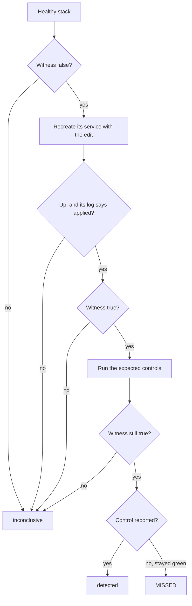

# Mutation guard

Answers one question the suite cannot answer about itself: **can a control fail?**

A control that cannot fail is indistinguishable from one that passes. It reports
green forever, and since `tooling/monitoring/run-assessment.sh` now drives the
assessment unattended with an empty accepted-findings baseline, green is read as
clean by a job nobody watches.

## The subject is the check, not the deployment

We do not need the application to be genuinely vulnerable. We need to know
whether a control would notice if it were. So a weakening is **simulated in the
response** rather than introduced into a deployment, which means no rebuild, no
restart, no privileged access, and no risk to anything real.

What that buys: the guard can run against the demo stack, in CI, by anyone.

What it cannot do: prove the application is sound. A control that detects a
simulated weakness has been shown *capable of reporting*. Whether the deployment
actually has that weakness is what an ordinary assessment answers.

## Running it

```sh
docker compose -f docker-compose.demo.yaml up -d          # any disposable target
cd security/pentest
export MASCOPE_PENTEST_EMAIL=demo@mascope.app
export MASCOPE_PENTEST_PASSWORD=mascope-demo
./.venv/bin/python -m mutations.run --target http://localhost:8080
```

The suite's own venv, the same one `run.sh` provisions — `mutations.run` needs
`httpx` at import and spawns `pytest` from `sys.executable`, so an ambient
interpreter without both fails inside the subprocess rather than at the prompt.

Exit status:

| | |
| --- | --- |
| **0** | every expected control reported its mutation |
| **1** | at least one control stayed green while its weakness was present |
| **2** | nothing was established — see below |

Two is the one worth wiring into a job. A guard that cannot run must not be
readable as a guard that found nothing wrong.

## Outcomes, deliberately not collapsed

| | meaning |
| --- | --- |
| **detected** | the control reported a finding while the weakness was present |
| **MISSED** | the mutation fired and the control stayed green - **triage, not a verdict** |
| **unproven** | nothing was learned; the reason is printed with it |

`unproven` covers several distinct situations, each named in the output rather
than merged into a number:

- *mutation altered no exchange* — the weakening matched nothing. A header strip
  against a deployment that never sent the header is the common case.
- *weakening not observable downstream* — it fired, but the witness could not see
  it from outside.
- *mutation stopped firing during the control run* — it was live for the witness
  and not for the controls, so a failure they reported was not this mutation's
  doing.
- *ineligible* — the control was not green beforehand, so flipping it red would
  prove nothing.
- *control skipped, not assessed* — the control never ran. One response slower
  than `MASCOPE_PENTEST_TIMEOUT` makes `target_reachable` false for a whole
  subprocess, and everything in it skips. **Not** blindness.
- *no result in the report* — the control produced no outcome at all (it errored
  in a fixture). Also not blindness.
- *witness raised* / *suite did not run* — the guard itself could not complete
  that step.

The last three used to be printed as MISSED. Any of them would have accused a
working control, which is why they are now named separately: a guard that cries
blind is exactly as useless as a control that cannot fail.

**A MISSED has two explanations and you must decide which.** Either the control
cannot report that weakness, or the mutation is mapped to the wrong control. The
witness proves *a* weakening was applied, not that it was the weakening this
control examines. The runner therefore prints the control's own title next to the
mutation's summary, because that is the comparison triage actually needs.

This is not hypothetical: on the guard's first run against a live stack it
reported two controls as blind, and both were working correctly.

- `HDR-03` inspects `Referrer-Policy`; the mutation had stripped
  `X-Content-Type-Options`, which belongs to `HDR-01`.
- `HDR-02` accepts `X-Frame-Options` **or** a CSP carrying `frame-ancestors`.
  Stripping only the first left the control correctly satisfied.

Read the control before believing the guard.

## Adding a mutation

Three things:

- **`weaken`**, in `catalogue.py` — alter the response the way a real regression
  would.
- **`mutation="<id>"`** on the marker of each control that must report it, in
  place of the reason it gave before. Check what the control actually inspects;
  matching on the name is how the two errors above happened. The runner reads
  the markers (`markers.py`), and an entry no marker names fails
  `selftest/test_mutation_coverage.py`.
- **`witness`**, in `catalogue.py` — confirm the weakening is observable from
  outside.

Also state `plausible_because`. A weakening the application could never produce
exercises a check against a response shape that cannot occur, which proves less
than it appears to.

The witness is necessary but not sufficient, and the runner enforces the
difference. Every header witness is absence-shaped: "the header is not there" is
just as true when the deployment never sent it, so a witness alone would report
`observable` for a mutation that changed nothing. The runner also requires
`proxy.fired > 0` — at least one exchange actually altered — before it will let a
control be blamed.

## The weakened target

The proxy simulates a weakness in the response. The weakened target puts one
into a real demo stack, by configuration alone, so the controls meet what nginx
actually serves. It is what runs unattended: weekly, on the monitoring host
(`tooling/monitoring/README.md`, "The weakened-target guard").

- **`weakened.compose.yaml`** is an override of `docker-compose.demo.yaml`.
  Most edits change the nginx config the frontend image ships, before the
  image's own entrypoint runs, one edit per id named in
  `MASCOPE_PENTEST_WEAKEN`. The backend's edits change the env's config layer
  (`prod.mascope.toml` in the env volume, the one an operator edits), one per
  id in `MASCOPE_PENTEST_WEAKEN_BACKEND`. That layer outlives the container,
  so the backend keeps the layer as `demo_init` wrote it beside it and puts it
  back on every start. An edit that finds nothing to change stops the
  container instead of serving a healthy stack. Empty, both leave the demo
  exactly as shipped.
- **The backend's test-only settings** switch off the two controls no
  configuration reaches: `MASCOPE_PENTEST_RATE_LIMIT_OFF` the rate limiter
  (`backend-limiter-off`), `MASCOPE_PENTEST_ORIGIN_GUARD_OFF` the write-origin
  guard (`origin-guard-off`). The backend's edit sets one for the process it
  starts (`server/backend/src/mascope_backend/weakened_controls.py`). The
  backend honours a setting only beside `MASCOPE_ALLOW_DEMO_SEED`, the demo
  stack's marker, which a real deployment never sets. Each worker logs a
  warning at start for a control switched off, and an error for a setting
  it ignored. An image older than the settings ignores them, and the witness
  then leaves the weakening inconclusive.
- **`weakened.py`** holds each weakening's edit as it shows in a response
  (`simulate`, for the selftests), a `witness` that measures the target from
  outside, and the `service` the edit is made in. The controls that must
  report it name it on their own markers, `weakening="<id>"`.

```sh
docker compose -f docker-compose.demo.yaml up -d                     # healthy demo stack
cd security/pentest
./.venv/bin/python -m mutations.run_weakened --target http://localhost:8080 \
    --compose-file ../../docker-compose.demo.yaml
```

Pass the same compose files, project name (`--project`) and environment the
stack came up with: the runner recreates services with them, and a
`MASCOPE_HTTP_PORT` left out moves the published port.

For each weakening the runner recreates the service it edits with that one
edit and concludes only from what the target shows. A backend edit recreates
the backend, waits for it to report healthy, and then recreates the frontend,
whose nginx finds the backend's address only when it starts. The backend is
recreated only when its edits change, since it takes a minute to start:



The witness must be false on the healthy stack and true on the weakened one,
before and after the controls run. That is where the recursion stops: a guard
that reports "detected" while its weakening never took has the same defect as
a control that cannot fail. A control red on the healthy stack is ineligible,
as with the proxy. The exit status is the same: 0, 1 for a MISSED, 2 when
anything was not established. The healthy stack is restored at the end
however the run went.

Some witnesses have to spend what the controls measure, and are written so
that no other control in the run pays for it:

- **`client-chosen-real-ip`** (IDENT-01) fills one named address's
  pairing-poll budget and then asks as another: only a backend keying on the
  header gives the second one a budget of its own. No control this guard runs
  polls, and on the healthy stack it spends the caller's poll budget for one
  60 s window. It paces itself under nginx's own limit for `/api/auth/`, so the
  429 it reads is the backend's.
- **`backend-limiter-off`** (RL-01, RL-02, RL-03) bursts the first-owner
  registration, one request past its budget of 5 an hour. The demo stack has
  its owner, so nothing is registered. On the healthy stack this spends the
  budget for the hour, and RL-02, the one control that spends it, passes on
  it as on its own burst. The route is outside nginx's `/api/auth/` limit, so
  the 429 it reads is the backend's. Only the route's own 403 on every
  request counts as switched off, so a 5xx from a backend that is down is no
  proof. RL-02 assesses only in aggressive mode,
  so the runner sets `MASCOPE_PENTEST_AGGRESSIVE=1` for every control it runs;
  RL-02 is the one control the mode changes. nginx's own limits stay on: RL-01
  and RL-03's start burst fit inside them, so with the backend's off, nothing
  refuses those bursts.
- **`origin-guard-off`** (CSRF-01) makes an anonymous write declaring a
  foreign origin. Past the guard, its route refuses it 401, which is the
  proof: the guard's 403, or a backend that is not up, is not. It creates
  nothing and signs in nowhere.
- **`strip-auth-cookie-flags`** (JWT-04) and **`raise-upload-cap`**
  (UPLOAD-02) sign in once per call, with the demo's published login: no
  anonymous route sets a cookie, and the demo stack publishes no runtime
  config, so `Tus-Max-Size` is read with a session. IDENT-01 fills the login
  budget on purpose, so each waits it out once rather than read the 429 as an
  edit that did not take. Reading the cap is an `OPTIONS`, which creates no
  upload and declares no size.

Coverage is a number here too. Every control without a weakening gives one of
four reasons on its marker, `weakening={"<kind>": "<reason>"}`, held apart for
the reason `out_of_reach` and `not_yet_written` are. `weakened.py` reads them
into one list per kind:

- **`UNCOVERABLE`** (`uncoverable`): application code that no setting turns off, such as
  access control, sessions and tenant isolation. A weakened build would reach
  these; a configuration never will.
- **`AWAITING_A_SWITCH`** (`awaiting_a_switch`): controls with no setting that switches them
  off, which a test-only setting would make coverable. Empty since #2888
  gave the backend's limiter (`RL-*`) and write-origin guard (`CSRF-01`)
  theirs.
- **`NOT_ON_THE_DEMO_STACK`** (`not_on_the_demo_stack`): controls that need HTTPS or Cloudflare, and
  `AUTHN-05`, since the demo ships the published login on purpose.
- **`NOT_YET_WRITTEN`** (`not_yet_written`): a configuration edit reaches these, and nobody has
  written it. Empty since #2889 wrote the last five.

## Controls that pass on silence

A control that passes because something is there (a header, a 429) fails when
it is gone. A control that passes because nothing came back cannot tell a
refusal from a renamed route, a dead channel or an unreachable target. It is
only evidence when it carries a **positive control**: a step showing the probe
reached the check it relies on, which stops the control passing when it did
not. `AUTHN-01` requires every probed route to answer 401 or 403, and a 404 is
a finding. `RT-02` skips unless the workspace's own member receives the event
the outsider must not.

`silence.py` sorts every control, closed-world:

- **`PASSES_ON_PRESENCE`**, falsifiable by construction;
- **`POSITIVE_CONTROLS`**, silence controls carrying one, each marked in its
  body with a comment that says "positive control";
- **`NO_POSITIVE_CONTROL`**, the allowlist: silence controls with none, or only
  part of one, each with its own reason. Strengthening them is #2890.

`selftest/test_silence_controls.py` fails on a control in none of them, and on
a claimed positive control its body does not mark. The silence controls a
fake anonymous client can drive run against a dead target, where every
request answers 404. Which ones those are is derived from each control's
fixtures: a silence control taking only `anon` is driven, or listed in
`NOT_DRIVEN_HERE` with the reason the run would prove nothing of it. A control with a positive control must not pass there,
and an allowlisted one must, so the allowlist is no wider than the gap. Last,
the file writes a deliberately unfalsifiable control into the suite and shows
each check catches it.

## What CI checks

`selftest/` runs on every PR and needs no target:

- **coverage** — every control is covered by a mutation or listed with a reason.
- **mapping** — each mutation, and each weakening's `simulate`, is applied to
  a synthesised healthy response and the control it names must then report a
  finding, *and* must pass without it. This is the check that would have
  caught the two first-run mis-maps above before they ever accused anyone.
- **weakened** — the override and `weakened.py` name the same weakenings,
  every control is covered or listed with one reason, and the runner's
  decisions hold on a fake stack: an edit that does not apply, a witness that
  does not flip, one that flips back mid-run, or a `docker compose` that hangs
  or is missing is inconclusive, never a pass. The override's edits also run
  under `sh` on a copy of `server/frontend/nginx.http.conf`: each must apply
  and change the config as its `simulate` claims, and refuse when its line is
  gone or the edit changed nothing.
- **silence** — the sorting above, its markers and the dead-target run.
- **proxy** — the hop is transparent: a compressed body survives it, it
  volunteers no `Server` or `Date` of its own, unusable request framing is
  answered rather than raised, the upstream's `Host` is used, and `fired` counts
  only exchanges a mutation actually altered.

What CI cannot check is whether the deployment sends the headers the controls
look for. That is what the live baseline run establishes.

## Coverage is a number, not an assumption

Every control says on its own marker how each mechanism shows it can fail, or
why it cannot (#1906):

```python
@pytest.mark.security(
    id="HDR-01",
    ...
    mutation="strip-content-type-options",
    weakening="strip-content-type-options",
)

@pytest.mark.security(
    id="RT-01",
    ...
    mutation={"out_of_reach": "websocket transport; the proxy forwards HTTP only"},
    weakening={"uncoverable": "tenant isolation and ownership checks are ..."},
)
```

A field is an entry's id, a tuple of them, or a one-entry dict whose key is the
kind of reason and whose value is the reason, in words that stand on their own.
A marker without both fields, or with one of another shape, fails collection,
so the question is answered where the control is written. The guard reads the
same fields by parsing the test modules (`markers.py`), not by collecting the
suite, which would probe a target; so the values must be literals. The
catalogue's `OUT_OF_REACH` and `NOT_YET_WRITTEN` and the weakened target's
four lists are built from them, and `selftest/test_mutation_coverage.py`, which
CI runs on every PR, holds them closed-world: the closed-world shape the
password-gate coverage test uses.

The uncovered controls are split in two, because the distinction is the whole
point of publishing a coverage figure:

- **`OUT_OF_REACH`** (`out_of_reach`) — response rewriting genuinely cannot reach these. Websocket
  controls (`RT-*`) because the proxy forwards HTTP only; transport controls
  (`TLS-*`, and `HDR-06`, which skips unless the origin is HTTPS) because it
  terminates plain HTTP; stateful budgets (`RL-*`); multi-account, multi-step
  tenant isolation (`AUTHZ-*`). No mutation written against this proxy will ever
  cover them. Closing them needs a different mechanism — a weakened build.
- **`NOT_YET_WRITTEN`** (`not_yet_written`) — the mechanism reaches these; nobody has written the
  mutation. Most are one added header or one fabricated body away.

Keeping them apart matters. Collapsing them lets unwritten work read as a limit
of the approach, which is how a coverage figure stops being a measurement and
becomes an excuse. Each `NOT_YET_WRITTEN` entry needs verifying against a live
target before it is trusted, for exactly the reason the two first-run errors
above illustrate.
